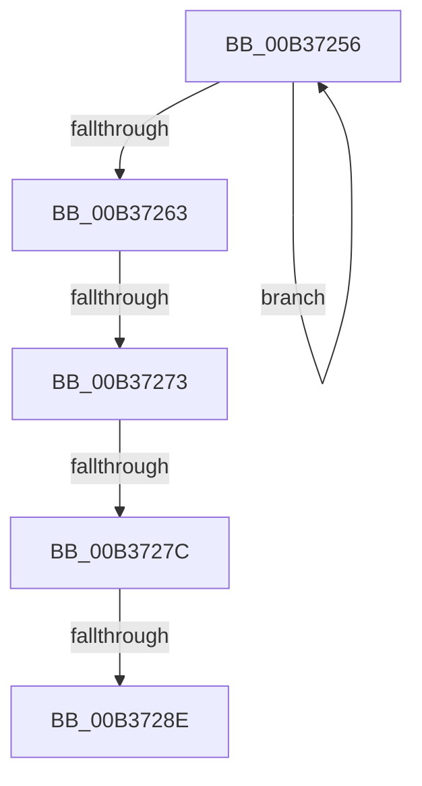

# sub_00B37256

- RVA: `0x00B37256`–`0x00B372CC` (길이 `118` bytes)
- VA: `0x0000000140B37256`
- 실행 섹션: `PAGE`
- PDB 이름 있음: `아니요`; PDB Function 태그: `아니요`
- unwind 정보 RVA: `0x000AA230`
- 디코드: `26`개 명령, `118/118` bytes 표시
- 미해석 바이트: `0` (있으면 어셈블리에 `.byte`로 보존)

> 이 문서는 커널 이미지의 기계어와 PDB 기호를 분석해 생성했습니다. 4번과 5번은 함수 원형과 자료형을 바이너리 사용 방식에서 추정한 C 해석이며 원본 소스 복구 결과는 아닙니다.

## 1. Dependencies

- 직접 호출 지점: **2**; 고유 호출 대상: **2**
- 직접 호출자로 확인된 함수: **0**
- RIP 상대 이미지 참조: **1**

### Outgoing calls
- `0x00B37281` → [tlgKeywordOn](../../text/42/tlgKeywordOn_function_0042EAA0.md) (function, `0x0042EAA0`)
- `0x00B372C1` → [VmpLogAccessFault](../7A/VmpLogAccessFault_function_007AE0C4.md) (function, `0x007AE0C4`)

### Direct callers
- 이 함수 시작 RVA로 연결되는 직접 call은 확인되지 않았습니다. 간접 호출은 완전히 역산할 수 없습니다.

### Static image references
- `0x00B37263` → RVA `0x00F02458` (`.data`; read)

## 2. Other-region calls and transfers

- 다른 실행 섹션으로 향하는 call: **1**
  - `0x00B37281` → [tlgKeywordOn](../../text/42/tlgKeywordOn_function_0042EAA0.md) (`PAGE` → `.text`)
- call이 아닌 외부 분기/꼬리 이동: **4**
  - `0x00B3726D` → [VmAccessFault + 0x1F7](../A1/VmAccessFault_function_00A18BF0.md) (`tail-transfer`)
  - `0x00B37276` → [VmAccessFault + 0x1F7](../A1/VmAccessFault_function_00A18BF0.md) (`tail-transfer`)
  - `0x00B37288` → [VmAccessFault + 0x1F7](../A1/VmAccessFault_function_00A18BF0.md) (`tail-transfer`)
  - `0x00B372C7` → [VmAccessFault + 0x1F7](../A1/VmAccessFault_function_00A18BF0.md) (`tail-transfer`)

## 3. Assembly (complete function range)

```asm
00B37256  4C 03 56 08                     add r10, qword ptr [rsi + 8]
00B3725A  48 83 C6 10                     add rsi, 0x10
00B3725E  48 3B F0                        cmp rsi, rax
00B37261  72 F3                           jb 0x140b37256
00B37263  48 8B 0D EE B1 3C 00            mov rcx, qword ptr [rip + 0x3cb1ee]
00B3726A  48 85 C9                        test rcx, rcx
00B3726D  0F 84 74 1B EE FF               je 0x140a18de7
00B37273  83 39 00                        cmp dword ptr [rcx], 0
00B37276  0F 86 6B 1B EE FF               jbe 0x140a18de7
00B3727C  BA 08 00 00 00                  mov edx, 8
00B37281  E8 1A 78 8F FF                  call 0x14042eaa0
00B37286  84 C0                           test al, al
00B37288  0F 84 59 1B EE FF               je 0x140a18de7
00B3728E  48 8B 84 24 20 04 00 00         mov rax, qword ptr [rsp + 0x420]
00B37296  44 8B C5                        mov r8d, ebp
00B37299  44 8B 8C 24 18 04 00 00         mov r9d, dword ptr [rsp + 0x418]
00B372A1  41 8B D4                        mov edx, r12d
00B372A4  89 5C 24 48                     mov dword ptr [rsp + 0x48], ebx
00B372A8  48 89 44 24 40                  mov qword ptr [rsp + 0x40], rax
00B372AD  4C 89 5C 24 38                  mov qword ptr [rsp + 0x38], r11
00B372B2  44 89 6C 24 30                  mov dword ptr [rsp + 0x30], r13d
00B372B7  4C 89 54 24 28                  mov qword ptr [rsp + 0x28], r10
00B372BC  4C 89 7C 24 20                  mov qword ptr [rsp + 0x20], r15
00B372C1  E8 FE 6D C7 FF                  call 0x1407ae0c4
00B372C6  90                              nop
00B372C7  E9 1B 1B EE FF                  jmp 0x140a18de7
```

## 4. C-style interpretation (structured pseudocode)

```c
__int64 __fastcall sub_00B37256(__int64 a1, __int64 a2, __int64 a3, __int64 a4, __int64 a5, __int64 a6, __int64 a7, __int64 a8, __int64 a9, __int64 a10, __int64 a11, __int64 a12, __int64 a13, __int64 a14, __int64 a15, __int64 a16, __int64 a17, __int64 a18, __int64 a19, __int64 a20, __int64 a21, __int64 a22, __int64 a23, __int64 a24, __int64 a25, __int64 a26, __int64 a27, __int64 a28, __int64 a29, __int64 a30, __int64 a31, __int64 a32, __int64 a33, __int64 a34, __int64 a35, __int64 a36, __int64 a37, __int64 a38, __int64 a39, __int64 a40, __int64 a41, __int64 a42, __int64 a43, __int64 a44, __int64 a45, __int64 a46, __int64 a47, __int64 a48, __int64 a49, __int64 a50, __int64 a51, __int64 a52, __int64 a53, __int64 a54, __int64 a55, __int64 a56, __int64 a57, __int64 a58, __int64 a59, __int64 a60, __int64 a61, __int64 a62, __int64 a63, __int64 a64, __int64 a65, __int64 a66, __int64 a67, __int64 a68, __int64 a69, __int64 a70, __int64 a71, __int64 a72, __int64 a73, __int64 a74, __int64 a75, __int64 a76, __int64 a77, __int64 a78, __int64 a79, __int64 a80, __int64 a81, __int64 a82, __int64 a83, __int64 a84, __int64 a85, __int64 a86, __int64 a87, __int64 a88, __int64 a89, __int64 a90, __int64 a91, __int64 a92, __int64 a93, __int64 a94, __int64 a95, __int64 a96, __int64 a97, __int64 a98, __int64 a99, __int64 a100, __int64 a101, __int64 a102, __int64 a103, __int64 a104, __int64 a105, __int64 a106, __int64 a107, __int64 a108, __int64 a109, __int64 a110, __int64 a111, __int64 a112, __int64 a113, __int64 a114, __int64 a115, __int64 a116, __int64 a117, __int64 a118, __int64 a119, __int64 a120, __int64 a121, __int64 a122, __int64 a123, __int64 a124, __int64 a125, __int64 a126, __int64 a127, __int64 a128, __int64 a129, __int64 a130, unsigned int a131, __int64 a132)
{
    __int64 result;
    __int64 v_r10;
    __int64 v_rsi;
    unsigned __int64 v_stack_p20;
    unsigned __int64 v_stack_p28;
    unsigned int v_stack_p30;
    unsigned __int64 v_stack_p38;
    unsigned __int64 v_stack_p40;
    unsigned int v_stack_p48;

    v_r10 = (v_r10) + (*(unsigned __int64 *)(v_rsi + 8));
    v_rsi = (v_rsi) + (16);
    if (v_rsi < result) goto loc_00B37256;
    result = tlgKeywordOn(*(unsigned __int64 *)(v_rip + 3977710), 8, a3, a4);
    v_stack_p48 = (unsigned int)(v_rbx);
    v_stack_p40 = a132;
    v_stack_p38 = v_r11;
    v_stack_p30 = (unsigned int)(v_r13);
    v_stack_p28 = v_r10;
    v_stack_p20 = v_r15;
    result = VmpLogAccessFault(*(unsigned __int64 *)(v_rip + 3977710), (unsigned int)((unsigned int)(v_r12)), (unsigned int)((unsigned int)(v_rbp)), (unsigned int)(a131));
}
```

## 5. (Beta) C Style

```c
int64_t sub_00B37256(int64_t Arg1, int64_t Arg2, int64_t Arg3, int64_t Arg4, uint64_t Arg5, uint64_t Arg6, uint64_t Arg7, uint64_t Arg8, uint64_t Arg9, uint64_t Arg10, uint64_t Arg11, uint64_t Arg12, uint64_t Arg13, uint64_t Arg14, uint64_t Arg15, uint64_t Arg16, uint64_t Arg17, uint64_t Arg18, uint64_t Arg19, uint64_t Arg20, uint64_t Arg21, uint64_t Arg22, uint64_t Arg23, uint64_t Arg24, uint64_t Arg25, uint64_t Arg26, uint64_t Arg27, uint64_t Arg28, uint64_t Arg29, uint64_t Arg30, uint64_t Arg31, uint64_t Arg32, uint64_t Arg33, uint64_t Arg34, uint64_t Arg35, uint64_t Arg36, uint64_t Arg37, uint64_t Arg38, uint64_t Arg39, uint64_t Arg40, uint64_t Arg41, uint64_t Arg42, uint64_t Arg43, uint64_t Arg44, uint64_t Arg45, uint64_t Arg46, uint64_t Arg47, uint64_t Arg48, uint64_t Arg49, uint64_t Arg50, uint64_t Arg51, uint64_t Arg52, uint64_t Arg53, uint64_t Arg54, uint64_t Arg55, uint64_t Arg56, uint64_t Arg57, uint64_t Arg58, uint64_t Arg59, uint64_t Arg60, uint64_t Arg61, uint64_t Arg62, uint64_t Arg63, uint64_t Arg64, uint64_t Arg65, uint64_t Arg66, uint64_t Arg67, uint64_t Arg68, uint64_t Arg69, uint64_t Arg70, uint64_t Arg71, uint64_t Arg72, uint64_t Arg73, uint64_t Arg74, uint64_t Arg75, uint64_t Arg76, uint64_t Arg77, uint64_t Arg78, uint64_t Arg79, uint64_t Arg80, uint64_t Arg81, uint64_t Arg82, uint64_t Arg83, uint64_t Arg84, uint64_t Arg85, uint64_t Arg86, uint64_t Arg87, uint64_t Arg88, uint64_t Arg89, uint64_t Arg90, uint64_t Arg91, uint64_t Arg92, uint64_t Arg93, uint64_t Arg94, uint64_t Arg95, uint64_t Arg96, uint64_t Arg97, uint64_t Arg98, uint64_t Arg99, uint64_t Arg100, uint64_t Arg101, uint64_t Arg102, uint64_t Arg103, uint64_t Arg104, uint64_t Arg105, uint64_t Arg106, uint64_t Arg107, uint64_t Arg108, uint64_t Arg109, uint64_t Arg110, uint64_t Arg111, uint64_t Arg112, uint64_t Arg113, uint64_t Arg114, uint64_t Arg115, uint64_t Arg116, uint64_t Arg117, uint64_t Arg118, uint64_t Arg119, uint64_t Arg120, uint64_t Arg121, uint64_t Arg122, uint64_t Arg123, uint64_t Arg124, uint64_t Arg125, uint64_t Arg126, uint64_t Arg127, uint64_t Arg128, uint64_t Arg129, uint64_t Arg130, uint32_t Arg131, int64_t Arg132)
{
    int64_t result;
    int64_t local_r10;
    int64_t local_rsi;
    uint64_t v_stack_p20;
    uint64_t v_stack_p28;
    uint32_t v_stack_p30;
    uint64_t v_stack_p38;
    uint64_t v_stack_p40;
    uint32_t v_stack_p48;

    local_r10 = (local_r10) + (*(uint64_t *)(local_rsi + 0x8));
    local_rsi = (local_rsi) + (16);
    if (local_rsi < result) goto loc_00B37256;
    result = tlgKeywordOn(*(uint64_t *)(v_rip + 0x3CB1EE), 8, Arg3, Arg4);
    v_stack_p48 = (uint32_t)(local_rbx);
    v_stack_p40 = Arg132;
    v_stack_p38 = local_r11;
    v_stack_p30 = (uint32_t)(local_r13);
    v_stack_p28 = local_r10;
    v_stack_p20 = local_r15;
    result = VmpLogAccessFault(*(uint64_t *)(v_rip + 0x3CB1EE), (uint32_t)((uint32_t)(local_r12)), (uint32_t)((uint32_t)(local_rbp)), (uint32_t)(Arg131));
}
```

## 6. Execution-region graph

[열기: 2D/3D 그래프와 함수 탐색 컨트롤 패널](../../../control-panel.html?section=page&rva=0x00B37256&view=graph)

- 2D 그래프는 위에서 아래로 흐르고, 3D 그래프는 빈 공간을 드래그해 회전합니다. Shift+드래그는 이동, 휠은 확대·축소, 함수 노드 선택은 대상 보고서 이동입니다.

### Static fallback


