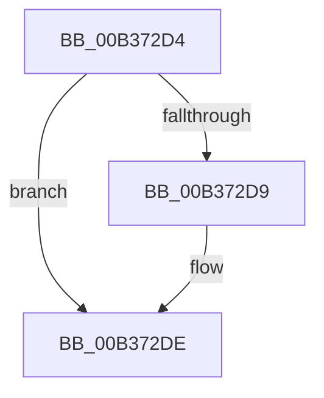

# sub_00B372D4

- RVA: `0x00B372D4`–`0x00B37302` (길이 `46` bytes)
- VA: `0x0000000140B372D4`
- 실행 섹션: `PAGE`
- PDB 이름 있음: `아니요`; PDB Function 태그: `아니요`
- unwind 정보 RVA: `0x000AA42C`
- 디코드: `10`개 명령, `46/46` bytes 표시
- 미해석 바이트: `0` (있으면 어셈블리에 `.byte`로 보존)

> 이 문서는 커널 이미지의 기계어와 PDB 기호를 분석해 생성했습니다. 4번과 5번은 함수 원형과 자료형을 바이너리 사용 방식에서 추정한 C 해석이며 원본 소스 복구 결과는 아닙니다.

## 1. Dependencies

- 직접 호출 지점: **0**; 고유 호출 대상: **0**
- 직접 호출자로 확인된 함수: **0**
- RIP 상대 이미지 참조: **0**

### Outgoing calls
- 직접 디코드된 call 명령이 없습니다.

### Direct callers
- 이 함수 시작 RVA로 연결되는 직접 call은 확인되지 않았습니다. 간접 호출은 완전히 역산할 수 없습니다.

### Static image references
- 디코드된 RIP-relative 메모리 참조가 없습니다.

## 2. Other-region calls and transfers

- 다른 실행 섹션으로 향하는 call: **0**
- call이 아닌 외부 분기/꼬리 이동: **1**
  - `0x00B372FD` → [NtAlpcSetInformation + 0x380](../A1/NtAlpcSetInformation_function_00A19DC0.md) (`tail-transfer`)

## 3. Assembly (complete function range)

```asm
00B372D4  4D 85 F6                        test r14, r14
00B372D7  74 05                           je 0x140b372de
00B372D9  41 C6 46 0A 01                  mov byte ptr [r14 + 0xa], 1
00B372DE  48 8B 54 24 40                  mov rdx, qword ptr [rsp + 0x40]
00B372E3  48 8B 02                        mov rax, qword ptr [rdx]
00B372E6  48 8B 4C 24 38                  mov rcx, qword ptr [rsp + 0x38]
00B372EB  48 89 81 70 01 00 00            mov qword ptr [rcx + 0x170], rax
00B372F2  48 8B 42 08                     mov rax, qword ptr [rdx + 8]
00B372F6  48 89 81 78 01 00 00            mov qword ptr [rcx + 0x178], rax
00B372FD  E9 3E 2E EE FF                  jmp 0x140a1a140
```

## 4. C-style interpretation (structured pseudocode)

```c
__int64 __fastcall sub_00B372D4(__int64 a1, __int64 a2, __int64 a3, __int64 a4, __int64 a5, __int64 a6, __int64 a7, __int64 a8)
{
    if (v_r14 != 0) {
        *(unsigned __int8 *)(v_r14 + 10) = 1;
    }
    *(unsigned __int64 *)(a7 + 368) = *(unsigned __int64 *)(a8);
    *(unsigned __int64 *)(a7 + 376) = *(unsigned __int64 *)(a8 + 8);
}
```

## 5. (Beta) C Style

```c
int64_t sub_00B372D4(int64_t Arg1, int64_t Arg2, int64_t Arg3, int64_t Arg4, uint64_t Arg5, uint64_t Arg6, void *Arg7, void *Arg8)
{
    uint8_t *arg7 = (uint8_t *)Arg7;
    uint8_t *arg8 = (uint8_t *)Arg8;

    if (local_r14 != 0) {
        *(uint8_t *)(local_r14 + 0xA) = 1;
    }
    *(uint64_t *)(arg7 + 0x170) = *(uint64_t *)(arg8);
    *(uint64_t *)(arg7 + 0x178) = *(uint64_t *)(arg8 + 0x8);
}
```

### 관측된 메모리 오프셋

구조체 형식이 확인되지 않은 접근은 인자 기준의 오프셋으로만 기록했습니다.

| 기준 인자 | 오프셋 표현 | 폭 (bit) | 접근 |
|---|---:|---:|---|
| `Arg7` | `+ 0x170` | `64` | `W` |
| `Arg7` | `+ 0x178` | `64` | `W` |
| `Arg8` | `+ 0x0` | `64` | `R` |
| `Arg8` | `+ 0x8` | `64` | `R` |

## 6. Execution-region graph

[열기: 2D/3D 그래프와 함수 탐색 컨트롤 패널](../../../control-panel.html?section=page&rva=0x00B372D4&view=graph)

- 2D 그래프는 위에서 아래로 흐르고, 3D 그래프는 빈 공간을 드래그해 회전합니다. Shift+드래그는 이동, 휠은 확대·축소, 함수 노드 선택은 대상 보고서 이동입니다.

### Static fallback


