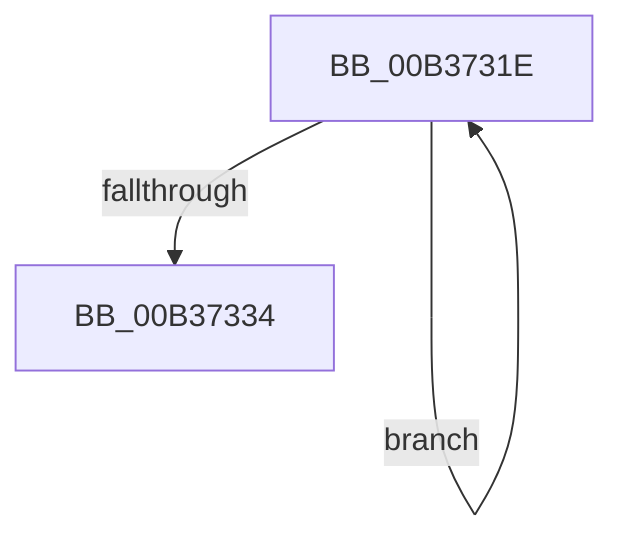

# sub_00B3731E

- RVA: `0x00B3731E`–`0x00B37339` (길이 `27` bytes)
- VA: `0x0000000140B3731E`
- 실행 섹션: `PAGE`
- PDB 이름 있음: `아니요`; PDB Function 태그: `아니요`
- unwind 정보 RVA: `0x000AA484`
- 디코드: `7`개 명령, `27/27` bytes 표시
- 미해석 바이트: `0` (있으면 어셈블리에 `.byte`로 보존)

> 이 문서는 커널 이미지의 기계어와 PDB 기호를 분석해 생성했습니다. 4번과 5번은 함수 원형과 자료형을 바이너리 사용 방식에서 추정한 C 해석이며 원본 소스 복구 결과는 아닙니다.

## 1. Dependencies

- 직접 호출 지점: **1**; 고유 호출 대상: **1**
- 직접 호출자로 확인된 함수: **0**
- RIP 상대 이미지 참조: **0**

### Outgoing calls
- `0x00B3732A` → [IopFreeMiniCompletionPacket](../9A/IopFreeMiniCompletionPacket_function_009A82D0.md) (function, `0x009A82D0`)

### Direct callers
- 이 함수 시작 RVA로 연결되는 직접 call은 확인되지 않았습니다. 간접 호출은 완전히 역산할 수 없습니다.

### Static image references
- 디코드된 RIP-relative 메모리 참조가 없습니다.

## 2. Other-region calls and transfers

- 다른 실행 섹션으로 향하는 call: **0**
- call이 아닌 외부 분기/꼬리 이동: **1**
  - `0x00B37334` → [AlpcpAllocateCompletionPacketLookaside + 0x10E](../A1/AlpcpAllocateCompletionPacketLookaside_function_00A1A4FC.md) (`tail-transfer`)

## 3. Assembly (complete function range)

```asm
00B3731E  48 8D 76 E8                     lea rsi, [rsi - 0x18]
00B37322  48 8B 0E                        mov rcx, qword ptr [rsi]
00B37325  48 83 61 38 00                  and qword ptr [rcx + 0x38], 0
00B3732A  E8 A1 0F E7 FF                  call 0x1409a82d0
00B3732F  83 C7 FF                        add edi, -1
00B37332  75 EA                           jne 0x140b3731e
00B37334  E9 D1 32 EE FF                  jmp 0x140a1a60a
```

## 4. C-style interpretation (structured pseudocode)

```c
__int64 __fastcall sub_00B3731E(void)
{
    __int64 result;
    __int64 v_rdi;

    result = IopFreeMiniCompletionPacket(*(unsigned __int64 *)(v_rsi - 24), a2, a3, a4);
    v_rdi = (unsigned int)((v_rdi) + (-1));
    if (condition_is_not_equal) goto loc_00B3731E;
}
```

## 5. (Beta) C Style

```c
void sub_00B3731E(void)
{
    int64_t result;
    int64_t local_rdi;

    result = IopFreeMiniCompletionPacket(*(uint64_t *)(local_rsi - 0x18), a2, a3, a4);
    local_rdi = (uint32_t)((local_rdi) + (-1));
    if (condition_is_not_equal) goto loc_00B3731E;
}
```

## 6. Execution-region graph

[열기: 2D/3D 그래프와 함수 탐색 컨트롤 패널](../../../control-panel.html?section=page&rva=0x00B3731E&view=graph)

- 2D 그래프는 위에서 아래로 흐르고, 3D 그래프는 빈 공간을 드래그해 회전합니다. Shift+드래그는 이동, 휠은 확대·축소, 함수 노드 선택은 대상 보고서 이동입니다.

### Static fallback


