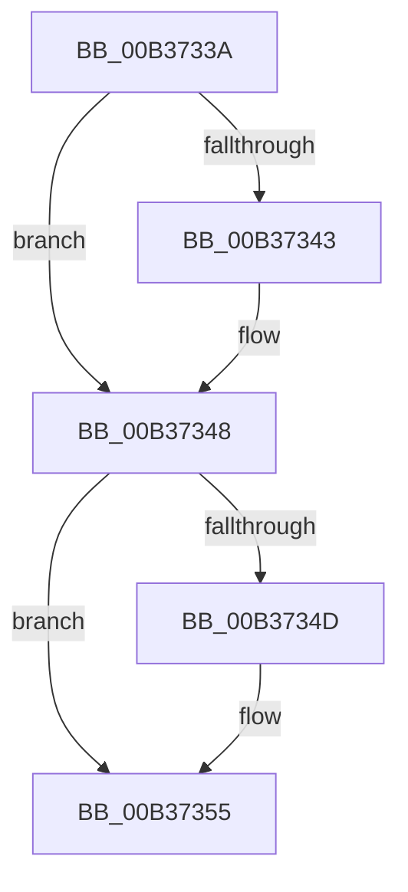

# sub_00B3733A

- RVA: `0x00B3733A`–`0x00B37365` (길이 `43` bytes)
- VA: `0x0000000140B3733A`
- 실행 섹션: `PAGE`
- PDB 이름 있음: `아니요`; PDB Function 태그: `아니요`
- unwind 정보 RVA: `0x000AA4E0`
- 디코드: `13`개 명령, `43/43` bytes 표시
- 미해석 바이트: `0` (있으면 어셈블리에 `.byte`로 보존)

> 이 문서는 커널 이미지의 기계어와 PDB 기호를 분석해 생성했습니다. 4번과 5번은 함수 원형과 자료형을 바이너리 사용 방식에서 추정한 C 해석이며 원본 소스 복구 결과는 아닙니다.

## 1. Dependencies

- 직접 호출 지점: **3**; 고유 호출 대상: **3**
- 직접 호출자로 확인된 함수: **0**
- RIP 상대 이미지 참조: **0**

### Outgoing calls
- `0x00B37343` → [IoFreeMdl](../../text/29/IoFreeMdl_function_0029EA80.md) (function, `0x0029EA80`)
- `0x00B37350` → [AlpcpUnregisterCompletionListDatabase](../A1/AlpcpUnregisterCompletionListDatabase_function_00A1AD64.md) (function, `0x00A1AD64`)
- `0x00B3735A` → [ExFreePoolWithTag](../../poolcode/B8/ExFreePoolWithTag_function_00B82870.md) (function, `0x00B82870`)

### Direct callers
- 이 함수 시작 RVA로 연결되는 직접 call은 확인되지 않았습니다. 간접 호출은 완전히 역산할 수 없습니다.

### Static image references
- 디코드된 RIP-relative 메모리 참조가 없습니다.

## 2. Other-region calls and transfers

- 다른 실행 섹션으로 향하는 call: **2**
  - `0x00B37343` → [IoFreeMdl](../../text/29/IoFreeMdl_function_0029EA80.md) (`PAGE` → `.text`)
  - `0x00B3735A` → [ExFreePoolWithTag](../../poolcode/B8/ExFreePoolWithTag_function_00B82870.md) (`PAGE` → `POOLCODE`)
- call이 아닌 외부 분기/꼬리 이동: **1**
  - `0x00B37360` → [AlpcpInitializeCompletionList + 0x475](../A1/AlpcpInitializeCompletionList_function_00A1A6D0.md) (`tail-transfer`)

## 3. Assembly (complete function range)

```asm
00B3733A  48 8B 4E 20                     mov rcx, qword ptr [rsi + 0x20]
00B3733E  48 85 C9                        test rcx, rcx
00B37341  74 05                           je 0x140b37348
00B37343  E8 38 77 76 FF                  call 0x14029ea80
00B37348  45 84 E4                        test r12b, r12b
00B3734B  74 08                           je 0x140b37355
00B3734D  48 8B CE                        mov rcx, rsi
00B37350  E8 0F 3A EE FF                  call 0x140a1ad64
00B37355  33 D2                           xor edx, edx
00B37357  48 8B CE                        mov rcx, rsi
00B3735A  E8 11 B5 04 00                  call 0x140b82870
00B3735F  90                              nop
00B37360  E9 E0 37 EE FF                  jmp 0x140a1ab45
```

## 4. C-style interpretation (structured pseudocode)

```c
__int64 __fastcall sub_00B3733A(__int64 a1, int a2)
{
    __int64 result;

    if (*(unsigned __int64 *)(v_rsi + 32) != 0) {
        result = IoFreeMdl(*(unsigned __int64 *)(v_rsi + 32), a2, a3, a4);
    }
    if ((unsigned __int8)(v_r12) != 0) {
        a1 = v_rsi;
        result = AlpcpUnregisterCompletionListDatabase(a1, a2, a3, a4);
    }
    a2 = 0;
    result = ExFreePoolWithTag(v_rsi, a2, a3, a4);
}
```

## 5. (Beta) C Style

```c
int64_t sub_00B3733A(int64_t Arg1, int32_t Arg2)
{
    int64_t result;

    if (*(uint64_t *)(local_rsi + 0x20) != 0) {
        result = IoFreeMdl(*(uint64_t *)(local_rsi + 0x20), Arg2, a3, a4);
    }
    if ((uint8_t)(local_r12) != 0) {
        Arg1 = local_rsi;
        result = AlpcpUnregisterCompletionListDatabase(Arg1, Arg2, a3, a4);
    }
    Arg2 = 0;
    result = ExFreePoolWithTag(local_rsi, Arg2, a3, a4);
}
```

## 6. Execution-region graph

[열기: 2D/3D 그래프와 함수 탐색 컨트롤 패널](../../../control-panel.html?section=page&rva=0x00B3733A&view=graph)

- 2D 그래프는 위에서 아래로 흐르고, 3D 그래프는 빈 공간을 드래그해 회전합니다. Shift+드래그는 이동, 휠은 확대·축소, 함수 노드 선택은 대상 보고서 이동입니다.

### Static fallback


