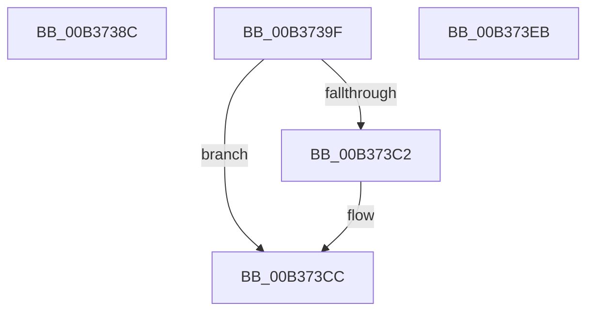

# sub_00B3738C

- RVA: `0x00B3738C`–`0x00B37418` (길이 `140` bytes)
- VA: `0x0000000140B3738C`
- 실행 섹션: `PAGE`
- PDB 이름 있음: `아니요`; PDB Function 태그: `아니요`
- unwind 정보 RVA: `0x000AA90C`
- 디코드: `33`개 명령, `140/140` bytes 표시
- 미해석 바이트: `0` (있으면 어셈블리에 `.byte`로 보존)

> 이 문서는 커널 이미지의 기계어와 PDB 기호를 분석해 생성했습니다. 4번과 5번은 함수 원형과 자료형을 바이너리 사용 방식에서 추정한 C 해석이며 원본 소스 복구 결과는 아닙니다.

## 1. Dependencies

- 직접 호출 지점: **4**; 고유 호출 대상: **4**
- 직접 호출자로 확인된 함수: **0**
- RIP 상대 이미지 참조: **0**

### Outgoing calls
- `0x00B373B5` → [IoAllocateMdl](../../text/29/IoAllocateMdl_function_0029EBF0.md) (function, `0x0029EBF0`)
- `0x00B373C7` → [RtlRaiseStatus](../../text/2F/RtlRaiseStatus_function_002F6A50.md) (function, `0x002F6A50`)
- `0x00B373DA` → [IopProbeAndLockPages](../../text/4B/IopProbeAndLockPages_function_004B1188.md) (function, `0x004B1188`)
- `0x00B3740C` → [IopExceptionCleanupEx](../8A/IopExceptionCleanupEx_function_008AE5C8.md) (function, `0x008AE5C8`)

### Direct callers
- 이 함수 시작 RVA로 연결되는 직접 call은 확인되지 않았습니다. 간접 호출은 완전히 역산할 수 없습니다.

### Static image references
- 디코드된 RIP-relative 메모리 참조가 없습니다.

## 2. Other-region calls and transfers

- 다른 실행 섹션으로 향하는 call: **3**
  - `0x00B373B5` → [IoAllocateMdl](../../text/29/IoAllocateMdl_function_0029EBF0.md) (`PAGE` → `.text`)
  - `0x00B373C7` → [RtlRaiseStatus](../../text/2F/RtlRaiseStatus_function_002F6A50.md) (`PAGE` → `.text`)
  - `0x00B373DA` → [IopProbeAndLockPages](../../text/4B/IopProbeAndLockPages_function_004B1188.md) (`PAGE` → `.text`)
- call이 아닌 외부 분기/꼬리 이동: **3**
  - `0x00B3739A` → [NtNotifyChangeDirectoryFileEx + 0x23E](../A1/NtNotifyChangeDirectoryFileEx_function_00A1DEA0.md) (`tail-transfer`)
  - `0x00B373E6` → [NtNotifyChangeDirectoryFileEx + 0x24A](../A1/NtNotifyChangeDirectoryFileEx_function_00A1DEA0.md) (`tail-transfer`)
  - `0x00B37413` → [NtNotifyChangeDirectoryFileEx + 0x299](../A1/NtNotifyChangeDirectoryFileEx_function_00A1DEA0.md) (`tail-transfer`)

## 3. Assembly (complete function range)

```asm
00B3738C  C7 47 10 70 00 00 00            mov dword ptr [rdi + 0x10], 0x70
00B37393  8B 8C 24 E8 00 00 00            mov ecx, dword ptr [rsp + 0xe8]
00B3739A  E9 3F 6D EE FF                  jmp 0x140a1e0de
00B3739F  48 89 7C 24 20                  mov qword ptr [rsp + 0x20], rdi
00B373A4  41 B1 01                        mov r9b, 1
00B373A7  45 33 C0                        xor r8d, r8d
00B373AA  41 8B D5                        mov edx, r13d
00B373AD  48 8B 8C 24 C8 00 00 00         mov rcx, qword ptr [rsp + 0xc8]
00B373B5  E8 36 78 76 FF                  call 0x14029ebf0
00B373BA  48 8B C8                        mov rcx, rax
00B373BD  48 85 C0                        test rax, rax
00B373C0  75 0A                           jne 0x140b373cc
00B373C2  B9 9A 00 00 C0                  mov ecx, 0xc000009a
00B373C7  E8 84 F6 7B FF                  call 0x1402f6a50
00B373CC  0F B6 46 B8                     movzx eax, byte ptr [rsi - 0x48]
00B373D0  89 44 24 20                     mov dword ptr [rsp + 0x20], eax
00B373D4  4D 8B CF                        mov r9, r15
00B373D7  41 8A D4                        mov dl, r12b
00B373DA  E8 A9 9D 97 FF                  call 0x1404b1188
00B373DF  8B 8C 24 E8 00 00 00            mov ecx, dword ptr [rsp + 0xe8]
00B373E6  E9 FF 6C EE FF                  jmp 0x140a1e0ea
00B373EB  8B D8                           mov ebx, eax
00B373ED  48 8B 4C 24 48                  mov rcx, qword ptr [rsp + 0x48]
00B373F2  0F B6 51 50                     movzx edx, byte ptr [rcx + 0x50]
00B373F6  D1 EA                           shr edx, 1
00B373F8  83 E2 01                        and edx, 1
00B373FB  88 54 24 20                     mov byte ptr [rsp + 0x20], dl
00B373FF  45 33 C9                        xor r9d, r9d
00B37402  4C 8B 44 24 50                  mov r8, qword ptr [rsp + 0x50]
00B37407  48 8B 54 24 58                  mov rdx, qword ptr [rsp + 0x58]
00B3740C  E8 B7 71 D7 FF                  call 0x1408ae5c8
00B37411  8B C3                           mov eax, ebx
00B37413  E9 21 6D EE FF                  jmp 0x140a1e139
```

## 4. C-style interpretation (structured pseudocode)

```c
__int64 __fastcall sub_00B3738C(__int64 a1, __int64 a2, int a3, __int64 a4, __int64 a5, __int64 a6, __int64 a7, __int64 a8, __int64 a9, __int64 a10, __int64 a11, __int64 a12, __int64 a13, __int64 a14, __int64 a15, __int64 a16, __int64 a17, __int64 a18, __int64 a19, __int64 a20, __int64 a21, __int64 a22, __int64 a23, __int64 a24, __int64 a25, __int64 a26, __int64 a27, __int64 a28, unsigned int a29)
{
    unsigned __int64 v_stack_p20;
    unsigned __int64 v_stack_p48;
    unsigned __int64 v_stack_p50;
    unsigned __int64 v_stack_p58;
    unsigned __int64 v_stack_pC8;
    unsigned int v_stack_pE8;

    *(unsigned int *)(v_rdi + 16) = 112;
}
```

## 5. (Beta) C Style

```c
int64_t sub_00B3738C(int64_t Arg1, int64_t Arg2, int32_t Arg3, int64_t Arg4, uint64_t Arg5, uint64_t Arg6, uint64_t Arg7, uint64_t Arg8, uint64_t Arg9, uint64_t Arg10, uint64_t Arg11, uint64_t Arg12, uint64_t Arg13, uint64_t Arg14, uint64_t Arg15, uint64_t Arg16, uint64_t Arg17, uint64_t Arg18, uint64_t Arg19, uint64_t Arg20, uint64_t Arg21, uint64_t Arg22, uint64_t Arg23, uint64_t Arg24, uint64_t Arg25, uint64_t Arg26, uint64_t Arg27, uint64_t Arg28, uint32_t Arg29)
{
    uint64_t v_stack_p20;
    uint64_t v_stack_p48;
    uint64_t v_stack_p50;
    uint64_t v_stack_p58;
    uint64_t v_stack_pC8;
    uint32_t v_stack_pE8;

    *(uint32_t *)(local_rdi + 0x10) = 112;
}
```

## 6. Execution-region graph

[열기: 2D/3D 그래프와 함수 탐색 컨트롤 패널](../../../control-panel.html?section=page&rva=0x00B3738C&view=graph)

- 2D 그래프는 위에서 아래로 흐르고, 3D 그래프는 빈 공간을 드래그해 회전합니다. Shift+드래그는 이동, 휠은 확대·축소, 함수 노드 선택은 대상 보고서 이동입니다.

### Static fallback


