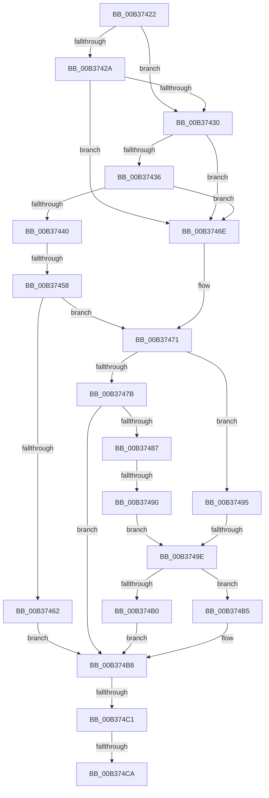

# sub_00B37422

- RVA: `0x00B37422`–`0x00B374CF` (길이 `173` bytes)
- VA: `0x0000000140B37422`
- 실행 섹션: `PAGE`
- PDB 이름 있음: `아니요`; PDB Function 태그: `아니요`
- unwind 정보 RVA: `0x000AACB8`
- 디코드: `50`개 명령, `173/173` bytes 표시
- 미해석 바이트: `0` (있으면 어셈블리에 `.byte`로 보존)

> 이 문서는 커널 이미지의 기계어와 PDB 기호를 분석해 생성했습니다. 4번과 5번은 함수 원형과 자료형을 바이너리 사용 방식에서 추정한 C 해석이며 원본 소스 복구 결과는 아닙니다.

## 1. Dependencies

- 직접 호출 지점: **3**; 고유 호출 대상: **2**
- 직접 호출자로 확인된 함수: **0**
- RIP 상대 이미지 참조: **0**

### Outgoing calls
- `0x00B37448` → [PspQueryComPlusRunUnderWoW](../AB/PspQueryComPlusRunUnderWoW_function_00ABC8EC.md) (function, `0x00ABC8EC`)
- `0x00B3747E` → [PsWow64IsMachineSupported](../8D/PsWow64IsMachineSupported_function_008D20A0.md) (function, `0x008D20A0`)
- `0x00B374A5` → [PsWow64IsMachineSupported](../8D/PsWow64IsMachineSupported_function_008D20A0.md) (function, `0x008D20A0`)

### Direct callers
- 이 함수 시작 RVA로 연결되는 직접 call은 확인되지 않았습니다. 간접 호출은 완전히 역산할 수 없습니다.

### Static image references
- 디코드된 RIP-relative 메모리 참조가 없습니다.

## 2. Other-region calls and transfers

- 다른 실행 섹션으로 향하는 call: **0**
- call이 아닌 외부 분기/꼬리 이동: **6**
  - `0x00B37452` → [PspSelectMachineForProcess + 0xDE](../A1/PspSelectMachineForProcess_function_00A1FFBC.md) (`tail-transfer`)
  - `0x00B3748A` → [PspSelectMachineForProcess + 0xFC](../A1/PspSelectMachineForProcess_function_00A1FFBC.md) (`tail-transfer`)
  - `0x00B37498` → [PspSelectMachineForProcess + 0xFC](../A1/PspSelectMachineForProcess_function_00A1FFBC.md) (`tail-transfer`)
  - `0x00B374BB` → [PspSelectMachineForProcess + 0xC5](../A1/PspSelectMachineForProcess_function_00A1FFBC.md) (`tail-transfer`)
  - `0x00B374C4` → [PspSelectMachineForProcess + 0xFC](../A1/PspSelectMachineForProcess_function_00A1FFBC.md) (`tail-transfer`)
  - `0x00B374CA` → [PspSelectMachineForProcess + 0xC5](../A1/PspSelectMachineForProcess_function_00A1FFBC.md) (`tail-transfer`)

## 3. Assembly (complete function range)

```asm
00B37422  0F B7 DA                        movzx ebx, dx
00B37425  40 84 F6                        test sil, sil
00B37428  75 06                           jne 0x140b37430
00B3742A  F6 45 6B 20                     test byte ptr [rbp + 0x6b], 0x20
00B3742E  75 3E                           jne 0x140b3746e
00B37430  66 41 3B D9                     cmp bx, r9w
00B37434  74 38                           je 0x140b3746e
00B37436  B8 C4 01 00 00                  mov eax, 0x1c4
00B3743B  66 3B D8                        cmp bx, ax
00B3743E  74 2E                           je 0x140b3746e
00B37440  48 8D 54 24 70                  lea rdx, [rsp + 0x70]
00B37445  48 8B CD                        mov rcx, rbp
00B37448  E8 9F 54 F8 FF                  call 0x140abc8ec
00B3744D  44 8B E0                        mov r12d, eax
00B37450  85 C0                           test eax, eax
00B37452  0F 88 42 8C EE FF               js 0x140a2009a
00B37458  40 8A 7C 24 70                  mov dil, byte ptr [rsp + 0x70]
00B3745D  40 84 FF                        test dil, dil
00B37460  75 0F                           jne 0x140b37471
00B37462  C6 44 24 78 01                  mov byte ptr [rsp + 0x78], 1
00B37467  BD 64 86 00 00                  mov ebp, 0x8664
00B3746C  EB 4A                           jmp 0x140b374b8
00B3746E  41 8A F8                        mov dil, r8b
00B37471  BD 64 86 00 00                  mov ebp, 0x8664
00B37476  66 3B DD                        cmp bx, bp
00B37479  74 1A                           je 0x140b37495
00B3747B  0F B7 CB                        movzx ecx, bx
00B3747E  E8 1D AC D9 FF                  call 0x1408d20a0
00B37483  85 C0                           test eax, eax
00B37485  75 31                           jne 0x140b374b8
00B37487  40 84 F6                        test sil, sil
00B3748A  0F 85 28 8C EE FF               jne 0x140a200b8
00B37490  0F B7 DD                        movzx ebx, bp
00B37493  EB 09                           jmp 0x140b3749e
00B37495  40 84 F6                        test sil, sil
00B37498  0F 85 1A 8C EE FF               jne 0x140a200b8
00B3749E  BE 4C 01 00 00                  mov esi, 0x14c
00B374A3  8B CE                           mov ecx, esi
00B374A5  E8 F6 AB D9 FF                  call 0x1408d20a0
00B374AA  33 C9                           xor ecx, ecx
00B374AC  85 C0                           test eax, eax
00B374AE  74 05                           je 0x140b374b5
00B374B0  0F B7 DE                        movzx ebx, si
00B374B3  EB 03                           jmp 0x140b374b8
00B374B5  40 8A F9                        mov dil, cl
00B374B8  40 84 FF                        test dil, dil
00B374BB  0F 85 C0 8B EE FF               jne 0x140a20081
00B374C1  66 3B DD                        cmp bx, bp
00B374C4  0F 85 EE 8B EE FF               jne 0x140a200b8
00B374CA  E9 B2 8B EE FF                  jmp 0x140a20081
```

## 4. C-style interpretation (structured pseudocode)

```c
__int64 __fastcall sub_00B37422(__int64 a1, unsigned __int16 a2, unsigned __int8 a3, unsigned __int16 a4, __int64 a5, __int64 a6, __int64 a7, __int64 a8, __int64 a9, __int64 a10, __int64 a11, __int64 a12, __int64 a13, unsigned __int8 a14)
{
    __int64 result;
    unsigned __int8 v_stack_p78;

    if ((unsigned __int8)(v_rsi) != 0) goto loc_00B37430;
    if (((*(unsigned __int8 *)(v_rbp + 107)) & (32)) != 0) goto loc_00B3746E;
loc_00B37430:
    if (a2 == a4) goto loc_00B3746E;
    if (a2 == 452) goto loc_00B3746E;
    result = PspQueryComPlusRunUnderWoW(v_rbp, a14, a3, a4);
    if (a14 != 0) goto loc_00B37471;
    v_stack_p78 = 1;
    goto loc_00B374B8;
loc_00B3746E:
loc_00B37471:
    if (a2 == ((unsigned __int16)((unsigned int)(0x8664ULL)))) goto loc_00B37495;
    result = PsWow64IsMachineSupported(a2, a14, a3, a4);
    if ((unsigned int)(result) != 0) goto loc_00B374B8;
    goto loc_00B3749E;
loc_00B37495:
loc_00B3749E:
    result = PsWow64IsMachineSupported(332, a14, a3, a4);
    a1 = 0;
    if ((unsigned int)(result) == 0) goto loc_00B374B5;
    goto loc_00B374B8;
loc_00B374B5:
loc_00B374B8:
}
```

## 5. (Beta) C Style

```c
int64_t sub_00B37422(int64_t Arg1, uint16_t Arg2, uint8_t Arg3, uint16_t Arg4, uint64_t Arg5, uint64_t Arg6, uint64_t Arg7, uint64_t Arg8, uint64_t Arg9, uint64_t Arg10, uint64_t Arg11, uint64_t Arg12, uint64_t Arg13, uint8_t Arg14)
{
    int64_t result;
    uint8_t v_stack_p78;

    if ((uint8_t)(local_rsi) != 0) goto loc_00B37430;
    if (((*(uint8_t *)(local_rbp + 0x6B)) & (32)) != 0) goto loc_00B3746E;
loc_00B37430:
    if (Arg2 == Arg4) goto loc_00B3746E;
    if (Arg2 == 452) goto loc_00B3746E;
    result = PspQueryComPlusRunUnderWoW(local_rbp, Arg14, Arg3, Arg4);
    if (Arg14 != 0) goto loc_00B37471;
    v_stack_p78 = 1;
    goto loc_00B374B8;
loc_00B3746E:
loc_00B37471:
    if (Arg2 == ((uint16_t)((uint32_t)(0x8664ULL)))) goto loc_00B37495;
    result = PsWow64IsMachineSupported(Arg2, Arg14, Arg3, Arg4);
    if ((uint32_t)(result) != 0) goto loc_00B374B8;
    goto loc_00B3749E;
loc_00B37495:
loc_00B3749E:
    result = PsWow64IsMachineSupported(332, Arg14, Arg3, Arg4);
    Arg1 = 0;
    if ((uint32_t)(result) == 0) goto loc_00B374B5;
    goto loc_00B374B8;
loc_00B374B5:
loc_00B374B8:
}
```

## 6. Execution-region graph

[열기: 2D/3D 그래프와 함수 탐색 컨트롤 패널](../../../control-panel.html?section=page&rva=0x00B37422&view=graph)

- 2D 그래프는 위에서 아래로 흐르고, 3D 그래프는 빈 공간을 드래그해 회전합니다. Shift+드래그는 이동, 휠은 확대·축소, 함수 노드 선택은 대상 보고서 이동입니다.

### Static fallback


