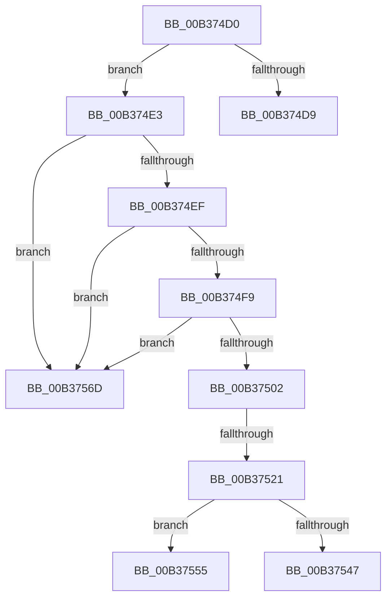

# sub_00B374D0

- RVA: `0x00B374D0`–`0x00B37577` (길이 `167` bytes)
- VA: `0x0000000140B374D0`
- 실행 섹션: `PAGE`
- PDB 이름 있음: `아니요`; PDB Function 태그: `아니요`
- unwind 정보 RVA: `0x000AACE0`
- 디코드: `42`개 명령, `167/167` bytes 표시
- 미해석 바이트: `0` (있으면 어셈블리에 `.byte`로 보존)

> 이 문서는 커널 이미지의 기계어와 PDB 기호를 분석해 생성했습니다. 4번과 5번은 함수 원형과 자료형을 바이너리 사용 방식에서 추정한 C 해석이며 원본 소스 복구 결과는 아닙니다.

## 1. Dependencies

- 직접 호출 지점: **3**; 고유 호출 대상: **3**
- 직접 호출자로 확인된 함수: **0**
- RIP 상대 이미지 참조: **1**

### Outgoing calls
- `0x00B37514` → [ObReferenceObjectByPointer](../../text/43/ObReferenceObjectByPointer_function_00438D00.md) (function, `0x00438D00`)
- `0x00B3753C` → [IopGetSetSpecificExtension](../../text/42/IopGetSetSpecificExtension_function_0042EE80.md) (function, `0x0042EE80`)
- `0x00B3754A` → [ObfDereferenceObject](../../text/2F/ObfDereferenceObject_function_002F9350.md) (function, `0x002F9350`)

### Direct callers
- 이 함수 시작 RVA로 연결되는 직접 call은 확인되지 않았습니다. 간접 호출은 완전히 역산할 수 없습니다.

### Static image references
- `0x00B37502` → RVA `0x00FC6EF0` (`ALMOSTRO`; read)

## 2. Other-region calls and transfers

- 다른 실행 섹션으로 향하는 call: **3**
  - `0x00B37514` → [ObReferenceObjectByPointer](../../text/43/ObReferenceObjectByPointer_function_00438D00.md) (`PAGE` → `.text`)
  - `0x00B3753C` → [IopGetSetSpecificExtension](../../text/42/IopGetSetSpecificExtension_function_0042EE80.md) (`PAGE` → `.text`)
  - `0x00B3754A` → [ObfDereferenceObject](../../text/2F/ObfDereferenceObject_function_002F9350.md) (`PAGE` → `.text`)
- call이 아닌 외부 분기/꼬리 이동: **5**
  - `0x00B374DE` → [IopRetrieveTransactionParametersFromOpenPacket + 0x2B](../A2/IopRetrieveTransactionParametersFromOpenPacket_function_00A2027C.md) (`tail-transfer`)
  - `0x00B3751B` → [IopRetrieveTransactionParametersFromOpenPacket + 0x2B](../A2/IopRetrieveTransactionParametersFromOpenPacket_function_00A2027C.md) (`tail-transfer`)
  - `0x00B37550` → [IopRetrieveTransactionParametersFromOpenPacket + 0x29](../A2/IopRetrieveTransactionParametersFromOpenPacket_function_00A2027C.md) (`tail-transfer`)
  - `0x00B37568` → [IopRetrieveTransactionParametersFromOpenPacket + 0x29](../A2/IopRetrieveTransactionParametersFromOpenPacket_function_00A2027C.md) (`tail-transfer`)
  - `0x00B37572` → [IopRetrieveTransactionParametersFromOpenPacket + 0x2B](../A2/IopRetrieveTransactionParametersFromOpenPacket_function_00A2027C.md) (`tail-transfer`)

## 3. Assembly (complete function range)

```asm
00B374D0  40 38 BB 89 00 00 00            cmp byte ptr [rbx + 0x89], dil
00B374D7  75 0A                           jne 0x140b374e3
00B374D9  B8 3F 00 19 C0                  mov eax, 0xc019003f
00B374DE  E9 C4 8D EE FF                  jmp 0x140a202a7
00B374E3  48 8B 83 B8 00 00 00            mov rax, qword ptr [rbx + 0xb8]
00B374EA  48 85 C0                        test rax, rax
00B374ED  74 7E                           je 0x140b3756d
00B374EF  BF 10 00 00 00                  mov edi, 0x10
00B374F4  66 39 38                        cmp word ptr [rax], di
00B374F7  75 74                           jne 0x140b3756d
00B374F9  48 8B 70 08                     mov rsi, qword ptr [rax + 8]
00B374FD  48 85 F6                        test rsi, rsi
00B37500  74 6B                           je 0x140b3756d
00B37502  4C 8B 05 E7 F9 48 00            mov r8, qword ptr [rip + 0x48f9e7]
00B37509  45 33 C9                        xor r9d, r9d
00B3750C  BA 37 00 12 00                  mov edx, 0x120037
00B37511  48 8B CE                        mov rcx, rsi
00B37514  E8 E7 17 90 FF                  call 0x140438d00
00B37519  85 C0                           test eax, eax
00B3751B  0F 88 86 8D EE FF               js 0x140a202a7
00B37521  48 83 64 24 28 00               and qword ptr [rsp + 0x28], 0
00B37527  48 8D 44 24 48                  lea rax, [rsp + 0x48]
00B3752C  41 B1 01                        mov r9b, 1
00B3752F  48 89 44 24 20                  mov qword ptr [rsp + 0x20], rax
00B37534  44 8B C7                        mov r8d, edi
00B37537  33 D2                           xor edx, edx
00B37539  48 8B CD                        mov rcx, rbp
00B3753C  E8 3F 79 8F FF                  call 0x14042ee80
00B37541  8B F8                           mov edi, eax
00B37543  85 C0                           test eax, eax
00B37545  79 0E                           jns 0x140b37555
00B37547  48 8B CE                        mov rcx, rsi
00B3754A  E8 01 1E 7C FF                  call 0x1402f9350
00B3754F  90                              nop
00B37550  E9 50 8D EE FF                  jmp 0x140a202a5
00B37555  48 8B 83 B8 00 00 00            mov rax, qword ptr [rbx + 0xb8]
00B3755C  0F 10 00                        movups xmm0, xmmword ptr [rax]
00B3755F  48 8B 44 24 48                  mov rax, qword ptr [rsp + 0x48]
00B37564  F3 0F 7F 00                     movdqu xmmword ptr [rax], xmm0
00B37568  E9 38 8D EE FF                  jmp 0x140a202a5
00B3756D  B8 0D 00 00 C0                  mov eax, 0xc000000d
00B37572  E9 30 8D EE FF                  jmp 0x140a202a7
```

## 4. C-style interpretation (structured pseudocode)

```c
__int64 __fastcall sub_00B374D0(__int64 a1, __int64 a2, __int64 a3, int a4, __int64 a5, __int64 a6, __int64 a7, __int64 a8, __int64 a9)
{
    __int64 result;
    unsigned __int64 v_stack_p20;

    if ((*(unsigned __int8 *)(v_rbx + 137)) != ((unsigned __int8)(v_rdi))) goto loc_00B374E3;
loc_00B374E3:
    if (*(unsigned __int64 *)(v_rbx + 184) == 0) goto loc_00B3756D;
    if ((*(unsigned __int16 *)(*(unsigned __int64 *)(v_rbx + 184))) != 16) goto loc_00B3756D;
    if (*(unsigned __int64 *)(*(unsigned __int64 *)(v_rbx + 184) + 8) == 0) goto loc_00B3756D;
    a4 = 0;
    result = ObReferenceObjectByPointer(*(unsigned __int64 *)(*(unsigned __int64 *)(v_rbx + 184) + 8), (unsigned int)(0x120037ULL), *(unsigned __int64 *)(v_rip + 4782567), a4);
    v_stack_p20 = a9;
    a2 = 0;
    result = IopGetSetSpecificExtension(v_rbp, a2, 16, 1);
    if (!sign_flag) goto loc_00B37555;
    result = ObfDereferenceObject(*(unsigned __int64 *)(*(unsigned __int64 *)(v_rbx + 184) + 8), a2, 16, 1);
loc_00B37555:
    *(unsigned __int64 *)(a9) = v_xmm0;
loc_00B3756D:
}
```

## 5. (Beta) C Style

```c
int64_t sub_00B374D0(int64_t Arg1, int64_t Arg2, int64_t Arg3, int32_t Arg4, int64_t Arg5, uint64_t Arg6, uint64_t Arg7, uint64_t Arg8, void *Arg9)
{
    uint8_t *arg9 = (uint8_t *)Arg9;

    int64_t result;
    uint64_t v_stack_p20;

    if ((*(uint8_t *)(local_rbx + 0x89)) != ((uint8_t)(local_rdi))) goto loc_00B374E3;
loc_00B374E3:
    if (*(uint64_t *)(local_rbx + 0xB8) == 0) goto loc_00B3756D;
    if ((*(uint16_t *)(*(uint64_t *)(local_rbx + 0xB8))) != 16) goto loc_00B3756D;
    if (*(uint64_t *)(*(uint64_t *)(local_rbx + 0xB8) + 0x8) == 0) goto loc_00B3756D;
    Arg4 = 0;
    result = ObReferenceObjectByPointer(*(uint64_t *)(*(uint64_t *)(local_rbx + 0xB8) + 0x8), (uint32_t)(0x120037ULL), *(uint64_t *)(v_rip + 0x48F9E7), Arg4);
    v_stack_p20 = Arg9;
    Arg2 = 0;
    result = IopGetSetSpecificExtension(local_rbp, Arg2, 16, 1);
    if (!sign_flag) goto loc_00B37555;
    result = ObfDereferenceObject(*(uint64_t *)(*(uint64_t *)(local_rbx + 0xB8) + 0x8), Arg2, 16, 1);
loc_00B37555:
    *(uint64_t *)(arg9) = v_xmm0;
loc_00B3756D:
}
```

### 관측된 메모리 오프셋

구조체 형식이 확인되지 않은 접근은 인자 기준의 오프셋으로만 기록했습니다.

| 기준 인자 | 오프셋 표현 | 폭 (bit) | 접근 |
|---|---:|---:|---|
| `Arg9` | `+ 0x0` | `128` | `W` |

## 6. Execution-region graph

[열기: 2D/3D 그래프와 함수 탐색 컨트롤 패널](../../../control-panel.html?section=page&rva=0x00B374D0&view=graph)

- 2D 그래프는 위에서 아래로 흐르고, 3D 그래프는 빈 공간을 드래그해 회전합니다. Shift+드래그는 이동, 휠은 확대·축소, 함수 노드 선택은 대상 보고서 이동입니다.

### Static fallback


