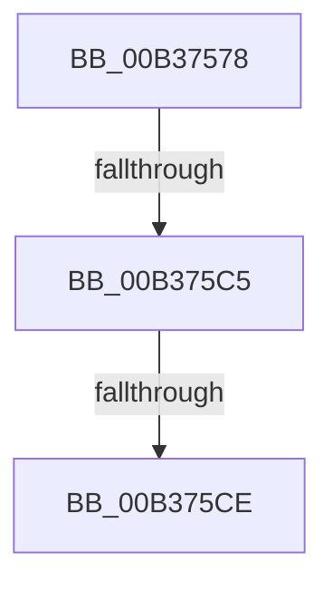

# sub_00B37578

- RVA: `0x00B37578`–`0x00B375D3` (길이 `91` bytes)
- VA: `0x0000000140B37578`
- 실행 섹션: `PAGE`
- PDB 이름 있음: `아니요`; PDB Function 태그: `아니요`
- unwind 정보 RVA: `0x000AAD78`
- 디코드: `20`개 명령, `91/91` bytes 표시
- 미해석 바이트: `0` (있으면 어셈블리에 `.byte`로 보존)

> 이 문서는 커널 이미지의 기계어와 PDB 기호를 분석해 생성했습니다. 4번과 5번은 함수 원형과 자료형을 바이너리 사용 방식에서 추정한 C 해석이며 원본 소스 복구 결과는 아닙니다.

## 1. Dependencies

- 직접 호출 지점: **3**; 고유 호출 대상: **3**
- 직접 호출자로 확인된 함수: **0**
- RIP 상대 이미지 참조: **0**

### Outgoing calls
- `0x00B37584` → [RtlInitializeSid](../9E/RtlInitializeSid_function_009EB720.md) (function, `0x009EB720`)
- `0x00B3759A` → [RtlSubAuthoritySid](../../text/45/RtlSubAuthoritySid_function_00456D10.md) (function, `0x00456D10`)
- `0x00B375B1` → [RtlCheckTokenMembership](../../text/3A/RtlCheckTokenMembership_function_003A5A10.md) (function, `0x003A5A10`)

### Direct callers
- 이 함수 시작 RVA로 연결되는 직접 call은 확인되지 않았습니다. 간접 호출은 완전히 역산할 수 없습니다.

### Static image references
- 디코드된 RIP-relative 메모리 참조가 없습니다.

## 2. Other-region calls and transfers

- 다른 실행 섹션으로 향하는 call: **2**
  - `0x00B3759A` → [RtlSubAuthoritySid](../../text/45/RtlSubAuthoritySid_function_00456D10.md) (`PAGE` → `.text`)
  - `0x00B375B1` → [RtlCheckTokenMembership](../../text/3A/RtlCheckTokenMembership_function_003A5A10.md) (`PAGE` → `.text`)
- call이 아닌 외부 분기/꼬리 이동: **3**
  - `0x00B375BF` → [RtlCapabilityCheck + 0x27B](../A2/RtlCapabilityCheck_function_00A20340.md) (`tail-transfer`)
  - `0x00B375C8` → [RtlCapabilityCheck + 0x260](../A2/RtlCapabilityCheck_function_00A20340.md) (`tail-transfer`)
  - `0x00B375CE` → [RtlCapabilityCheck + 0x2CE](../A2/RtlCapabilityCheck_function_00A20340.md) (`tail-transfer`)

## 3. Assembly (complete function range)

```asm
00B37578  41 B0 02                        mov r8b, 2
00B3757B  48 8D 54 24 38                  lea rdx, [rsp + 0x38]
00B37580  48 8D 4D B0                     lea rcx, [rbp - 0x50]
00B37584  E8 97 41 EB FF                  call 0x1409eb720
00B37589  BA 01 00 00 00                  mov edx, 1
00B3758E  41 C7 45 00 20 00 00 00         mov dword ptr [r13], 0x20
00B37596  48 8D 4D B0                     lea rcx, [rbp - 0x50]
00B3759A  E8 71 F7 91 FF                  call 0x140456d10
00B3759F  4C 8D 44 24 30                  lea r8, [rsp + 0x30]
00B375A4  49 8B CF                        mov rcx, r15
00B375A7  48 8D 55 B0                     lea rdx, [rbp - 0x50]
00B375AB  C7 00 20 02 00 00               mov dword ptr [rax], 0x220
00B375B1  E8 5A E4 86 FF                  call 0x1403a5a10
00B375B6  40 8A 74 24 30                  mov sil, byte ptr [rsp + 0x30]
00B375BB  8B D8                           mov ebx, eax
00B375BD  85 C0                           test eax, eax
00B375BF  0F 88 F6 8F EE FF               js 0x140a205bb
00B375C5  40 84 F6                        test sil, sil
00B375C8  0F 85 D2 8F EE FF               jne 0x140a205a0
00B375CE  E9 3B 90 EE FF                  jmp 0x140a2060e
```

## 4. C-style interpretation (structured pseudocode)

```c
__int64 __fastcall sub_00B37578(__int64 a1, __int64 a2, __int64 a3, __int64 a4, __int64 a5, unsigned __int8 a6, __int64 a7)
{
    __int64 result;

    result = RtlInitializeSid(v_rbp - 80, a7, 2, a4);
    *(unsigned int *)(v_r13) = 32;
    result = RtlSubAuthoritySid(v_rbp - 80, 1, 2, a4);
    *(unsigned int *)(result) = 544;
    result = RtlCheckTokenMembership(v_r15, v_rbp - 80, a6, a4);
}
```

## 5. (Beta) C Style

```c
int64_t sub_00B37578(int64_t Arg1, int64_t Arg2, int64_t Arg3, int64_t Arg4, uint64_t Arg5, uint8_t Arg6, int64_t Arg7)
{
    int64_t result;

    result = RtlInitializeSid(local_rbp - 80, Arg7, 2, Arg4);
    *(uint32_t *)(local_r13) = 32;
    result = RtlSubAuthoritySid(local_rbp - 80, 1, 2, Arg4);
    *(uint32_t *)(result) = 544;
    result = RtlCheckTokenMembership(local_r15, local_rbp - 80, Arg6, Arg4);
}
```

## 6. Execution-region graph

[열기: 2D/3D 그래프와 함수 탐색 컨트롤 패널](../../../control-panel.html?section=page&rva=0x00B37578&view=graph)

- 2D 그래프는 위에서 아래로 흐르고, 3D 그래프는 빈 공간을 드래그해 회전합니다. Shift+드래그는 이동, 휠은 확대·축소, 함수 노드 선택은 대상 보고서 이동입니다.

### Static fallback


