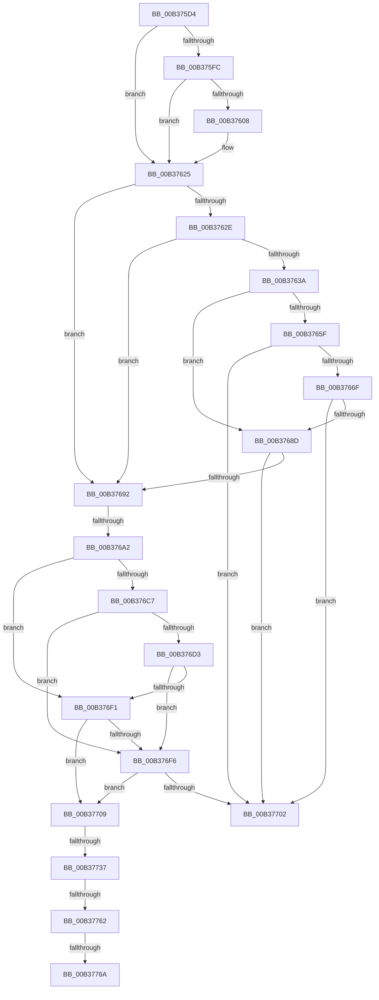

# sub_00B375D4

- RVA: `0x00B375D4`–`0x00B37783` (길이 `431` bytes)
- VA: `0x0000000140B375D4`
- 실행 섹션: `PAGE`
- PDB 이름 있음: `아니요`; PDB Function 태그: `아니요`
- unwind 정보 RVA: `0x000AAD88`
- 디코드: `109`개 명령, `431/431` bytes 표시
- 미해석 바이트: `0` (있으면 어셈블리에 `.byte`로 보존)

> 이 문서는 커널 이미지의 기계어와 PDB 기호를 분석해 생성했습니다. 4번과 5번은 함수 원형과 자료형을 바이너리 사용 방식에서 추정한 C 해석이며 원본 소스 복구 결과는 아닙니다.

## 1. Dependencies

- 직접 호출 지점: **12**; 고유 호출 대상: **5**
- 직접 호출자로 확인된 함수: **0**
- RIP 상대 이미지 참조: **5**

### Outgoing calls
- `0x00B375F0` → [SepSidInToken](../../text/3D/SepSidInToken_function_003D0430.md) (function, `0x003D0430`)
- `0x00B375FF` → [SeTokenIsRestricted](../../text/43/SeTokenIsRestricted_function_00438CE0.md) (function, `0x00438CE0`)
- `0x00B3761D` → [SepSidInToken](../../text/3D/SepSidInToken_function_003D0430.md) (function, `0x003D0430`)
- `0x00B37656` → [SepSidInToken](../../text/3D/SepSidInToken_function_003D0430.md) (function, `0x003D0430`)
- `0x00B37662` → [SeTokenIsRestricted](../../text/43/SeTokenIsRestricted_function_00438CE0.md) (function, `0x00438CE0`)
- `0x00B37684` → [SepSidInToken](../../text/3D/SepSidInToken_function_003D0430.md) (function, `0x003D0430`)
- `0x00B376BE` → [SepSidInToken](../../text/3D/SepSidInToken_function_003D0430.md) (function, `0x003D0430`)
- `0x00B376CA` → [SeTokenIsRestricted](../../text/43/SeTokenIsRestricted_function_00438CE0.md) (function, `0x00438CE0`)
- `0x00B376E8` → [SepSidInToken](../../text/3D/SepSidInToken_function_003D0430.md) (function, `0x003D0430`)
- `0x00B37726` → [SepSidInTokenSidHash](../../text/3C/SepSidInTokenSidHash_function_003C85E0.md) (function, `0x003C85E0`)
- `0x00B37751` → [SepCheckCapabilities](../AA/SepCheckCapabilities_function_00AA4A10.md) (function, `0x00AA4A10`)
- `0x00B37778` → [RtlEqualSid](../../text/40/RtlEqualSid_function_00400AD0.md) (function, `0x00400AD0`)

### Direct callers
- 이 함수 시작 RVA로 연결되는 직접 call은 확인되지 않았습니다. 간접 호출은 완전히 역산할 수 없습니다.

### Static image references
- `0x00B375D4` → RVA `0x00F05798` (`.data`; read)
- `0x00B37625` → RVA `0x00FD8194` (`PAGEDATA`; read)
- `0x00B3763A` → RVA `0x00F057A8` (`.data`; read)
- `0x00B376A2` → RVA `0x00F05868` (`.data`; read)
- `0x00B37709` → RVA `0x00F05870` (`.data`; read)

## 2. Other-region calls and transfers

- 다른 실행 섹션으로 향하는 call: **11**
  - `0x00B375F0` → [SepSidInToken](../../text/3D/SepSidInToken_function_003D0430.md) (`PAGE` → `.text`)
  - `0x00B375FF` → [SeTokenIsRestricted](../../text/43/SeTokenIsRestricted_function_00438CE0.md) (`PAGE` → `.text`)
  - `0x00B3761D` → [SepSidInToken](../../text/3D/SepSidInToken_function_003D0430.md) (`PAGE` → `.text`)
  - `0x00B37656` → [SepSidInToken](../../text/3D/SepSidInToken_function_003D0430.md) (`PAGE` → `.text`)
  - `0x00B37662` → [SeTokenIsRestricted](../../text/43/SeTokenIsRestricted_function_00438CE0.md) (`PAGE` → `.text`)
  - `0x00B37684` → [SepSidInToken](../../text/3D/SepSidInToken_function_003D0430.md) (`PAGE` → `.text`)
  - `0x00B376BE` → [SepSidInToken](../../text/3D/SepSidInToken_function_003D0430.md) (`PAGE` → `.text`)
  - `0x00B376CA` → [SeTokenIsRestricted](../../text/43/SeTokenIsRestricted_function_00438CE0.md) (`PAGE` → `.text`)
  - `0x00B376E8` → [SepSidInToken](../../text/3D/SepSidInToken_function_003D0430.md) (`PAGE` → `.text`)
  - `0x00B37726` → [SepSidInTokenSidHash](../../text/3C/SepSidInTokenSidHash_function_003C85E0.md) (`PAGE` → `.text`)
  - `0x00B37778` → [RtlEqualSid](../../text/40/RtlEqualSid_function_00400AD0.md) (`PAGE` → `.text`)
- call이 아닌 외부 분기/꼬리 이동: **6**
  - `0x00B3769C` → [SepIsImpersonationAllowedDueToCapability + 0x40](../A2/SepIsImpersonationAllowedDueToCapability_function_00A206CC.md) (`tail-transfer`)
  - `0x00B37704` → [SepIsImpersonationAllowedDueToCapability + 0x42](../A2/SepIsImpersonationAllowedDueToCapability_function_00A206CC.md) (`tail-transfer`)
  - `0x00B37731` → [SepIsImpersonationAllowedDueToCapability + 0x42](../A2/SepIsImpersonationAllowedDueToCapability_function_00A206CC.md) (`tail-transfer`)
  - `0x00B3775C` → [SepIsImpersonationAllowedDueToCapability + 0x42](../A2/SepIsImpersonationAllowedDueToCapability_function_00A206CC.md) (`tail-transfer`)
  - `0x00B37764` → [SepIsImpersonationAllowedDueToCapability + 0x42](../A2/SepIsImpersonationAllowedDueToCapability_function_00A206CC.md) (`tail-transfer`)
  - `0x00B3777E` → [SepIsImpersonationAllowedDueToCapability + 0x42](../A2/SepIsImpersonationAllowedDueToCapability_function_00A206CC.md) (`tail-transfer`)

## 3. Assembly (complete function range)

```asm
00B375D4  48 8B 2D BD E1 3C 00            mov rbp, qword ptr [rip + 0x3ce1bd]
00B375DB  45 33 C9                        xor r9d, r9d
00B375DE  4C 8B C5                        mov r8, rbp
00B375E1  C6 44 24 28 00                  mov byte ptr [rsp + 0x28], 0
00B375E6  33 D2                           xor edx, edx
00B375E8  C6 44 24 20 00                  mov byte ptr [rsp + 0x20], 0
00B375ED  48 8B CB                        mov rcx, rbx
00B375F0  E8 3B 8E 89 FF                  call 0x1403d0430
00B375F5  40 8A F0                        mov sil, al
00B375F8  84 C0                           test al, al
00B375FA  74 29                           je 0x140b37625
00B375FC  48 8B CB                        mov rcx, rbx
00B375FF  E8 DC 16 90 FF                  call 0x140438ce0
00B37604  84 C0                           test al, al
00B37606  74 1D                           je 0x140b37625
00B37608  C6 44 24 28 00                  mov byte ptr [rsp + 0x28], 0
00B3760D  45 33 C9                        xor r9d, r9d
00B37610  4C 8B C5                        mov r8, rbp
00B37613  C6 44 24 20 01                  mov byte ptr [rsp + 0x20], 1
00B37618  33 D2                           xor edx, edx
00B3761A  48 8B CB                        mov rcx, rbx
00B3761D  E8 0E 8E 89 FF                  call 0x1403d0430
00B37622  40 8A F0                        mov sil, al
00B37625  83 3D 68 0B 4A 00 00            cmp dword ptr [rip + 0x4a0b68], 0
00B3762C  74 64                           je 0x140b37692
00B3762E  F7 83 C8 00 00 00 00 40 00 00   test dword ptr [rbx + 0xc8], 0x4000
00B37638  75 58                           jne 0x140b37692
00B3763A  48 8B 2D 67 E1 3C 00            mov rbp, qword ptr [rip + 0x3ce167]
00B37641  45 33 C9                        xor r9d, r9d
00B37644  4C 8B C5                        mov r8, rbp
00B37647  C6 44 24 28 00                  mov byte ptr [rsp + 0x28], 0
00B3764C  33 D2                           xor edx, edx
00B3764E  C6 44 24 20 00                  mov byte ptr [rsp + 0x20], 0
00B37653  48 8B CB                        mov rcx, rbx
00B37656  E8 D5 8D 89 FF                  call 0x1403d0430
00B3765B  84 C0                           test al, al
00B3765D  74 2E                           je 0x140b3768d
00B3765F  48 8B CB                        mov rcx, rbx
00B37662  E8 79 16 90 FF                  call 0x140438ce0
00B37667  84 C0                           test al, al
00B37669  0F 84 93 00 00 00               je 0x140b37702
00B3766F  C6 44 24 28 00                  mov byte ptr [rsp + 0x28], 0
00B37674  45 33 C9                        xor r9d, r9d
00B37677  4C 8B C5                        mov r8, rbp
00B3767A  C6 44 24 20 01                  mov byte ptr [rsp + 0x20], 1
00B3767F  33 D2                           xor edx, edx
00B37681  48 8B CB                        mov rcx, rbx
00B37684  E8 A7 8D 89 FF                  call 0x1403d0430
00B37689  84 C0                           test al, al
00B3768B  75 75                           jne 0x140b37702
00B3768D  40 84 F6                        test sil, sil
00B37690  75 70                           jne 0x140b37702
00B37692  F7 87 C8 00 00 00 00 40 00 00   test dword ptr [rdi + 0xc8], 0x4000
00B3769C  0F 84 6A 90 EE FF               je 0x140a2070c
00B376A2  48 8B 2D BF E1 3C 00            mov rbp, qword ptr [rip + 0x3ce1bf]
00B376A9  45 33 C9                        xor r9d, r9d
00B376AC  4C 8B C5                        mov r8, rbp
00B376AF  C6 44 24 28 00                  mov byte ptr [rsp + 0x28], 0
00B376B4  33 D2                           xor edx, edx
00B376B6  C6 44 24 20 00                  mov byte ptr [rsp + 0x20], 0
00B376BB  48 8B CB                        mov rcx, rbx
00B376BE  E8 6D 8D 89 FF                  call 0x1403d0430
00B376C3  84 C0                           test al, al
00B376C5  74 2A                           je 0x140b376f1
00B376C7  48 8B CB                        mov rcx, rbx
00B376CA  E8 11 16 90 FF                  call 0x140438ce0
00B376CF  84 C0                           test al, al
00B376D1  74 23                           je 0x140b376f6
00B376D3  C6 44 24 28 00                  mov byte ptr [rsp + 0x28], 0
00B376D8  45 33 C9                        xor r9d, r9d
00B376DB  4C 8B C5                        mov r8, rbp
00B376DE  C6 44 24 20 01                  mov byte ptr [rsp + 0x20], 1
00B376E3  33 D2                           xor edx, edx
00B376E5  48 8B CB                        mov rcx, rbx
00B376E8  E8 43 8D 89 FF                  call 0x1403d0430
00B376ED  84 C0                           test al, al
00B376EF  75 05                           jne 0x140b376f6
00B376F1  40 84 F6                        test sil, sil
00B376F4  74 13                           je 0x140b37709
00B376F6  F7 83 C8 00 00 00 00 40 00 00   test dword ptr [rbx + 0xc8], 0x4000
00B37700  75 07                           jne 0x140b37709
00B37702  B0 01                           mov al, 1
00B37704  E9 05 90 EE FF                  jmp 0x140a2070e
00B37709  4C 8B 05 60 E1 3C 00            mov r8, qword ptr [rip + 0x3ce160]
00B37710  48 8D 8B 28 03 00 00            lea rcx, [rbx + 0x328]
00B37717  C6 44 24 28 00                  mov byte ptr [rsp + 0x28], 0
00B3771C  45 33 C9                        xor r9d, r9d
00B3771F  33 D2                           xor edx, edx
00B37721  C6 44 24 20 01                  mov byte ptr [rsp + 0x20], 1
00B37726  E8 B5 0E 89 FF                  call 0x1403c85e0
00B3772B  88 44 24 40                     mov byte ptr [rsp + 0x40], al
00B3772F  84 C0                           test al, al
00B37731  0F 84 D7 8F EE FF               je 0x140a2070e
00B37737  4C 8B 87 18 03 00 00            mov r8, qword ptr [rdi + 0x318]
00B3773E  48 8D 44 24 40                  lea rax, [rsp + 0x40]
00B37743  8B 97 20 03 00 00               mov edx, dword ptr [rdi + 0x320]
00B37749  48 8B CB                        mov rcx, rbx
00B3774C  48 89 44 24 20                  mov qword ptr [rsp + 0x20], rax
00B37751  E8 BA D2 F6 FF                  call 0x140aa4a10
00B37756  85 C0                           test eax, eax
00B37758  8A 44 24 40                     mov al, byte ptr [rsp + 0x40]
00B3775C  0F 88 AC 8F EE FF               js 0x140a2070e
00B37762  84 C0                           test al, al
00B37764  0F 85 A4 8F EE FF               jne 0x140a2070e
00B3776A  48 8B 97 10 03 00 00            mov rdx, qword ptr [rdi + 0x310]
00B37771  48 8B 8B 10 03 00 00            mov rcx, qword ptr [rbx + 0x310]
00B37778  E8 53 93 8C FF                  call 0x140400ad0
00B3777D  90                              nop
00B3777E  E9 8B 8F EE FF                  jmp 0x140a2070e
```

## 4. C-style interpretation (structured pseudocode)

```c
__int64 __fastcall sub_00B375D4(__int64 a1, int a2, __int64 a3, int a4, __int64 a5, __int64 a6, __int64 a7, unsigned __int8 a8)
{
    __int64 result;
    __int64 v_rsi;
    unsigned __int8 v_stack_p20;
    unsigned __int8 v_stack_p28;
    unsigned __int8 v_stack_p40;

    a4 = 0;
    v_stack_p28 = 0;
    a2 = 0;
    v_stack_p20 = 0;
    result = SepSidInToken(v_rbx, a2, *(unsigned __int64 *)(v_rip + 3989949), a4);
    if ((unsigned __int8)(result) == 0) goto loc_00B37625;
    result = SeTokenIsRestricted(v_rbx, a2, *(unsigned __int64 *)(v_rip + 3989949), a4);
    v_rsi = (unsigned __int8)(result);
    if ((unsigned __int8)(result) != 0) {
        v_stack_p28 = 0;
        a4 = 0;
        a3 = *(unsigned __int64 *)(v_rip + 3989949);
        v_stack_p20 = 1;
        a2 = 0;
        a1 = v_rbx;
        result = SepSidInToken(a1, a2, a3, a4);
        v_rsi = (unsigned __int8)(result);
    }
    if ((*(unsigned int *)(v_rip + 4852584)) == 0) goto loc_00B37692;
    if (((*(unsigned int *)(v_rbx + 200)) & (0x4000ULL)) != 0) goto loc_00B37692;
    a4 = 0;
    v_stack_p28 = 0;
    a2 = 0;
    v_stack_p20 = 0;
    result = SepSidInToken(v_rbx, a2, *(unsigned __int64 *)(v_rip + 3989863), a4);
    if ((unsigned __int8)(result) == 0) goto loc_00B3768D;
    result = SeTokenIsRestricted(v_rbx, a2, *(unsigned __int64 *)(v_rip + 3989863), a4);
    if ((unsigned __int8)(result) == 0) goto loc_00B37702;
    v_stack_p28 = 0;
    a4 = 0;
    v_stack_p20 = 1;
    a2 = 0;
    result = SepSidInToken(v_rbx, a2, *(unsigned __int64 *)(v_rip + 3989863), a4);
    if ((unsigned __int8)(result) != 0) goto loc_00B37702;
loc_00B3768D:
    if ((unsigned __int8)(v_rsi) != 0) goto loc_00B37702;
loc_00B37692:
    a4 = 0;
    v_stack_p28 = 0;
    a2 = 0;
    v_stack_p20 = 0;
    result = SepSidInToken(v_rbx, a2, *(unsigned __int64 *)(v_rip + 3989951), a4);
    if ((unsigned __int8)(result) == 0) goto loc_00B376F1;
    result = SeTokenIsRestricted(v_rbx, a2, *(unsigned __int64 *)(v_rip + 3989951), a4);
    if ((unsigned __int8)(result) == 0) goto loc_00B376F6;
    v_stack_p28 = 0;
    a4 = 0;
    v_stack_p20 = 1;
    a2 = 0;
    result = SepSidInToken(v_rbx, a2, *(unsigned __int64 *)(v_rip + 3989951), a4);
    if ((unsigned __int8)(result) != 0) goto loc_00B376F6;
loc_00B376F1:
    if ((unsigned __int8)(v_rsi) == 0) goto loc_00B37709;
loc_00B376F6:
    if (((*(unsigned int *)(v_rbx + 200)) & (0x4000ULL)) != 0) goto loc_00B37709;
loc_00B37702:
loc_00B37709:
    v_stack_p28 = 0;
    a4 = 0;
    a2 = 0;
    v_stack_p20 = 1;
    result = SepSidInTokenSidHash(v_rbx + 808, a2, *(unsigned __int64 *)(v_rip + 3989856), a4);
    v_stack_p40 = (unsigned __int8)(result);
    v_stack_p20 = a8;
    result = SepCheckCapabilities(v_rbx, (unsigned int)(*(unsigned int *)(v_rdi + 800)), *(unsigned __int64 *)(v_rdi + 792), a4);
    result = RtlEqualSid(*(unsigned __int64 *)(v_rbx + 784), *(unsigned __int64 *)(v_rdi + 784), *(unsigned __int64 *)(v_rdi + 792), a4);
}
```

## 5. (Beta) C Style

```c
int64_t sub_00B375D4(int64_t Arg1, int32_t Arg2, int64_t Arg3, int32_t Arg4, uint64_t Arg5, uint64_t Arg6, uint64_t Arg7, uint8_t Arg8)
{
    int64_t result;
    int64_t local_rsi;
    uint8_t v_stack_p20;
    uint8_t v_stack_p28;
    uint8_t v_stack_p40;

    Arg4 = 0;
    v_stack_p28 = 0;
    Arg2 = 0;
    v_stack_p20 = 0;
    result = SepSidInToken(local_rbx, Arg2, *(uint64_t *)(v_rip + 0x3CE1BD), Arg4);
    if ((uint8_t)(result) == 0) goto loc_00B37625;
    result = SeTokenIsRestricted(local_rbx, Arg2, *(uint64_t *)(v_rip + 0x3CE1BD), Arg4);
    local_rsi = (uint8_t)(result);
    if ((uint8_t)(result) != 0) {
        v_stack_p28 = 0;
        Arg4 = 0;
        Arg3 = *(uint64_t *)(v_rip + 0x3CE1BD);
        v_stack_p20 = 1;
        Arg2 = 0;
        Arg1 = local_rbx;
        result = SepSidInToken(Arg1, Arg2, Arg3, Arg4);
        local_rsi = (uint8_t)(result);
    }
    if ((*(uint32_t *)(v_rip + 0x4A0B68)) == 0) goto loc_00B37692;
    if (((*(uint32_t *)(local_rbx + 0xC8)) & (0x4000ULL)) != 0) goto loc_00B37692;
    Arg4 = 0;
    v_stack_p28 = 0;
    Arg2 = 0;
    v_stack_p20 = 0;
    result = SepSidInToken(local_rbx, Arg2, *(uint64_t *)(v_rip + 0x3CE167), Arg4);
    if ((uint8_t)(result) == 0) goto loc_00B3768D;
    result = SeTokenIsRestricted(local_rbx, Arg2, *(uint64_t *)(v_rip + 0x3CE167), Arg4);
    if ((uint8_t)(result) == 0) goto loc_00B37702;
    v_stack_p28 = 0;
    Arg4 = 0;
    v_stack_p20 = 1;
    Arg2 = 0;
    result = SepSidInToken(local_rbx, Arg2, *(uint64_t *)(v_rip + 0x3CE167), Arg4);
    if ((uint8_t)(result) != 0) goto loc_00B37702;
loc_00B3768D:
    if ((uint8_t)(local_rsi) != 0) goto loc_00B37702;
loc_00B37692:
    Arg4 = 0;
    v_stack_p28 = 0;
    Arg2 = 0;
    v_stack_p20 = 0;
    result = SepSidInToken(local_rbx, Arg2, *(uint64_t *)(v_rip + 0x3CE1BF), Arg4);
    if ((uint8_t)(result) == 0) goto loc_00B376F1;
    result = SeTokenIsRestricted(local_rbx, Arg2, *(uint64_t *)(v_rip + 0x3CE1BF), Arg4);
    if ((uint8_t)(result) == 0) goto loc_00B376F6;
    v_stack_p28 = 0;
    Arg4 = 0;
    v_stack_p20 = 1;
    Arg2 = 0;
    result = SepSidInToken(local_rbx, Arg2, *(uint64_t *)(v_rip + 0x3CE1BF), Arg4);
    if ((uint8_t)(result) != 0) goto loc_00B376F6;
loc_00B376F1:
    if ((uint8_t)(local_rsi) == 0) goto loc_00B37709;
loc_00B376F6:
    if (((*(uint32_t *)(local_rbx + 0xC8)) & (0x4000ULL)) != 0) goto loc_00B37709;
loc_00B37702:
loc_00B37709:
    v_stack_p28 = 0;
    Arg4 = 0;
    Arg2 = 0;
    v_stack_p20 = 1;
    result = SepSidInTokenSidHash(local_rbx + 808, Arg2, *(uint64_t *)(v_rip + 0x3CE160), Arg4);
    v_stack_p40 = (uint8_t)(result);
    v_stack_p20 = Arg8;
    result = SepCheckCapabilities(local_rbx, (uint32_t)(*(uint32_t *)(local_rdi + 0x320)), *(uint64_t *)(local_rdi + 0x318), Arg4);
    result = RtlEqualSid(*(uint64_t *)(local_rbx + 0x310), *(uint64_t *)(local_rdi + 0x310), *(uint64_t *)(local_rdi + 0x318), Arg4);
}
```

## 6. Execution-region graph

[열기: 2D/3D 그래프와 함수 탐색 컨트롤 패널](../../../control-panel.html?section=page&rva=0x00B375D4&view=graph)

- 2D 그래프는 위에서 아래로 흐르고, 3D 그래프는 빈 공간을 드래그해 회전합니다. Shift+드래그는 이동, 휠은 확대·축소, 함수 노드 선택은 대상 보고서 이동입니다.

### Static fallback


