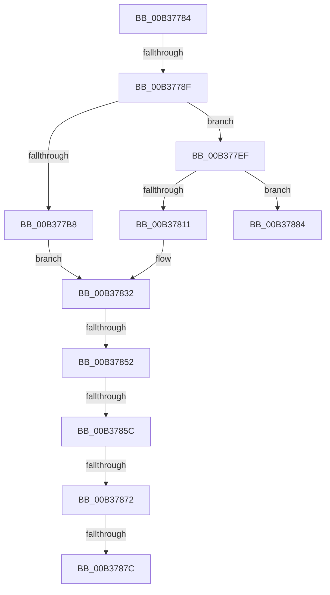

# sub_00B37784

- RVA: `0x00B37784`–`0x00B3788E` (길이 `266` bytes)
- VA: `0x0000000140B37784`
- 실행 섹션: `PAGE`
- PDB 이름 있음: `아니요`; PDB Function 태그: `아니요`
- unwind 정보 RVA: `0x000AADB4`
- 디코드: `64`개 명령, `266/266` bytes 표시
- 미해석 바이트: `0` (있으면 어셈블리에 `.byte`로 보존)

> 이 문서는 커널 이미지의 기계어와 PDB 기호를 분석해 생성했습니다. 4번과 5번은 함수 원형과 자료형을 바이너리 사용 방식에서 추정한 C 해석이며 원본 소스 복구 결과는 아닙니다.

## 1. Dependencies

- 직접 호출 지점: **9**; 고유 호출 대상: **5**
- 직접 호출자로 확인된 함수: **0**
- RIP 상대 이미지 참조: **2**

### Outgoing calls
- `0x00B377AF` → [RtlCompareUnicodeStrings](../97/RtlCompareUnicodeStrings_function_009727E0.md) (function, `0x009727E0`)
- `0x00B377C3` → [RtlInitializeSid](../9E/RtlInitializeSid_function_009EB720.md) (function, `0x009EB720`)
- `0x00B377CE` → [RtlSubAuthoritySid](../../text/45/RtlSubAuthoritySid_function_00456D10.md) (function, `0x00456D10`)
- `0x00B377E2` → [RtlSubAuthoritySid](../../text/45/RtlSubAuthoritySid_function_00456D10.md) (function, `0x00456D10`)
- `0x00B37808` → [RtlCompareUnicodeStrings](../97/RtlCompareUnicodeStrings_function_009727E0.md) (function, `0x009727E0`)
- `0x00B3781C` → [RtlInitializeSid](../9E/RtlInitializeSid_function_009EB720.md) (function, `0x009EB720`)
- `0x00B37827` → [RtlSubAuthoritySid](../../text/45/RtlSubAuthoritySid_function_00456D10.md) (function, `0x00456D10`)
- `0x00B37843` → [RtlCheckTokenMembershipEx](../../text/3A/RtlCheckTokenMembershipEx_function_003A5A30.md) (function, `0x003A5A30`)
- `0x00B37863` → [RtlpIsAppContainer](../78/RtlpIsAppContainer_function_0078F37C.md) (function, `0x0078F37C`)

### Direct callers
- 이 함수 시작 RVA로 연결되는 직접 call은 확인되지 않았습니다. 간접 호출은 완전히 역산할 수 없습니다.

### Static image references
- `0x00B37799` → RVA `0x0000B628` (`.rdata`; read)
- `0x00B377EF` → RVA `0x0000B618` (`.rdata`; read)

## 2. Other-region calls and transfers

- 다른 실행 섹션으로 향하는 call: **4**
  - `0x00B377CE` → [RtlSubAuthoritySid](../../text/45/RtlSubAuthoritySid_function_00456D10.md) (`PAGE` → `.text`)
  - `0x00B377E2` → [RtlSubAuthoritySid](../../text/45/RtlSubAuthoritySid_function_00456D10.md) (`PAGE` → `.text`)
  - `0x00B37827` → [RtlSubAuthoritySid](../../text/45/RtlSubAuthoritySid_function_00456D10.md) (`PAGE` → `.text`)
  - `0x00B37843` → [RtlCheckTokenMembershipEx](../../text/3A/RtlCheckTokenMembershipEx_function_003A5A30.md) (`PAGE` → `.text`)
- call이 아닌 외부 분기/꼬리 이동: **7**
  - `0x00B37789` → [RtlpCapabilityCheckSystemCapability + 0x5E](../A2/RtlpCapabilityCheckSystemCapability_function_00A20768.md) (`tail-transfer`)
  - `0x00B3784C` → [RtlpCapabilityCheckSystemCapability + 0x5E](../A2/RtlpCapabilityCheckSystemCapability_function_00A20768.md) (`tail-transfer`)
  - `0x00B37856` → [RtlpCapabilityCheckSystemCapability + 0x5E](../A2/RtlpCapabilityCheckSystemCapability_function_00A20768.md) (`tail-transfer`)
  - `0x00B3786C` → [RtlpCapabilityCheckSystemCapability + 0x5E](../A2/RtlpCapabilityCheckSystemCapability_function_00A20768.md) (`tail-transfer`)
  - `0x00B37876` → [RtlpCapabilityCheckSystemCapability + 0x5E](../A2/RtlpCapabilityCheckSystemCapability_function_00A20768.md) (`tail-transfer`)
  - `0x00B3787F` → [RtlpCapabilityCheckSystemCapability + 0x5E](../A2/RtlpCapabilityCheckSystemCapability_function_00A20768.md) (`tail-transfer`)
  - `0x00B37889` → [RtlpCapabilityCheckSystemCapability + 0x5E](../A2/RtlpCapabilityCheckSystemCapability_function_00A20768.md) (`tail-transfer`)

## 3. Assembly (complete function range)

```asm
00B37784  44 88 3E                        mov byte ptr [rsi], r15b
00B37787  85 C0                           test eax, eax
00B37789  0F 88 37 90 EE FF               js 0x140a207c6
00B3778F  0F B7 5D D0                     movzx ebx, word ptr [rbp - 0x30]
00B37793  41 B9 02 00 00 00               mov r9d, 2
00B37799  4C 8B 05 88 3E 4D FF            mov r8, qword ptr [rip - 0xb2c178]
00B377A0  48 8B 4D D8                     mov rcx, qword ptr [rbp - 0x28]
00B377A4  48 D1 EB                        shr rbx, 1
00B377A7  48 8B D3                        mov rdx, rbx
00B377AA  44 88 7C 24 20                  mov byte ptr [rsp + 0x20], r15b
00B377AF  E8 2C B0 E3 FF                  call 0x1409727e0
00B377B4  85 C0                           test eax, eax
00B377B6  75 37                           jne 0x140b377ef
00B377B8  41 B0 02                        mov r8b, 2
00B377BB  48 8D 55 C4                     lea rdx, [rbp - 0x3c]
00B377BF  48 8D 4D E0                     lea rcx, [rbp - 0x20]
00B377C3  E8 58 3F EB FF                  call 0x1409eb720
00B377C8  33 D2                           xor edx, edx
00B377CA  48 8D 4D E0                     lea rcx, [rbp - 0x20]
00B377CE  E8 3D F5 91 FF                  call 0x140456d10
00B377D3  BA 01 00 00 00                  mov edx, 1
00B377D8  48 8D 4D E0                     lea rcx, [rbp - 0x20]
00B377DC  C7 00 20 00 00 00               mov dword ptr [rax], 0x20
00B377E2  E8 29 F5 91 FF                  call 0x140456d10
00B377E7  C7 00 47 02 00 00               mov dword ptr [rax], 0x247
00B377ED  EB 43                           jmp 0x140b37832
00B377EF  4C 8B 05 22 3E 4D FF            mov r8, qword ptr [rip - 0xb2c1de]
00B377F6  41 B9 02 00 00 00               mov r9d, 2
00B377FC  48 8B 4D D8                     mov rcx, qword ptr [rbp - 0x28]
00B37800  48 8B D3                        mov rdx, rbx
00B37803  44 88 7C 24 20                  mov byte ptr [rsp + 0x20], r15b
00B37808  E8 D3 AF E3 FF                  call 0x1409727e0
00B3780D  85 C0                           test eax, eax
00B3780F  75 73                           jne 0x140b37884
00B37811  41 B0 01                        mov r8b, 1
00B37814  48 8D 55 C4                     lea rdx, [rbp - 0x3c]
00B37818  48 8D 4D E0                     lea rcx, [rbp - 0x20]
00B3781C  E8 FF 3E EB FF                  call 0x1409eb720
00B37821  33 D2                           xor edx, edx
00B37823  48 8D 4D E0                     lea rcx, [rbp - 0x20]
00B37827  E8 E4 F4 91 FF                  call 0x140456d10
00B3782C  C7 00 04 00 00 00               mov dword ptr [rax], 4
00B37832  4C 8D 4D C0                     lea r9, [rbp - 0x40]
00B37836  41 B8 02 00 00 00               mov r8d, 2
00B3783C  48 8D 55 E0                     lea rdx, [rbp - 0x20]
00B37840  49 8B CE                        mov rcx, r14
00B37843  E8 E8 E1 86 FF                  call 0x1403a5a30
00B37848  8B D8                           mov ebx, eax
00B3784A  85 C0                           test eax, eax
00B3784C  0F 88 74 8F EE FF               js 0x140a207c6
00B37852  44 38 7D C0                     cmp byte ptr [rbp - 0x40], r15b
00B37856  0F 84 6A 8F EE FF               je 0x140a207c6
00B3785C  48 8D 55 C1                     lea rdx, [rbp - 0x3f]
00B37860  49 8B CE                        mov rcx, r14
00B37863  E8 14 7B C5 FF                  call 0x14078f37c
00B37868  8B D8                           mov ebx, eax
00B3786A  85 C0                           test eax, eax
00B3786C  0F 88 54 8F EE FF               js 0x140a207c6
00B37872  44 38 7D C1                     cmp byte ptr [rbp - 0x3f], r15b
00B37876  0F 84 4A 8F EE FF               je 0x140a207c6
00B3787C  C6 06 01                        mov byte ptr [rsi], 1
00B3787F  E9 42 8F EE FF                  jmp 0x140a207c6
00B37884  BB 01 00 00 C0                  mov ebx, 0xc0000001
00B37889  E9 38 8F EE FF                  jmp 0x140a207c6
```

## 4. C-style interpretation (structured pseudocode)

```c
__int64 __fastcall sub_00B37784(void)
{
    __int64 result;
    __int64 v_rbx;
    unsigned __int8 v_stack_p20;

    *(unsigned __int8 *)(v_rsi) = (unsigned __int8)(v_r15);
    v_rbx = (*(unsigned __int16 *)(v_rbp - 48)) >> (1);
    v_stack_p20 = (unsigned __int8)(v_r15);
    result = RtlCompareUnicodeStrings(*(unsigned __int64 *)(v_rbp - 40), v_rbx, *(unsigned __int64 *)(v_rip - 11714936), 2);
    if ((unsigned int)(result) != 0) goto loc_00B377EF;
    result = RtlInitializeSid(v_rbp - 32, v_rbp - 60, 2, 2);
    a2 = 0;
    result = RtlSubAuthoritySid(v_rbp - 32, a2, 2, 2);
    *(unsigned int *)(result) = 32;
    result = RtlSubAuthoritySid(v_rbp - 32, 1, 2, 2);
    *(unsigned int *)(result) = 583;
    goto loc_00B37832;
loc_00B377EF:
    v_stack_p20 = (unsigned __int8)(v_r15);
    result = RtlCompareUnicodeStrings(*(unsigned __int64 *)(v_rbp - 40), v_rbx, *(unsigned __int64 *)(v_rip - 11715038), 2);
    if ((unsigned int)(result) != 0) goto loc_00B37884;
    result = RtlInitializeSid(v_rbp - 32, v_rbp - 60, 1, 2);
    a2 = 0;
    result = RtlSubAuthoritySid(v_rbp - 32, a2, 1, 2);
    *(unsigned int *)(result) = 4;
loc_00B37832:
    result = RtlCheckTokenMembershipEx(v_r14, v_rbp - 32, 2, v_rbp - 64);
    result = RtlpIsAppContainer(v_r14, v_rbp - 63, 2, v_rbp - 64);
    *(unsigned __int8 *)(v_rsi) = 1;
loc_00B37884:
}
```

## 5. (Beta) C Style

```c
void sub_00B37784(void)
{
    int64_t result;
    int64_t local_rbx;
    uint8_t v_stack_p20;

    *(uint8_t *)(local_rsi) = (uint8_t)(local_r15);
    local_rbx = (*(uint16_t *)(local_rbp - 0x30)) >> (1);
    v_stack_p20 = (uint8_t)(local_r15);
    result = RtlCompareUnicodeStrings(*(uint64_t *)(local_rbp - 0x28), local_rbx, *(uint64_t *)(v_rip - 0xB2C178), 2);
    if ((uint32_t)(result) != 0) goto loc_00B377EF;
    result = RtlInitializeSid(local_rbp - 32, local_rbp - 60, 2, 2);
    a2 = 0;
    result = RtlSubAuthoritySid(local_rbp - 32, a2, 2, 2);
    *(uint32_t *)(result) = 32;
    result = RtlSubAuthoritySid(local_rbp - 32, 1, 2, 2);
    *(uint32_t *)(result) = 583;
    goto loc_00B37832;
loc_00B377EF:
    v_stack_p20 = (uint8_t)(local_r15);
    result = RtlCompareUnicodeStrings(*(uint64_t *)(local_rbp - 0x28), local_rbx, *(uint64_t *)(v_rip - 0xB2C1DE), 2);
    if ((uint32_t)(result) != 0) goto loc_00B37884;
    result = RtlInitializeSid(local_rbp - 32, local_rbp - 60, 1, 2);
    a2 = 0;
    result = RtlSubAuthoritySid(local_rbp - 32, a2, 1, 2);
    *(uint32_t *)(result) = 4;
loc_00B37832:
    result = RtlCheckTokenMembershipEx(local_r14, local_rbp - 32, 2, local_rbp - 64);
    result = RtlpIsAppContainer(local_r14, local_rbp - 63, 2, local_rbp - 64);
    *(uint8_t *)(local_rsi) = 1;
loc_00B37884:
}
```

## 6. Execution-region graph

[열기: 2D/3D 그래프와 함수 탐색 컨트롤 패널](../../../control-panel.html?section=page&rva=0x00B37784&view=graph)

- 2D 그래프는 위에서 아래로 흐르고, 3D 그래프는 빈 공간을 드래그해 회전합니다. Shift+드래그는 이동, 휠은 확대·축소, 함수 노드 선택은 대상 보고서 이동입니다.

### Static fallback


