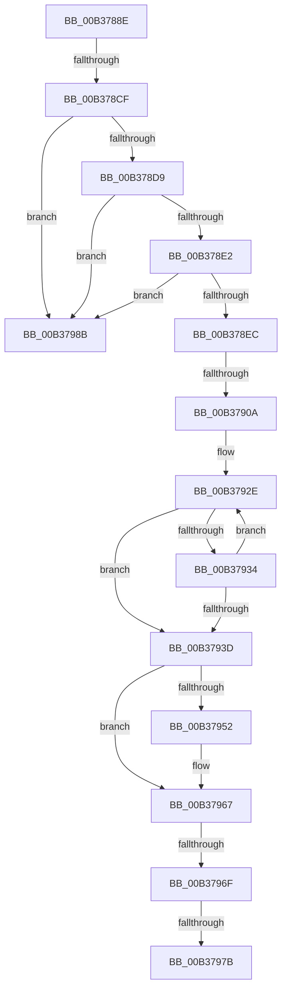

# sub_00B3788E

- RVA: `0x00B3788E`–`0x00B37995` (길이 `263` bytes)
- VA: `0x0000000140B3788E`
- 실행 섹션: `PAGE`
- PDB 이름 있음: `아니요`; PDB Function 태그: `아니요`
- unwind 정보 RVA: `0x000AADE0`
- 디코드: `70`개 명령, `263/263` bytes 표시
- 미해석 바이트: `0` (있으면 어셈블리에 `.byte`로 보존)

> 이 문서는 커널 이미지의 기계어와 PDB 기호를 분석해 생성했습니다. 4번과 5번은 함수 원형과 자료형을 바이너리 사용 방식에서 추정한 C 해석이며 원본 소스 복구 결과는 아닙니다.

## 1. Dependencies

- 직접 호출 지점: **5**; 고유 호출 대상: **4**
- 직접 호출자로 확인된 함수: **0**
- RIP 상대 이미지 참조: **0**

### Outgoing calls
- `0x00B378A1` → [ExAllocatePool2](../../poolcode/B8/ExAllocatePool2_function_00B820F0.md) (function, `0x00B820F0`)
- `0x00B378C0` → [ZwQueryLicenseValue](../../text/6A/ZwQueryLicenseValue_function_006AFCF0.md) (function, `0x006AFCF0`)
- `0x00B378F9` → [ExAllocatePool2](../../poolcode/B8/ExAllocatePool2_function_00B820F0.md) (function, `0x00B820F0`)
- `0x00B37913` → [memcpy](../../text/6C/memcpy_function_006C6840.md) (function, `0x006C6840`)
- `0x00B37980` → [ExFreePoolWithTag](../../poolcode/B8/ExFreePoolWithTag_function_00B82870.md) (function, `0x00B82870`)

### Direct callers
- 이 함수 시작 RVA로 연결되는 직접 call은 확인되지 않았습니다. 간접 호출은 완전히 역산할 수 없습니다.

### Static image references
- 디코드된 RIP-relative 메모리 참조가 없습니다.

## 2. Other-region calls and transfers

- 다른 실행 섹션으로 향하는 call: **5**
  - `0x00B378A1` → [ExAllocatePool2](../../poolcode/B8/ExAllocatePool2_function_00B820F0.md) (`PAGE` → `POOLCODE`)
  - `0x00B378C0` → [ZwQueryLicenseValue](../../text/6A/ZwQueryLicenseValue_function_006AFCF0.md) (`PAGE` → `.text`)
  - `0x00B378F9` → [ExAllocatePool2](../../poolcode/B8/ExAllocatePool2_function_00B820F0.md) (`PAGE` → `POOLCODE`)
  - `0x00B37913` → [memcpy](../../text/6C/memcpy_function_006C6840.md) (`PAGE` → `.text`)
  - `0x00B37980` → [ExFreePoolWithTag](../../poolcode/B8/ExFreePoolWithTag_function_00B82870.md) (`PAGE` → `POOLCODE`)
- call이 아닌 외부 분기/꼬리 이동: **6**
  - `0x00B378C9` → [RtlpGetPolicyValueForSystemCapability + 0x45](../A2/RtlpGetPolicyValueForSystemCapability_function_00A207F8.md) (`tail-transfer`)
  - `0x00B37904` → [RtlpGetPolicyValueForSystemCapability + 0x119](../A2/RtlpGetPolicyValueForSystemCapability_function_00A207F8.md) (`tail-transfer`)
  - `0x00B37969` → [RtlpGetPolicyValueForSystemCapability + 0x45](../A2/RtlpGetPolicyValueForSystemCapability_function_00A207F8.md) (`tail-transfer`)
  - `0x00B37975` → [RtlpGetPolicyValueForSystemCapability + 0xF0](../A2/RtlpGetPolicyValueForSystemCapability_function_00A207F8.md) (`tail-transfer`)
  - `0x00B37986` → [RtlpGetPolicyValueForSystemCapability + 0xF0](../A2/RtlpGetPolicyValueForSystemCapability_function_00A207F8.md) (`tail-transfer`)
  - `0x00B37990` → [RtlpGetPolicyValueForSystemCapability + 0x45](../A2/RtlpGetPolicyValueForSystemCapability_function_00A207F8.md) (`tail-transfer`)

## 3. Assembly (complete function range)

```asm
00B3788E  8B 75 40                        mov esi, dword ptr [rbp + 0x40]
00B37891  41 B8 52 74 50 62               mov r8d, 0x62507452
00B37897  8B D6                           mov edx, esi
00B37899  B9 41 00 00 00                  mov ecx, 0x41
00B3789E  44 8B FE                        mov r15d, esi
00B378A1  E8 4A A8 04 00                  call 0x140b820f0
00B378A6  4C 8B F0                        mov r14, rax
00B378A9  48 8D 55 50                     lea rdx, [rbp + 0x50]
00B378AD  48 8D 45 40                     lea rax, [rbp + 0x40]
00B378B1  4D 8B C6                        mov r8, r14
00B378B4  44 8B CE                        mov r9d, esi
00B378B7  48 89 44 24 20                  mov qword ptr [rsp + 0x20], rax
00B378BC  48 8D 4D F0                     lea rcx, [rbp - 0x10]
00B378C0  E8 2B 84 B7 FF                  call 0x1406afcf0
00B378C5  8B D8                           mov ebx, eax
00B378C7  85 C0                           test eax, eax
00B378C9  0F 88 6E 8F EE FF               js 0x140a2083d
00B378CF  83 7D 50 01                     cmp dword ptr [rbp + 0x50], 1
00B378D3  0F 85 B2 00 00 00               jne 0x140b3798b
00B378D9  83 FE 01                        cmp esi, 1
00B378DC  0F 82 A9 00 00 00               jb 0x140b3798b
00B378E2  40 F6 C6 01                     test sil, 1
00B378E6  0F 85 9F 00 00 00               jne 0x140b3798b
00B378EC  41 B8 53 74 72 67               mov r8d, 0x67727453
00B378F2  8B D6                           mov edx, esi
00B378F4  B9 00 01 00 00                  mov ecx, 0x100
00B378F9  E8 F2 A7 04 00                  call 0x140b820f0
00B378FE  48 8B F0                        mov rsi, rax
00B37901  48 85 C0                        test rax, rax
00B37904  0F 84 07 90 EE FF               je 0x140a20911
00B3790A  45 8B C7                        mov r8d, r15d
00B3790D  49 8B D6                        mov rdx, r14
00B37910  48 8B C8                        mov rcx, rax
00B37913  E8 28 EF B8 FF                  call 0x1406c6840
00B37918  0F 57 C0                        xorps xmm0, xmm0
00B3791B  B9 FF 7F 00 00                  mov ecx, 0x7fff
00B37920  0F 11 07                        movups xmmword ptr [rdi], xmm0
00B37923  8B D1                           mov edx, ecx
00B37925  48 8B C6                        mov rax, rsi
00B37928  41 B8 02 00 00 00               mov r8d, 2
00B3792E  66 44 39 28                     cmp word ptr [rax], r13w
00B37932  74 09                           je 0x140b3793d
00B37934  49 03 C0                        add rax, r8
00B37937  48 83 EA 01                     sub rdx, 1
00B3793B  75 F1                           jne 0x140b3792e
00B3793D  48 8B C2                        mov rax, rdx
00B37940  48 F7 D8                        neg rax
00B37943  1B DB                           sbb ebx, ebx
00B37945  F7 D3                           not ebx
00B37947  81 E3 0D 00 00 C0               and ebx, 0xc000000d
00B3794D  48 85 D2                        test rdx, rdx
00B37950  74 15                           je 0x140b37967
00B37952  48 2B CA                        sub rcx, rdx
00B37955  48 89 77 08                     mov qword ptr [rdi + 8], rsi
00B37959  66 03 C9                        add cx, cx
00B3795C  66 89 0F                        mov word ptr [rdi], cx
00B3795F  66 41 03 C8                     add cx, r8w
00B37963  66 89 4F 02                     mov word ptr [rdi + 2], cx
00B37967  85 DB                           test ebx, ebx
00B37969  0F 88 CE 8E EE FF               js 0x140a2083d
00B3796F  41 8B DD                        mov ebx, r13d
00B37972  4D 85 F6                        test r14, r14
00B37975  0F 84 6D 8F EE FF               je 0x140a208e8
00B3797B  33 D2                           xor edx, edx
00B3797D  49 8B CE                        mov rcx, r14
00B37980  E8 EB AE 04 00                  call 0x140b82870
00B37985  90                              nop
00B37986  E9 5D 8F EE FF                  jmp 0x140a208e8
00B3798B  BB 01 00 00 C0                  mov ebx, 0xc0000001
00B37990  E9 A8 8E EE FF                  jmp 0x140a2083d
```

## 4. C-style interpretation (structured pseudocode)

```c
__int64 __fastcall sub_00B3788E(void)
{
    __int64 result;
    __int64 v_rbx;
    unsigned __int64 v_stack_p20;

    result = ExAllocatePool2(65, (unsigned int)((unsigned int)((unsigned int)(*(unsigned int *)(v_rbp + 64)))), (unsigned int)(0x62507452ULL), a4);
    v_stack_p20 = v_rbp + 64;
    result = ZwQueryLicenseValue(v_rbp - 16, v_rbp + 80, result, (unsigned int)((unsigned int)((unsigned int)(*(unsigned int *)(v_rbp + 64)))));
    if ((*(unsigned int *)(v_rbp + 80)) != 1) goto loc_00B3798B;
    if (((unsigned int)((unsigned int)(*(unsigned int *)(v_rbp + 64)))) < 1) goto loc_00B3798B;
    if ((((unsigned __int8)((unsigned int)(*(unsigned int *)(v_rbp + 64)))) & (1)) != 0) goto loc_00B3798B;
    result = ExAllocatePool2(256, (unsigned int)((unsigned int)((unsigned int)(*(unsigned int *)(v_rbp + 64)))), (unsigned int)(0x67727453ULL), (unsigned int)((unsigned int)((unsigned int)(*(unsigned int *)(v_rbp + 64)))));
    result = memcpy(result, result, (unsigned int)((unsigned int)((unsigned int)((unsigned int)((unsigned int)(*(unsigned int *)(v_rbp + 64)))))), (unsigned int)((unsigned int)((unsigned int)(*(unsigned int *)(v_rbp + 64)))));
    *(unsigned __int64 *)(v_rdi) = v_xmm0;
loc_00B3792E:
    if ((*(unsigned __int16 *)(result)) == ((unsigned __int16)(v_r13))) goto loc_00B3793D;
    result = (result) + (2);
    a2 = ((unsigned int)((unsigned int)((unsigned int)(0x7FFFULL)))) - (1);
    if (condition_is_not_equal) goto loc_00B3792E;
loc_00B3793D:
    result = -(a2);
    v_rbx = (unsigned int)(~((unsigned int)((unsigned int)(result))));
    v_rbx = (unsigned int)((v_rbx) & (0xC000000DULL));
    if (a2 != 0) {
        a1 = ((unsigned int)(0x7FFFULL)) - (a2);
        *(unsigned __int64 *)(v_rdi + 8) = result;
        a1 = (unsigned __int16)((a1) + ((unsigned __int16)(a1)));
        *(unsigned __int16 *)(v_rdi) = (unsigned __int16)(a1);
        a1 = (unsigned __int16)((a1) + (2));
        *(unsigned __int16 *)(v_rdi + 2) = (unsigned __int16)(a1);
    }
    a2 = 0;
    result = ExFreePoolWithTag(result, a2, 2, (unsigned int)((unsigned int)((unsigned int)(*(unsigned int *)(v_rbp + 64)))));
loc_00B3798B:
}
```

## 5. (Beta) C Style

```c
void sub_00B3788E(void)
{
    int64_t result;
    int64_t local_rbx;
    uint64_t v_stack_p20;

    result = ExAllocatePool2(65, (uint32_t)((uint32_t)((uint32_t)(*(uint32_t *)(local_rbp + 0x40)))), (uint32_t)(0x62507452ULL), a4);
    v_stack_p20 = local_rbp + 64;
    result = ZwQueryLicenseValue(local_rbp - 16, local_rbp + 80, result, (uint32_t)((uint32_t)((uint32_t)(*(uint32_t *)(local_rbp + 0x40)))));
    if ((*(uint32_t *)(local_rbp + 0x50)) != 1) goto loc_00B3798B;
    if (((uint32_t)((uint32_t)(*(uint32_t *)(local_rbp + 0x40)))) < 1) goto loc_00B3798B;
    if ((((uint8_t)((uint32_t)(*(uint32_t *)(local_rbp + 0x40)))) & (1)) != 0) goto loc_00B3798B;
    result = ExAllocatePool2(256, (uint32_t)((uint32_t)((uint32_t)(*(uint32_t *)(local_rbp + 0x40)))), (uint32_t)(0x67727453ULL), (uint32_t)((uint32_t)((uint32_t)(*(uint32_t *)(local_rbp + 0x40)))));
    result = memcpy(result, result, (uint32_t)((uint32_t)((uint32_t)((uint32_t)((uint32_t)(*(uint32_t *)(local_rbp + 0x40)))))), (uint32_t)((uint32_t)((uint32_t)(*(uint32_t *)(local_rbp + 0x40)))));
    *(uint64_t *)(local_rdi) = v_xmm0;
loc_00B3792E:
    if ((*(uint16_t *)(result)) == ((uint16_t)(local_r13))) goto loc_00B3793D;
    result = (result) + (2);
    a2 = ((uint32_t)((uint32_t)((uint32_t)(0x7FFFULL)))) - (1);
    if (condition_is_not_equal) goto loc_00B3792E;
loc_00B3793D:
    result = -(a2);
    local_rbx = (uint32_t)(~((uint32_t)((uint32_t)(result))));
    local_rbx = (uint32_t)((local_rbx) & (0xC000000DULL));
    if (a2 != 0) {
        a1 = ((uint32_t)(0x7FFFULL)) - (a2);
        *(uint64_t *)(local_rdi + 0x8) = result;
        a1 = (uint16_t)((a1) + ((uint16_t)(a1)));
        *(uint16_t *)(local_rdi) = (uint16_t)(a1);
        a1 = (uint16_t)((a1) + (2));
        *(uint16_t *)(local_rdi + 0x2) = (uint16_t)(a1);
    }
    a2 = 0;
    result = ExFreePoolWithTag(result, a2, 2, (uint32_t)((uint32_t)((uint32_t)(*(uint32_t *)(local_rbp + 0x40)))));
loc_00B3798B:
}
```

## 6. Execution-region graph

[열기: 2D/3D 그래프와 함수 탐색 컨트롤 패널](../../../control-panel.html?section=page&rva=0x00B3788E&view=graph)

- 2D 그래프는 위에서 아래로 흐르고, 3D 그래프는 빈 공간을 드래그해 회전합니다. Shift+드래그는 이동, 휠은 확대·축소, 함수 노드 선택은 대상 보고서 이동입니다.

### Static fallback


