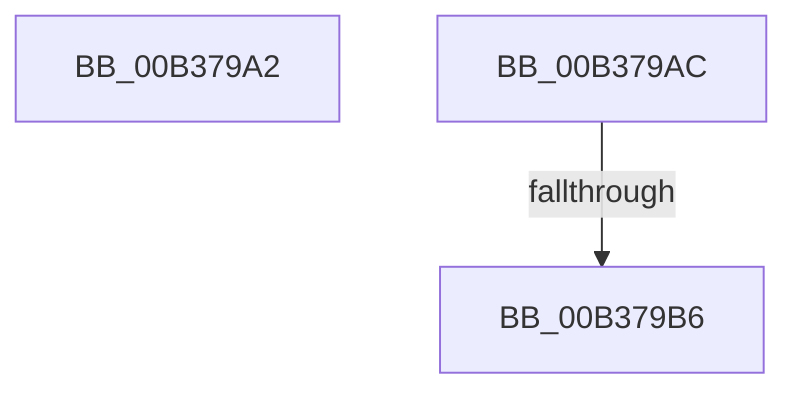

# sub_00B379A2

- RVA: `0x00B379A2`–`0x00B379CA` (길이 `40` bytes)
- VA: `0x0000000140B379A2`
- 실행 섹션: `PAGE`
- PDB 이름 있음: `아니요`; PDB Function 태그: `아니요`
- unwind 정보 RVA: `0x000AAF60`
- 디코드: `9`개 명령, `40/40` bytes 표시
- 미해석 바이트: `0` (있으면 어셈블리에 `.byte`로 보존)

> 이 문서는 커널 이미지의 기계어와 PDB 기호를 분석해 생성했습니다. 4번과 5번은 함수 원형과 자료형을 바이너리 사용 방식에서 추정한 C 해석이며 원본 소스 복구 결과는 아닙니다.

## 1. Dependencies

- 직접 호출 지점: **0**; 고유 호출 대상: **0**
- 직접 호출자로 확인된 함수: **0**
- RIP 상대 이미지 참조: **0**

### Outgoing calls
- 직접 디코드된 call 명령이 없습니다.

### Direct callers
- 이 함수 시작 RVA로 연결되는 직접 call은 확인되지 않았습니다. 간접 호출은 완전히 역산할 수 없습니다.

### Static image references
- 디코드된 RIP-relative 메모리 참조가 없습니다.

## 2. Other-region calls and transfers

- 다른 실행 섹션으로 향하는 call: **0**
- call이 아닌 외부 분기/꼬리 이동: **3**
  - `0x00B379A7` → [RtlRunOnceBeginInitialize + 0x4F](../A2/RtlRunOnceBeginInitialize_function_00A20E60.md) (`tail-transfer`)
  - `0x00B379B0` → [RtlRunOnceBeginInitialize + 0x43](../A2/RtlRunOnceBeginInitialize_function_00A20E60.md) (`tail-transfer`)
  - `0x00B379C5` → [RtlRunOnceBeginInitialize + 0x4F](../A2/RtlRunOnceBeginInitialize_function_00A20E60.md) (`tail-transfer`)

## 3. Assembly (complete function range)

```asm
00B379A2  BF F0 00 00 C0                  mov edi, 0xc00000f0
00B379A7  E9 03 95 EE FF                  jmp 0x140a20eaf
00B379AC  48 83 F9 03                     cmp rcx, 3
00B379B0  0F 85 ED 94 EE FF               jne 0x140a20ea3
00B379B6  F7 DB                           neg ebx
00B379B8  1B C0                           sbb eax, eax
00B379BA  25 13 00 00 40                  and eax, 0x40000013
00B379BF  8D B8 F0 00 00 C0               lea edi, [rax - 0x3fffff10]
00B379C5  E9 E5 94 EE FF                  jmp 0x140a20eaf
```

## 4. C-style interpretation (structured pseudocode)

```c
__int64 __fastcall sub_00B379A2(__int64 a1)
{
}
```

## 5. (Beta) C Style

```c
int64_t sub_00B379A2(int64_t Arg1)
{
}
```

## 6. Execution-region graph

[열기: 2D/3D 그래프와 함수 탐색 컨트롤 패널](../../../control-panel.html?section=page&rva=0x00B379A2&view=graph)

- 2D 그래프는 위에서 아래로 흐르고, 3D 그래프는 빈 공간을 드래그해 회전합니다. Shift+드래그는 이동, 휠은 확대·축소, 함수 노드 선택은 대상 보고서 이동입니다.

### Static fallback


