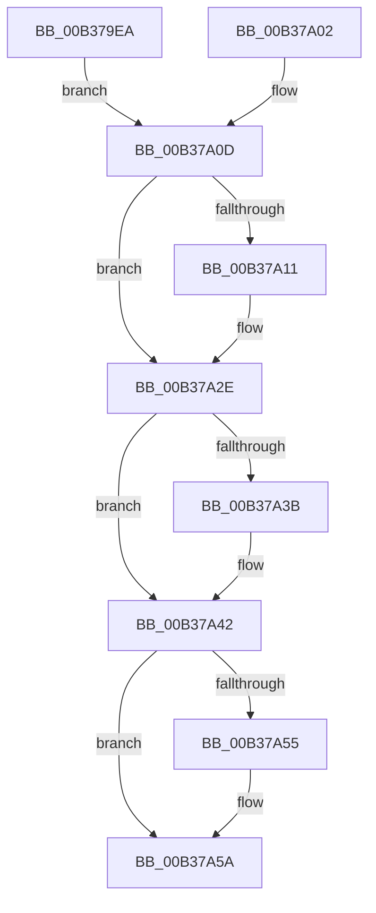

# sub_00B379EA

- RVA: `0x00B379EA`–`0x00B37A61` (길이 `119` bytes)
- VA: `0x0000000140B379EA`
- 실행 섹션: `PAGE`
- PDB 이름 있음: `아니요`; PDB Function 태그: `아니요`
- unwind 정보 RVA: `0x000AB2C8`
- 디코드: `30`개 명령, `119/119` bytes 표시
- 미해석 바이트: `0` (있으면 어셈블리에 `.byte`로 보존)

> 이 문서는 커널 이미지의 기계어와 PDB 기호를 분석해 생성했습니다. 4번과 5번은 함수 원형과 자료형을 바이너리 사용 방식에서 추정한 C 해석이며 원본 소스 복구 결과는 아닙니다.

## 1. Dependencies

- 직접 호출 지점: **5**; 고유 호출 대상: **5**
- 직접 호출자로 확인된 함수: **0**
- RIP 상대 이미지 참조: **0**

### Outgoing calls
- `0x00B379F5` → [SepProbeAndCaptureString_U](../97/SepProbeAndCaptureString_U_function_00975070.md) (function, `0x00975070`)
- `0x00B37A29` → [SepAdtCloseObjectAuditAlarm](../86/SepAdtCloseObjectAuditAlarm_function_0086B4E8.md) (function, `0x0086B4E8`)
- `0x00B37A3D` → [ExFreePoolWithTag](../../poolcode/B8/ExFreePoolWithTag_function_00B82870.md) (function, `0x00B82870`)
- `0x00B37A47` → [SeReleaseSubjectContext](../86/SeReleaseSubjectContext_function_0086B710.md) (function, `0x0086B710`)
- `0x00B37A55` → [SepAuditFailed](../86/SepAuditFailed_function_0086EE20.md) (function, `0x0086EE20`)

### Direct callers
- 이 함수 시작 RVA로 연결되는 직접 call은 확인되지 않았습니다. 간접 호출은 완전히 역산할 수 없습니다.

### Static image references
- 디코드된 RIP-relative 메모리 참조가 없습니다.

## 2. Other-region calls and transfers

- 다른 실행 섹션으로 향하는 call: **1**
  - `0x00B37A3D` → [ExFreePoolWithTag](../../poolcode/B8/ExFreePoolWithTag_function_00B82870.md) (`PAGE` → `POOLCODE`)
- call이 아닌 외부 분기/꼬리 이동: **1**
  - `0x00B37A5C` → [NtCloseObjectAuditAlarm + 0x41](../A2/NtCloseObjectAuditAlarm_function_00A21E60.md) (`tail-transfer`)

## 3. Assembly (complete function range)

```asm
00B379EA  48 8D 94 24 88 00 00 00         lea rdx, [rsp + 0x88]
00B379F2  48 8B CB                        mov rcx, rbx
00B379F5  E8 76 D6 E3 FF                  call 0x140975070
00B379FA  8B D8                           mov ebx, eax
00B379FC  89 44 24 30                     mov dword ptr [rsp + 0x30], eax
00B37A00  EB 0B                           jmp 0x140b37a0d
00B37A02  8B D8                           mov ebx, eax
00B37A04  89 44 24 30                     mov dword ptr [rsp + 0x30], eax
00B37A08  48 8B 7C 24 78                  mov rdi, qword ptr [rsp + 0x78]
00B37A0D  85 DB                           test ebx, ebx
00B37A0F  78 1D                           js 0x140b37a2e
00B37A11  C6 44 24 20 00                  mov byte ptr [rsp + 0x20], 0
00B37A16  45 33 C9                        xor r9d, r9d
00B37A19  4C 8D 44 24 38                  lea r8, [rsp + 0x38]
00B37A1E  48 8B D7                        mov rdx, rdi
00B37A21  48 8B 8C 24 88 00 00 00         mov rcx, qword ptr [rsp + 0x88]
00B37A29  E8 BA 3A D3 FF                  call 0x14086b4e8
00B37A2E  48 8B 8C 24 88 00 00 00         mov rcx, qword ptr [rsp + 0x88]
00B37A36  48 85 C9                        test rcx, rcx
00B37A39  74 07                           je 0x140b37a42
00B37A3B  33 D2                           xor edx, edx
00B37A3D  E8 2E AE 04 00                  call 0x140b82870
00B37A42  48 8D 4C 24 38                  lea rcx, [rsp + 0x38]
00B37A47  E8 C4 3C D3 FF                  call 0x14086b710
00B37A4C  B9 9A 00 00 C0                  mov ecx, 0xc000009a
00B37A51  3B D9                           cmp ebx, ecx
00B37A53  75 05                           jne 0x140b37a5a
00B37A55  E8 C6 73 D3 FF                  call 0x14086ee20
00B37A5A  8B C3                           mov eax, ebx
00B37A5C  E9 40 A4 EE FF                  jmp 0x140a21ea1
```

## 4. C-style interpretation (structured pseudocode)

```c
__int64 __fastcall sub_00B379EA(__int64 a1, __int64 a2, __int64 a3, int a4, __int64 a5, __int64 a6, __int64 a7, __int64 a8, __int64 a9, __int64 a10, __int64 a11, __int64 a12, __int64 a13, __int64 a14, __int64 a15, __int64 a16, __int64 a17)
{
    __int64 result;
    unsigned __int8 v_stack_p20;
    unsigned int v_stack_p30;
    unsigned __int64 v_stack_p78;

    result = SepProbeAndCaptureString_U(v_rbx, a17, a3, a4);
    v_stack_p30 = (unsigned int)(result);
    goto loc_00B37A0D;
loc_00B37A0D:
    if (!(sign_flag)) {
        v_stack_p20 = 0;
        a4 = 0;
        a3 = a7;
        a2 = v_rdi;
        a1 = a17;
        result = SepAdtCloseObjectAuditAlarm(a1, a2, a3, a4);
    }
    if (a17 != 0) {
        a2 = 0;
        result = ExFreePoolWithTag(a17, a2, a3, a4);
    }
    result = SeReleaseSubjectContext(a7, a2, a3, a4);
    if (((unsigned int)((unsigned int)((unsigned int)(result)))) == ((unsigned int)((unsigned int)(0xC000009AULL)))) {
        result = SepAuditFailed((unsigned int)(0xC000009AULL), a2, a3, a4);
    }
}
```

## 5. (Beta) C Style

```c
int64_t sub_00B379EA(int64_t Arg1, int64_t Arg2, int64_t Arg3, int32_t Arg4, uint64_t Arg5, uint64_t Arg6, int64_t Arg7, uint64_t Arg8, uint64_t Arg9, uint64_t Arg10, uint64_t Arg11, uint64_t Arg12, uint64_t Arg13, uint64_t Arg14, uint64_t Arg15, uint64_t Arg16, int64_t Arg17)
{
    int64_t result;
    uint8_t v_stack_p20;
    uint32_t v_stack_p30;
    uint64_t v_stack_p78;

    result = SepProbeAndCaptureString_U(local_rbx, Arg17, Arg3, Arg4);
    v_stack_p30 = (uint32_t)(result);
    goto loc_00B37A0D;
loc_00B37A0D:
    if (!(sign_flag)) {
        v_stack_p20 = 0;
        Arg4 = 0;
        Arg3 = Arg7;
        Arg2 = local_rdi;
        Arg1 = Arg17;
        result = SepAdtCloseObjectAuditAlarm(Arg1, Arg2, Arg3, Arg4);
    }
    if (Arg17 != 0) {
        Arg2 = 0;
        result = ExFreePoolWithTag(Arg17, Arg2, Arg3, Arg4);
    }
    result = SeReleaseSubjectContext(Arg7, Arg2, Arg3, Arg4);
    if (((uint32_t)((uint32_t)((uint32_t)(result)))) == ((uint32_t)((uint32_t)(0xC000009AULL)))) {
        result = SepAuditFailed((uint32_t)(0xC000009AULL), Arg2, Arg3, Arg4);
    }
}
```

## 6. Execution-region graph

[열기: 2D/3D 그래프와 함수 탐색 컨트롤 패널](../../../control-panel.html?section=page&rva=0x00B379EA&view=graph)

- 2D 그래프는 위에서 아래로 흐르고, 3D 그래프는 빈 공간을 드래그해 회전합니다. Shift+드래그는 이동, 휠은 확대·축소, 함수 노드 선택은 대상 보고서 이동입니다.

### Static fallback


