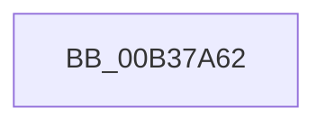

# sub_00B37A62

- RVA: `0x00B37A62`–`0x00B37A78` (길이 `22` bytes)
- VA: `0x0000000140B37A62`
- 실행 섹션: `PAGE`
- PDB 이름 있음: `아니요`; PDB Function 태그: `아니요`
- unwind 정보 RVA: `0x000AB490`
- 디코드: `6`개 명령, `22/22` bytes 표시
- 미해석 바이트: `0` (있으면 어셈블리에 `.byte`로 보존)

> 이 문서는 커널 이미지의 기계어와 PDB 기호를 분석해 생성했습니다. 4번과 5번은 함수 원형과 자료형을 바이너리 사용 방식에서 추정한 C 해석이며 원본 소스 복구 결과는 아닙니다.

## 1. Dependencies

- 직접 호출 지점: **0**; 고유 호출 대상: **0**
- 직접 호출자로 확인된 함수: **0**
- RIP 상대 이미지 참조: **0**

### Outgoing calls
- 직접 디코드된 call 명령이 없습니다.

### Direct callers
- 이 함수 시작 RVA로 연결되는 직접 call은 확인되지 않았습니다. 간접 호출은 완전히 역산할 수 없습니다.

### Static image references
- 디코드된 RIP-relative 메모리 참조가 없습니다.

## 2. Other-region calls and transfers

- 다른 실행 섹션으로 향하는 call: **0**
- call이 아닌 외부 분기/꼬리 이동: **1**
  - `0x00B37A73` → [LdrResFallbackLangList + 0x14B](../A2/LdrResFallbackLangList_function_00A21F1C.md) (`tail-transfer`)

## 3. Assembly (complete function range)

```asm
00B37A62  0F B7 4D 38                     movzx ecx, word ptr [rbp + 0x38]
00B37A66  83 C8 FF                        or eax, 0xffffffff
00B37A69  44 8B D6                        mov r10d, esi
00B37A6C  66 85 C9                        test cx, cx
00B37A6F  44 0F 44 D0                     cmove r10d, eax
00B37A73  E9 EF A5 EE FF                  jmp 0x140a22067
```

## 4. C-style interpretation (structured pseudocode)

```c
__int64 __fastcall sub_00B37A62(void)
{
    __int64 result;
    __int64 v_r10;

    result = (unsigned int)((result) | (0xFFFFFFFFULL));
    v_r10 = (unsigned int)((unsigned int)(v_rsi));
    if ((unsigned __int16)(*(unsigned __int16 *)(v_rbp + 56)) == 0) { v_r10 = (unsigned int)(result); }
}
```

## 5. (Beta) C Style

```c
void sub_00B37A62(void)
{
    int64_t result;
    int64_t local_r10;

    result = (uint32_t)((result) | (0xFFFFFFFFULL));
    local_r10 = (uint32_t)((uint32_t)(local_rsi));
    if ((uint16_t)(*(uint16_t *)(local_rbp + 0x38)) == 0) { local_r10 = (uint32_t)(result); }
}
```

## 6. Execution-region graph

[열기: 2D/3D 그래프와 함수 탐색 컨트롤 패널](../../../control-panel.html?section=page&rva=0x00B37A62&view=graph)

- 2D 그래프는 위에서 아래로 흐르고, 3D 그래프는 빈 공간을 드래그해 회전합니다. Shift+드래그는 이동, 휠은 확대·축소, 함수 노드 선택은 대상 보고서 이동입니다.

### Static fallback


