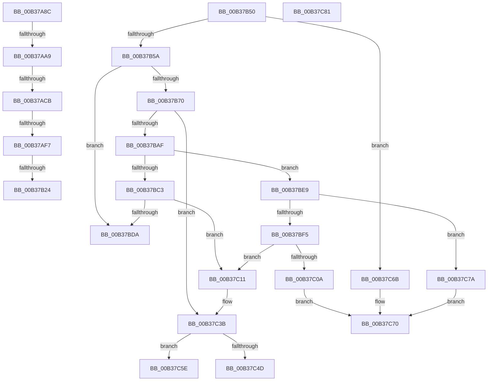

# sub_00B37A8C

- RVA: `0x00B37A8C`–`0x00B37C99` (길이 `525` bytes)
- VA: `0x0000000140B37A8C`
- 실행 섹션: `PAGE`
- PDB 이름 있음: `아니요`; PDB Function 태그: `아니요`
- unwind 정보 RVA: `0x000AB764`
- 디코드: `133`개 명령, `525/525` bytes 표시
- 미해석 바이트: `0` (있으면 어셈블리에 `.byte`로 보존)

> 이 문서는 커널 이미지의 기계어와 PDB 기호를 분석해 생성했습니다. 4번과 5번은 함수 원형과 자료형을 바이너리 사용 방식에서 추정한 C 해석이며 원본 소스 복구 결과는 아닙니다.

## 1. Dependencies

- 직접 호출 지점: **15**; 고유 호출 대상: **8**
- 직접 호출자로 확인된 함수: **0**
- RIP 상대 이미지 참조: **3**

### Outgoing calls
- `0x00B37A9C` → [strnicmp](../../text/4F/strnicmp_function_004FFE30.md) (function, `0x004FFE30`)
- `0x00B37AB9` → [strnicmp](../../text/4F/strnicmp_function_004FFE30.md) (function, `0x004FFE30`)
- `0x00B37AEA` → [RtlCompareUnicodeStrings](../97/RtlCompareUnicodeStrings_function_009727E0.md) (function, `0x009727E0`)
- `0x00B37B10` → [MiAllocatePool](../../text/35/MiAllocatePool_function_0035B540.md) (function, `0x0035B540`)
- `0x00B37B2F` → [RtlAppendUnicodeStringToString](../../text/40/RtlAppendUnicodeStringToString_function_0040FA50.md) (function, `0x0040FA50`)
- `0x00B37B3C` → [RtlAppendUnicodeStringToString](../../text/40/RtlAppendUnicodeStringToString_function_0040FA50.md) (function, `0x0040FA50`)
- `0x00B37B65` → [MiFormFullImageName](../7F/MiFormFullImageName_function_007F7FC4.md) (function, `0x007F7FC4`)
- `0x00B37B9D` → [MmLoadSystemImageEx](../99/MmLoadSystemImageEx_function_00999B8C.md) (function, `0x00999B8C`)
- `0x00B37BB5` → [ExFreePoolWithTag](../../poolcode/B8/ExFreePoolWithTag_function_00B82870.md) (function, `0x00B82870`)
- `0x00B37BCF` → [MiFormFullImageName](../7F/MiFormFullImageName_function_007F7FC4.md) (function, `0x007F7FC4`)
- `0x00B37C01` → [MiFormFullImageName](../7F/MiFormFullImageName_function_007F7FC4.md) (function, `0x007F7FC4`)
- `0x00B37C34` → [MmLoadSystemImageEx](../99/MmLoadSystemImageEx_function_00999B8C.md) (function, `0x00999B8C`)
- `0x00B37C41` → [ExFreePoolWithTag](../../poolcode/B8/ExFreePoolWithTag_function_00B82870.md) (function, `0x00B82870`)
- `0x00B37C84` → [MiDereferenceImports](../7F/MiDereferenceImports_function_007F7DB4.md) (function, `0x007F7DB4`)
- `0x00B37C8E` → [ExFreePoolWithTag](../../poolcode/B8/ExFreePoolWithTag_function_00B82870.md) (function, `0x00B82870`)

### Direct callers
- 이 함수 시작 RVA로 연결되는 직접 call은 확인되지 않았습니다. 간접 호출은 완전히 역산할 수 없습니다.

### Static image references
- `0x00B37A92` → RVA `0x00B09D60` (` ?? ::NNGAKEGL::`string'`; read)
- `0x00B37AAF` → RVA `0x00B09D50` (` ?? ::NNGAKEGL::`string'`; read)
- `0x00B37ADB` → RVA `0x00B09D70` (` ?? ::NNGAKEGL::`string'`; read)

## 2. Other-region calls and transfers

- 다른 실행 섹션으로 향하는 call: **8**
  - `0x00B37A9C` → [strnicmp](../../text/4F/strnicmp_function_004FFE30.md) (`PAGE` → `.text`)
  - `0x00B37AB9` → [strnicmp](../../text/4F/strnicmp_function_004FFE30.md) (`PAGE` → `.text`)
  - `0x00B37B10` → [MiAllocatePool](../../text/35/MiAllocatePool_function_0035B540.md) (`PAGE` → `.text`)
  - `0x00B37B2F` → [RtlAppendUnicodeStringToString](../../text/40/RtlAppendUnicodeStringToString_function_0040FA50.md) (`PAGE` → `.text`)
  - `0x00B37B3C` → [RtlAppendUnicodeStringToString](../../text/40/RtlAppendUnicodeStringToString_function_0040FA50.md) (`PAGE` → `.text`)
  - `0x00B37BB5` → [ExFreePoolWithTag](../../poolcode/B8/ExFreePoolWithTag_function_00B82870.md) (`PAGE` → `POOLCODE`)
  - `0x00B37C41` → [ExFreePoolWithTag](../../poolcode/B8/ExFreePoolWithTag_function_00B82870.md) (`PAGE` → `POOLCODE`)
  - `0x00B37C8E` → [ExFreePoolWithTag](../../poolcode/B8/ExFreePoolWithTag_function_00B82870.md) (`PAGE` → `POOLCODE`)
- call이 아닌 외부 분기/꼬리 이동: **10**
  - `0x00B37AA3` → [MiResolveImageReferences + 0x199](../A2/MiResolveImageReferences_function_00A23BE4.md) (`tail-transfer`)
  - `0x00B37AC5` → [MiResolveImageReferences + 0x19E](../A2/MiResolveImageReferences_function_00A23BE4.md) (`tail-transfer`)
  - `0x00B37AF1` → [MiResolveImageReferences + 0x19E](../A2/MiResolveImageReferences_function_00A23BE4.md) (`tail-transfer`)
  - `0x00B37B1E` → [MiResolveImageReferences + 0x3D0](../A2/MiResolveImageReferences_function_00A23BE4.md) (`tail-transfer`)
  - `0x00B37B4B` → [MiResolveImageReferences + 0x1A7](../A2/MiResolveImageReferences_function_00A23BE4.md) (`tail-transfer`)
  - `0x00B37BE4` → [MiResolveImageReferences + 0x3D5](../A2/MiResolveImageReferences_function_00A23BE4.md) (`tail-transfer`)
  - `0x00B37C59` → [MiResolveImageReferences + 0x21F](../A2/MiResolveImageReferences_function_00A23BE4.md) (`tail-transfer`)
  - `0x00B37C66` → [MiResolveImageReferences + 0x33D](../A2/MiResolveImageReferences_function_00A23BE4.md) (`tail-transfer`)
  - `0x00B37C75` → [MiResolveImageReferences + 0x3EB](../A2/MiResolveImageReferences_function_00A23BE4.md) (`tail-transfer`)
  - `0x00B37C94` → [MiResolveImageReferences + 0x377](../A2/MiResolveImageReferences_function_00A23BE4.md) (`tail-transfer`)

## 3. Assembly (complete function range)

```asm
00B37A8C  41 B8 08 00 00 00               mov r8d, 8
00B37A92  48 8D 15 C7 22 FD FF            lea rdx, [rip - 0x2dd39]
00B37A99  48 8B CF                        mov rcx, rdi
00B37A9C  E8 8F 83 9C FF                  call 0x1404ffe30
00B37AA1  85 C0                           test eax, eax
00B37AA3  0F 84 D4 C2 EE FF               je 0x140a23d7d
00B37AA9  41 B8 03 00 00 00               mov r8d, 3
00B37AAF  48 8D 15 9A 22 FD FF            lea rdx, [rip - 0x2dd66]
00B37AB6  48 8B CF                        mov rcx, rdi
00B37AB9  E8 72 83 9C FF                  call 0x1404ffe30
00B37ABE  BF 01 00 00 00                  mov edi, 1
00B37AC3  85 C0                           test eax, eax
00B37AC5  0F 84 B7 C2 EE FF               je 0x140a23d82
00B37ACB  0F B7 5D 8F                     movzx ebx, word ptr [rbp - 0x71]
00B37ACF  44 8D 4F 13                     lea r9d, [rdi + 0x13]
00B37AD3  8B D3                           mov edx, ebx
00B37AD5  49 D1 E9                        shr r9, 1
00B37AD8  48 D1 EA                        shr rdx, 1
00B37ADB  4C 8D 05 8E 22 FD FF            lea r8, [rip - 0x2dd72]
00B37AE2  48 8B CE                        mov rcx, rsi
00B37AE5  40 88 7C 24 20                  mov byte ptr [rsp + 0x20], dil
00B37AEA  E8 F1 AC E3 FF                  call 0x1409727e0
00B37AEF  85 C0                           test eax, eax
00B37AF1  0F 84 8B C2 EE FF               je 0x140a23d82
00B37AF7  48 8B 7D 77                     mov rdi, qword ptr [rbp + 0x77]
00B37AFB  B9 00 01 00 00                  mov ecx, 0x100
00B37B00  41 B8 4D 6D 44 54               mov r8d, 0x54446d4d
00B37B06  66 03 1F                        add bx, word ptr [rdi]
00B37B09  0F B7 D3                        movzx edx, bx
00B37B0C  66 89 55 B1                     mov word ptr [rbp - 0x4f], dx
00B37B10  E8 2B 3A 82 FF                  call 0x14035b540
00B37B15  33 C9                           xor ecx, ecx
00B37B17  48 89 45 B7                     mov qword ptr [rbp - 0x49], rax
00B37B1B  48 85 C0                        test rax, rax
00B37B1E  0F 84 90 C4 EE FF               je 0x140a23fb4
00B37B24  66 89 4D AF                     mov word ptr [rbp - 0x51], cx
00B37B28  48 8B D7                        mov rdx, rdi
00B37B2B  48 8D 4D AF                     lea rcx, [rbp - 0x51]
00B37B2F  E8 1C 7F 8D FF                  call 0x14040fa50
00B37B34  48 8D 55 8F                     lea rdx, [rbp - 0x71]
00B37B38  48 8D 4D AF                     lea rcx, [rbp - 0x51]
00B37B3C  E8 0F 7F 8D FF                  call 0x14040fa50
00B37B41  BF 01 00 00 00                  mov edi, 1
00B37B46  40 88 7C 24 40                  mov byte ptr [rsp + 0x40], dil
00B37B4B  E9 3B C2 EE FF                  jmp 0x140a23d8b
00B37B50  44 39 45 7F                     cmp dword ptr [rbp + 0x7f], r8d
00B37B54  0F 85 11 01 00 00               jne 0x140b37c6b
00B37B5A  4C 8D 45 BF                     lea r8, [rbp - 0x41]
00B37B5E  49 8B CE                        mov rcx, r14
00B37B61  48 8D 55 8F                     lea rdx, [rbp - 0x71]
00B37B65  E8 5A 04 CC FF                  call 0x1407f7fc4
00B37B6A  33 C9                           xor ecx, ecx
00B37B6C  85 C0                           test eax, eax
00B37B6E  74 6A                           je 0x140b37bda
00B37B70  8B 7D 87                        mov edi, dword ptr [rbp - 0x79]
00B37B73  48 8D 45 EF                     lea rax, [rbp - 0x11]
00B37B77  4C 8B 7D 77                     mov r15, qword ptr [rbp + 0x77]
00B37B7B  48 8D 4D BF                     lea rcx, [rbp - 0x41]
00B37B7F  48 89 44 24 30                  mov qword ptr [rsp + 0x30], rax
00B37B84  83 CF 08                        or edi, 8
00B37B87  48 8D 45 CF                     lea rax, [rbp - 0x31]
00B37B8B  45 33 C9                        xor r9d, r9d
00B37B8E  48 89 44 24 28                  mov qword ptr [rsp + 0x28], rax
00B37B93  45 33 C0                        xor r8d, r8d
00B37B96  49 8B D7                        mov rdx, r15
00B37B99  89 7C 24 20                     mov dword ptr [rsp + 0x20], edi
00B37B9D  E8 EA 1F E6 FF                  call 0x140999b8c
00B37BA2  8B D8                           mov ebx, eax
00B37BA4  3D 34 00 00 C0                  cmp eax, 0xc0000034
00B37BA9  0F 85 8C 00 00 00               jne 0x140b37c3b
00B37BAF  48 8B 4D C7                     mov rcx, qword ptr [rbp - 0x39]
00B37BB3  33 D2                           xor edx, edx
00B37BB5  E8 B6 AC 04 00                  call 0x140b82870
00B37BBA  48 8D 45 DF                     lea rax, [rbp - 0x21]
00B37BBE  4C 3B F0                        cmp r14, rax
00B37BC1  74 26                           je 0x140b37be9
00B37BC3  4C 8D 45 BF                     lea r8, [rbp - 0x41]
00B37BC7  48 8D 55 8F                     lea rdx, [rbp - 0x71]
00B37BCB  48 8D 4D DF                     lea rcx, [rbp - 0x21]
00B37BCF  E8 F0 03 CC FF                  call 0x1407f7fc4
00B37BD4  33 C9                           xor ecx, ecx
00B37BD6  85 C0                           test eax, eax
00B37BD8  75 37                           jne 0x140b37c11
00B37BDA  4C 8B 7C 24 50                  mov r15, qword ptr [rsp + 0x50]
00B37BDF  BB 9A 00 00 C0                  mov ebx, 0xc000009a
00B37BE4  E9 D0 C3 EE FF                  jmp 0x140a23fb9
00B37BE9  33 DB                           xor ebx, ebx
00B37BEB  38 5C 24 41                     cmp byte ptr [rsp + 0x41], bl
00B37BEF  0F 84 85 00 00 00               je 0x140b37c7a
00B37BF5  48 8B 4D 6F                     mov rcx, qword ptr [rbp + 0x6f]
00B37BF9  4C 8D 45 BF                     lea r8, [rbp - 0x41]
00B37BFD  48 8D 55 8F                     lea rdx, [rbp - 0x71]
00B37C01  E8 BE 03 CC FF                  call 0x1407f7fc4
00B37C06  85 C0                           test eax, eax
00B37C08  75 07                           jne 0x140b37c11
00B37C0A  BB 9A 00 00 C0                  mov ebx, 0xc000009a
00B37C0F  EB 5F                           jmp 0x140b37c70
00B37C11  48 8D 45 EF                     lea rax, [rbp - 0x11]
00B37C15  45 33 C9                        xor r9d, r9d
00B37C18  48 89 44 24 30                  mov qword ptr [rsp + 0x30], rax
00B37C1D  48 8D 4D BF                     lea rcx, [rbp - 0x41]
00B37C21  48 8D 45 CF                     lea rax, [rbp - 0x31]
00B37C25  45 33 C0                        xor r8d, r8d
00B37C28  48 89 44 24 28                  mov qword ptr [rsp + 0x28], rax
00B37C2D  49 8B D7                        mov rdx, r15
00B37C30  89 7C 24 20                     mov dword ptr [rsp + 0x20], edi
00B37C34  E8 53 1F E6 FF                  call 0x140999b8c
00B37C39  8B D8                           mov ebx, eax
00B37C3B  48 8B 4D C7                     mov rcx, qword ptr [rbp - 0x39]
00B37C3F  33 D2                           xor edx, edx
00B37C41  E8 2A AC 04 00                  call 0x140b82870
00B37C46  45 33 C0                        xor r8d, r8d
00B37C49  85 DB                           test ebx, ebx
00B37C4B  78 11                           js 0x140b37c5e
00B37C4D  48 8B 5D CF                     mov rbx, qword ptr [rbp - 0x31]
00B37C51  41 8D 78 01                     lea edi, [r8 + 1]
00B37C55  4C 8B 7B 30                     mov r15, qword ptr [rbx + 0x30]
00B37C59  E9 A5 C1 EE FF                  jmp 0x140a23e03
00B37C5E  4C 8B 7C 24 50                  mov r15, qword ptr [rsp + 0x50]
00B37C63  49 8B C0                        mov rax, r8
00B37C66  E9 B6 C2 EE FF                  jmp 0x140a23f21
00B37C6B  BB 6F 03 00 C0                  mov ebx, 0xc000036f
00B37C70  4C 8B 7C 24 50                  mov r15, qword ptr [rsp + 0x50]
00B37C75  E9 55 C3 EE FF                  jmp 0x140a23fcf
00B37C7A  BB 34 00 00 C0                  mov ebx, 0xc0000034
00B37C7F  EB EF                           jmp 0x140b37c70
00B37C81  49 8B CD                        mov rcx, r13
00B37C84  E8 2B 01 CC FF                  call 0x1407f7db4
00B37C89  33 D2                           xor edx, edx
00B37C8B  49 8B CD                        mov rcx, r13
00B37C8E  E8 DD AB 04 00                  call 0x140b82870
00B37C93  90                              nop
00B37C94  E9 C2 C2 EE FF                  jmp 0x140a23f5b
```

## 4. C-style interpretation (structured pseudocode)

```c
__int64 __fastcall sub_00B37A8C(void)
{
    __int64 result;
    __int64 v_rbx;
    unsigned __int8 v_stack_p20;
    unsigned __int64 v_stack_p28;
    unsigned __int64 v_stack_p30;
    unsigned __int8 v_stack_p40;
    unsigned __int8 v_stack_p41;
    unsigned __int64 v_stack_p50;

    result = strnicmp(v_rdi, v_rip - 187705, 8, a4);
    result = strnicmp(v_rdi, v_rip - 187750, 3, a4);
    a4 = (1 + 19) >> (1);
    a2 = ((unsigned int)((unsigned int)(*(unsigned __int16 *)(v_rbp - 113)))) >> (1);
    v_stack_p20 = 1;
    result = RtlCompareUnicodeStrings(v_rsi, a2, v_rip - 187762, a4);
    v_rbx = (unsigned __int16)((*(unsigned __int16 *)(v_rbp - 113)) + (*(unsigned __int16 *)(*(unsigned __int64 *)(v_rbp + 119))));
    *(unsigned __int16 *)(v_rbp - 79) = (unsigned __int16)((unsigned __int16)(v_rbx));
    result = MiAllocatePool(256, (unsigned __int16)(v_rbx), (unsigned int)(0x54446D4DULL), a4);
    a1 = 0;
    *(unsigned __int64 *)(v_rbp - 73) = result;
    *(unsigned __int16 *)(v_rbp - 81) = 0;
    result = RtlAppendUnicodeStringToString(v_rbp - 81, *(unsigned __int64 *)(v_rbp + 119), (unsigned int)(0x54446D4DULL), a4);
    result = RtlAppendUnicodeStringToString(v_rbp - 81, v_rbp - 113, (unsigned int)(0x54446D4DULL), a4);
    v_stack_p40 = 1;
}
```

## 5. (Beta) C Style

```c
void sub_00B37A8C(void)
{
    int64_t result;
    int64_t local_rbx;
    uint8_t v_stack_p20;
    uint64_t v_stack_p28;
    uint64_t v_stack_p30;
    uint8_t v_stack_p40;
    uint8_t v_stack_p41;
    uint64_t v_stack_p50;

    result = strnicmp(local_rdi, v_rip - 187705, 8, a4);
    result = strnicmp(local_rdi, v_rip - 187750, 3, a4);
    a4 = (1 + 19) >> (1);
    a2 = ((uint32_t)((uint32_t)(*(uint16_t *)(local_rbp - 0x71)))) >> (1);
    v_stack_p20 = 1;
    result = RtlCompareUnicodeStrings(local_rsi, a2, v_rip - 187762, a4);
    local_rbx = (uint16_t)((*(uint16_t *)(local_rbp - 0x71)) + (*(uint16_t *)(*(uint64_t *)(local_rbp + 0x77))));
    *(uint16_t *)(local_rbp - 0x4F) = (uint16_t)((uint16_t)(local_rbx));
    result = MiAllocatePool(256, (uint16_t)(local_rbx), (uint32_t)(0x54446D4DULL), a4);
    a1 = 0;
    *(uint64_t *)(local_rbp - 0x49) = result;
    *(uint16_t *)(local_rbp - 0x51) = 0;
    result = RtlAppendUnicodeStringToString(local_rbp - 81, *(uint64_t *)(local_rbp + 0x77), (uint32_t)(0x54446D4DULL), a4);
    result = RtlAppendUnicodeStringToString(local_rbp - 81, local_rbp - 113, (uint32_t)(0x54446D4DULL), a4);
    v_stack_p40 = 1;
}
```

## 6. Execution-region graph

[열기: 2D/3D 그래프와 함수 탐색 컨트롤 패널](../../../control-panel.html?section=page&rva=0x00B37A8C&view=graph)

- 2D 그래프는 위에서 아래로 흐르고, 3D 그래프는 빈 공간을 드래그해 회전합니다. Shift+드래그는 이동, 휠은 확대·축소, 함수 노드 선택은 대상 보고서 이동입니다.

### Static fallback


