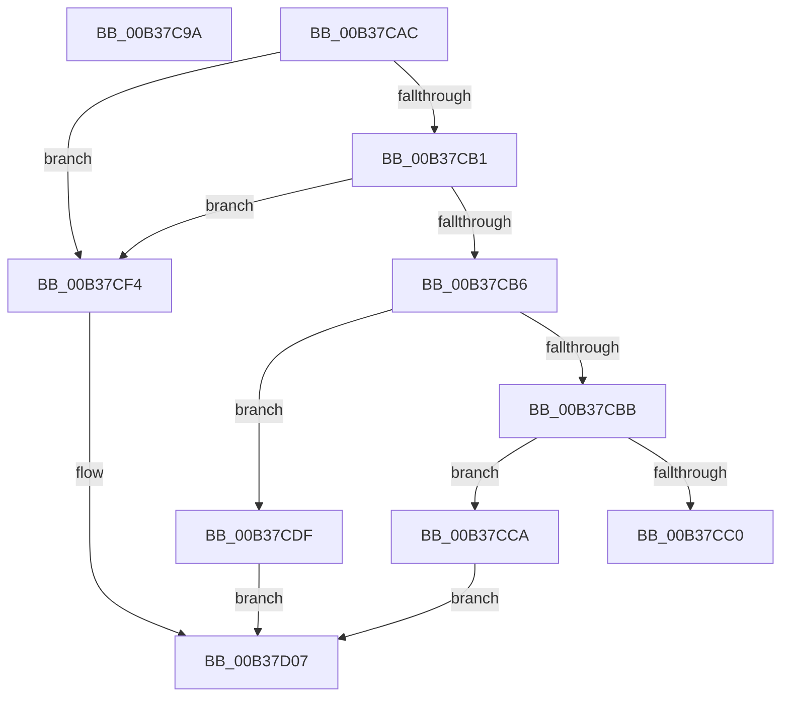

# sub_00B37C9A

- RVA: `0x00B37C9A`–`0x00B37D12` (길이 `120` bytes)
- VA: `0x0000000140B37C9A`
- 실행 섹션: `PAGE`
- PDB 이름 있음: `아니요`; PDB Function 태그: `아니요`
- unwind 정보 RVA: `0x000AB928`
- 디코드: `34`개 명령, `120/120` bytes 표시
- 미해석 바이트: `0` (있으면 어셈블리에 `.byte`로 보존)

> 이 문서는 커널 이미지의 기계어와 PDB 기호를 분석해 생성했습니다. 4번과 5번은 함수 원형과 자료형을 바이너리 사용 방식에서 추정한 C 해석이며 원본 소스 복구 결과는 아닙니다.

## 1. Dependencies

- 직접 호출 지점: **3**; 고유 호출 대상: **3**
- 직접 호출자로 확인된 함수: **0**
- RIP 상대 이미지 참조: **0**

### Outgoing calls
- `0x00B37CD8` → [ExpTranslateEfiPath](../A7/ExpTranslateEfiPath_function_00A7AF84.md) (function, `0x00A7AF84`)
- `0x00B37CED` → [ExpTranslateNtPath](../7C/ExpTranslateNtPath_function_007CCEF4.md) (function, `0x007CCEF4`)
- `0x00B37D02` → [ExpTranslateArcPath](../7C/ExpTranslateArcPath_function_007CCA6C.md) (function, `0x007CCA6C`)

### Direct callers
- 이 함수 시작 RVA로 연결되는 직접 call은 확인되지 않았습니다. 간접 호출은 완전히 역산할 수 없습니다.

### Static image references
- 디코드된 RIP-relative 메모리 참조가 없습니다.

## 2. Other-region calls and transfers

- 다른 실행 섹션으로 향하는 call: **0**
- call이 아닌 외부 분기/꼬리 이동: **3**
  - `0x00B37CA7` → [NtTranslateFilePath + 0x234](../A2/NtTranslateFilePath_function_00A24D50.md) (`tail-transfer`)
  - `0x00B37CC5` → [NtTranslateFilePath + 0x234](../A2/NtTranslateFilePath_function_00A24D50.md) (`tail-transfer`)
  - `0x00B37D0D` → [NtTranslateFilePath + 0x234](../A2/NtTranslateFilePath_function_00A24D50.md) (`tail-transfer`)

## 3. Assembly (complete function range)

```asm
00B37C9A  BB 23 00 00 C0                  mov ebx, 0xc0000023
00B37C9F  41 8B FF                        mov edi, r15d
00B37CA2  44 89 7C 24 24                  mov dword ptr [rsp + 0x24], r15d
00B37CA7  E9 D8 D2 EE FF                  jmp 0x140a24f84
00B37CAC  83 E8 01                        sub eax, 1
00B37CAF  74 43                           je 0x140b37cf4
00B37CB1  83 E8 01                        sub eax, 1
00B37CB4  74 3E                           je 0x140b37cf4
00B37CB6  83 E8 01                        sub eax, 1
00B37CB9  74 24                           je 0x140b37cdf
00B37CBB  83 F8 01                        cmp eax, 1
00B37CBE  74 0A                           je 0x140b37cca
00B37CC0  BB 0D 00 00 C0                  mov ebx, 0xc000000d
00B37CC5  E9 BA D2 EE FF                  jmp 0x140a24f84
00B37CCA  4C 8D 4C 24 24                  lea r9, [rsp + 0x24]
00B37CCF  4C 8B C6                        mov r8, rsi
00B37CD2  41 8B D5                        mov edx, r13d
00B37CD5  49 8B CE                        mov rcx, r14
00B37CD8  E8 A7 32 F4 FF                  call 0x140a7af84
00B37CDD  EB 28                           jmp 0x140b37d07
00B37CDF  4C 8D 4C 24 24                  lea r9, [rsp + 0x24]
00B37CE4  4C 8B C6                        mov r8, rsi
00B37CE7  41 8B D5                        mov edx, r13d
00B37CEA  49 8B CE                        mov rcx, r14
00B37CED  E8 02 52 C9 FF                  call 0x1407ccef4
00B37CF2  EB 13                           jmp 0x140b37d07
00B37CF4  4C 8D 4C 24 24                  lea r9, [rsp + 0x24]
00B37CF9  4C 8B C6                        mov r8, rsi
00B37CFC  41 8B D5                        mov edx, r13d
00B37CFF  49 8B CE                        mov rcx, r14
00B37D02  E8 65 4D C9 FF                  call 0x1407cca6c
00B37D07  8B D8                           mov ebx, eax
00B37D09  8B 7C 24 24                     mov edi, dword ptr [rsp + 0x24]
00B37D0D  E9 72 D2 EE FF                  jmp 0x140a24f84
```

## 4. C-style interpretation (structured pseudocode)

```c
__int64 __fastcall sub_00B37C9A(void)
{
    unsigned int v_stack_p24;

    v_stack_p24 = (unsigned int)(v_r15);
}
```

## 5. (Beta) C Style

```c
void sub_00B37C9A(void)
{
    uint32_t v_stack_p24;

    v_stack_p24 = (uint32_t)(local_r15);
}
```

## 6. Execution-region graph

[열기: 2D/3D 그래프와 함수 탐색 컨트롤 패널](../../../control-panel.html?section=page&rva=0x00B37C9A&view=graph)

- 2D 그래프는 위에서 아래로 흐르고, 3D 그래프는 빈 공간을 드래그해 회전합니다. Shift+드래그는 이동, 휠은 확대·축소, 함수 노드 선택은 대상 보고서 이동입니다.

### Static fallback


