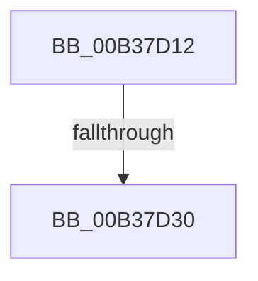

# sub_00B37D12

- RVA: `0x00B37D12`–`0x00B37D3A` (길이 `40` bytes)
- VA: `0x0000000140B37D12`
- 실행 섹션: `PAGE`
- PDB 이름 있음: `아니요`; PDB Function 태그: `아니요`
- unwind 정보 RVA: `0x000AB994`
- 디코드: `9`개 명령, `40/40` bytes 표시
- 미해석 바이트: `0` (있으면 어셈블리에 `.byte`로 보존)

> 이 문서는 커널 이미지의 기계어와 PDB 기호를 분석해 생성했습니다. 4번과 5번은 함수 원형과 자료형을 바이너리 사용 방식에서 추정한 C 해석이며 원본 소스 복구 결과는 아닙니다.

## 1. Dependencies

- 직접 호출 지점: **1**; 고유 호출 대상: **1**
- 직접 호출자로 확인된 함수: **0**
- RIP 상대 이미지 참조: **0**

### Outgoing calls
- `0x00B37D1F` → [ExAllocatePool2](../../poolcode/B8/ExAllocatePool2_function_00B820F0.md) (function, `0x00B820F0`)

### Direct callers
- 이 함수 시작 RVA로 연결되는 직접 call은 확인되지 않았습니다. 간접 호출은 완전히 역산할 수 없습니다.

### Static image references
- 디코드된 RIP-relative 메모리 참조가 없습니다.

## 2. Other-region calls and transfers

- 다른 실행 섹션으로 향하는 call: **1**
  - `0x00B37D1F` → [ExAllocatePool2](../../poolcode/B8/ExAllocatePool2_function_00B820F0.md) (`PAGE` → `POOLCODE`)
- call이 아닌 외부 분기/꼬리 이동: **2**
  - `0x00B37D2A` → [NtEnumerateBootEntries + 0x163](../A2/NtEnumerateBootEntries_function_00A25040.md) (`tail-transfer`)
  - `0x00B37D35` → [NtEnumerateBootEntries + 0x18F](../A2/NtEnumerateBootEntries_function_00A25040.md) (`tail-transfer`)

## 3. Assembly (complete function range)

```asm
00B37D12  8B D0                           mov edx, eax
00B37D14  B9 40 00 00 00                  mov ecx, 0x40
00B37D19  41 B8 45 6E 76 72               mov r8d, 0x72766e45
00B37D1F  E8 CC A3 04 00                  call 0x140b820f0
00B37D24  4C 8B F8                        mov r15, rax
00B37D27  48 85 C0                        test rax, rax
00B37D2A  0F 85 73 D4 EE FF               jne 0x140a251a3
00B37D30  BF 9A 00 00 C0                  mov edi, 0xc000009a
00B37D35  E9 95 D4 EE FF                  jmp 0x140a251cf
```

## 4. C-style interpretation (structured pseudocode)

```c
__int64 __fastcall sub_00B37D12(void)
{
    __int64 result;

    result = ExAllocatePool2(64, (unsigned int)((unsigned int)(result)), (unsigned int)(0x72766E45ULL), a4);
}
```

## 5. (Beta) C Style

```c
void sub_00B37D12(void)
{
    int64_t result;

    result = ExAllocatePool2(64, (uint32_t)((uint32_t)(result)), (uint32_t)(0x72766E45ULL), a4);
}
```

## 6. Execution-region graph

[열기: 2D/3D 그래프와 함수 탐색 컨트롤 패널](../../../control-panel.html?section=page&rva=0x00B37D12&view=graph)

- 2D 그래프는 위에서 아래로 흐르고, 3D 그래프는 빈 공간을 드래그해 회전합니다. Shift+드래그는 이동, 휠은 확대·축소, 함수 노드 선택은 대상 보고서 이동입니다.

### Static fallback


