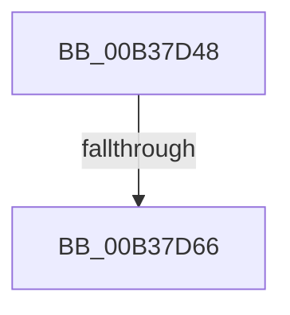

# sub_00B37D48

- RVA: `0x00B37D48`–`0x00B37DEE` (길이 `166` bytes)
- VA: `0x0000000140B37D48`
- 실행 섹션: `PAGE`
- PDB 이름 있음: `아니요`; PDB Function 태그: `아니요`
- unwind 정보 RVA: `0x000AB9D4`
- 디코드: `38`개 명령, `166/166` bytes 표시
- 미해석 바이트: `0` (있으면 어셈블리에 `.byte`로 보존)

> 이 문서는 커널 이미지의 기계어와 PDB 기호를 분석해 생성했습니다. 4번과 5번은 함수 원형과 자료형을 바이너리 사용 방식에서 추정한 C 해석이며 원본 소스 복구 결과는 아닙니다.

## 1. Dependencies

- 직접 호출 지점: **2**; 고유 호출 대상: **2**
- 직접 호출자로 확인된 함수: **0**
- RIP 상대 이미지 참조: **2**

### Outgoing calls
- `0x00B37D59` → [tlgKeywordOn](../../text/42/tlgKeywordOn_function_0042EAA0.md) (function, `0x0042EAA0`)
- `0x00B37DE3` → [tlgWriteTransfer_EtwWriteTransfer](../../text/42/tlgWriteTransfer_EtwWriteTransfer_function_004260E0.md) (function, `0x004260E0`)

### Direct callers
- 이 함수 시작 RVA로 연결되는 직접 call은 확인되지 않았습니다. 간접 호출은 완전히 역산할 수 없습니다.

### Static image references
- `0x00B37D52` → RVA `0x00E06ED8` (`.data`; read)
- `0x00B37DC2` → RVA `0x00046AF7` (`.rdata`; read)

## 2. Other-region calls and transfers

- 다른 실행 섹션으로 향하는 call: **2**
  - `0x00B37D59` → [tlgKeywordOn](../../text/42/tlgKeywordOn_function_0042EAA0.md) (`PAGE` → `.text`)
  - `0x00B37DE3` → [tlgWriteTransfer_EtwWriteTransfer](../../text/42/tlgWriteTransfer_EtwWriteTransfer_function_004260E0.md) (`PAGE` → `.text`)
- call이 아닌 외부 분기/꼬리 이동: **2**
  - `0x00B37D60` → [IoEnumerateEnvironmentVariablesEx + 0x90](../A2/IoEnumerateEnvironmentVariablesEx_function_00A2592C.md) (`tail-transfer`)
  - `0x00B37DE9` → [IoEnumerateEnvironmentVariablesEx + 0x90](../A2/IoEnumerateEnvironmentVariablesEx_function_00A2592C.md) (`tail-transfer`)

## 3. Assembly (complete function range)

```asm
00B37D48  48 BA 00 00 00 00 00 20 00 00   movabs rdx, 0x200000000000
00B37D52  48 8D 0D 7F F1 2C 00            lea rcx, [rip + 0x2cf17f]
00B37D59  E8 42 6D 8F FF                  call 0x14042eaa0
00B37D5E  84 C0                           test al, al
00B37D60  0F 84 56 DC EE FF               je 0x140a259bc
00B37D66  83 65 E3 00                     and dword ptr [rbp - 0x1d], 0
00B37D6A  48 8D 45 9F                     lea rax, [rbp - 0x61]
00B37D6E  83 65 F3 00                     and dword ptr [rbp - 0xd], 0
00B37D72  48 8D 0D 5F F1 2C 00            lea rcx, [rip + 0x2cf15f]
00B37D79  83 65 03 00                     and dword ptr [rbp + 3], 0
00B37D7D  BA 04 00 00 00                  mov edx, 4
00B37D82  48 89 45 D7                     mov qword ptr [rbp - 0x29], rax
00B37D86  4D 85 F6                        test r14, r14
00B37D89  41 8B 07                        mov eax, dword ptr [r15]
00B37D8C  89 45 A7                        mov dword ptr [rbp - 0x59], eax
00B37D8F  0F 95 45 97                     setne byte ptr [rbp - 0x69]
00B37D93  83 65 13 00                     and dword ptr [rbp + 0x13], 0
00B37D97  48 8D 45 A7                     lea rax, [rbp - 0x59]
00B37D9B  48 89 45 E7                     mov qword ptr [rbp - 0x19], rax
00B37D9F  45 33 C9                        xor r9d, r9d
00B37DA2  48 8D 45 AF                     lea rax, [rbp - 0x51]
00B37DA6  89 55 DF                        mov dword ptr [rbp - 0x21], edx
00B37DA9  48 89 45 F7                     mov qword ptr [rbp - 9], rax
00B37DAD  45 33 C0                        xor r8d, r8d
00B37DB0  48 8D 45 97                     lea rax, [rbp - 0x69]
00B37DB4  89 55 EF                        mov dword ptr [rbp - 0x11], edx
00B37DB7  48 89 45 07                     mov qword ptr [rbp + 7], rax
00B37DBB  48 8D 45 B7                     lea rax, [rbp - 0x49]
00B37DBF  89 55 FF                        mov dword ptr [rbp - 1], edx
00B37DC2  48 8D 15 2E ED 50 FF            lea rdx, [rip - 0xaf12d2]
00B37DC9  48 89 44 24 28                  mov qword ptr [rsp + 0x28], rax
00B37DCE  C7 44 24 20 06 00 00 00         mov dword ptr [rsp + 0x20], 6
00B37DD6  89 75 9F                        mov dword ptr [rbp - 0x61], esi
00B37DD9  89 5D AF                        mov dword ptr [rbp - 0x51], ebx
00B37DDC  C7 45 0F 01 00 00 00            mov dword ptr [rbp + 0xf], 1
00B37DE3  E8 F8 E2 8E FF                  call 0x1404260e0
00B37DE8  90                              nop
00B37DE9  E9 CE DB EE FF                  jmp 0x140a259bc
```

## 4. C-style interpretation (structured pseudocode)

```c
__int64 __fastcall sub_00B37D48(__int64 a1, __int64 a2, int a3, int a4)
{
    __int64 result;
    unsigned int v_stack_p20;
    unsigned __int64 v_stack_p28;

    result = tlgKeywordOn(v_rip + 2945407, a2, a3, a4);
    *(unsigned __int64 *)(v_rbp - 41) = v_rbp - 97;
    *(unsigned int *)(v_rbp - 89) = (unsigned int)((unsigned int)(*(unsigned int *)(v_r15)));
    *(unsigned __int64 *)(v_rbp - 25) = v_rbp - 89;
    a4 = 0;
    *(unsigned int *)(v_rbp - 33) = 4;
    *(unsigned __int64 *)(v_rbp - 9) = v_rbp - 81;
    a3 = 0;
    *(unsigned int *)(v_rbp - 17) = 4;
    *(unsigned __int64 *)(v_rbp + 7) = v_rbp - 105;
    *(unsigned int *)(v_rbp - 1) = 4;
    v_stack_p28 = v_rbp - 73;
    v_stack_p20 = 6;
    *(unsigned int *)(v_rbp - 97) = (unsigned int)(v_rsi);
    *(unsigned int *)(v_rbp - 81) = (unsigned int)(v_rbx);
    *(unsigned int *)(v_rbp + 15) = 1;
    result = tlgWriteTransfer_EtwWriteTransfer(v_rip + 2945375, v_rip - 11473618, a3, a4);
}
```

## 5. (Beta) C Style

```c
int64_t sub_00B37D48(int64_t Arg1, int64_t Arg2, int32_t Arg3, int32_t Arg4)
{
    int64_t result;
    uint32_t v_stack_p20;
    uint64_t v_stack_p28;

    result = tlgKeywordOn(v_rip + 2945407, Arg2, Arg3, Arg4);
    *(uint64_t *)(local_rbp - 0x29) = local_rbp - 97;
    *(uint32_t *)(local_rbp - 0x59) = (uint32_t)((uint32_t)(*(uint32_t *)(local_r15)));
    *(uint64_t *)(local_rbp - 0x19) = local_rbp - 89;
    Arg4 = 0;
    *(uint32_t *)(local_rbp - 0x21) = 4;
    *(uint64_t *)(local_rbp - 0x9) = local_rbp - 81;
    Arg3 = 0;
    *(uint32_t *)(local_rbp - 0x11) = 4;
    *(uint64_t *)(local_rbp + 0x7) = local_rbp - 105;
    *(uint32_t *)(local_rbp - 0x1) = 4;
    v_stack_p28 = local_rbp - 73;
    v_stack_p20 = 6;
    *(uint32_t *)(local_rbp - 0x61) = (uint32_t)(local_rsi);
    *(uint32_t *)(local_rbp - 0x51) = (uint32_t)(local_rbx);
    *(uint32_t *)(local_rbp + 0xF) = 1;
    result = tlgWriteTransfer_EtwWriteTransfer(v_rip + 2945375, v_rip - 11473618, Arg3, Arg4);
}
```

## 6. Execution-region graph

[열기: 2D/3D 그래프와 함수 탐색 컨트롤 패널](../../../control-panel.html?section=page&rva=0x00B37D48&view=graph)

- 2D 그래프는 위에서 아래로 흐르고, 3D 그래프는 빈 공간을 드래그해 회전합니다. Shift+드래그는 이동, 휠은 확대·축소, 함수 노드 선택은 대상 보고서 이동입니다.

### Static fallback


