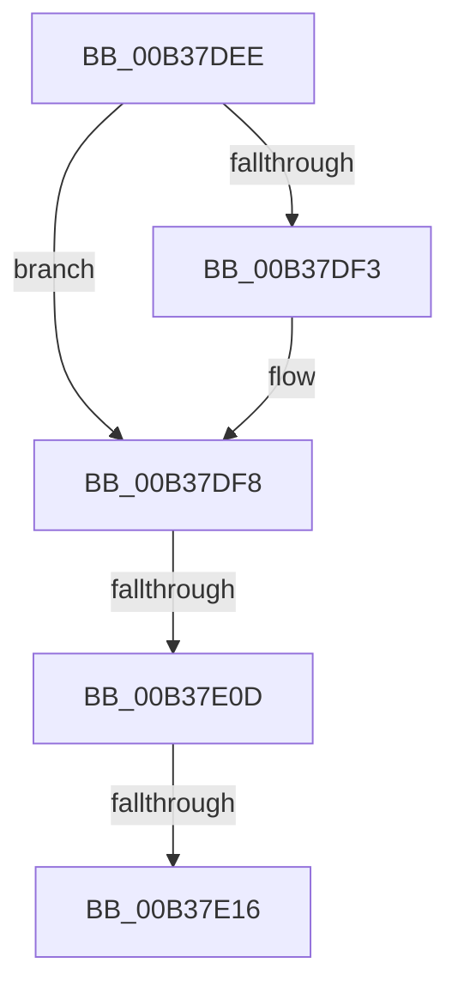

# sub_00B37DEE

- RVA: `0x00B37DEE`–`0x00B37E29` (길이 `59` bytes)
- VA: `0x0000000140B37DEE`
- 실행 섹션: `PAGE`
- PDB 이름 있음: `아니요`; PDB Function 태그: `아니요`
- unwind 정보 RVA: `0x000ABC24`
- 디코드: `15`개 명령, `59/59` bytes 표시
- 미해석 바이트: `0` (있으면 어셈블리에 `.byte`로 보존)

> 이 문서는 커널 이미지의 기계어와 PDB 기호를 분석해 생성했습니다. 4번과 5번은 함수 원형과 자료형을 바이너리 사용 방식에서 추정한 C 해석이며 원본 소스 복구 결과는 아닙니다.

## 1. Dependencies

- 직접 호출 지점: **0**; 고유 호출 대상: **0**
- 직접 호출자로 확인된 함수: **0**
- RIP 상대 이미지 참조: **0**

### Outgoing calls
- 직접 디코드된 call 명령이 없습니다.

### Direct callers
- 이 함수 시작 RVA로 연결되는 직접 call은 확인되지 않았습니다. 간접 호출은 완전히 역산할 수 없습니다.

### Static image references
- 디코드된 RIP-relative 메모리 참조가 없습니다.

## 2. Other-region calls and transfers

- 다른 실행 섹션으로 향하는 call: **0**
- call이 아닌 외부 분기/꼬리 이동: **3**
  - `0x00B37E07` → [RtlpFlsSetValueSlot + 0xEB](../A2/RtlpFlsSetValueSlot_function_00A25AB4.md) (`tail-transfer`)
  - `0x00B37E10` → [RtlpFlsSetValueSlot + 0xEB](../A2/RtlpFlsSetValueSlot_function_00A25AB4.md) (`tail-transfer`)
  - `0x00B37E24` → [RtlpFlsSetValueSlot + 0x16F](../A2/RtlpFlsSetValueSlot_function_00A25AB4.md) (`tail-transfer`)

## 3. Assembly (complete function range)

```asm
00B37DEE  4D 85 F6                        test r14, r14
00B37DF1  74 05                           je 0x140b37df8
00B37DF3  41 C6 46 0A 01                  mov byte ptr [r14 + 0xa], 1
00B37DF8  48 83 26 00                     and qword ptr [rsi], 0
00B37DFC  48 8B 0F                        mov rcx, qword ptr [rdi]
00B37DFF  48 8B 47 08                     mov rax, qword ptr [rdi + 8]
00B37E03  48 39 79 08                     cmp qword ptr [rcx + 8], rdi
00B37E07  0F 85 92 DD EE FF               jne 0x140a25b9f
00B37E0D  48 39 38                        cmp qword ptr [rax], rdi
00B37E10  0F 85 89 DD EE FF               jne 0x140a25b9f
00B37E16  48 89 08                        mov qword ptr [rax], rcx
00B37E19  48 89 41 08                     mov qword ptr [rcx + 8], rax
00B37E1D  48 89 7F 08                     mov qword ptr [rdi + 8], rdi
00B37E21  48 89 3F                        mov qword ptr [rdi], rdi
00B37E24  E9 FA DD EE FF                  jmp 0x140a25c23
```

## 4. C-style interpretation (structured pseudocode)

```c
__int64 __fastcall sub_00B37DEE(void)
{
    if (v_r14 != 0) {
        *(unsigned __int8 *)(v_r14 + 10) = 1;
    }
    *(unsigned __int64 *)(*(unsigned __int64 *)(v_rdi + 8)) = *(unsigned __int64 *)(v_rdi);
    *(unsigned __int64 *)(*(unsigned __int64 *)(v_rdi) + 8) = *(unsigned __int64 *)(v_rdi + 8);
    *(unsigned __int64 *)(v_rdi + 8) = v_rdi;
    *(unsigned __int64 *)(v_rdi) = v_rdi;
}
```

## 5. (Beta) C Style

```c
void sub_00B37DEE(void)
{
    if (local_r14 != 0) {
        *(uint8_t *)(local_r14 + 0xA) = 1;
    }
    *(uint64_t *)(*(uint64_t *)(local_rdi + 0x8)) = *(uint64_t *)(local_rdi);
    *(uint64_t *)(*(uint64_t *)(local_rdi) + 0x8) = *(uint64_t *)(local_rdi + 0x8);
    *(uint64_t *)(local_rdi + 0x8) = local_rdi;
    *(uint64_t *)(local_rdi) = local_rdi;
}
```

## 6. Execution-region graph

[열기: 2D/3D 그래프와 함수 탐색 컨트롤 패널](../../../control-panel.html?section=page&rva=0x00B37DEE&view=graph)

- 2D 그래프는 위에서 아래로 흐르고, 3D 그래프는 빈 공간을 드래그해 회전합니다. Shift+드래그는 이동, 휠은 확대·축소, 함수 노드 선택은 대상 보고서 이동입니다.

### Static fallback


