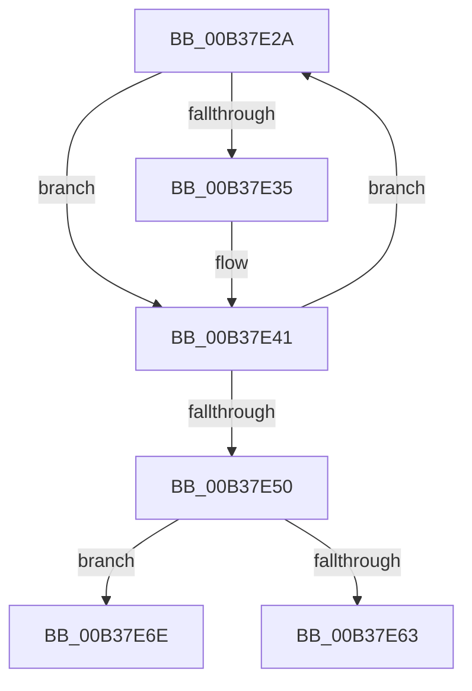

# sub_00B37E2A

- RVA: `0x00B37E2A`–`0x00B37E79` (길이 `79` bytes)
- VA: `0x0000000140B37E2A`
- 실행 섹션: `PAGE`
- PDB 이름 있음: `아니요`; PDB Function 태그: `아니요`
- unwind 정보 RVA: `0x000ABE38`
- 디코드: `22`개 명령, `79/79` bytes 표시
- 미해석 바이트: `0` (있으면 어셈블리에 `.byte`로 보존)

> 이 문서는 커널 이미지의 기계어와 PDB 기호를 분석해 생성했습니다. 4번과 5번은 함수 원형과 자료형을 바이너리 사용 방식에서 추정한 C 해석이며 원본 소스 복구 결과는 아닙니다.

## 1. Dependencies

- 직접 호출 지점: **3**; 고유 호출 대상: **3**
- 직접 호출자로 확인된 함수: **0**
- RIP 상대 이미지 참조: **0**

### Outgoing calls
- `0x00B37E38` → [HvFreeCell](../85/HvFreeCell_function_0085A72C.md) (function, `0x0085A72C`)
- `0x00B37E63` → [HvpReleaseCellFlat](../85/HvpReleaseCellFlat_function_0085CC20.md) (function, `0x0085CC20`)
- `0x00B37E6E` → [HvpReleaseCellPaged](../85/HvpReleaseCellPaged_function_00855F40.md) (function, `0x00855F40`)

### Direct callers
- 이 함수 시작 RVA로 연결되는 직접 call은 확인되지 않았습니다. 간접 호출은 완전히 역산할 수 없습니다.

### Static image references
- 디코드된 RIP-relative 메모리 참조가 없습니다.

## 2. Other-region calls and transfers

- 다른 실행 섹션으로 향하는 call: **0**
- call이 아닌 외부 분기/꼬리 이동: **2**
  - `0x00B37E69` → [CmpSetValueDataNew + 0x262](../A2/CmpSetValueDataNew_function_00A26550.md) (`tail-transfer`)
  - `0x00B37E74` → [CmpSetValueDataNew + 0x262](../A2/CmpSetValueDataNew_function_00A26550.md) (`tail-transfer`)

## 3. Assembly (complete function range)

```asm
00B37E2A  0F B7 C0                        movzx eax, ax
00B37E2D  8B 14 81                        mov edx, dword ptr [rcx + rax*4]
00B37E30  83 FA FF                        cmp edx, -1
00B37E33  74 0C                           je 0x140b37e41
00B37E35  48 8B CB                        mov rcx, rbx
00B37E38  E8 EF 28 D2 FF                  call 0x14085a72c
00B37E3D  48 8B 4D E0                     mov rcx, qword ptr [rbp - 0x20]
00B37E41  41 0F B7 47 02                  movzx eax, word ptr [r15 + 2]
00B37E46  66 2B C7                        sub ax, di
00B37E49  66 41 89 47 02                  mov word ptr [r15 + 2], ax
00B37E4E  75 DA                           jne 0x140b37e2a
00B37E50  48 8D B3 8C 00 00 00            lea rsi, [rbx + 0x8c]
00B37E57  48 8B CB                        mov rcx, rbx
00B37E5A  48 8D 55 D0                     lea rdx, [rbp - 0x30]
00B37E5E  40 84 3E                        test byte ptr [rsi], dil
00B37E61  74 0B                           je 0x140b37e6e
00B37E63  E8 B8 4D D2 FF                  call 0x14085cc20
00B37E68  90                              nop
00B37E69  E9 44 E9 EE FF                  jmp 0x140a267b2
00B37E6E  E8 CD E0 D1 FF                  call 0x140855f40
00B37E73  90                              nop
00B37E74  E9 39 E9 EE FF                  jmp 0x140a267b2
```

## 4. C-style interpretation (structured pseudocode)

```c
__int64 __fastcall sub_00B37E2A(__int64 a1)
{
    __int64 result;

    result = (unsigned __int16)(result);
    if (((unsigned int)((unsigned int)(*(unsigned int *)(a1 + (unsigned __int16)(result) * 4)))) != -1) {
        a1 = v_rbx;
        result = HvFreeCell(a1, (unsigned int)(*(unsigned int *)(a1 + (unsigned __int16)(result) * 4)), a3, a4);
        a1 = *(unsigned __int64 *)(v_rbp - 32);
    }
    result = (unsigned __int16)((*(unsigned __int16 *)(v_r15 + 2)) - ((unsigned __int16)(v_rdi)));
    *(unsigned __int16 *)(v_r15 + 2) = (unsigned __int16)(result);
    if (condition_is_not_equal) goto loc_00B37E2A;
    if (((*(unsigned __int8 *)(v_rbx + 140)) & ((unsigned __int8)(v_rdi))) == 0) goto loc_00B37E6E;
    result = HvpReleaseCellFlat(v_rbx, v_rbp - 48, a3, a4);
loc_00B37E6E:
    result = HvpReleaseCellPaged(v_rbx, v_rbp - 48, a3, a4);
}
```

## 5. (Beta) C Style

```c
int64_t sub_00B37E2A(int64_t Arg1)
{
    int64_t result;

    result = (uint16_t)(result);
    if (((uint32_t)((uint32_t)(*(uint32_t *)(Arg1 + (uint16_t)(result) * 4)))) != -1) {
        Arg1 = local_rbx;
        result = HvFreeCell(Arg1, (uint32_t)(*(uint32_t *)(Arg1 + (uint16_t)(result) * 4)), a3, a4);
        Arg1 = *(uint64_t *)(local_rbp - 0x20);
    }
    result = (uint16_t)((*(uint16_t *)(local_r15 + 0x2)) - ((uint16_t)(local_rdi)));
    *(uint16_t *)(local_r15 + 0x2) = (uint16_t)(result);
    if (condition_is_not_equal) goto loc_00B37E2A;
    if (((*(uint8_t *)(local_rbx + 0x8C)) & ((uint8_t)(local_rdi))) == 0) goto loc_00B37E6E;
    result = HvpReleaseCellFlat(local_rbx, local_rbp - 48, a3, a4);
loc_00B37E6E:
    result = HvpReleaseCellPaged(local_rbx, local_rbp - 48, a3, a4);
}
```

## 6. Execution-region graph

[열기: 2D/3D 그래프와 함수 탐색 컨트롤 패널](../../../control-panel.html?section=page&rva=0x00B37E2A&view=graph)

- 2D 그래프는 위에서 아래로 흐르고, 3D 그래프는 빈 공간을 드래그해 회전합니다. Shift+드래그는 이동, 휠은 확대·축소, 함수 노드 선택은 대상 보고서 이동입니다.

### Static fallback


