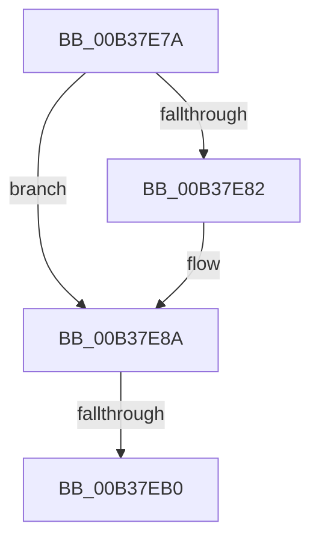

# sub_00B37E7A

- RVA: `0x00B37E7A`–`0x00B37EB8` (길이 `62` bytes)
- VA: `0x0000000140B37E7A`
- 실행 섹션: `PAGE`
- PDB 이름 있음: `아니요`; PDB Function 태그: `아니요`
- unwind 정보 RVA: `0x000ABE64`
- 디코드: `17`개 명령, `62/62` bytes 표시
- 미해석 바이트: `0` (있으면 어셈블리에 `.byte`로 보존)

> 이 문서는 커널 이미지의 기계어와 PDB 기호를 분석해 생성했습니다. 4번과 5번은 함수 원형과 자료형을 바이너리 사용 방식에서 추정한 C 해석이며 원본 소스 복구 결과는 아닙니다.

## 1. Dependencies

- 직접 호출 지점: **0**; 고유 호출 대상: **0**
- 직접 호출자로 확인된 함수: **0**
- RIP 상대 이미지 참조: **0**

### Outgoing calls
- 직접 디코드된 call 명령이 없습니다.

### Direct callers
- 이 함수 시작 RVA로 연결되는 직접 call은 확인되지 않았습니다. 간접 호출은 완전히 역산할 수 없습니다.

### Static image references
- 디코드된 RIP-relative 메모리 참조가 없습니다.

## 2. Other-region calls and transfers

- 다른 실행 섹션으로 향하는 call: **0**
- call이 아닌 외부 분기/꼬리 이동: **2**
  - `0x00B37EAA` → [PspSchedulerSharedDataRegionSlotAllocate + 0x1F9](../A2/PspSchedulerSharedDataRegionSlotAllocate_function_00A268C8.md) (`tail-transfer`)
  - `0x00B37EB3` → [PspSchedulerSharedDataRegionSlotAllocate + 0x1F9](../A2/PspSchedulerSharedDataRegionSlotAllocate_function_00A268C8.md) (`tail-transfer`)

## 3. Assembly (complete function range)

```asm
00B37E7A  4D 8B C4                        mov r8, r12
00B37E7D  4D 85 F6                        test r14, r14
00B37E80  74 08                           je 0x140b37e8a
00B37E82  41 C6 46 0A 01                  mov byte ptr [r14 + 0xa], 1
00B37E87  4C 8B C0                        mov r8, rax
00B37E8A  49 8B D7                        mov rdx, r15
00B37E8D  41 8B C7                        mov eax, r15d
00B37E90  48 C1 EA 03                     shr rdx, 3
00B37E94  83 E0 07                        and eax, 7
00B37E97  48 03 97 D8 00 00 00            add rdx, qword ptr [rdi + 0xd8]
00B37E9E  0F BE 0A                        movsx ecx, byte ptr [rdx]
00B37EA1  0F B3 C1                        btr ecx, eax
00B37EA4  88 0A                           mov byte ptr [rdx], cl
00B37EA6  45 39 3C 24                     cmp dword ptr [r12], r15d
00B37EAA  0F 86 11 EC EE FF               jbe 0x140a26ac1
00B37EB0  45 89 38                        mov dword ptr [r8], r15d
00B37EB3  E9 09 EC EE FF                  jmp 0x140a26ac1
```

## 4. C-style interpretation (structured pseudocode)

```c
__int64 __fastcall sub_00B37E7A(void)
{
    __int64 result;

    if (v_r14 != 0) {
        *(unsigned __int8 *)(v_r14 + 10) = 1;
        a3 = result;
    }
    a2 = (v_r15) >> (3);
    result = (unsigned int)(((unsigned int)((unsigned int)(v_r15))) & (7));
    a2 = (a2) + (*(unsigned __int64 *)(v_rdi + 216));
    *(unsigned __int8 *)(a2) = (unsigned __int8)((__int8)(*(unsigned __int8 *)(a2)));
    *(unsigned int *)(a3) = (unsigned int)(v_r15);
}
```

## 5. (Beta) C Style

```c
void sub_00B37E7A(void)
{
    int64_t result;

    if (local_r14 != 0) {
        *(uint8_t *)(local_r14 + 0xA) = 1;
        a3 = result;
    }
    a2 = (local_r15) >> (3);
    result = (uint32_t)(((uint32_t)((uint32_t)(local_r15))) & (7));
    a2 = (a2) + (*(uint64_t *)(local_rdi + 0xD8));
    *(uint8_t *)(a2) = (uint8_t)((int8_t)(*(uint8_t *)(a2)));
    *(uint32_t *)(a3) = (uint32_t)(local_r15);
}
```

## 6. Execution-region graph

[열기: 2D/3D 그래프와 함수 탐색 컨트롤 패널](../../../control-panel.html?section=page&rva=0x00B37E7A&view=graph)

- 2D 그래프는 위에서 아래로 흐르고, 3D 그래프는 빈 공간을 드래그해 회전합니다. Shift+드래그는 이동, 휠은 확대·축소, 함수 노드 선택은 대상 보고서 이동입니다.

### Static fallback


