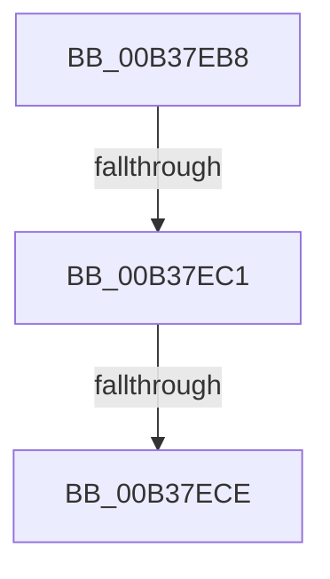

# sub_00B37EB8

- RVA: `0x00B37EB8`–`0x00B37F04` (길이 `76` bytes)
- VA: `0x0000000140B37EB8`
- 실행 섹션: `PAGE`
- PDB 이름 있음: `아니요`; PDB Function 태그: `아니요`
- unwind 정보 RVA: `0x000ABEBC`
- 디코드: `19`개 명령, `76/76` bytes 표시
- 미해석 바이트: `0` (있으면 어셈블리에 `.byte`로 보존)

> 이 문서는 커널 이미지의 기계어와 PDB 기호를 분석해 생성했습니다. 4번과 5번은 함수 원형과 자료형을 바이너리 사용 방식에서 추정한 C 해석이며 원본 소스 복구 결과는 아닙니다.

## 1. Dependencies

- 직접 호출 지점: **1**; 고유 호출 대상: **1**
- 직접 호출자로 확인된 함수: **0**
- RIP 상대 이미지 참조: **0**

### Outgoing calls
- `0x00B37EF9` → [RtlSetBits](../../text/3E/RtlSetBits_function_003E1610.md) (function, `0x003E1610`)

### Direct callers
- 이 함수 시작 RVA로 연결되는 직접 call은 확인되지 않았습니다. 간접 호출은 완전히 역산할 수 없습니다.

### Static image references
- 디코드된 RIP-relative 메모리 참조가 없습니다.

## 2. Other-region calls and transfers

- 다른 실행 섹션으로 향하는 call: **1**
  - `0x00B37EF9` → [RtlSetBits](../../text/3E/RtlSetBits_function_003E1610.md) (`PAGE` → `.text`)
- call이 아닌 외부 분기/꼬리 이동: **3**
  - `0x00B37EBB` → [RtlMarkExceptionHandlingPages + 0x190](../A2/RtlMarkExceptionHandlingPages_function_00A26D60.md) (`tail-transfer`)
  - `0x00B37EC8` → [RtlMarkExceptionHandlingPages + 0x190](../A2/RtlMarkExceptionHandlingPages_function_00A26D60.md) (`tail-transfer`)
  - `0x00B37EFF` → [RtlMarkExceptionHandlingPages + 0x9E](../A2/RtlMarkExceptionHandlingPages_function_00A26D60.md) (`tail-transfer`)

## 3. Assembly (complete function range)

```asm
00B37EB8  48 3B DF                        cmp rbx, rdi
00B37EBB  0F 82 2F F0 EE FF               jb 0x140a26ef0
00B37EC1  48 8D 46 F4                     lea rax, [rsi - 0xc]
00B37EC5  48 3B D8                        cmp rbx, rax
00B37EC8  0F 87 22 F0 EE FF               ja 0x140a26ef0
00B37ECE  48 8B 4C 24 70                  mov rcx, qword ptr [rsp + 0x70]
00B37ED3  45 33 C0                        xor r8d, r8d
00B37ED6  48 8B D3                        mov rdx, rbx
00B37ED9  48 2B D7                        sub rdx, rdi
00B37EDC  48 8B C2                        mov rax, rdx
00B37EDF  25 FF 0F 00 00                  and eax, 0xfff
00B37EE4  48 83 C0 0C                     add rax, 0xc
00B37EE8  48 3D 00 10 00 00               cmp rax, 0x1000
00B37EEE  41 0F 97 C0                     seta r8b
00B37EF2  48 C1 EA 0C                     shr rdx, 0xc
00B37EF6  41 FF C0                        inc r8d
00B37EF9  E8 12 97 8A FF                  call 0x1403e1610
00B37EFE  90                              nop
00B37EFF  E9 FA EE EE FF                  jmp 0x140a26dfe
```

## 4. C-style interpretation (structured pseudocode)

```c
__int64 __fastcall sub_00B37EB8(__int64 a1, __int64 a2, int a3, __int64 a4, __int64 a5, __int64 a6, __int64 a7, __int64 a8, __int64 a9, __int64 a10, __int64 a11, __int64 a12, __int64 a13, __int64 a14)
{
    __int64 result;

    a3 = 0;
    a2 = (v_rbx) - (v_rdi);
    result = (unsigned int)((a2) & (0xFFFULL));
    result = (result) + (12);
    a3 = (result > 0x1000ULL) ? 1 : 0;
    a2 = (a2) >> (12);
    a3 = (unsigned int)((a3) + 1);
    result = RtlSetBits(a14, a2, a3, a4);
}
```

## 5. (Beta) C Style

```c
int64_t sub_00B37EB8(int64_t Arg1, int64_t Arg2, int32_t Arg3, int64_t Arg4, uint64_t Arg5, uint64_t Arg6, uint64_t Arg7, uint64_t Arg8, uint64_t Arg9, uint64_t Arg10, uint64_t Arg11, uint64_t Arg12, uint64_t Arg13, int64_t Arg14)
{
    int64_t result;

    Arg3 = 0;
    Arg2 = (local_rbx) - (local_rdi);
    result = (uint32_t)((Arg2) & (0xFFFULL));
    result = (result) + (12);
    Arg3 = (result > 0x1000ULL) ? 1 : 0;
    Arg2 = (Arg2) >> (12);
    Arg3 = (uint32_t)((Arg3) + 1);
    result = RtlSetBits(Arg14, Arg2, Arg3, Arg4);
}
```

## 6. Execution-region graph

[열기: 2D/3D 그래프와 함수 탐색 컨트롤 패널](../../../control-panel.html?section=page&rva=0x00B37EB8&view=graph)

- 2D 그래프는 위에서 아래로 흐르고, 3D 그래프는 빈 공간을 드래그해 회전합니다. Shift+드래그는 이동, 휠은 확대·축소, 함수 노드 선택은 대상 보고서 이동입니다.

### Static fallback


