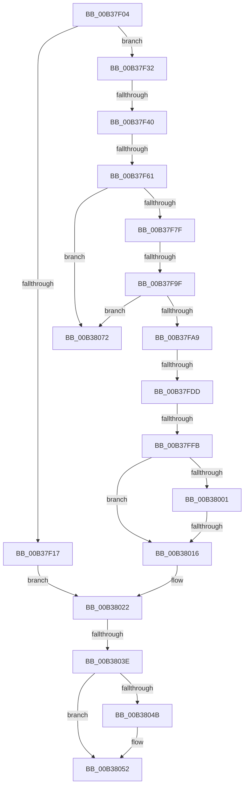

# sub_00B37F04

- RVA: `0x00B37F04`–`0x00B3807C` (길이 `376` bytes)
- VA: `0x0000000140B37F04`
- 실행 섹션: `PAGE`
- PDB 이름 있음: `아니요`; PDB Function 태그: `아니요`
- unwind 정보 RVA: `0x000ABEEC`
- 디코드: `100`개 명령, `376/376` bytes 표시
- 미해석 바이트: `0` (있으면 어셈블리에 `.byte`로 보존)

> 이 문서는 커널 이미지의 기계어와 PDB 기호를 분석해 생성했습니다. 4번과 5번은 함수 원형과 자료형을 바이너리 사용 방식에서 추정한 C 해석이며 원본 소스 복구 결과는 아닙니다.

## 1. Dependencies

- 직접 호출 지점: **14**; 고유 호출 대상: **11**
- 직접 호출자로 확인된 함수: **0**
- RIP 상대 이미지 참조: **0**

### Outgoing calls
- `0x00B37F0E` → [CmpReparseToVirtualPath](../7E/CmpReparseToVirtualPath_function_007EBA48.md) (function, `0x007EBA48`)
- `0x00B37F1D` → [ExFreePoolWithTag](../../poolcode/B8/ExFreePoolWithTag_function_00B82870.md) (function, `0x00B82870`)
- `0x00B37F28` → [RtlInitUnicodeString](../../text/42/RtlInitUnicodeString_function_0042A780.md) (function, `0x0042A780`)
- `0x00B37F54` → [CmpDoAccessCheckOnKCB](../7E/CmpDoAccessCheckOnKCB_function_007EB348.md) (function, `0x007EB348`)
- `0x00B37F72` → [CmpDoAccessCheckOnKCB](../7E/CmpDoAccessCheckOnKCB_function_007EB348.md) (function, `0x007EB348`)
- `0x00B37F90` → [CmpCheckAdminAccess](../9A/CmpCheckAdminAccess_function_009A87A0.md) (function, `0x009A87A0`)
- `0x00B37FAC` → [CmpUnlockKcb](../../pagecmrc/BC/CmpUnlockKcb_function_00BC92C0.md) (function, `0x00BC92C0`)
- `0x00B37FC6` → [CmpReplicateKeyToVirtual](../7E/CmpReplicateKeyToVirtual_function_007EBAEC.md) (function, `0x007EBAEC`)
- `0x00B37FD0` → [CmpLockKcbExclusive](../86/CmpLockKcbExclusive_function_00861EB0.md) (function, `0x00861EB0`)
- `0x00B37FEC` → [CmpExamineSaclForAuditEvent](../7E/CmpExamineSaclForAuditEvent_function_007ECDB0.md) (function, `0x007ECDB0`)
- `0x00B38007` → [CmpReportAuditVirtualizationEvent](../7E/CmpReportAuditVirtualizationEvent_function_007ED758.md) (function, `0x007ED758`)
- `0x00B3802F` → [CmRealKCBToVirtualPath](../99/CmRealKCBToVirtualPath_function_00990130.md) (function, `0x00990130`)
- `0x00B3804D` → [ExFreePoolWithTag](../../poolcode/B8/ExFreePoolWithTag_function_00B82870.md) (function, `0x00B82870`)
- `0x00B38060` → [RtlInitUnicodeString](../../text/42/RtlInitUnicodeString_function_0042A780.md) (function, `0x0042A780`)

### Direct callers
- 이 함수 시작 RVA로 연결되는 직접 call은 확인되지 않았습니다. 간접 호출은 완전히 역산할 수 없습니다.

### Static image references
- 디코드된 RIP-relative 메모리 참조가 없습니다.

## 2. Other-region calls and transfers

- 다른 실행 섹션으로 향하는 call: **5**
  - `0x00B37F1D` → [ExFreePoolWithTag](../../poolcode/B8/ExFreePoolWithTag_function_00B82870.md) (`PAGE` → `POOLCODE`)
  - `0x00B37F28` → [RtlInitUnicodeString](../../text/42/RtlInitUnicodeString_function_0042A780.md) (`PAGE` → `.text`)
  - `0x00B37FAC` → [CmpUnlockKcb](../../pagecmrc/BC/CmpUnlockKcb_function_00BC92C0.md) (`PAGE` → `PAGECMRC`)
  - `0x00B3804D` → [ExFreePoolWithTag](../../poolcode/B8/ExFreePoolWithTag_function_00B82870.md) (`PAGE` → `POOLCODE`)
  - `0x00B38060` → [RtlInitUnicodeString](../../text/42/RtlInitUnicodeString_function_0042A780.md) (`PAGE` → `.text`)
- call이 아닌 외부 분기/꼬리 이동: **9**
  - `0x00B37F3A` → [CmpVEExecuteCreateLogic + 0x75](../A2/CmpVEExecuteCreateLogic_function_00A26F28.md) (`tail-transfer`)
  - `0x00B37F5B` → [CmpVEExecuteCreateLogic + 0x75](../A2/CmpVEExecuteCreateLogic_function_00A26F28.md) (`tail-transfer`)
  - `0x00B37F99` → [CmpVEExecuteCreateLogic + 0x7A](../A2/CmpVEExecuteCreateLogic_function_00A26F28.md) (`tail-transfer`)
  - `0x00B37FD7` → [CmpVEExecuteCreateLogic + 0x7A](../A2/CmpVEExecuteCreateLogic_function_00A26F28.md) (`tail-transfer`)
  - `0x00B37FF5` → [CmpVEExecuteCreateLogic + 0x7A](../A2/CmpVEExecuteCreateLogic_function_00A26F28.md) (`tail-transfer`)
  - `0x00B38010` → [CmpVEExecuteCreateLogic + 0x7A](../A2/CmpVEExecuteCreateLogic_function_00A26F28.md) (`tail-transfer`)
  - `0x00B38038` → [CmpVEExecuteCreateLogic + 0x7A](../A2/CmpVEExecuteCreateLogic_function_00A26F28.md) (`tail-transfer`)
  - `0x00B3806D` → [CmpVEExecuteCreateLogic + 0x7A](../A2/CmpVEExecuteCreateLogic_function_00A26F28.md) (`tail-transfer`)
  - `0x00B38077` → [CmpVEExecuteCreateLogic + 0x7A](../A2/CmpVEExecuteCreateLogic_function_00A26F28.md) (`tail-transfer`)

## 3. Assembly (complete function range)

```asm
00B37F04  4C 8D 4D F0                     lea r9, [rbp - 0x10]
00B37F08  4D 8B C6                        mov r8, r14
00B37F0B  48 8B CE                        mov rcx, rsi
00B37F0E  E8 35 3B CB FF                  call 0x1407eba48
00B37F13  84 C0                           test al, al
00B37F15  74 1B                           je 0x140b37f32
00B37F17  48 8B 4D F8                     mov rcx, qword ptr [rbp - 8]
00B37F1B  33 D2                           xor edx, edx
00B37F1D  E8 4E A9 04 00                  call 0x140b82870
00B37F22  33 D2                           xor edx, edx
00B37F24  48 8D 4D F0                     lea rcx, [rbp - 0x10]
00B37F28  E8 53 28 8F FF                  call 0x14042a780
00B37F2D  E9 F0 00 00 00                  jmp 0x140b38022
00B37F32  8B 86 B8 00 00 00               mov eax, dword ptr [rsi + 0xb8]
00B37F38  A8 20                           test al, 0x20
00B37F3A  0F 85 5D F0 EE FF               jne 0x140a26f9d
00B37F40  8B 5D 58                        mov ebx, dword ptr [rbp + 0x58]
00B37F43  48 8B CE                        mov rcx, rsi
00B37F46  44 8A 4D 50                     mov r9b, byte ptr [rbp + 0x50]
00B37F4A  83 CB 04                        or ebx, 4
00B37F4D  48 8B 55 60                     mov rdx, qword ptr [rbp + 0x60]
00B37F51  44 8B C3                        mov r8d, ebx
00B37F54  E8 EF 33 CB FF                  call 0x1407eb348
00B37F59  84 C0                           test al, al
00B37F5B  0F 85 3C F0 EE FF               jne 0x140a26f9d
00B37F61  44 8A 4D 50                     mov r9b, byte ptr [rbp + 0x50]
00B37F65  41 B8 19 00 02 00               mov r8d, 0x20019
00B37F6B  48 8B 55 60                     mov rdx, qword ptr [rbp + 0x60]
00B37F6F  48 8B CE                        mov rcx, rsi
00B37F72  E8 D1 33 CB FF                  call 0x1407eb348
00B37F77  84 C0                           test al, al
00B37F79  0F 84 F3 00 00 00               je 0x140b38072
00B37F7F  48 8B 56 58                     mov rdx, qword ptr [rsi + 0x58]
00B37F83  4C 8D 4D 30                     lea r9, [rbp + 0x30]
00B37F87  48 83 C2 20                     add rdx, 0x20
00B37F8B  4D 8B C6                        mov r8, r14
00B37F8E  8B CB                           mov ecx, ebx
00B37F90  E8 0B 08 E7 FF                  call 0x1409a87a0
00B37F95  8B D8                           mov ebx, eax
00B37F97  85 C0                           test eax, eax
00B37F99  0F 88 03 F0 EE FF               js 0x140a26fa2
00B37F9F  44 38 6D 30                     cmp byte ptr [rbp + 0x30], r13b
00B37FA3  0F 84 C9 00 00 00               je 0x140b38072
00B37FA9  49 8B CC                        mov rcx, r12
00B37FAC  E8 0F 13 09 00                  call 0x140bc92c0
00B37FB1  44 8B 07                        mov r8d, dword ptr [rdi]
00B37FB4  4C 8D 4D E8                     lea r9, [rbp - 0x18]
00B37FB8  41 C1 E8 0A                     shr r8d, 0xa
00B37FBC  49 8B D6                        mov rdx, r14
00B37FBF  41 80 E0 01                     and r8b, 1
00B37FC3  48 8B CE                        mov rcx, rsi
00B37FC6  E8 21 3B CB FF                  call 0x1407ebaec
00B37FCB  49 8B CC                        mov rcx, r12
00B37FCE  8B D8                           mov ebx, eax
00B37FD0  E8 DB 9E D2 FF                  call 0x140861eb0
00B37FD5  85 DB                           test ebx, ebx
00B37FD7  0F 88 C5 EF EE FF               js 0x140a26fa2
00B37FDD  48 8B 4E 58                     mov rcx, qword ptr [rsi + 0x58]
00B37FE1  4C 8D 45 E0                     lea r8, [rbp - 0x20]
00B37FE5  48 83 C1 20                     add rcx, 0x20
00B37FE9  49 8B D6                        mov rdx, r14
00B37FEC  E8 BF 4D CB FF                  call 0x1407ecdb0
00B37FF1  8B D8                           mov ebx, eax
00B37FF3  85 C0                           test eax, eax
00B37FF5  0F 88 A7 EF EE FF               js 0x140a26fa2
00B37FFB  44 38 6D E0                     cmp byte ptr [rbp - 0x20], r13b
00B37FFF  74 15                           je 0x140b38016
00B38001  49 8B D6                        mov rdx, r14
00B38004  48 8B CE                        mov rcx, rsi
00B38007  E8 4C 57 CB FF                  call 0x1407ed758
00B3800C  8B D8                           mov ebx, eax
00B3800E  85 C0                           test eax, eax
00B38010  0F 88 8C EF EE FF               js 0x140a26fa2
00B38016  48 8B 45 E8                     mov rax, qword ptr [rbp - 0x18]
00B3801A  83 4F 64 02                     or dword ptr [rdi + 0x64], 2
00B3801E  48 89 47 70                     mov qword ptr [rdi + 0x70], rax
00B38022  4C 8D 4D F0                     lea r9, [rbp - 0x10]
00B38026  4D 8B C6                        mov r8, r14
00B38029  49 8B D7                        mov rdx, r15
00B3802C  48 8B CE                        mov rcx, rsi
00B3802F  E8 FC 80 E5 FF                  call 0x140990130
00B38034  8B D8                           mov ebx, eax
00B38036  85 C0                           test eax, eax
00B38038  0F 88 64 EF EE FF               js 0x140a26fa2
00B3803E  48 8B 5D 70                     mov rbx, qword ptr [rbp + 0x70]
00B38042  48 8B 4B 08                     mov rcx, qword ptr [rbx + 8]
00B38046  48 85 C9                        test rcx, rcx
00B38049  74 07                           je 0x140b38052
00B3804B  33 D2                           xor edx, edx
00B3804D  E8 1E A8 04 00                  call 0x140b82870
00B38052  0F 10 45 F0                     movups xmm0, xmmword ptr [rbp - 0x10]
00B38056  33 D2                           xor edx, edx
00B38058  48 8D 4D F0                     lea rcx, [rbp - 0x10]
00B3805C  F3 0F 7F 03                     movdqu xmmword ptr [rbx], xmm0
00B38060  E8 1B 27 8F FF                  call 0x14042a780
00B38065  83 0F 08                        or dword ptr [rdi], 8
00B38068  BB 04 01 00 00                  mov ebx, 0x104
00B3806D  E9 30 EF EE FF                  jmp 0x140a26fa2
00B38072  BB 22 00 00 C0                  mov ebx, 0xc0000022
00B38077  E9 26 EF EE FF                  jmp 0x140a26fa2
```

## 4. C-style interpretation (structured pseudocode)

```c
__int64 __fastcall sub_00B37F04(__int64 a1, int a2)
{
    __int64 result;
    __int64 v_rbx;

    result = CmpReparseToVirtualPath(v_rsi, a2, v_r14, v_rbp - 16);
    if ((unsigned __int8)(result) == 0) goto loc_00B37F32;
    a2 = 0;
    result = ExFreePoolWithTag(*(unsigned __int64 *)(v_rbp - 8), a2, v_r14, v_rbp - 16);
    a2 = 0;
    result = RtlInitUnicodeString(v_rbp - 16, a2, v_r14, v_rbp - 16);
    goto loc_00B38022;
loc_00B37F32:
    v_rbx = (unsigned int)(((unsigned int)(*(unsigned int *)(v_rbp + 88))) | (4));
    result = CmpDoAccessCheckOnKCB(v_rsi, *(unsigned __int64 *)(v_rbp + 96), (unsigned int)((unsigned int)(v_rbx)), *(unsigned __int8 *)(v_rbp + 80));
    result = CmpDoAccessCheckOnKCB(v_rsi, *(unsigned __int64 *)(v_rbp + 96), (unsigned int)(0x20019ULL), *(unsigned __int8 *)(v_rbp + 80));
    if ((unsigned __int8)(result) == 0) goto loc_00B38072;
    a2 = (*(unsigned __int64 *)(v_rsi + 88)) + (32);
    result = CmpCheckAdminAccess((unsigned int)((unsigned int)(v_rbx)), a2, v_r14, v_rbp + 48);
    if ((*(unsigned __int8 *)(v_rbp + 48)) == ((unsigned __int8)(v_r13))) goto loc_00B38072;
    result = CmpUnlockKcb(v_r12, a2, v_r14, v_rbp + 48);
    a3 = (unsigned int)(((unsigned int)(*(unsigned int *)(v_rdi))) >> (10));
    a3 = (unsigned __int8)((a3) & (1));
    result = CmpReplicateKeyToVirtual(v_rsi, v_r14, a3, v_rbp - 24);
    result = CmpLockKcbExclusive(v_r12, v_r14, a3, v_rbp - 24);
    a1 = (*(unsigned __int64 *)(v_rsi + 88)) + (32);
    result = CmpExamineSaclForAuditEvent(a1, v_r14, v_rbp - 32, v_rbp - 24);
    if ((*(unsigned __int8 *)(v_rbp - 32)) == ((unsigned __int8)(v_r13))) goto loc_00B38016;
    result = CmpReportAuditVirtualizationEvent(v_rsi, v_r14, v_rbp - 32, v_rbp - 24);
loc_00B38016:
    *(unsigned __int64 *)(v_rdi + 112) = *(unsigned __int64 *)(v_rbp - 24);
loc_00B38022:
    result = CmRealKCBToVirtualPath(v_rsi, v_r15, v_r14, v_rbp - 16);
    if (*(unsigned __int64 *)(*(unsigned __int64 *)(v_rbp + 112) + 8) != 0) {
        a2 = 0;
        result = ExFreePoolWithTag(*(unsigned __int64 *)(*(unsigned __int64 *)(v_rbp + 112) + 8), a2, v_r14, v_rbp - 16);
    }
    a2 = 0;
    *(unsigned __int64 *)(*(unsigned __int64 *)(v_rbp + 112)) = v_xmm0;
    result = RtlInitUnicodeString(v_rbp - 16, a2, v_r14, v_rbp - 16);
loc_00B38072:
}
```

## 5. (Beta) C Style

```c
int64_t sub_00B37F04(int64_t Arg1, int32_t Arg2)
{
    int64_t result;
    int64_t local_rbx;

    result = CmpReparseToVirtualPath(local_rsi, Arg2, local_r14, local_rbp - 16);
    if ((uint8_t)(result) == 0) goto loc_00B37F32;
    Arg2 = 0;
    result = ExFreePoolWithTag(*(uint64_t *)(local_rbp - 0x8), Arg2, local_r14, local_rbp - 16);
    Arg2 = 0;
    result = RtlInitUnicodeString(local_rbp - 16, Arg2, local_r14, local_rbp - 16);
    goto loc_00B38022;
loc_00B37F32:
    local_rbx = (uint32_t)(((uint32_t)(*(uint32_t *)(local_rbp + 0x58))) | (4));
    result = CmpDoAccessCheckOnKCB(local_rsi, *(uint64_t *)(local_rbp + 0x60), (uint32_t)((uint32_t)(local_rbx)), *(uint8_t *)(local_rbp + 0x50));
    result = CmpDoAccessCheckOnKCB(local_rsi, *(uint64_t *)(local_rbp + 0x60), (uint32_t)(0x20019ULL), *(uint8_t *)(local_rbp + 0x50));
    if ((uint8_t)(result) == 0) goto loc_00B38072;
    Arg2 = (*(uint64_t *)(local_rsi + 0x58)) + (32);
    result = CmpCheckAdminAccess((uint32_t)((uint32_t)(local_rbx)), Arg2, local_r14, local_rbp + 48);
    if ((*(uint8_t *)(local_rbp + 0x30)) == ((uint8_t)(local_r13))) goto loc_00B38072;
    result = CmpUnlockKcb(local_r12, Arg2, local_r14, local_rbp + 48);
    a3 = (uint32_t)(((uint32_t)(*(uint32_t *)(local_rdi))) >> (10));
    a3 = (uint8_t)((a3) & (1));
    result = CmpReplicateKeyToVirtual(local_rsi, local_r14, a3, local_rbp - 24);
    result = CmpLockKcbExclusive(local_r12, local_r14, a3, local_rbp - 24);
    Arg1 = (*(uint64_t *)(local_rsi + 0x58)) + (32);
    result = CmpExamineSaclForAuditEvent(Arg1, local_r14, local_rbp - 32, local_rbp - 24);
    if ((*(uint8_t *)(local_rbp - 0x20)) == ((uint8_t)(local_r13))) goto loc_00B38016;
    result = CmpReportAuditVirtualizationEvent(local_rsi, local_r14, local_rbp - 32, local_rbp - 24);
loc_00B38016:
    *(uint64_t *)(local_rdi + 0x70) = *(uint64_t *)(local_rbp - 0x18);
loc_00B38022:
    result = CmRealKCBToVirtualPath(local_rsi, local_r15, local_r14, local_rbp - 16);
    if (*(uint64_t *)(*(uint64_t *)(local_rbp + 0x70) + 0x8) != 0) {
        Arg2 = 0;
        result = ExFreePoolWithTag(*(uint64_t *)(*(uint64_t *)(local_rbp + 0x70) + 0x8), Arg2, local_r14, local_rbp - 16);
    }
    Arg2 = 0;
    *(uint64_t *)(*(uint64_t *)(local_rbp + 0x70)) = v_xmm0;
    result = RtlInitUnicodeString(local_rbp - 16, Arg2, local_r14, local_rbp - 16);
loc_00B38072:
}
```

## 6. Execution-region graph

[열기: 2D/3D 그래프와 함수 탐색 컨트롤 패널](../../../control-panel.html?section=page&rva=0x00B37F04&view=graph)

- 2D 그래프는 위에서 아래로 흐르고, 3D 그래프는 빈 공간을 드래그해 회전합니다. Shift+드래그는 이동, 휠은 확대·축소, 함수 노드 선택은 대상 보고서 이동입니다.

### Static fallback


