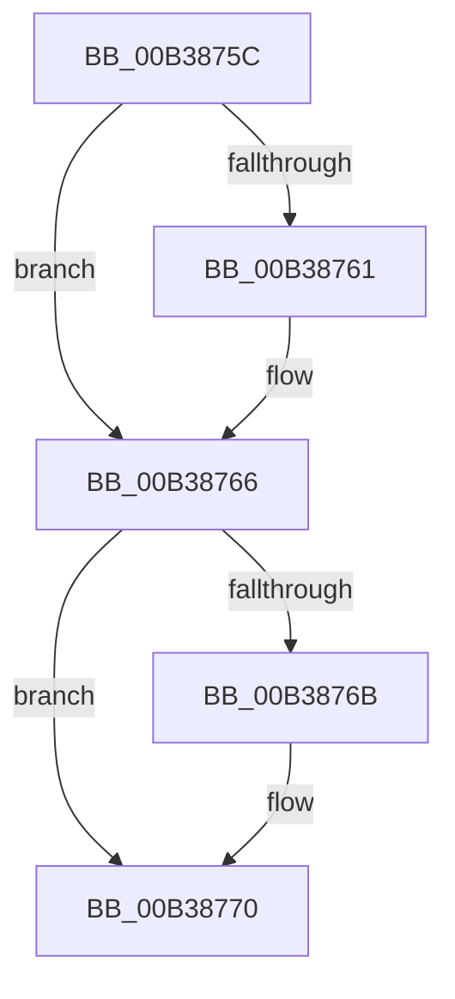

# sub_00B3875C

- RVA: `0x00B3875C`–`0x00B3877D` (길이 `33` bytes)
- VA: `0x0000000140B3875C`
- 실행 섹션: `PAGE`
- PDB 이름 있음: `아니요`; PDB Function 태그: `아니요`
- unwind 정보 RVA: `0x000AC024`
- 디코드: `12`개 명령, `33/33` bytes 표시
- 미해석 바이트: `0` (있으면 어셈블리에 `.byte`로 보존)

> 이 문서는 커널 이미지의 기계어와 PDB 기호를 분석해 생성했습니다. 4번과 5번은 함수 원형과 자료형을 바이너리 사용 방식에서 추정한 C 해석이며 원본 소스 복구 결과는 아닙니다.

## 1. Dependencies

- 직접 호출 지점: **1**; 고유 호출 대상: **1**
- 직접 호출자로 확인된 함수: **0**
- RIP 상대 이미지 참조: **0**

### Outgoing calls
- `0x00B38772` → [ExFreePoolWithTag](../../poolcode/B8/ExFreePoolWithTag_function_00B82870.md) (function, `0x00B82870`)

### Direct callers
- 이 함수 시작 RVA로 연결되는 직접 call은 확인되지 않았습니다. 간접 호출은 완전히 역산할 수 없습니다.

### Static image references
- 디코드된 RIP-relative 메모리 참조가 없습니다.

## 2. Other-region calls and transfers

- 다른 실행 섹션으로 향하는 call: **1**
  - `0x00B38772` → [ExFreePoolWithTag](../../poolcode/B8/ExFreePoolWithTag_function_00B82870.md) (`PAGE` → `POOLCODE`)
- call이 아닌 외부 분기/꼬리 이동: **1**
  - `0x00B38778` → [IopQueryLegacyBusInformation + 0x68](../A2/IopQueryLegacyBusInformation_function_00A28078.md) (`tail-transfer`)

## 3. Assembly (complete function range)

```asm
00B3875C  48 85 FF                        test rdi, rdi
00B3875F  74 05                           je 0x140b38766
00B38761  8B 41 10                        mov eax, dword ptr [rcx + 0x10]
00B38764  89 07                           mov dword ptr [rdi], eax
00B38766  48 85 DB                        test rbx, rbx
00B38769  74 05                           je 0x140b38770
00B3876B  8B 41 14                        mov eax, dword ptr [rcx + 0x14]
00B3876E  89 03                           mov dword ptr [rbx], eax
00B38770  33 D2                           xor edx, edx
00B38772  E8 F9 A0 04 00                  call 0x140b82870
00B38777  90                              nop
00B38778  E9 63 F9 EE FF                  jmp 0x140a280e0
```

## 4. C-style interpretation (structured pseudocode)

```c
__int64 __fastcall sub_00B3875C(__int64 a1, int a2)
{
    __int64 result;

    if (v_rdi != 0) {
        result = *(unsigned int *)(a1 + 16);
        *(unsigned int *)(v_rdi) = (unsigned int)(result);
    }
    if (v_rbx != 0) {
        result = *(unsigned int *)(a1 + 20);
        *(unsigned int *)(v_rbx) = (unsigned int)(result);
    }
    a2 = 0;
    result = ExFreePoolWithTag(a1, a2, a3, a4);
}
```

## 5. (Beta) C Style

```c
int64_t sub_00B3875C(void *Arg1, int32_t Arg2)
{
    uint8_t *arg1 = (uint8_t *)Arg1;

    int64_t result;

    if (local_rdi != 0) {
        result = *(uint32_t *)(arg1 + 0x10);
        *(uint32_t *)(local_rdi) = (uint32_t)(result);
    }
    if (local_rbx != 0) {
        result = *(uint32_t *)(arg1 + 0x14);
        *(uint32_t *)(local_rbx) = (uint32_t)(result);
    }
    Arg2 = 0;
    result = ExFreePoolWithTag(Arg1, Arg2, a3, a4);
}
```

### 관측된 메모리 오프셋

구조체 형식이 확인되지 않은 접근은 인자 기준의 오프셋으로만 기록했습니다.

| 기준 인자 | 오프셋 표현 | 폭 (bit) | 접근 |
|---|---:|---:|---|
| `Arg1` | `+ 0x10` | `32` | `R` |
| `Arg1` | `+ 0x14` | `32` | `R` |

## 6. Execution-region graph

[열기: 2D/3D 그래프와 함수 탐색 컨트롤 패널](../../../control-panel.html?section=page&rva=0x00B3875C&view=graph)

- 2D 그래프는 위에서 아래로 흐르고, 3D 그래프는 빈 공간을 드래그해 회전합니다. Shift+드래그는 이동, 휠은 확대·축소, 함수 노드 선택은 대상 보고서 이동입니다.

### Static fallback


