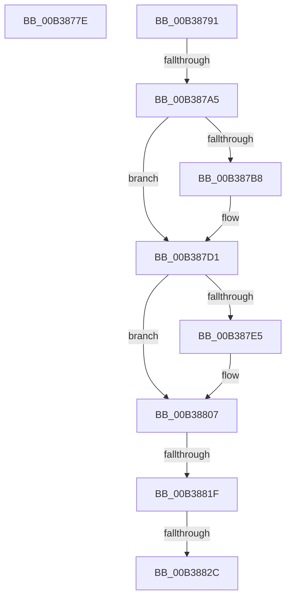

# sub_00B3877E

- RVA: `0x00B3877E`–`0x00B38858` (길이 `218` bytes)
- VA: `0x0000000140B3877E`
- 실행 섹션: `PAGE`
- PDB 이름 있음: `아니요`; PDB Function 태그: `아니요`
- unwind 정보 RVA: `0x000AC0A4`
- 디코드: `50`개 명령, `218/218` bytes 표시
- 미해석 바이트: `0` (있으면 어셈블리에 `.byte`로 보존)

> 이 문서는 커널 이미지의 기계어와 PDB 기호를 분석해 생성했습니다. 4번과 5번은 함수 원형과 자료형을 바이너리 사용 방식에서 추정한 C 해석이며 원본 소스 복구 결과는 아닙니다.

## 1. Dependencies

- 직접 호출 지점: **8**; 고유 호출 대상: **2**
- 직접 호출자로 확인된 함수: **0**
- RIP 상대 이미지 참조: **0**

### Outgoing calls
- `0x00B38786` → [PiIommuPutInterface](../74/PiIommuPutInterface_function_0074026C.md) (function, `0x0074026C`)
- `0x00B387AE` → [IoAddTriageDumpDataBlock](../../text/42/IoAddTriageDumpDataBlock_function_00428374.md) (function, `0x00428374`)
- `0x00B387C0` → [IoAddTriageDumpDataBlock](../../text/42/IoAddTriageDumpDataBlock_function_00428374.md) (function, `0x00428374`)
- `0x00B387CC` → [IoAddTriageDumpDataBlock](../../text/42/IoAddTriageDumpDataBlock_function_00428374.md) (function, `0x00428374`)
- `0x00B387EA` → [IoAddTriageDumpDataBlock](../../text/42/IoAddTriageDumpDataBlock_function_00428374.md) (function, `0x00428374`)
- `0x00B38802` → [IoAddTriageDumpDataBlock](../../text/42/IoAddTriageDumpDataBlock_function_00428374.md) (function, `0x00428374`)
- `0x00B38831` → [IoAddTriageDumpDataBlock](../../text/42/IoAddTriageDumpDataBlock_function_00428374.md) (function, `0x00428374`)
- `0x00B3884D` → [IoAddTriageDumpDataBlock](../../text/42/IoAddTriageDumpDataBlock_function_00428374.md) (function, `0x00428374`)

### Direct callers
- 이 함수 시작 RVA로 연결되는 직접 call은 확인되지 않았습니다. 간접 호출은 완전히 역산할 수 없습니다.

### Static image references
- 디코드된 RIP-relative 메모리 참조가 없습니다.

## 2. Other-region calls and transfers

- 다른 실행 섹션으로 향하는 call: **7**
  - `0x00B387AE` → [IoAddTriageDumpDataBlock](../../text/42/IoAddTriageDumpDataBlock_function_00428374.md) (`PAGE` → `.text`)
  - `0x00B387C0` → [IoAddTriageDumpDataBlock](../../text/42/IoAddTriageDumpDataBlock_function_00428374.md) (`PAGE` → `.text`)
  - `0x00B387CC` → [IoAddTriageDumpDataBlock](../../text/42/IoAddTriageDumpDataBlock_function_00428374.md) (`PAGE` → `.text`)
  - `0x00B387EA` → [IoAddTriageDumpDataBlock](../../text/42/IoAddTriageDumpDataBlock_function_00428374.md) (`PAGE` → `.text`)
  - `0x00B38802` → [IoAddTriageDumpDataBlock](../../text/42/IoAddTriageDumpDataBlock_function_00428374.md) (`PAGE` → `.text`)
  - `0x00B38831` → [IoAddTriageDumpDataBlock](../../text/42/IoAddTriageDumpDataBlock_function_00428374.md) (`PAGE` → `.text`)
  - `0x00B3884D` → [IoAddTriageDumpDataBlock](../../text/42/IoAddTriageDumpDataBlock_function_00428374.md) (`PAGE` → `.text`)
- call이 아닌 외부 분기/꼬리 이동: **5**
  - `0x00B3878C` → [PiIommuGetInterface + 0x5F](../A2/PiIommuGetInterface_function_00A285B0.md) (`tail-transfer`)
  - `0x00B3879F` → [PiIommuGetInterface + 0x72](../A2/PiIommuGetInterface_function_00A285B0.md) (`tail-transfer`)
  - `0x00B38819` → [PiIommuGetInterface + 0x72](../A2/PiIommuGetInterface_function_00A285B0.md) (`tail-transfer`)
  - `0x00B38826` → [PiIommuGetInterface + 0x72](../A2/PiIommuGetInterface_function_00A285B0.md) (`tail-transfer`)
  - `0x00B38853` → [PiIommuGetInterface + 0x72](../A2/PiIommuGetInterface_function_00A285B0.md) (`tail-transfer`)

## 3. Assembly (complete function range)

```asm
00B3877E  48 8B CF                        mov rcx, rdi
00B38781  BB BB 00 00 C0                  mov ebx, 0xc00000bb
00B38786  E8 E1 7A C0 FF                  call 0x14074026c
00B3878B  90                              nop
00B3878C  E9 7E FE EE FF                  jmp 0x140a2860f
00B38791  48 8B 83 38 01 00 00            mov rax, qword ptr [rbx + 0x138]
00B38798  48 8B 48 28                     mov rcx, qword ptr [rax + 0x28]
00B3879C  48 85 C9                        test rcx, rcx
00B3879F  0F 84 7D FE EE FF               je 0x140a28622
00B387A5  BA 88 03 00 00                  mov edx, 0x388
00B387AA  48 8D 79 28                     lea rdi, [rcx + 0x28]
00B387AE  E8 C1 FB 8E FF                  call 0x140428374
00B387B3  66 39 2F                        cmp word ptr [rdi], bp
00B387B6  74 19                           je 0x140b387d1
00B387B8  BA 02 00 00 00                  mov edx, 2
00B387BD  48 8B CF                        mov rcx, rdi
00B387C0  E8 AF FB 8E FF                  call 0x140428374
00B387C5  0F B7 17                        movzx edx, word ptr [rdi]
00B387C8  48 8B 4F 08                     mov rcx, qword ptr [rdi + 8]
00B387CC  E8 A3 FB 8E FF                  call 0x140428374
00B387D1  48 8B 83 38 01 00 00            mov rax, qword ptr [rbx + 0x138]
00B387D8  48 8B 48 28                     mov rcx, qword ptr [rax + 0x28]
00B387DC  48 83 C1 38                     add rcx, 0x38
00B387E0  66 39 29                        cmp word ptr [rcx], bp
00B387E3  74 22                           je 0x140b38807
00B387E5  BA 02 00 00 00                  mov edx, 2
00B387EA  E8 85 FB 8E FF                  call 0x140428374
00B387EF  48 8B 83 38 01 00 00            mov rax, qword ptr [rbx + 0x138]
00B387F6  48 8B 48 28                     mov rcx, qword ptr [rax + 0x28]
00B387FA  0F B7 51 38                     movzx edx, word ptr [rcx + 0x38]
00B387FE  48 8B 49 40                     mov rcx, qword ptr [rcx + 0x40]
00B38802  E8 6D FB 8E FF                  call 0x140428374
00B38807  48 8B 83 38 01 00 00            mov rax, qword ptr [rbx + 0x138]
00B3880E  48 8B 48 28                     mov rcx, qword ptr [rax + 0x28]
00B38812  48 8B 41 10                     mov rax, qword ptr [rcx + 0x10]
00B38816  48 85 C0                        test rax, rax
00B38819  0F 84 03 FE EE FF               je 0x140a28622
00B3881F  48 8D 48 38                     lea rcx, [rax + 0x38]
00B38823  66 39 29                        cmp word ptr [rcx], bp
00B38826  0F 84 F6 FD EE FF               je 0x140a28622
00B3882C  BA 02 00 00 00                  mov edx, 2
00B38831  E8 3E FB 8E FF                  call 0x140428374
00B38836  48 8B 83 38 01 00 00            mov rax, qword ptr [rbx + 0x138]
00B3883D  48 8B 48 28                     mov rcx, qword ptr [rax + 0x28]
00B38841  48 8B 49 10                     mov rcx, qword ptr [rcx + 0x10]
00B38845  0F B7 51 38                     movzx edx, word ptr [rcx + 0x38]
00B38849  48 8B 49 40                     mov rcx, qword ptr [rcx + 0x40]
00B3884D  E8 22 FB 8E FF                  call 0x140428374
00B38852  90                              nop
00B38853  E9 CA FD EE FF                  jmp 0x140a28622
```

## 4. C-style interpretation (structured pseudocode)

```c
__int64 __fastcall sub_00B3877E(void)
{
    __int64 result;

    result = PiIommuPutInterface(v_rdi, a2, a3, a4);
}
```

## 5. (Beta) C Style

```c
void sub_00B3877E(void)
{
    int64_t result;

    result = PiIommuPutInterface(local_rdi, a2, a3, a4);
}
```

## 6. Execution-region graph

[열기: 2D/3D 그래프와 함수 탐색 컨트롤 패널](../../../control-panel.html?section=page&rva=0x00B3877E&view=graph)

- 2D 그래프는 위에서 아래로 흐르고, 3D 그래프는 빈 공간을 드래그해 회전합니다. Shift+드래그는 이동, 휠은 확대·축소, 함수 노드 선택은 대상 보고서 이동입니다.

### Static fallback


