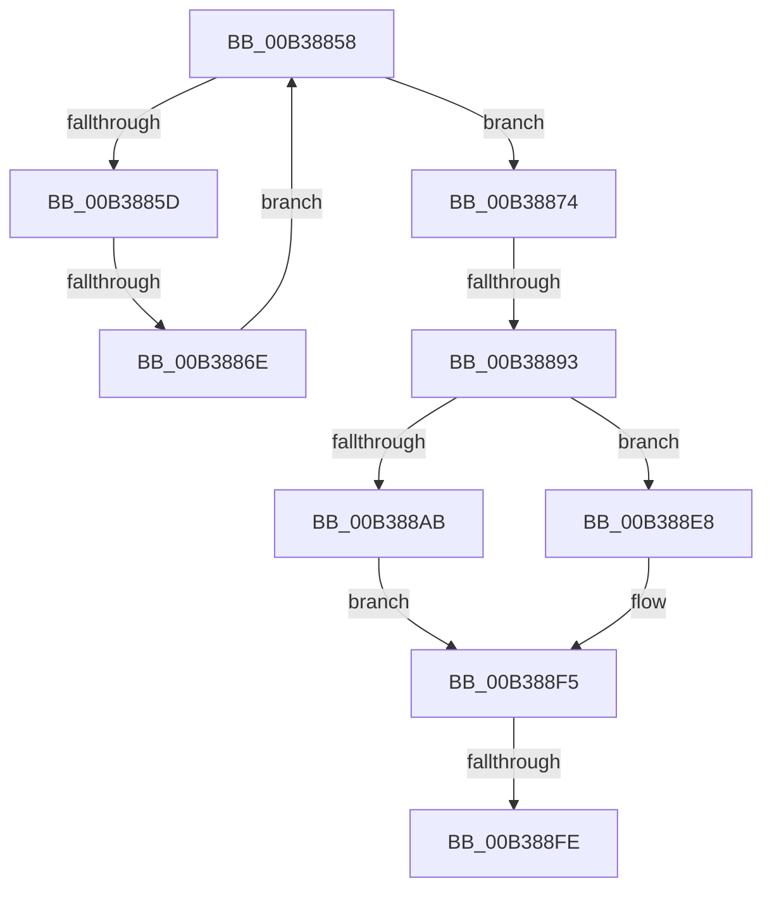

# sub_00B38858

- RVA: `0x00B38858`–`0x00B38903` (길이 `171` bytes)
- VA: `0x0000000140B38858`
- 실행 섹션: `PAGE`
- PDB 이름 있음: `아니요`; PDB Function 태그: `아니요`
- unwind 정보 RVA: `0x000AC0EC`
- 디코드: `42`개 명령, `171/171` bytes 표시
- 미해석 바이트: `0` (있으면 어셈블리에 `.byte`로 보존)

> 이 문서는 커널 이미지의 기계어와 PDB 기호를 분석해 생성했습니다. 4번과 5번은 함수 원형과 자료형을 바이너리 사용 방식에서 추정한 C 해석이며 원본 소스 복구 결과는 아닙니다.

## 1. Dependencies

- 직접 호출 지점: **6**; 고유 호출 대상: **6**
- 직접 호출자로 확인된 함수: **0**
- RIP 상대 이미지 참조: **1**

### Outgoing calls
- `0x00B38882` → [ExAllocatePool2](../../poolcode/B8/ExAllocatePool2_function_00B820F0.md) (function, `0x00B820F0`)
- `0x00B3889E` → [PnpDeviceCompletionRequestCreate](../8F/PnpDeviceCompletionRequestCreate_function_008F9BB4.md) (function, `0x008F9BB4`)
- `0x00B388C6` → [PipSetDevNodeState](../../text/47/PipSetDevNodeState_function_00470708.md) (function, `0x00470708`)
- `0x00B388D4` → [PnpDeviceCompletionQueueAddDispatchedRequest](../../text/49/PnpDeviceCompletionQueueAddDispatchedRequest_function_0049619C.md) (function, `0x0049619C`)
- `0x00B388E1` → [ExQueueWorkItem](../../text/2F/ExQueueWorkItem_function_002F9520.md) (function, `0x002F9520`)
- `0x00B388F0` → [ExFreePoolWithTag](../../poolcode/B8/ExFreePoolWithTag_function_00B82870.md) (function, `0x00B82870`)

### Direct callers
- 이 함수 시작 RVA로 연결되는 직접 call은 확인되지 않았습니다. 간접 호출은 완전히 역산할 수 없습니다.

### Static image references
- `0x00B388AF` → RVA `0x0072D4C0` (`PiProcessNewDeviceNodeWorker`; read)

## 2. Other-region calls and transfers

- 다른 실행 섹션으로 향하는 call: **5**
  - `0x00B38882` → [ExAllocatePool2](../../poolcode/B8/ExAllocatePool2_function_00B820F0.md) (`PAGE` → `POOLCODE`)
  - `0x00B388C6` → [PipSetDevNodeState](../../text/47/PipSetDevNodeState_function_00470708.md) (`PAGE` → `.text`)
  - `0x00B388D4` → [PnpDeviceCompletionQueueAddDispatchedRequest](../../text/49/PnpDeviceCompletionQueueAddDispatchedRequest_function_0049619C.md) (`PAGE` → `.text`)
  - `0x00B388E1` → [ExQueueWorkItem](../../text/2F/ExQueueWorkItem_function_002F9520.md) (`PAGE` → `.text`)
  - `0x00B388F0` → [ExFreePoolWithTag](../../poolcode/B8/ExFreePoolWithTag_function_00B82870.md) (`PAGE` → `POOLCODE`)
- call이 아닌 외부 분기/꼬리 이동: **4**
  - `0x00B38868` → [PiProcessNewDeviceNodeAsync + 0x3E](../A2/PiProcessNewDeviceNodeAsync_function_00A28EA8.md) (`tail-transfer`)
  - `0x00B3888D` → [PiProcessNewDeviceNodeAsync + 0x3E](../A2/PiProcessNewDeviceNodeAsync_function_00A28EA8.md) (`tail-transfer`)
  - `0x00B388F8` → [PiProcessNewDeviceNodeAsync + 0x48](../A2/PiProcessNewDeviceNodeAsync_function_00A28EA8.md) (`tail-transfer`)
  - `0x00B388FE` → [PiProcessNewDeviceNodeAsync + 0x3E](../A2/PiProcessNewDeviceNodeAsync_function_00A28EA8.md) (`tail-transfer`)

## 3. Assembly (complete function range)

```asm
00B38858  48 85 D2                        test rdx, rdx
00B3885B  74 17                           je 0x140b38874
00B3885D  48 8B 42 08                     mov rax, qword ptr [rdx + 8]
00B38861  F7 40 10 00 10 00 00            test dword ptr [rax + 0x10], 0x1000
00B38868  0F 84 78 06 EF FF               je 0x140a28ee6
00B3886E  48 8B 52 18                     mov rdx, qword ptr [rdx + 0x18]
00B38872  EB E4                           jmp 0x140b38858
00B38874  BA 20 00 00 00                  mov edx, 0x20
00B38879  41 B8 50 6E 70 31               mov r8d, 0x31706e50
00B3887F  8D 4A 20                        lea ecx, [rdx + 0x20]
00B38882  E8 69 98 04 00                  call 0x140b820f0
00B38887  48 8B D8                        mov rbx, rax
00B3888A  48 85 C0                        test rax, rax
00B3888D  0F 84 53 06 EF FF               je 0x140a28ee6
00B38893  4C 8B C0                        mov r8, rax
00B38896  BA 04 03 00 00                  mov edx, 0x304
00B3889B  48 8B CF                        mov rcx, rdi
00B3889E  E8 11 13 DC FF                  call 0x1408f9bb4
00B388A3  4C 8B F0                        mov r14, rax
00B388A6  48 85 C0                        test rax, rax
00B388A9  74 3D                           je 0x140b388e8
00B388AB  48 83 23 00                     and qword ptr [rbx], 0
00B388AF  48 8D 05 0A 4C BF FF            lea rax, [rip - 0x40b3f6]
00B388B6  BA 02 03 00 00                  mov edx, 0x302
00B388BB  48 89 43 10                     mov qword ptr [rbx + 0x10], rax
00B388BF  48 8B CF                        mov rcx, rdi
00B388C2  4C 89 73 18                     mov qword ptr [rbx + 0x18], r14
00B388C6  E8 3D 7E 93 FF                  call 0x140470708
00B388CB  49 8B D6                        mov rdx, r14
00B388CE  89 B7 88 01 00 00               mov dword ptr [rdi + 0x188], esi
00B388D4  E8 C3 D8 95 FF                  call 0x14049619c
00B388D9  BA 01 00 00 00                  mov edx, 1
00B388DE  48 8B CB                        mov rcx, rbx
00B388E1  E8 3A 0C 7C FF                  call 0x1402f9520
00B388E6  EB 0D                           jmp 0x140b388f5
00B388E8  40 32 ED                        xor bpl, bpl
00B388EB  33 D2                           xor edx, edx
00B388ED  48 8B CB                        mov rcx, rbx
00B388F0  E8 7B 9F 04 00                  call 0x140b82870
00B388F5  40 84 ED                        test bpl, bpl
00B388F8  0F 85 F2 05 EF FF               jne 0x140a28ef0
00B388FE  E9 E3 05 EF FF                  jmp 0x140a28ee6
```

## 4. C-style interpretation (structured pseudocode)

```c
__int64 __fastcall sub_00B38858(__int64 a1, __int64 a2)
{
    __int64 result;
    __int64 v_rbp;

    if (a2 == 0) goto loc_00B38874;
    goto loc_00B38858;
loc_00B38874:
    result = ExAllocatePool2(32 + 32, 32, (unsigned int)(0x31706E50ULL), a4);
    result = PnpDeviceCompletionRequestCreate(v_rdi, 772, result, a4);
    if (result == 0) goto loc_00B388E8;
    *(unsigned __int64 *)(result + 16) = v_rip - 4240374;
    *(unsigned __int64 *)(result + 24) = result;
    result = PipSetDevNodeState(v_rdi, 770, result, a4);
    *(unsigned int *)(v_rdi + 392) = (unsigned int)(v_rsi);
    result = PnpDeviceCompletionQueueAddDispatchedRequest(v_rdi, result, result, a4);
    result = ExQueueWorkItem(result, 1, result, a4);
    goto loc_00B388F5;
loc_00B388E8:
    v_rbp = 0;
    a2 = 0;
    result = ExFreePoolWithTag(result, a2, result, a4);
loc_00B388F5:
}
```

## 5. (Beta) C Style

```c
int64_t sub_00B38858(int64_t Arg1, int64_t Arg2)
{
    int64_t result;
    int64_t local_rbp;

    if (Arg2 == 0) goto loc_00B38874;
    goto loc_00B38858;
loc_00B38874:
    result = ExAllocatePool2(32 + 32, 32, (uint32_t)(0x31706E50ULL), a4);
    result = PnpDeviceCompletionRequestCreate(local_rdi, 772, result, a4);
    if (result == 0) goto loc_00B388E8;
    *(uint64_t *)(result + 0x10) = v_rip - 4240374;
    *(uint64_t *)(result + 0x18) = result;
    result = PipSetDevNodeState(local_rdi, 770, result, a4);
    *(uint32_t *)(local_rdi + 0x188) = (uint32_t)(local_rsi);
    result = PnpDeviceCompletionQueueAddDispatchedRequest(local_rdi, result, result, a4);
    result = ExQueueWorkItem(result, 1, result, a4);
    goto loc_00B388F5;
loc_00B388E8:
    local_rbp = 0;
    Arg2 = 0;
    result = ExFreePoolWithTag(result, Arg2, result, a4);
loc_00B388F5:
}
```

## 6. Execution-region graph

[열기: 2D/3D 그래프와 함수 탐색 컨트롤 패널](../../../control-panel.html?section=page&rva=0x00B38858&view=graph)

- 2D 그래프는 위에서 아래로 흐르고, 3D 그래프는 빈 공간을 드래그해 회전합니다. Shift+드래그는 이동, 휠은 확대·축소, 함수 노드 선택은 대상 보고서 이동입니다.

### Static fallback


