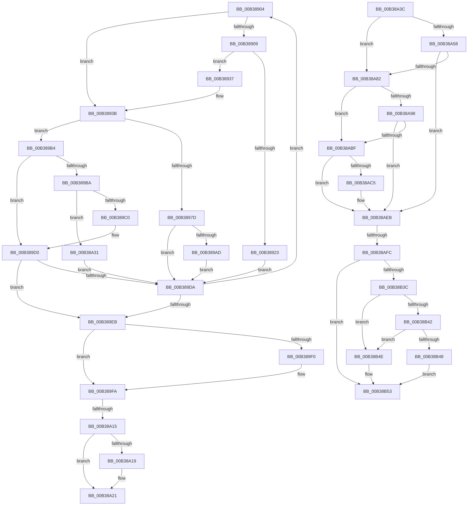

# sub_00B38904

- RVA: `0x00B38904`–`0x00B38B6B` (길이 `615` bytes)
- VA: `0x0000000140B38904`
- 실행 섹션: `PAGE`
- PDB 이름 있음: `아니요`; PDB Function 태그: `아니요`
- unwind 정보 RVA: `0x000AC14C`
- 디코드: `160`개 명령, `615/615` bytes 표시
- 미해석 바이트: `0` (있으면 어셈블리에 `.byte`로 보존)

> 이 문서는 커널 이미지의 기계어와 PDB 기호를 분석해 생성했습니다. 4번과 5번은 함수 원형과 자료형을 바이너리 사용 방식에서 추정한 C 해석이며 원본 소스 복구 결과는 아닙니다.

## 1. Dependencies

- 직접 호출 지점: **15**; 고유 호출 대상: **9**
- 직접 호출자로 확인된 함수: **0**
- RIP 상대 이미지 참조: **3**

### Outgoing calls
- `0x00B38916` → [ExAllocatePool2](../../poolcode/B8/ExAllocatePool2_function_00B820F0.md) (function, `0x00B820F0`)
- `0x00B3896F` → [CmGetDeviceRegProp](../8E/CmGetDeviceRegProp_function_008ED870.md) (function, `0x008ED870`)
- `0x00B38982` → [ExFreePoolWithTag](../../poolcode/B8/ExFreePoolWithTag_function_00B82870.md) (function, `0x00B82870`)
- `0x00B38996` → [ExAllocatePool2](../../poolcode/B8/ExAllocatePool2_function_00B820F0.md) (function, `0x00B820F0`)
- `0x00B389C7` → [PipFindDeviceOverrideEntry](../A2/PipFindDeviceOverrideEntry_function_00A2A694.md) (function, `0x00A2A694`)
- `0x00B389F5` → [ExFreePoolWithTag](../../poolcode/B8/ExFreePoolWithTag_function_00B82870.md) (function, `0x00B82870`)
- `0x00B389FE` → [ZwClose](../../text/6A/ZwClose_function_006AD2B0.md) (function, `0x006AD2B0`)
- `0x00B38A77` → [IopOpenRegistryKeyEx](../A5/IopOpenRegistryKeyEx_function_00A51B44.md) (function, `0x00A51B44`)
- `0x00B38A8D` → [PnpGetDeviceLocationStrings](../A2/PnpGetDeviceLocationStrings_function_00A286C0.md) (function, `0x00A286C0`)
- `0x00B38AA9` → [PnpOpenFirstMatchingSubKey](../72/PnpOpenFirstMatchingSubKey_function_0072CA20.md) (function, `0x0072CA20`)
- `0x00B38AB6` → [ExFreePoolWithTag](../../poolcode/B8/ExFreePoolWithTag_function_00B82870.md) (function, `0x00B82870`)
- `0x00B38AE4` → [IopOpenRegistryKeyEx](../A5/IopOpenRegistryKeyEx_function_00A51B44.md) (function, `0x00A51B44`)
- `0x00B38AEF` → [ZwClose](../../text/6A/ZwClose_function_006AD2B0.md) (function, `0x006AD2B0`)
- `0x00B38B31` → [ZwQueryValueKey](../../text/6A/ZwQueryValueKey_function_006AD3B0.md) (function, `0x006AD3B0`)
- `0x00B38B57` → [ZwClose](../../text/6A/ZwClose_function_006AD2B0.md) (function, `0x006AD2B0`)

### Direct callers
- 이 함수 시작 RVA로 연결되는 직접 call은 확인되지 않았습니다. 간접 호출은 완전히 역산할 수 없습니다.

### Static image references
- `0x00B38951` → RVA `0x00E66398` (`.data`; read)
- `0x00B38A41` → RVA `0x00AFD260` (` ?? ::NNGAKEGL::`string'`; read)
- `0x00B38AFC` → RVA `0x00AFD270` (` ?? ::NNGAKEGL::`string'`; read)

## 2. Other-region calls and transfers

- 다른 실행 섹션으로 향하는 call: **9**
  - `0x00B38916` → [ExAllocatePool2](../../poolcode/B8/ExAllocatePool2_function_00B820F0.md) (`PAGE` → `POOLCODE`)
  - `0x00B38982` → [ExFreePoolWithTag](../../poolcode/B8/ExFreePoolWithTag_function_00B82870.md) (`PAGE` → `POOLCODE`)
  - `0x00B38996` → [ExAllocatePool2](../../poolcode/B8/ExAllocatePool2_function_00B820F0.md) (`PAGE` → `POOLCODE`)
  - `0x00B389F5` → [ExFreePoolWithTag](../../poolcode/B8/ExFreePoolWithTag_function_00B82870.md) (`PAGE` → `POOLCODE`)
  - `0x00B389FE` → [ZwClose](../../text/6A/ZwClose_function_006AD2B0.md) (`PAGE` → `.text`)
  - `0x00B38AB6` → [ExFreePoolWithTag](../../poolcode/B8/ExFreePoolWithTag_function_00B82870.md) (`PAGE` → `POOLCODE`)
  - `0x00B38AEF` → [ZwClose](../../text/6A/ZwClose_function_006AD2B0.md) (`PAGE` → `.text`)
  - `0x00B38B31` → [ZwQueryValueKey](../../text/6A/ZwQueryValueKey_function_006AD3B0.md) (`PAGE` → `.text`)
  - `0x00B38B57` → [ZwClose](../../text/6A/ZwClose_function_006AD2B0.md) (`PAGE` → `.text`)
- call이 아닌 외부 분기/꼬리 이동: **4**
  - `0x00B38A0F` → [PiQueryRemovableDeviceOverride + 0x1B7](../A2/PiQueryRemovableDeviceOverride_function_00A2A474.md) (`tail-transfer`)
  - `0x00B38A2C` → [PiQueryRemovableDeviceOverride + 0x1B7](../A2/PiQueryRemovableDeviceOverride_function_00A2A474.md) (`tail-transfer`)
  - `0x00B38AF6` → [PiQueryRemovableDeviceOverride + 0x1BB](../A2/PiQueryRemovableDeviceOverride_function_00A2A474.md) (`tail-transfer`)
  - `0x00B38B66` → [PiQueryRemovableDeviceOverride + 0x1BB](../A2/PiQueryRemovableDeviceOverride_function_00A2A474.md) (`tail-transfer`)

## 3. Assembly (complete function range)

```asm
00B38904  4D 85 F6                        test r14, r14
00B38907  75 32                           jne 0x140b3893b
00B38909  8B D0                           mov edx, eax
00B3890B  B9 00 01 00 00                  mov ecx, 0x100
00B38910  41 B8 50 70 69 6E               mov r8d, 0x6e697050
00B38916  E8 D5 97 04 00                  call 0x140b820f0
00B3891B  4C 8B F0                        mov r14, rax
00B3891E  48 85 C0                        test rax, rax
00B38921  75 14                           jne 0x140b38937
00B38923  8B 44 24 40                     mov eax, dword ptr [rsp + 0x40]
00B38927  BB 9A 00 00 C0                  mov ebx, 0xc000009a
00B3892C  8B F8                           mov edi, eax
00B3892E  89 44 24 40                     mov dword ptr [rsp + 0x40], eax
00B38932  E9 A3 00 00 00                  jmp 0x140b389da
00B38937  8B 7C 24 40                     mov edi, dword ptr [rsp + 0x40]
00B3893B  83 64 24 38 00                  and dword ptr [rsp + 0x38], 0
00B38940  48 8D 44 24 40                  lea rax, [rsp + 0x40]
00B38945  48 8B 56 10                     mov rdx, qword ptr [rsi + 0x10]
00B38949  45 8B 4D 00                     mov r9d, dword ptr [r13]
00B3894D  4C 8B 45 CF                     mov r8, qword ptr [rbp - 0x31]
00B38951  48 8B 0D 40 DA 32 00            mov rcx, qword ptr [rip + 0x32da40]
00B38958  48 8B 52 30                     mov rdx, qword ptr [rdx + 0x30]
00B3895C  48 89 44 24 30                  mov qword ptr [rsp + 0x30], rax
00B38961  48 8D 45 8F                     lea rax, [rbp - 0x71]
00B38965  4C 89 74 24 28                  mov qword ptr [rsp + 0x28], r14
00B3896A  48 89 44 24 20                  mov qword ptr [rsp + 0x20], rax
00B3896F  E8 FC 4E DB FF                  call 0x1408ed870
00B38974  8B D8                           mov ebx, eax
00B38976  3D 23 00 00 C0                  cmp eax, 0xc0000023
00B3897B  75 37                           jne 0x140b389b4
00B3897D  33 D2                           xor edx, edx
00B3897F  49 8B CE                        mov rcx, r14
00B38982  E8 E9 9E 04 00                  call 0x140b82870
00B38987  8B 54 24 40                     mov edx, dword ptr [rsp + 0x40]
00B3898B  B9 00 01 00 00                  mov ecx, 0x100
00B38990  41 B8 50 70 69 6E               mov r8d, 0x6e697050
00B38996  E8 55 97 04 00                  call 0x140b820f0
00B3899B  4C 8B F0                        mov r14, rax
00B3899E  48 85 C0                        test rax, rax
00B389A1  8B 44 24 40                     mov eax, dword ptr [rsp + 0x40]
00B389A5  8B F8                           mov edi, eax
00B389A7  89 44 24 40                     mov dword ptr [rsp + 0x40], eax
00B389AB  75 2D                           jne 0x140b389da
00B389AD  BB 9A 00 00 C0                  mov ebx, 0xc000009a
00B389B2  EB 26                           jmp 0x140b389da
00B389B4  8B C7                           mov eax, edi
00B389B6  85 DB                           test ebx, ebx
00B389B8  78 16                           js 0x140b389d0
00B389BA  83 7D 8F 07                     cmp dword ptr [rbp - 0x71], 7
00B389BE  75 71                           jne 0x140b38a31
00B389C0  4C 8D 45 9F                     lea r8, [rbp - 0x61]
00B389C4  49 8B CE                        mov rcx, r14
00B389C7  E8 C8 1C EF FF                  call 0x140a2a694
00B389CC  8B D8                           mov ebx, eax
00B389CE  8B C7                           mov eax, edi
00B389D0  89 44 24 40                     mov dword ptr [rsp + 0x40], eax
00B389D4  8B F8                           mov edi, eax
00B389D6  85 DB                           test ebx, ebx
00B389D8  79 11                           jns 0x140b389eb
00B389DA  41 FF C4                        inc r12d
00B389DD  49 83 C5 04                     add r13, 4
00B389E1  41 83 FC 02                     cmp r12d, 2
00B389E5  0F 82 19 FF FF FF               jb 0x140b38904
00B389EB  4D 85 F6                        test r14, r14
00B389EE  74 0A                           je 0x140b389fa
00B389F0  33 D2                           xor edx, edx
00B389F2  49 8B CE                        mov rcx, r14
00B389F5  E8 76 9E 04 00                  call 0x140b82870
00B389FA  48 8B 4D CF                     mov rcx, qword ptr [rbp - 0x31]
00B389FE  E8 AD 48 B7 FF                  call 0x1406ad2b0
00B38A03  48 8B 4E 10                     mov rcx, qword ptr [rsi + 0x10]
00B38A07  8A 81 A8 02 00 00               mov al, byte ptr [rcx + 0x2a8]
00B38A0D  A8 01                           test al, 1
00B38A0F  0F 85 16 1C EF FF               jne 0x140a2a62b
00B38A15  85 DB                           test ebx, ebx
00B38A17  78 08                           js 0x140b38a21
00B38A19  0C 04                           or al, 4
00B38A1B  88 81 A8 02 00 00               mov byte ptr [rcx + 0x2a8], al
00B38A21  48 8B 46 10                     mov rax, qword ptr [rsi + 0x10]
00B38A25  80 88 A8 02 00 00 01            or byte ptr [rax + 0x2a8], 1
00B38A2C  E9 FA 1B EF FF                  jmp 0x140a2a62b
00B38A31  BB 01 00 00 C0                  mov ebx, 0xc0000001
00B38A36  89 7C 24 40                     mov dword ptr [rsp + 0x40], edi
00B38A3A  EB 9E                           jmp 0x140b389da
00B38A3C  48 83 65 97 00                  and qword ptr [rbp - 0x69], 0
00B38A41  48 8D 3D 18 48 FC FF            lea rdi, [rip - 0x3b7e8]
00B38A48  83 7D B7 01                     cmp dword ptr [rbp - 0x49], 1
00B38A4C  41 BE 04 00 00 00               mov r14d, 4
00B38A52  45 8D 7E FE                     lea r15d, [r14 - 2]
00B38A56  75 2A                           jne 0x140b38a82
00B38A58  48 8B 55 AF                     mov rdx, qword ptr [rbp - 0x51]
00B38A5C  4C 8D 44 24 48                  lea r8, [rsp + 0x48]
00B38A61  41 B9 19 00 02 00               mov r9d, 0x20019
00B38A67  C7 44 24 48 02 00 04 00         mov dword ptr [rsp + 0x48], 0x40002
00B38A6F  48 8D 4D 97                     lea rcx, [rbp - 0x69]
00B38A73  48 89 7D 87                     mov qword ptr [rbp - 0x79], rdi
00B38A77  E8 C8 90 F1 FF                  call 0x140a51b44
00B38A7C  8B D8                           mov ebx, eax
00B38A7E  85 C0                           test eax, eax
00B38A80  79 69                           jns 0x140b38aeb
00B38A82  4C 8D 45 C3                     lea r8, [rbp - 0x3d]
00B38A86  48 8B CE                        mov rcx, rsi
00B38A89  48 8D 55 D7                     lea rdx, [rbp - 0x29]
00B38A8D  E8 2E FC EE FF                  call 0x140a286c0
00B38A92  8B D8                           mov ebx, eax
00B38A94  85 C0                           test eax, eax
00B38A96  78 27                           js 0x140b38abf
00B38A98  48 8B 55 AF                     mov rdx, qword ptr [rbp - 0x51]
00B38A9C  48 8D 45 97                     lea rax, [rbp - 0x69]
00B38AA0  48 8B 4D D7                     mov rcx, qword ptr [rbp - 0x29]
00B38AA4  48 89 44 24 20                  mov qword ptr [rsp + 0x20], rax
00B38AA9  E8 72 3F BF FF                  call 0x14072ca20
00B38AAE  48 8B 4D D7                     mov rcx, qword ptr [rbp - 0x29]
00B38AB2  33 D2                           xor edx, edx
00B38AB4  8B D8                           mov ebx, eax
00B38AB6  E8 B5 9D 04 00                  call 0x140b82870
00B38ABB  85 DB                           test ebx, ebx
00B38ABD  79 2C                           jns 0x140b38aeb
00B38ABF  83 7D B7 01                     cmp dword ptr [rbp - 0x49], 1
00B38AC3  76 26                           jbe 0x140b38aeb
00B38AC5  48 8B 55 AF                     mov rdx, qword ptr [rbp - 0x51]
00B38AC9  4C 8D 44 24 48                  lea r8, [rsp + 0x48]
00B38ACE  41 B9 19 00 02 00               mov r9d, 0x20019
00B38AD4  C7 44 24 48 02 00 04 00         mov dword ptr [rsp + 0x48], 0x40002
00B38ADC  48 8D 4D 97                     lea rcx, [rbp - 0x69]
00B38AE0  48 89 7D 87                     mov qword ptr [rbp - 0x79], rdi
00B38AE4  E8 5B 90 F1 FF                  call 0x140a51b44
00B38AE9  8B D8                           mov ebx, eax
00B38AEB  48 8B 4D AF                     mov rcx, qword ptr [rbp - 0x51]
00B38AEF  E8 BC 47 B7 FF                  call 0x1406ad2b0
00B38AF4  85 DB                           test ebx, ebx
00B38AF6  0F 88 33 1B EF FF               js 0x140a2a62f
00B38AFC  48 8D 05 6D 47 FC FF            lea rax, [rip - 0x3b893]
00B38B03  C7 44 24 48 12 00 14 00         mov dword ptr [rsp + 0x48], 0x140012
00B38B0B  48 89 45 87                     mov qword ptr [rbp - 0x79], rax
00B38B0F  4C 8D 4D EF                     lea r9, [rbp - 0x11]
00B38B13  48 8D 45 C7                     lea rax, [rbp - 0x39]
00B38B17  B9 14 00 00 00                  mov ecx, 0x14
00B38B1C  48 89 44 24 28                  mov qword ptr [rsp + 0x28], rax
00B38B21  48 8D 54 24 48                  lea rdx, [rsp + 0x48]
00B38B26  89 4C 24 20                     mov dword ptr [rsp + 0x20], ecx
00B38B2A  45 8B C7                        mov r8d, r15d
00B38B2D  48 8B 4D 97                     mov rcx, qword ptr [rbp - 0x69]
00B38B31  E8 7A 48 B7 FF                  call 0x1406ad3b0
00B38B36  8B D8                           mov ebx, eax
00B38B38  85 C0                           test eax, eax
00B38B3A  78 17                           js 0x140b38b53
00B38B3C  44 39 75 F3                     cmp dword ptr [rbp - 0xd], r14d
00B38B40  75 0C                           jne 0x140b38b4e
00B38B42  44 39 75 F7                     cmp dword ptr [rbp - 9], r14d
00B38B46  75 06                           jne 0x140b38b4e
00B38B48  44 8B 65 FB                     mov r12d, dword ptr [rbp - 5]
00B38B4C  EB 05                           jmp 0x140b38b53
00B38B4E  BB 01 00 00 C0                  mov ebx, 0xc0000001
00B38B53  48 8B 4D 97                     mov rcx, qword ptr [rbp - 0x69]
00B38B57  E8 54 47 B7 FF                  call 0x1406ad2b0
00B38B5C  45 85 E4                        test r12d, r12d
00B38B5F  0F 95 C0                        setne al
00B38B62  41 88 45 00                     mov byte ptr [r13], al
00B38B66  E9 C4 1A EF FF                  jmp 0x140a2a62f
```

## 4. C-style interpretation (structured pseudocode)

```c
__int64 __fastcall sub_00B38904(__int64 a1, __int64 a2, __int64 a3, __int64 a4, __int64 a5, __int64 a6, unsigned int a7, unsigned int a8)
{
    __int64 result;
    __int64 v_r12;
    __int64 v_r13;
    unsigned __int64 v_stack_p20;
    unsigned __int64 v_stack_p28;
    unsigned __int64 v_stack_p30;
    unsigned int v_stack_p40;
    unsigned __int64 v_stack_p48;

    if (v_r14 != 0) goto loc_00B3893B;
    result = ExAllocatePool2(256, (unsigned int)((unsigned int)(result)), (unsigned int)(0x6E697050ULL), a4);
    if (result != 0) goto loc_00B38937;
    v_stack_p40 = (unsigned int)((unsigned int)(a8));
    goto loc_00B389DA;
loc_00B38937:
loc_00B3893B:
    v_stack_p30 = a8;
    v_stack_p28 = result;
    v_stack_p20 = v_rbp - 113;
    result = CmGetDeviceRegProp(*(unsigned __int64 *)(v_rip + 3332672), *(unsigned __int64 *)(*(unsigned __int64 *)(v_rsi + 16) + 48), *(unsigned __int64 *)(v_rbp - 49), (unsigned int)(*(unsigned int *)(v_r13)));
    if (((unsigned int)(result)) != 0xC0000023ULL) goto loc_00B389B4;
    a2 = 0;
    result = ExFreePoolWithTag(result, a2, *(unsigned __int64 *)(v_rbp - 49), (unsigned int)(*(unsigned int *)(v_r13)));
    result = ExAllocatePool2(256, (unsigned int)(a8), (unsigned int)(0x6E697050ULL), (unsigned int)(*(unsigned int *)(v_r13)));
    v_stack_p40 = (unsigned int)((unsigned int)(a8));
    if (result != 0) goto loc_00B389DA;
    goto loc_00B389DA;
loc_00B389B4:
    if (sign_flag) goto loc_00B389D0;
    if ((*(unsigned int *)(v_rbp - 113)) != 7) goto loc_00B38A31;
    result = PipFindDeviceOverrideEntry(result, (unsigned int)(a8), v_rbp - 97, (unsigned int)(*(unsigned int *)(v_r13)));
loc_00B389D0:
    v_stack_p40 = (unsigned int)((unsigned int)((unsigned int)((unsigned int)((unsigned int)((unsigned int)(a8))))));
    if (!sign_flag) goto loc_00B389EB;
loc_00B389DA:
    v_r12 = (unsigned int)((v_r12) + 1);
    v_r13 = (v_r13) + (4);
    if (((unsigned int)(v_r12)) < 2) goto loc_00B38904;
loc_00B389EB:
    result = (unsigned int)((unsigned int)((unsigned int)((unsigned int)((unsigned int)(a8)))));
    if (result != 0) {
        a2 = 0;
        a1 = result;
        result = ExFreePoolWithTag(a1, a2, v_rbp - 97, (unsigned int)(*(unsigned int *)(v_r13)));
    }
    result = ZwClose(*(unsigned __int64 *)(v_rbp - 49), a2, v_rbp - 97, (unsigned int)(*(unsigned int *)(v_r13)));
    result = *(unsigned __int8 *)(*(unsigned __int64 *)(v_rsi + 16) + 680);
    if (!(sign_flag)) {
        result = (unsigned __int8)((*(unsigned __int8 *)(*(unsigned __int64 *)(v_rsi + 16) + 680)) | (4));
        *(unsigned __int8 *)(*(unsigned __int64 *)(v_rsi + 16) + 680) = (unsigned __int8)(result);
    }
loc_00B38A31:
    v_stack_p40 = (unsigned int)((unsigned int)((unsigned int)((unsigned int)((unsigned int)((unsigned int)((unsigned int)((unsigned int)(a8))))))));
    goto loc_00B389DA;
}
```

## 5. (Beta) C Style

```c
int64_t sub_00B38904(int64_t Arg1, int64_t Arg2, int64_t Arg3, int64_t Arg4, uint64_t Arg5, uint64_t Arg6, uint32_t Arg7, uint32_t Arg8)
{
    int64_t result;
    int64_t local_r12;
    int64_t local_r13;
    uint64_t v_stack_p20;
    uint64_t v_stack_p28;
    uint64_t v_stack_p30;
    uint32_t v_stack_p40;
    uint64_t v_stack_p48;

    if (local_r14 != 0) goto loc_00B3893B;
    result = ExAllocatePool2(256, (uint32_t)((uint32_t)(result)), (uint32_t)(0x6E697050ULL), Arg4);
    if (result != 0) goto loc_00B38937;
    v_stack_p40 = (uint32_t)((uint32_t)(Arg8));
    goto loc_00B389DA;
loc_00B38937:
loc_00B3893B:
    v_stack_p30 = Arg8;
    v_stack_p28 = result;
    v_stack_p20 = local_rbp - 113;
    result = CmGetDeviceRegProp(*(uint64_t *)(v_rip + 0x32DA40), *(uint64_t *)(*(uint64_t *)(local_rsi + 0x10) + 0x30), *(uint64_t *)(local_rbp - 0x31), (uint32_t)(*(uint32_t *)(local_r13)));
    if (((uint32_t)(result)) != 0xC0000023ULL) goto loc_00B389B4;
    Arg2 = 0;
    result = ExFreePoolWithTag(result, Arg2, *(uint64_t *)(local_rbp - 0x31), (uint32_t)(*(uint32_t *)(local_r13)));
    result = ExAllocatePool2(256, (uint32_t)(Arg8), (uint32_t)(0x6E697050ULL), (uint32_t)(*(uint32_t *)(local_r13)));
    v_stack_p40 = (uint32_t)((uint32_t)(Arg8));
    if (result != 0) goto loc_00B389DA;
    goto loc_00B389DA;
loc_00B389B4:
    if (sign_flag) goto loc_00B389D0;
    if ((*(uint32_t *)(local_rbp - 0x71)) != 7) goto loc_00B38A31;
    result = PipFindDeviceOverrideEntry(result, (uint32_t)(Arg8), local_rbp - 97, (uint32_t)(*(uint32_t *)(local_r13)));
loc_00B389D0:
    v_stack_p40 = (uint32_t)((uint32_t)((uint32_t)((uint32_t)((uint32_t)((uint32_t)(Arg8))))));
    if (!sign_flag) goto loc_00B389EB;
loc_00B389DA:
    local_r12 = (uint32_t)((local_r12) + 1);
    local_r13 = (local_r13) + (4);
    if (((uint32_t)(local_r12)) < 2) goto loc_00B38904;
loc_00B389EB:
    result = (uint32_t)((uint32_t)((uint32_t)((uint32_t)((uint32_t)(Arg8)))));
    if (result != 0) {
        Arg2 = 0;
        Arg1 = result;
        result = ExFreePoolWithTag(Arg1, Arg2, local_rbp - 97, (uint32_t)(*(uint32_t *)(local_r13)));
    }
    result = ZwClose(*(uint64_t *)(local_rbp - 0x31), Arg2, local_rbp - 97, (uint32_t)(*(uint32_t *)(local_r13)));
    result = *(uint8_t *)(*(uint64_t *)(local_rsi + 0x10) + 0x2A8);
    if (!(sign_flag)) {
        result = (uint8_t)((*(uint8_t *)(*(uint64_t *)(local_rsi + 0x10) + 0x2A8)) | (4));
        *(uint8_t *)(*(uint64_t *)(local_rsi + 0x10) + 0x2A8) = (uint8_t)(result);
    }
loc_00B38A31:
    v_stack_p40 = (uint32_t)((uint32_t)((uint32_t)((uint32_t)((uint32_t)((uint32_t)((uint32_t)((uint32_t)(Arg8))))))));
    goto loc_00B389DA;
}
```

## 6. Execution-region graph

[열기: 2D/3D 그래프와 함수 탐색 컨트롤 패널](../../../control-panel.html?section=page&rva=0x00B38904&view=graph)

- 2D 그래프는 위에서 아래로 흐르고, 3D 그래프는 빈 공간을 드래그해 회전합니다. Shift+드래그는 이동, 휠은 확대·축소, 함수 노드 선택은 대상 보고서 이동입니다.

### Static fallback


