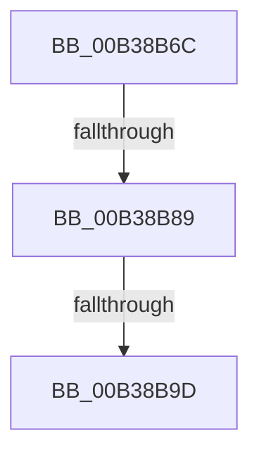

# sub_00B38B6C

- RVA: `0x00B38B6C`–`0x00B38BAE` (길이 `66` bytes)
- VA: `0x0000000140B38B6C`
- 실행 섹션: `PAGE`
- PDB 이름 있음: `아니요`; PDB Function 태그: `아니요`
- unwind 정보 RVA: `0x000AC178`
- 디코드: `16`개 명령, `66/66` bytes 표시
- 미해석 바이트: `0` (있으면 어셈블리에 `.byte`로 보존)

> 이 문서는 커널 이미지의 기계어와 PDB 기호를 분석해 생성했습니다. 4번과 5번은 함수 원형과 자료형을 바이너리 사용 방식에서 추정한 C 해석이며 원본 소스 복구 결과는 아닙니다.

## 1. Dependencies

- 직접 호출 지점: **3**; 고유 호출 대상: **3**
- 직접 호출자로 확인된 함수: **0**
- RIP 상대 이미지 참조: **0**

### Outgoing calls
- `0x00B38B7A` → [IopOpenRegistryKeyEx](../A5/IopOpenRegistryKeyEx_function_00A51B44.md) (function, `0x00A51B44`)
- `0x00B38B90` → [PipCallbackHasDeviceOverrides](../72/PipCallbackHasDeviceOverrides_function_007231D4.md) (function, `0x007231D4`)
- `0x00B38BA1` → [ZwClose](../../text/6A/ZwClose_function_006AD2B0.md) (function, `0x006AD2B0`)

### Direct callers
- 이 함수 시작 RVA로 연결되는 직접 call은 확인되지 않았습니다. 간접 호출은 완전히 역산할 수 없습니다.

### Static image references
- 디코드된 RIP-relative 메모리 참조가 없습니다.

## 2. Other-region calls and transfers

- 다른 실행 섹션으로 향하는 call: **1**
  - `0x00B38BA1` → [ZwClose](../../text/6A/ZwClose_function_006AD2B0.md) (`PAGE` → `.text`)
- call이 아닌 외부 분기/꼬리 이동: **3**
  - `0x00B38B83` → [PipFindDeviceOverrideEntry + 0x177](../A2/PipFindDeviceOverrideEntry_function_00A2A694.md) (`tail-transfer`)
  - `0x00B38B97` → [PipFindDeviceOverrideEntry + 0x29D](../A2/PipFindDeviceOverrideEntry_function_00A2A694.md) (`tail-transfer`)
  - `0x00B38BA9` → [PipFindDeviceOverrideEntry + 0x177](../A2/PipFindDeviceOverrideEntry_function_00A2A694.md) (`tail-transfer`)

## 3. Assembly (complete function range)

```asm
00B38B6C  41 B9 19 00 02 00               mov r9d, 0x20019
00B38B72  4C 8D 45 F0                     lea r8, [rbp - 0x10]
00B38B76  48 8D 4D 48                     lea rcx, [rbp + 0x48]
00B38B7A  E8 C5 8F F1 FF                  call 0x140a51b44
00B38B7F  8B D8                           mov ebx, eax
00B38B81  85 C0                           test eax, eax
00B38B83  0F 88 82 1C EF FF               js 0x140a2a80b
00B38B89  48 8B 4D 48                     mov rcx, qword ptr [rbp + 0x48]
00B38B8D  49 8B D5                        mov rdx, r13
00B38B90  E8 3F A6 BE FF                  call 0x1407231d4
00B38B95  84 C0                           test al, al
00B38B97  0F 85 94 1D EF FF               jne 0x140a2a931
00B38B9D  48 8B 4D 48                     mov rcx, qword ptr [rbp + 0x48]
00B38BA1  E8 0A 47 B7 FF                  call 0x1406ad2b0
00B38BA6  41 8B DE                        mov ebx, r14d
00B38BA9  E9 5D 1C EF FF                  jmp 0x140a2a80b
```

## 4. C-style interpretation (structured pseudocode)

```c
__int64 __fastcall sub_00B38B6C(void)
{
    __int64 result;

    result = IopOpenRegistryKeyEx(v_rbp + 72, a2, v_rbp - 16, (unsigned int)(0x20019ULL));
    result = PipCallbackHasDeviceOverrides(*(unsigned __int64 *)(v_rbp + 72), v_r13, v_rbp - 16, (unsigned int)(0x20019ULL));
    result = ZwClose(*(unsigned __int64 *)(v_rbp + 72), v_r13, v_rbp - 16, (unsigned int)(0x20019ULL));
}
```

## 5. (Beta) C Style

```c
void sub_00B38B6C(void)
{
    int64_t result;

    result = IopOpenRegistryKeyEx(local_rbp + 72, a2, local_rbp - 16, (uint32_t)(0x20019ULL));
    result = PipCallbackHasDeviceOverrides(*(uint64_t *)(local_rbp + 0x48), local_r13, local_rbp - 16, (uint32_t)(0x20019ULL));
    result = ZwClose(*(uint64_t *)(local_rbp + 0x48), local_r13, local_rbp - 16, (uint32_t)(0x20019ULL));
}
```

## 6. Execution-region graph

[열기: 2D/3D 그래프와 함수 탐색 컨트롤 패널](../../../control-panel.html?section=page&rva=0x00B38B6C&view=graph)

- 2D 그래프는 위에서 아래로 흐르고, 3D 그래프는 빈 공간을 드래그해 회전합니다. Shift+드래그는 이동, 휠은 확대·축소, 함수 노드 선택은 대상 보고서 이동입니다.

### Static fallback


