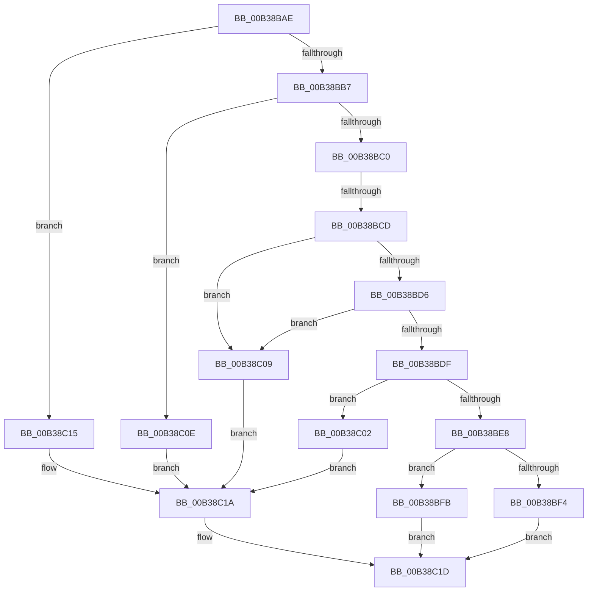

# sub_00B38BAE

- RVA: `0x00B38BAE`–`0x00B38C28` (길이 `122` bytes)
- VA: `0x0000000140B38BAE`
- 실행 섹션: `PAGE`
- PDB 이름 있음: `아니요`; PDB Function 태그: `아니요`
- unwind 정보 RVA: `0x000AC1A8`
- 디코드: `30`개 명령, `122/122` bytes 표시
- 미해석 바이트: `0` (있으면 어셈블리에 `.byte`로 보존)

> 이 문서는 커널 이미지의 기계어와 PDB 기호를 분석해 생성했습니다. 4번과 5번은 함수 원형과 자료형을 바이너리 사용 방식에서 추정한 C 해석이며 원본 소스 복구 결과는 아닙니다.

## 1. Dependencies

- 직접 호출 지점: **1**; 고유 호출 대상: **1**
- 직접 호출자로 확인된 함수: **0**
- RIP 상대 이미지 참조: **0**

### Outgoing calls
- `0x00B38C1D` → [PipSetDevNodeProblem](../8F/PipSetDevNodeProblem_function_008FDE0C.md) (function, `0x008FDE0C`)

### Direct callers
- 이 함수 시작 RVA로 연결되는 직접 call은 확인되지 않았습니다. 간접 호출은 완전히 역산할 수 없습니다.

### Static image references
- 디코드된 RIP-relative 메모리 참조가 없습니다.

## 2. Other-region calls and transfers

- 다른 실행 섹션으로 향하는 call: **0**
- call이 아닌 외부 분기/꼬리 이동: **2**
  - `0x00B38BC7` → [PnpProcessAssignResources + 0x163](../A2/PnpProcessAssignResources_function_00A2A950.md) (`tail-transfer`)
  - `0x00B38C23` → [PnpProcessAssignResources + 0x163](../A2/PnpProcessAssignResources_function_00A2A950.md) (`tail-transfer`)

## 3. Assembly (complete function range)

```asm
00B38BAE  41 81 F8 8A 00 00 C0            cmp r8d, 0xc000008a
00B38BB5  74 5E                           je 0x140b38c15
00B38BB7  41 81 F8 82 01 00 C0            cmp r8d, 0xc0000182
00B38BBE  74 4E                           je 0x140b38c0e
00B38BC0  41 81 F8 2D 02 00 C0            cmp r8d, 0xc000022d
00B38BC7  0F 84 E6 1E EF FF               je 0x140a2aab3
00B38BCD  41 81 F8 08 09 00 C0            cmp r8d, 0xc0000908
00B38BD4  74 33                           je 0x140b38c09
00B38BD6  41 81 F8 35 00 04 C0            cmp r8d, 0xc0040035
00B38BDD  74 2A                           je 0x140b38c09
00B38BDF  41 81 F8 36 00 04 C0            cmp r8d, 0xc0040036
00B38BE6  74 1A                           je 0x140b38c02
00B38BE8  48 8B CB                        mov rcx, rbx
00B38BEB  41 81 F8 37 00 04 C0            cmp r8d, 0xc0040037
00B38BF2  74 07                           je 0x140b38bfb
00B38BF4  BA 0C 00 00 00                  mov edx, 0xc
00B38BF9  EB 22                           jmp 0x140b38c1d
00B38BFB  BA 24 00 00 00                  mov edx, 0x24
00B38C00  EB 1B                           jmp 0x140b38c1d
00B38C02  BA 21 00 00 00                  mov edx, 0x21
00B38C07  EB 11                           jmp 0x140b38c1a
00B38C09  41 8B D6                        mov edx, r14d
00B38C0C  EB 0C                           jmp 0x140b38c1a
00B38C0E  BA 22 00 00 00                  mov edx, 0x22
00B38C13  EB 05                           jmp 0x140b38c1a
00B38C15  BA 11 00 00 00                  mov edx, 0x11
00B38C1A  48 8B CB                        mov rcx, rbx
00B38C1D  E8 EA 51 DC FF                  call 0x1408fde0c
00B38C22  90                              nop
00B38C23  E9 8B 1E EF FF                  jmp 0x140a2aab3
```

## 4. C-style interpretation (structured pseudocode)

```c
__int64 __fastcall sub_00B38BAE(__int64 a1, __int64 a2, int a3)
{
    __int64 result;

    if (a3 == 0xC000008AULL) goto loc_00B38C15;
    if (a3 == 0xC0000182ULL) goto loc_00B38C0E;
    if (a3 == 0xC0000908ULL) goto loc_00B38C09;
    if (a3 == 0xC0040035ULL) goto loc_00B38C09;
    if (a3 == 0xC0040036ULL) goto loc_00B38C02;
    if (a3 == 0xC0040037ULL) goto loc_00B38BFB;
    goto loc_00B38C1D;
loc_00B38BFB:
    goto loc_00B38C1D;
loc_00B38C02:
    goto loc_00B38C1A;
loc_00B38C09:
    goto loc_00B38C1A;
loc_00B38C0E:
    goto loc_00B38C1A;
loc_00B38C15:
loc_00B38C1A:
loc_00B38C1D:
    result = PipSetDevNodeProblem(v_rbx, 17, a3, a4);
}
```

## 5. (Beta) C Style

```c
int64_t sub_00B38BAE(int64_t Arg1, int64_t Arg2, int32_t Arg3)
{
    int64_t result;

    if (Arg3 == 0xC000008AULL) goto loc_00B38C15;
    if (Arg3 == 0xC0000182ULL) goto loc_00B38C0E;
    if (Arg3 == 0xC0000908ULL) goto loc_00B38C09;
    if (Arg3 == 0xC0040035ULL) goto loc_00B38C09;
    if (Arg3 == 0xC0040036ULL) goto loc_00B38C02;
    if (Arg3 == 0xC0040037ULL) goto loc_00B38BFB;
    goto loc_00B38C1D;
loc_00B38BFB:
    goto loc_00B38C1D;
loc_00B38C02:
    goto loc_00B38C1A;
loc_00B38C09:
    goto loc_00B38C1A;
loc_00B38C0E:
    goto loc_00B38C1A;
loc_00B38C15:
loc_00B38C1A:
loc_00B38C1D:
    result = PipSetDevNodeProblem(local_rbx, 17, Arg3, a4);
}
```

## 6. Execution-region graph

[열기: 2D/3D 그래프와 함수 탐색 컨트롤 패널](../../../control-panel.html?section=page&rva=0x00B38BAE&view=graph)

- 2D 그래프는 위에서 아래로 흐르고, 3D 그래프는 빈 공간을 드래그해 회전합니다. Shift+드래그는 이동, 휠은 확대·축소, 함수 노드 선택은 대상 보고서 이동입니다.

### Static fallback


