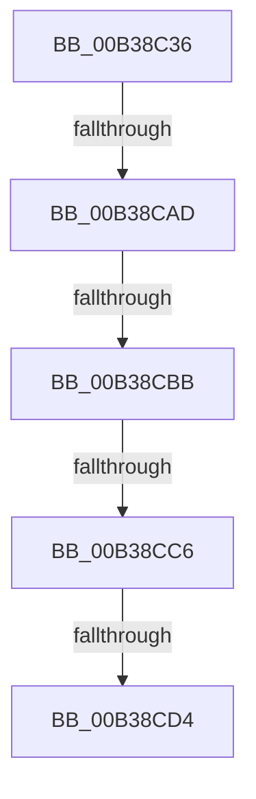

# sub_00B38C36

- RVA: `0x00B38C36`–`0x00B38CDD` (길이 `167` bytes)
- VA: `0x0000000140B38C36`
- 실행 섹션: `PAGE`
- PDB 이름 있음: `아니요`; PDB Function 태그: `아니요`
- unwind 정보 RVA: `0x000AC1E0`
- 디코드: `29`개 명령, `167/167` bytes 표시
- 미해석 바이트: `0` (있으면 어셈블리에 `.byte`로 보존)

> 이 문서는 커널 이미지의 기계어와 PDB 기호를 분석해 생성했습니다. 4번과 5번은 함수 원형과 자료형을 바이너리 사용 방식에서 추정한 C 해석이며 원본 소스 복구 결과는 아닙니다.

## 1. Dependencies

- 직접 호출 지점: **1**; 고유 호출 대상: **1**
- 직접 호출자로 확인된 함수: **0**
- RIP 상대 이미지 참조: **2**

### Outgoing calls
- `0x00B38CA0` → [PnpGetObjectProperty](../8E/PnpGetObjectProperty_function_008E2180.md) (function, `0x008E2180`)

### Direct callers
- 이 함수 시작 RVA로 연결되는 직접 call은 확인되지 않았습니다. 간접 호출은 완전히 역산할 수 없습니다.

### Static image references
- `0x00B38C47` → RVA `0x00E66398` (`.data`; read)
- `0x00B38C86` → RVA `0x00014428` (`.rdata`; read)

## 2. Other-region calls and transfers

- 다른 실행 섹션으로 향하는 call: **0**
- call이 아닌 외부 분기/꼬리 이동: **5**
  - `0x00B38CA7` → [PnpAssignResourcesToDevices + 0x3F](../A2/PnpAssignResourcesToDevices_function_00A2AC4C.md) (`tail-transfer`)
  - `0x00B38CB5` → [PnpAssignResourcesToDevices + 0x3F](../A2/PnpAssignResourcesToDevices_function_00A2AC4C.md) (`tail-transfer`)
  - `0x00B38CC0` → [PnpAssignResourcesToDevices + 0x3F](../A2/PnpAssignResourcesToDevices_function_00A2AC4C.md) (`tail-transfer`)
  - `0x00B38CCE` → [PnpAssignResourcesToDevices + 0x3F](../A2/PnpAssignResourcesToDevices_function_00A2AC4C.md) (`tail-transfer`)
  - `0x00B38CD8` → [PnpAssignResourcesToDevices + 0x3F](../A2/PnpAssignResourcesToDevices_function_00A2AC4C.md) (`tail-transfer`)

## 3. Assembly (complete function range)

```asm
00B38C36  83 64 24 50 00                  and dword ptr [rsp + 0x50], 0
00B38C3B  48 8D 44 24 60                  lea rax, [rsp + 0x60]
00B38C40  48 8B 52 30                     mov rdx, qword ptr [rdx + 0x30]
00B38C44  45 33 C9                        xor r9d, r9d
00B38C47  48 8B 0D 4A D7 32 00            mov rcx, qword ptr [rip + 0x32d74a]
00B38C4E  83 64 24 60 00                  and dword ptr [rsp + 0x60], 0
00B38C53  83 A4 24 A8 00 00 00 00         and dword ptr [rsp + 0xa8], 0
00B38C5B  48 89 44 24 48                  mov qword ptr [rsp + 0x48], rax
00B38C60  45 8D 41 01                     lea r8d, [r9 + 1]
00B38C64  C7 44 24 40 01 00 00 00         mov dword ptr [rsp + 0x40], 1
00B38C6C  48 8D 84 24 90 00 00 00         lea rax, [rsp + 0x90]
00B38C74  48 89 44 24 38                  mov qword ptr [rsp + 0x38], rax
00B38C79  48 8D 84 24 A8 00 00 00         lea rax, [rsp + 0xa8]
00B38C81  48 89 44 24 30                  mov qword ptr [rsp + 0x30], rax
00B38C86  48 8D 05 9B B7 4D FF            lea rax, [rip - 0xb24865]
00B38C8D  48 89 44 24 28                  mov qword ptr [rsp + 0x28], rax
00B38C92  48 83 64 24 20 00               and qword ptr [rsp + 0x20], 0
00B38C98  C6 84 24 90 00 00 00 00         mov byte ptr [rsp + 0x90], 0
00B38CA0  E8 DB 94 DA FF                  call 0x1408e2180
00B38CA5  85 C0                           test eax, eax
00B38CA7  0F 88 DE 1F EF FF               js 0x140a2ac8b
00B38CAD  83 BC 24 A8 00 00 00 11         cmp dword ptr [rsp + 0xa8], 0x11
00B38CB5  0F 85 D0 1F EF FF               jne 0x140a2ac8b
00B38CBB  83 7C 24 60 01                  cmp dword ptr [rsp + 0x60], 1
00B38CC0  0F 85 C5 1F EF FF               jne 0x140a2ac8b
00B38CC6  80 BC 24 90 00 00 00 FF         cmp byte ptr [rsp + 0x90], 0xff
00B38CCE  0F 85 B7 1F EF FF               jne 0x140a2ac8b
00B38CD4  83 63 0C 00                     and dword ptr [rbx + 0xc], 0
00B38CD8  E9 AE 1F EF FF                  jmp 0x140a2ac8b
```

## 4. C-style interpretation (structured pseudocode)

```c
__int64 __fastcall sub_00B38C36(__int64 a1, __int64 a2, __int64 a3, int a4, __int64 a5, __int64 a6, __int64 a7, __int64 a8, __int64 a9, unsigned int a10, __int64 a11, unsigned int a12, __int64 a13, __int64 a14, __int64 a15, __int64 a16, __int64 a17, unsigned __int8 a18, __int64 a19, __int64 a20, unsigned int a21)
{
    __int64 result;
    unsigned __int64 v_stack_p20;
    unsigned __int64 v_stack_p28;
    unsigned __int64 v_stack_p30;
    unsigned __int64 v_stack_p38;
    unsigned int v_stack_p40;
    unsigned __int64 v_stack_p48;
    unsigned __int8 v_stack_p90;

    a4 = 0;
    v_stack_p48 = a12;
    v_stack_p40 = 1;
    v_stack_p38 = a18;
    v_stack_p30 = a21;
    v_stack_p28 = v_rip - 11683941;
    v_stack_p90 = 0;
    result = PnpGetObjectProperty(*(unsigned __int64 *)(v_rip + 3331914), *(unsigned __int64 *)(a2 + 48), a4 + 1, a4);
}
```

## 5. (Beta) C Style

```c
int64_t sub_00B38C36(int64_t Arg1, void *Arg2, int64_t Arg3, int32_t Arg4, uint64_t Arg5, uint64_t Arg6, uint64_t Arg7, uint64_t Arg8, uint64_t Arg9, uint32_t Arg10, uint64_t Arg11, uint32_t Arg12, uint64_t Arg13, uint64_t Arg14, uint64_t Arg15, uint64_t Arg16, uint64_t Arg17, uint8_t Arg18, uint64_t Arg19, uint64_t Arg20, uint32_t Arg21)
{
    uint8_t *arg2 = (uint8_t *)Arg2;

    int64_t result;
    uint64_t v_stack_p20;
    uint64_t v_stack_p28;
    uint64_t v_stack_p30;
    uint64_t v_stack_p38;
    uint32_t v_stack_p40;
    uint64_t v_stack_p48;
    uint8_t v_stack_p90;

    Arg4 = 0;
    v_stack_p48 = Arg12;
    v_stack_p40 = 1;
    v_stack_p38 = Arg18;
    v_stack_p30 = Arg21;
    v_stack_p28 = v_rip - 11683941;
    v_stack_p90 = 0;
    result = PnpGetObjectProperty(*(uint64_t *)(v_rip + 0x32D74A), *(uint64_t *)(arg2 + 0x30), Arg4 + 1, Arg4);
}
```

### 관측된 메모리 오프셋

구조체 형식이 확인되지 않은 접근은 인자 기준의 오프셋으로만 기록했습니다.

| 기준 인자 | 오프셋 표현 | 폭 (bit) | 접근 |
|---|---:|---:|---|
| `Arg2` | `+ 0x30` | `64` | `R` |

## 6. Execution-region graph

[열기: 2D/3D 그래프와 함수 탐색 컨트롤 패널](../../../control-panel.html?section=page&rva=0x00B38C36&view=graph)

- 2D 그래프는 위에서 아래로 흐르고, 3D 그래프는 빈 공간을 드래그해 회전합니다. Shift+드래그는 이동, 휠은 확대·축소, 함수 노드 선택은 대상 보고서 이동입니다.

### Static fallback


