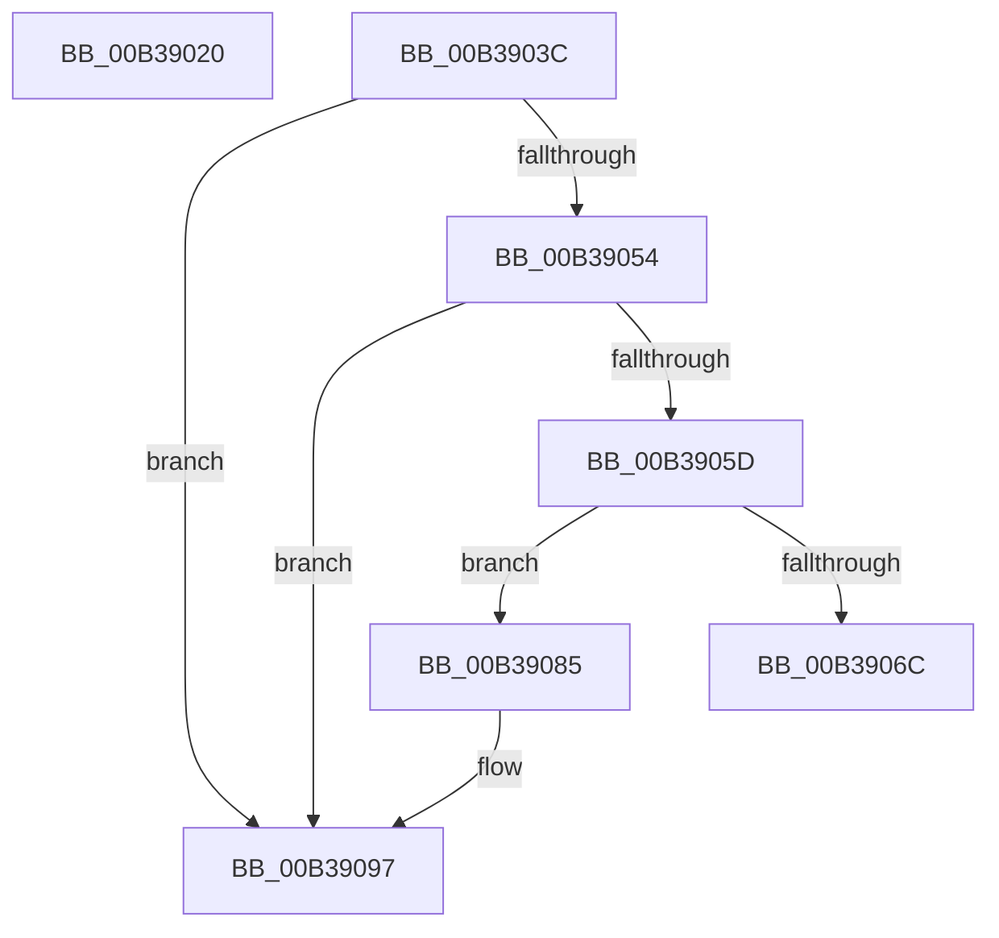

# sub_00B39020

- RVA: `0x00B39020`–`0x00B3909F` (길이 `127` bytes)
- VA: `0x0000000140B39020`
- 실행 섹션: `PAGE`
- PDB 이름 있음: `아니요`; PDB Function 태그: `아니요`
- unwind 정보 RVA: `0x000AC230`
- 디코드: `34`개 명령, `127/127` bytes 표시
- 미해석 바이트: `0` (있으면 어셈블리에 `.byte`로 보존)

> 이 문서는 커널 이미지의 기계어와 PDB 기호를 분석해 생성했습니다. 4번과 5번은 함수 원형과 자료형을 바이너리 사용 방식에서 추정한 C 해석이며 원본 소스 복구 결과는 아닙니다.

## 1. Dependencies

- 직접 호출 지점: **4**; 고유 호출 대상: **4**
- 직접 호출자로 확인된 함수: **0**
- RIP 상대 이미지 참조: **1**

### Outgoing calls
- `0x00B39031` → [ExReleaseFastMutex](../../text/25/ExReleaseFastMutex_function_002519C0.md) (function, `0x002519C0`)
- `0x00B39049` → [IopResourceRequirementsListToReqList](../A8/IopResourceRequirementsListToReqList_function_00A82954.md) (function, `0x00A82954`)
- `0x00B39060` → [IopRearrangeReqList](../AB/IopRearrangeReqList_function_00ABDA24.md) (function, `0x00ABDA24`)
- `0x00B3908D` → [PnpFreeResourceRequirementsForAssignTable](../73/PnpFreeResourceRequirementsForAssignTable_function_0073E8B8.md) (function, `0x0073E8B8`)

### Direct callers
- 이 함수 시작 RVA로 연결되는 직접 call은 확인되지 않았습니다. 간접 호출은 완전히 역산할 수 없습니다.

### Static image references
- `0x00B39023` → RVA `0x00F8C3E0` (`.data`; read)

## 2. Other-region calls and transfers

- 다른 실행 섹션으로 향하는 call: **1**
  - `0x00B39031` → [ExReleaseFastMutex](../../text/25/ExReleaseFastMutex_function_002519C0.md) (`PAGE` → `.text`)
- call이 아닌 외부 분기/꼬리 이동: **3**
  - `0x00B39037` → [PnpGetResourceRequirementsForAssignTable + 0x185](../A2/PnpGetResourceRequirementsForAssignTable_function_00A2ADBC.md) (`tail-transfer`)
  - `0x00B39080` → [PnpGetResourceRequirementsForAssignTable + 0xC7](../A2/PnpGetResourceRequirementsForAssignTable_function_00A2ADBC.md) (`tail-transfer`)
  - `0x00B3909A` → [PnpGetResourceRequirementsForAssignTable + 0xC3](../A2/PnpGetResourceRequirementsForAssignTable_function_00A2ADBC.md) (`tail-transfer`)

## 3. Assembly (complete function range)

```asm
00B39020  48 8B 03                        mov rax, qword ptr [rbx]
00B39023  48 8D 0D B6 33 45 00            lea rcx, [rip + 0x4533b6]
00B3902A  48 89 87 B8 01 00 00            mov qword ptr [rdi + 0x1b8], rax
00B39031  E8 8A 89 71 FF                  call 0x1402519c0
00B39036  90                              nop
00B39037  E9 05 1F EF FF                  jmp 0x140a2af41
00B3903C  0F BA 73 F0 09                  btr dword ptr [rbx - 0x10], 9
00B39041  48 8D 53 08                     lea rdx, [rbx + 8]
00B39045  48 8D 4B E8                     lea rcx, [rbx - 0x18]
00B39049  E8 06 99 F4 FF                  call 0x140a82954
00B3904E  8B F0                           mov esi, eax
00B39050  85 C0                           test eax, eax
00B39052  78 43                           js 0x140b39097
00B39054  48 8B 7B 08                     mov rdi, qword ptr [rbx + 8]
00B39058  48 85 FF                        test rdi, rdi
00B3905B  74 3A                           je 0x140b39097
00B3905D  48 8B CF                        mov rcx, rdi
00B39060  E8 BF 49 F8 FF                  call 0x140abda24
00B39065  48 83 7F 18 00                  cmp qword ptr [rdi + 0x18], 0
00B3906A  74 19                           je 0x140b39085
00B3906C  8B 4F 20                        mov ecx, dword ptr [rdi + 0x20]
00B3906F  33 C0                           xor eax, eax
00B39071  83 F9 03                        cmp ecx, 3
00B39074  89 73 20                        mov dword ptr [rbx + 0x20], esi
00B39077  0F 43 C1                        cmovae eax, ecx
00B3907A  41 FF 06                        inc dword ptr [r14]
00B3907D  89 43 F8                        mov dword ptr [rbx - 8], eax
00B39080  E9 FE 1D EF FF                  jmp 0x140a2ae83
00B39085  48 8D 53 28                     lea rdx, [rbx + 0x28]
00B39089  48 8D 4B E8                     lea rcx, [rbx - 0x18]
00B3908D  E8 26 58 C0 FF                  call 0x14073e8b8
00B39092  BE 82 01 00 C0                  mov esi, 0xc0000182
00B39097  89 73 20                        mov dword ptr [rbx + 0x20], esi
00B3909A  E9 E0 1D EF FF                  jmp 0x140a2ae7f
```

## 4. C-style interpretation (structured pseudocode)

```c
__int64 __fastcall sub_00B39020(void)
{
    __int64 result;

    *(unsigned __int64 *)(v_rdi + 440) = *(unsigned __int64 *)(v_rbx);
    result = ExReleaseFastMutex(v_rip + 4535222, a2, a3, a4);
}
```

## 5. (Beta) C Style

```c
void sub_00B39020(void)
{
    int64_t result;

    *(uint64_t *)(local_rdi + 0x1B8) = *(uint64_t *)(local_rbx);
    result = ExReleaseFastMutex(v_rip + 4535222, a2, a3, a4);
}
```

## 6. Execution-region graph

[열기: 2D/3D 그래프와 함수 탐색 컨트롤 패널](../../../control-panel.html?section=page&rva=0x00B39020&view=graph)

- 2D 그래프는 위에서 아래로 흐르고, 3D 그래프는 빈 공간을 드래그해 회전합니다. Shift+드래그는 이동, 휠은 확대·축소, 함수 노드 선택은 대상 보고서 이동입니다.

### Static fallback


