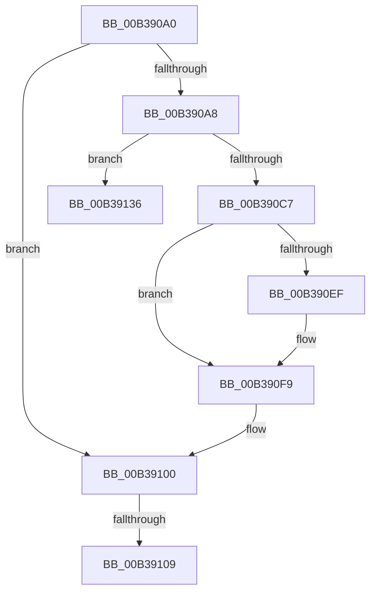

# sub_00B390A0

- RVA: `0x00B390A0`–`0x00B3913E` (길이 `158` bytes)
- VA: `0x0000000140B390A0`
- 실행 섹션: `PAGE`
- PDB 이름 있음: `아니요`; PDB Function 태그: `아니요`
- unwind 정보 RVA: `0x000AC254`
- 디코드: `36`개 명령, `158/158` bytes 표시
- 미해석 바이트: `0` (있으면 어셈블리에 `.byte`로 보존)

> 이 문서는 커널 이미지의 기계어와 PDB 기호를 분석해 생성했습니다. 4번과 5번은 함수 원형과 자료형을 바이너리 사용 방식에서 추정한 C 해석이며 원본 소스 복구 결과는 아닙니다.

## 1. Dependencies

- 직접 호출 지점: **3**; 고유 호출 대상: **3**
- 직접 호출자로 확인된 함수: **0**
- RIP 상대 이미지 참조: **6**

### Outgoing calls
- `0x00B390BA` → [ExAllocatePool2](../../poolcode/B8/ExAllocatePool2_function_00B820F0.md) (function, `0x00B820F0`)
- `0x00B390DF` → [memcpy](../../text/6C/memcpy_function_006C6840.md) (function, `0x006C6840`)
- `0x00B390F4` → [ExFreePoolWithTag](../../poolcode/B8/ExFreePoolWithTag_function_00B82870.md) (function, `0x00B82870`)

### Direct callers
- 이 함수 시작 RVA로 연결되는 직접 call은 확인되지 않았습니다. 간접 호출은 완전히 역산할 수 없습니다.

### Static image references
- `0x00B390A0` → RVA `0x00F8CC38` (`.data`; read)
- `0x00B390C7` → RVA `0x00F8CB28` (`.data`; read)
- `0x00B390D1` → RVA `0x00F8CB30` (`.data`; read)
- `0x00B390E4` → RVA `0x00F8CC38` (`.data`; read/write)
- `0x00B390F9` → RVA `0x00F8CB30` (`.data`; write)
- `0x00B39124` → RVA `0x00F8CB28` (`.data`; write)

## 2. Other-region calls and transfers

- 다른 실행 섹션으로 향하는 call: **3**
  - `0x00B390BA` → [ExAllocatePool2](../../poolcode/B8/ExAllocatePool2_function_00B820F0.md) (`PAGE` → `POOLCODE`)
  - `0x00B390DF` → [memcpy](../../text/6C/memcpy_function_006C6840.md) (`PAGE` → `.text`)
  - `0x00B390F4` → [ExFreePoolWithTag](../../poolcode/B8/ExFreePoolWithTag_function_00B82870.md) (`PAGE` → `POOLCODE`)
- call이 아닌 외부 분기/꼬리 이동: **3**
  - `0x00B39103` → [PnpBusTypeGuidGetIndex + 0x6D](../A2/PnpBusTypeGuidGetIndex_function_00A2B088.md) (`tail-transfer`)
  - `0x00B39131` → [PnpBusTypeGuidGetIndex + 0x6D](../A2/PnpBusTypeGuidGetIndex_function_00A2B088.md) (`tail-transfer`)
  - `0x00B39139` → [PnpBusTypeGuidGetIndex + 0x6D](../A2/PnpBusTypeGuidGetIndex_function_00A2B088.md) (`tail-transfer`)

## 3. Assembly (complete function range)

```asm
00B390A0  3B 1D 92 3B 45 00               cmp ebx, dword ptr [rip + 0x453b92]
00B390A6  75 58                           jne 0x140b39100
00B390A8  8D 53 01                        lea edx, [rbx + 1]
00B390AB  B9 00 01 00 00                  mov ecx, 0x100
00B390B0  48 C1 E2 04                     shl rdx, 4
00B390B4  41 B8 50 70 73 75               mov r8d, 0x75737050
00B390BA  E8 31 90 04 00                  call 0x140b820f0
00B390BF  48 8B F8                        mov rdi, rax
00B390C2  48 85 C0                        test rax, rax
00B390C5  74 6F                           je 0x140b39136
00B390C7  44 8B 05 5A 3A 45 00            mov r8d, dword ptr [rip + 0x453a5a]
00B390CE  48 8B C8                        mov rcx, rax
00B390D1  48 8B 35 58 3A 45 00            mov rsi, qword ptr [rip + 0x453a58]
00B390D8  49 C1 E0 04                     shl r8, 4
00B390DC  48 8B D6                        mov rdx, rsi
00B390DF  E8 5C D7 B8 FF                  call 0x1406c6840
00B390E4  FF 05 4E 3B 45 00               inc dword ptr [rip + 0x453b4e]
00B390EA  48 85 F6                        test rsi, rsi
00B390ED  74 0A                           je 0x140b390f9
00B390EF  33 D2                           xor edx, edx
00B390F1  48 8B CE                        mov rcx, rsi
00B390F4  E8 77 97 04 00                  call 0x140b82870
00B390F9  48 89 3D 30 3A 45 00            mov qword ptr [rip + 0x453a30], rdi
00B39100  83 FB FF                        cmp ebx, -1
00B39103  0F 84 EC 1F EF FF               je 0x140a2b0f5
00B39109  44 8B 0D 18 3A 45 00            mov r9d, dword ptr [rip + 0x453a18]
00B39110  48 8B 15 19 3A 45 00            mov rdx, qword ptr [rip + 0x453a19]
00B39117  45 8B C1                        mov r8d, r9d
00B3911A  0F 10 45 00                     movups xmm0, xmmword ptr [rbp]
00B3911E  4D 03 C0                        add r8, r8
00B39121  41 FF C1                        inc r9d
00B39124  44 89 0D FD 39 45 00            mov dword ptr [rip + 0x4539fd], r9d
00B3912B  F3 42 0F 7F 04 C2               movdqu xmmword ptr [rdx + r8*8], xmm0
00B39131  E9 BF 1F EF FF                  jmp 0x140a2b0f5
00B39136  83 CB FF                        or ebx, 0xffffffff
00B39139  E9 B7 1F EF FF                  jmp 0x140a2b0f5
```

## 4. C-style interpretation (structured pseudocode)

```c
__int64 __fastcall sub_00B390A0(void)
{
    __int64 result;
    __int64 v_rbx;

    if (((unsigned int)(v_rbx)) != (*(unsigned int *)(v_rip + 4537234))) goto loc_00B39100;
    a2 = (v_rbx + 1) << (4);
    result = ExAllocatePool2(256, a2, (unsigned int)(0x75737050ULL), a4);
    if (result == 0) goto loc_00B39136;
    a3 = ((unsigned int)(*(unsigned int *)(v_rip + 4536922))) << (4);
    result = memcpy(result, *(unsigned __int64 *)(v_rip + 4536920), a3, a4);
    if (*(unsigned __int64 *)(v_rip + 4536920) != 0) {
        a2 = 0;
        a1 = *(unsigned __int64 *)(v_rip + 4536920);
        result = ExFreePoolWithTag(a1, a2, a3, a4);
    }
    *(unsigned __int64 *)(v_rip + 4536880) = result;
loc_00B39100:
    a3 = ((unsigned int)((unsigned int)((unsigned int)(*(unsigned int *)(v_rip + 4536856))))) + ((unsigned int)((unsigned int)((unsigned int)(*(unsigned int *)(v_rip + 4536856)))));
    a4 = (unsigned int)(((unsigned int)(*(unsigned int *)(v_rip + 4536856))) + 1);
    *(unsigned int *)(v_rip + 4536829) = (unsigned int)(a4);
    *(unsigned __int64 *)(*(unsigned __int64 *)(v_rip + 4536857) + a3 * 8) = v_xmm0;
loc_00B39136:
    v_rbx = (unsigned int)((v_rbx) | (0xFFFFFFFFULL));
}
```

## 5. (Beta) C Style

```c
void sub_00B390A0(void)
{
    int64_t result;
    int64_t local_rbx;

    if (((uint32_t)(local_rbx)) != (*(uint32_t *)(v_rip + 0x453B92))) goto loc_00B39100;
    a2 = (local_rbx + 1) << (4);
    result = ExAllocatePool2(256, a2, (uint32_t)(0x75737050ULL), a4);
    if (result == 0) goto loc_00B39136;
    a3 = ((uint32_t)(*(uint32_t *)(v_rip + 0x453A5A))) << (4);
    result = memcpy(result, *(uint64_t *)(v_rip + 0x453A58), a3, a4);
    if (*(uint64_t *)(v_rip + 0x453A58) != 0) {
        a2 = 0;
        a1 = *(uint64_t *)(v_rip + 0x453A58);
        result = ExFreePoolWithTag(a1, a2, a3, a4);
    }
    *(uint64_t *)(v_rip + 0x453A30) = result;
loc_00B39100:
    a3 = ((uint32_t)((uint32_t)((uint32_t)(*(uint32_t *)(v_rip + 0x453A18))))) + ((uint32_t)((uint32_t)((uint32_t)(*(uint32_t *)(v_rip + 0x453A18)))));
    a4 = (uint32_t)(((uint32_t)(*(uint32_t *)(v_rip + 0x453A18))) + 1);
    *(uint32_t *)(v_rip + 0x4539FD) = (uint32_t)(a4);
    *(uint64_t *)(*(uint64_t *)(v_rip + 0x453A19) + a3 * 8) = v_xmm0;
loc_00B39136:
    local_rbx = (uint32_t)((local_rbx) | (0xFFFFFFFFULL));
}
```

## 6. Execution-region graph

[열기: 2D/3D 그래프와 함수 탐색 컨트롤 패널](../../../control-panel.html?section=page&rva=0x00B390A0&view=graph)

- 2D 그래프는 위에서 아래로 흐르고, 3D 그래프는 빈 공간을 드래그해 회전합니다. Shift+드래그는 이동, 휠은 확대·축소, 함수 노드 선택은 대상 보고서 이동입니다.

### Static fallback


