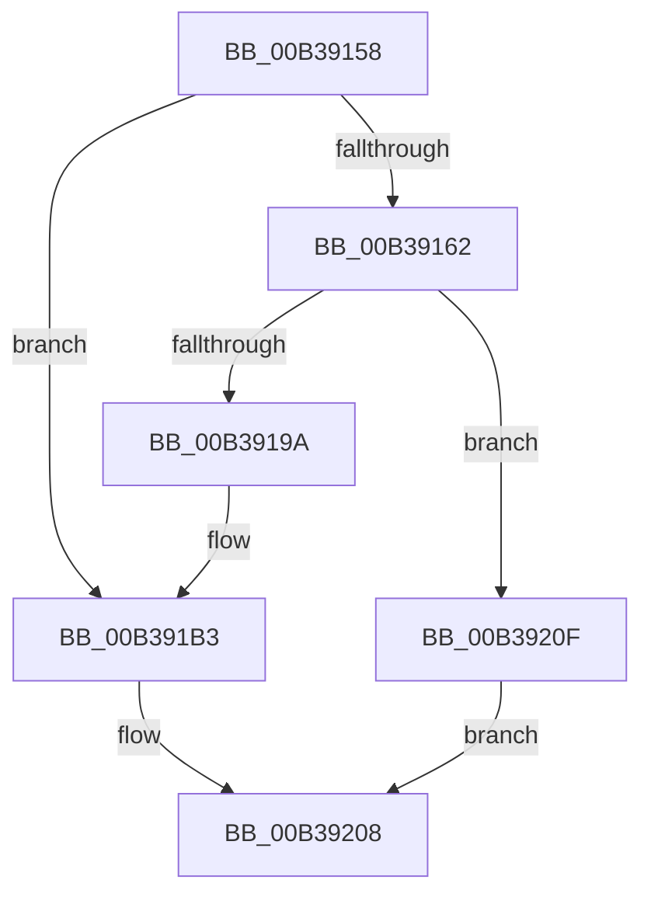

# sub_00B39158

- RVA: `0x00B39158`–`0x00B3921B` (길이 `195` bytes)
- VA: `0x0000000140B39158`
- 실행 섹션: `PAGE`
- PDB 이름 있음: `아니요`; PDB Function 태그: `아니요`
- unwind 정보 RVA: `0x000AC2E4`
- 디코드: `45`개 명령, `195/195` bytes 표시
- 미해석 바이트: `0` (있으면 어셈블리에 `.byte`로 보존)

> 이 문서는 커널 이미지의 기계어와 PDB 기호를 분석해 생성했습니다. 4번과 5번은 함수 원형과 자료형을 바이너리 사용 방식에서 추정한 C 해석이며 원본 소스 복구 결과는 아닙니다.

## 1. Dependencies

- 직접 호출 지점: **5**; 고유 호출 대상: **5**
- 직접 호출자로 확인된 함수: **0**
- RIP 상대 이미지 참조: **2**

### Outgoing calls
- `0x00B39169` → [KeGetProcessorNodeNumberByIndex](../../text/44/KeGetProcessorNodeNumberByIndex_function_004402A0.md) (function, `0x004402A0`)
- `0x00B3918F` → [MmCreateKernelStack](../../text/33/MmCreateKernelStack_function_00337D20.md) (function, `0x00337D20`)
- `0x00B391F0` → [KeInitializeApc](../../text/42/KeInitializeApc_function_00428510.md) (function, `0x00428510`)
- `0x00B39201` → [KeInsertQueueApc](../../text/20/KeInsertQueueApc_function_00203F10.md) (function, `0x00203F10`)
- `0x00B39214` → [ExFreePoolWithTag](../../poolcode/B8/ExFreePoolWithTag_function_00B82870.md) (function, `0x00B82870`)

### Direct callers
- 이 함수 시작 RVA로 연결되는 직접 call은 확인되지 않았습니다. 간접 호출은 완전히 역산할 수 없습니다.

### Static image references
- `0x00B3919F` → RVA `0x00FC6C54` (`ALMOSTRO`; read)
- `0x00B391B9` → RVA `0x005B9B90` (`KeEnableOptionalXStateFeaturesApc`; read)

## 2. Other-region calls and transfers

- 다른 실행 섹션으로 향하는 call: **5**
  - `0x00B39169` → [KeGetProcessorNodeNumberByIndex](../../text/44/KeGetProcessorNodeNumberByIndex_function_004402A0.md) (`PAGE` → `.text`)
  - `0x00B3918F` → [MmCreateKernelStack](../../text/33/MmCreateKernelStack_function_00337D20.md) (`PAGE` → `.text`)
  - `0x00B391F0` → [KeInitializeApc](../../text/42/KeInitializeApc_function_00428510.md) (`PAGE` → `.text`)
  - `0x00B39201` → [KeInsertQueueApc](../../text/20/KeInsertQueueApc_function_00203F10.md) (`PAGE` → `.text`)
  - `0x00B39214` → [ExFreePoolWithTag](../../poolcode/B8/ExFreePoolWithTag_function_00B82870.md) (`PAGE` → `POOLCODE`)
- call이 아닌 외부 분기/꼬리 이동: **1**
  - `0x00B3920A` → [PspRecheckThreadOptionalXStateFeatures + 0x40](../A2/PspRecheckThreadOptionalXStateFeatures_function_00A2B4B0.md) (`tail-transfer`)

## 3. Assembly (complete function range)

```asm
00B39158  41 F7 46 74 00 00 80 00         test dword ptr [r14 + 0x74], 0x800000
00B39160  75 51                           jne 0x140b391b3
00B39162  41 8B 8E 4C 02 00 00            mov ecx, dword ptr [r14 + 0x24c]
00B39169  E8 32 71 90 FF                  call 0x1404402a0
00B3916E  0F B7 D0                        movzx edx, ax
00B39171  48 8D 4C 24 40                  lea rcx, [rsp + 0x40]
00B39176  89 54 24 48                     mov dword ptr [rsp + 0x48], edx
00B3917A  C7 44 24 40 20 00 00 00         mov dword ptr [rsp + 0x40], 0x20
00B39182  C7 44 24 44 05 00 00 00         mov dword ptr [rsp + 0x44], 5
00B3918A  4C 89 74 24 50                  mov qword ptr [rsp + 0x50], r14
00B3918F  E8 8C EB 7F FF                  call 0x140337d20
00B39194  8B E8                           mov ebp, eax
00B39196  85 C0                           test eax, eax
00B39198  78 75                           js 0x140b3920f
00B3919A  48 8B 54 24 58                  mov rdx, qword ptr [rsp + 0x58]
00B3919F  8B 05 AF DA 48 00               mov eax, dword ptr [rip + 0x48daaf]
00B391A5  48 8B CA                        mov rcx, rdx
00B391A8  48 2B C8                        sub rcx, rax
00B391AB  48 89 56 68                     mov qword ptr [rsi + 0x68], rdx
00B391AF  48 89 4E 60                     mov qword ptr [rsi + 0x60], rcx
00B391B3  48 83 64 24 38 00               and qword ptr [rsp + 0x38], 0
00B391B9  4C 8D 0D D0 09 A8 FF            lea r9, [rip - 0x57f630]
00B391C0  C6 44 24 30 00                  mov byte ptr [rsp + 0x30], 0
00B391C5  48 8D 4E 08                     lea rcx, [rsi + 8]
00B391C9  48 83 64 24 28 00               and qword ptr [rsp + 0x28], 0
00B391CF  45 33 C0                        xor r8d, r8d
00B391D2  48 83 64 24 20 00               and qword ptr [rsp + 0x20], 0
00B391D8  49 8B D6                        mov rdx, r14
00B391DB  48 89 5E 70                     mov qword ptr [rsi + 0x70], rbx
00B391DF  4C 89 76 78                     mov qword ptr [rsi + 0x78], r14
00B391E3  48 89 B6 80 00 00 00            mov qword ptr [rsi + 0x80], rsi
00B391EA  C7 06 01 00 00 00               mov dword ptr [rsi], 1
00B391F0  E8 1B F3 8E FF                  call 0x140428510
00B391F5  45 33 C9                        xor r9d, r9d
00B391F8  48 8D 4E 08                     lea rcx, [rsi + 8]
00B391FC  45 33 C0                        xor r8d, r8d
00B391FF  33 D2                           xor edx, edx
00B39201  E8 0A AD 6C FF                  call 0x140203f10
00B39206  33 ED                           xor ebp, ebp
00B39208  8B C5                           mov eax, ebp
00B3920A  E9 E1 22 EF FF                  jmp 0x140a2b4f0
00B3920F  33 D2                           xor edx, edx
00B39211  48 8B CE                        mov rcx, rsi
00B39214  E8 57 96 04 00                  call 0x140b82870
00B39219  EB ED                           jmp 0x140b39208
```

## 4. C-style interpretation (structured pseudocode)

```c
__int64 __fastcall sub_00B39158(__int64 a1, __int64 a2, int a3, __int64 a4, __int64 a5, __int64 a6, __int64 a7, __int64 a8, __int64 a9, __int64 a10, __int64 a11)
{
    __int64 result;
    __int64 v_rbp;
    unsigned __int64 v_stack_p20;
    unsigned __int8 v_stack_p30;
    unsigned int v_stack_p40;
    unsigned int v_stack_p44;
    unsigned int v_stack_p48;
    unsigned __int64 v_stack_p50;

    if (((*(unsigned int *)(v_r14 + 116)) & (0x800000ULL)) != 0) goto loc_00B391B3;
    result = KeGetProcessorNodeNumberByIndex((unsigned int)(*(unsigned int *)(v_r14 + 588)), a2, a3, a4);
    v_stack_p48 = (unsigned int)((unsigned __int16)(result));
    v_stack_p40 = 32;
    v_stack_p44 = 5;
    v_stack_p50 = v_r14;
    result = MmCreateKernelStack(a8, (unsigned __int16)(result), a3, a4);
    if (sign_flag) goto loc_00B3920F;
    a1 = (a11) - ((unsigned int)(*(unsigned int *)(v_rip + 4774575)));
    *(unsigned __int64 *)(v_rsi + 104) = a11;
    *(unsigned __int64 *)(v_rsi + 96) = a1;
loc_00B391B3:
    v_stack_p30 = 0;
    a3 = 0;
    *(unsigned __int64 *)(v_rsi + 112) = v_rbx;
    *(unsigned __int64 *)(v_rsi + 120) = v_r14;
    *(unsigned __int64 *)(v_rsi + 128) = v_rsi;
    *(unsigned int *)(v_rsi) = 1;
    result = KeInitializeApc(v_rsi + 8, v_r14, a3, v_rip - 5764656);
    a4 = 0;
    a3 = 0;
    a2 = 0;
    result = KeInsertQueueApc(v_rsi + 8, a2, a3, a4);
    v_rbp = 0;
loc_00B39208:
loc_00B3920F:
    a2 = 0;
    result = ExFreePoolWithTag(v_rsi, a2, a3, a4);
    goto loc_00B39208;
}
```

## 5. (Beta) C Style

```c
int64_t sub_00B39158(int64_t Arg1, int64_t Arg2, int32_t Arg3, int64_t Arg4, int64_t Arg5, uint64_t Arg6, int64_t Arg7, int64_t Arg8, uint64_t Arg9, uint64_t Arg10, int64_t Arg11)
{
    int64_t result;
    int64_t local_rbp;
    uint64_t v_stack_p20;
    uint8_t v_stack_p30;
    uint32_t v_stack_p40;
    uint32_t v_stack_p44;
    uint32_t v_stack_p48;
    uint64_t v_stack_p50;

    if (((*(uint32_t *)(local_r14 + 0x74)) & (0x800000ULL)) != 0) goto loc_00B391B3;
    result = KeGetProcessorNodeNumberByIndex((uint32_t)(*(uint32_t *)(local_r14 + 0x24C)), Arg2, Arg3, Arg4);
    v_stack_p48 = (uint32_t)((uint16_t)(result));
    v_stack_p40 = 32;
    v_stack_p44 = 5;
    v_stack_p50 = local_r14;
    result = MmCreateKernelStack(Arg8, (uint16_t)(result), Arg3, Arg4);
    if (sign_flag) goto loc_00B3920F;
    Arg1 = (Arg11) - ((uint32_t)(*(uint32_t *)(v_rip + 0x48DAAF)));
    *(uint64_t *)(local_rsi + 0x68) = Arg11;
    *(uint64_t *)(local_rsi + 0x60) = Arg1;
loc_00B391B3:
    v_stack_p30 = 0;
    Arg3 = 0;
    *(uint64_t *)(local_rsi + 0x70) = local_rbx;
    *(uint64_t *)(local_rsi + 0x78) = local_r14;
    *(uint64_t *)(local_rsi + 0x80) = local_rsi;
    *(uint32_t *)(local_rsi) = 1;
    result = KeInitializeApc(local_rsi + 8, local_r14, Arg3, v_rip - 5764656);
    Arg4 = 0;
    Arg3 = 0;
    Arg2 = 0;
    result = KeInsertQueueApc(local_rsi + 8, Arg2, Arg3, Arg4);
    local_rbp = 0;
loc_00B39208:
loc_00B3920F:
    Arg2 = 0;
    result = ExFreePoolWithTag(local_rsi, Arg2, Arg3, Arg4);
    goto loc_00B39208;
}
```

## 6. Execution-region graph

[열기: 2D/3D 그래프와 함수 탐색 컨트롤 패널](../../../control-panel.html?section=page&rva=0x00B39158&view=graph)

- 2D 그래프는 위에서 아래로 흐르고, 3D 그래프는 빈 공간을 드래그해 회전합니다. Shift+드래그는 이동, 휠은 확대·축소, 함수 노드 선택은 대상 보고서 이동입니다.

### Static fallback


