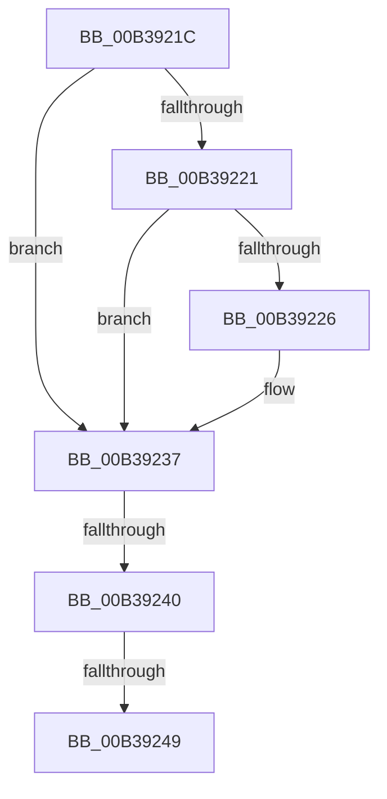

# sub_00B3921C

- RVA: `0x00B3921C`–`0x00B3925F` (길이 `67` bytes)
- VA: `0x0000000140B3921C`
- 실행 섹션: `PAGE`
- PDB 이름 있음: `아니요`; PDB Function 태그: `아니요`
- unwind 정보 RVA: `0x000AC300`
- 디코드: `17`개 명령, `67/67` bytes 표시
- 미해석 바이트: `0` (있으면 어셈블리에 `.byte`로 보존)

> 이 문서는 커널 이미지의 기계어와 PDB 기호를 분석해 생성했습니다. 4번과 5번은 함수 원형과 자료형을 바이너리 사용 방식에서 추정한 C 해석이며 원본 소스 복구 결과는 아닙니다.

## 1. Dependencies

- 직접 호출 지점: **2**; 고유 호출 대상: **1**
- 직접 호출자로 확인된 함수: **0**
- RIP 상대 이미지 참조: **1**

### Outgoing calls
- `0x00B39230` → [RtlInitUnicodeString](../../text/42/RtlInitUnicodeString_function_0042A780.md) (function, `0x0042A780`)
- `0x00B39253` → [RtlInitUnicodeString](../../text/42/RtlInitUnicodeString_function_0042A780.md) (function, `0x0042A780`)

### Direct callers
- 이 함수 시작 RVA로 연결되는 직접 call은 확인되지 않았습니다. 간접 호출은 완전히 역산할 수 없습니다.

### Static image references
- `0x00B39226` → RVA `0x0001A748` (`.rdata`; read)

## 2. Other-region calls and transfers

- 다른 실행 섹션으로 향하는 call: **2**
  - `0x00B39230` → [RtlInitUnicodeString](../../text/42/RtlInitUnicodeString_function_0042A780.md) (`PAGE` → `.text`)
  - `0x00B39253` → [RtlInitUnicodeString](../../text/42/RtlInitUnicodeString_function_0042A780.md) (`PAGE` → `.text`)
- call이 아닌 외부 분기/꼬리 이동: **3**
  - `0x00B3923A` → [AdtpBuildSockAddrString + 0x48](../A2/AdtpBuildSockAddrString_function_00A2B53C.md) (`tail-transfer`)
  - `0x00B39243` → [AdtpBuildSockAddrString + 0x48](../A2/AdtpBuildSockAddrString_function_00A2B53C.md) (`tail-transfer`)
  - `0x00B3925A` → [AdtpBuildSockAddrString + 0x48](../A2/AdtpBuildSockAddrString_function_00A2B53C.md) (`tail-transfer`)

## 3. Assembly (complete function range)

```asm
00B3921C  4D 85 D2                        test r10, r10
00B3921F  74 16                           je 0x140b39237
00B39221  48 85 F6                        test rsi, rsi
00B39224  74 11                           je 0x140b39237
00B39226  48 8D 15 1B 15 4E FF            lea rdx, [rip - 0xb1eae5]
00B3922D  49 8B CA                        mov rcx, r10
00B39230  E8 4B 15 8F FF                  call 0x14042a780
00B39235  88 1E                           mov byte ptr [rsi], bl
00B39237  48 85 ED                        test rbp, rbp
00B3923A  0F 84 44 23 EF FF               je 0x140a2b584
00B39240  48 85 FF                        test rdi, rdi
00B39243  0F 84 3B 23 EF FF               je 0x140a2b584
00B39249  48 8D 15 F8 14 4E FF            lea rdx, [rip - 0xb1eb08]
00B39250  48 8B CD                        mov rcx, rbp
00B39253  E8 28 15 8F FF                  call 0x14042a780
00B39258  88 1F                           mov byte ptr [rdi], bl
00B3925A  E9 25 23 EF FF                  jmp 0x140a2b584
```

## 4. C-style interpretation (structured pseudocode)

```c
__int64 __fastcall sub_00B3921C(void)
{
    __int64 result;

    if (v_r10 == 0) goto loc_00B39237;
    if (v_rsi != 0) {
        a2 = v_rip - 11660005;
        a1 = v_r10;
        result = RtlInitUnicodeString(a1, a2, a3, a4);
        *(unsigned __int8 *)(v_rsi) = (unsigned __int8)(v_rbx);
    }
    result = RtlInitUnicodeString(v_rbp, v_rip - 11660040, a3, a4);
    *(unsigned __int8 *)(v_rdi) = (unsigned __int8)(v_rbx);
}
```

## 5. (Beta) C Style

```c
void sub_00B3921C(void)
{
    int64_t result;

    if (local_r10 == 0) goto loc_00B39237;
    if (local_rsi != 0) {
        a2 = v_rip - 11660005;
        a1 = local_r10;
        result = RtlInitUnicodeString(a1, a2, a3, a4);
        *(uint8_t *)(local_rsi) = (uint8_t)(local_rbx);
    }
    result = RtlInitUnicodeString(local_rbp, v_rip - 11660040, a3, a4);
    *(uint8_t *)(local_rdi) = (uint8_t)(local_rbx);
}
```

## 6. Execution-region graph

[열기: 2D/3D 그래프와 함수 탐색 컨트롤 패널](../../../control-panel.html?section=page&rva=0x00B3921C&view=graph)

- 2D 그래프는 위에서 아래로 흐르고, 3D 그래프는 빈 공간을 드래그해 회전합니다. Shift+드래그는 이동, 휠은 확대·축소, 함수 노드 선택은 대상 보고서 이동입니다.

### Static fallback


