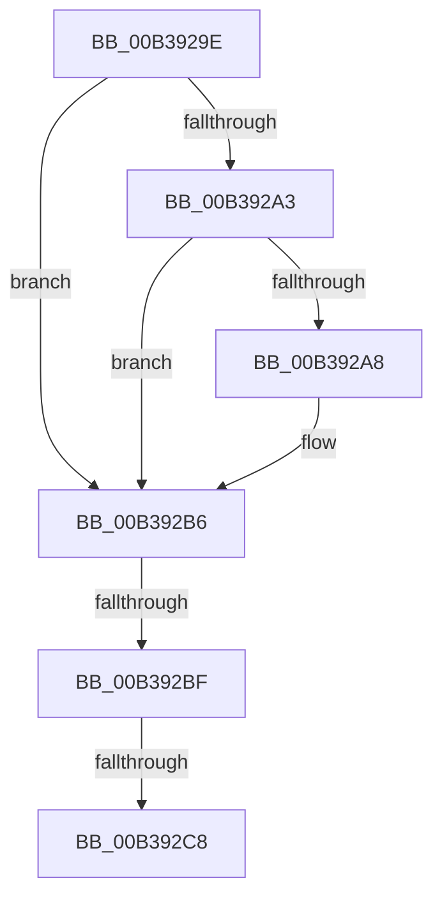

# sub_00B3929E

- RVA: `0x00B3929E`–`0x00B392DC` (길이 `62` bytes)
- VA: `0x0000000140B3929E`
- 실행 섹션: `PAGE`
- PDB 이름 있음: `아니요`; PDB Function 태그: `아니요`
- unwind 정보 RVA: `0x000AC33C`
- 디코드: `18`개 명령, `62/62` bytes 표시
- 미해석 바이트: `0` (있으면 어셈블리에 `.byte`로 보존)

> 이 문서는 커널 이미지의 기계어와 PDB 기호를 분석해 생성했습니다. 4번과 5번은 함수 원형과 자료형을 바이너리 사용 방식에서 추정한 C 해석이며 원본 소스 복구 결과는 아닙니다.

## 1. Dependencies

- 직접 호출 지점: **2**; 고유 호출 대상: **1**
- 직접 호출자로 확인된 함수: **0**
- RIP 상대 이미지 참조: **0**

### Outgoing calls
- `0x00B392B1` → [ExFreePoolWithTag](../../poolcode/B8/ExFreePoolWithTag_function_00B82870.md) (function, `0x00B82870`)
- `0x00B392D1` → [ExFreePoolWithTag](../../poolcode/B8/ExFreePoolWithTag_function_00B82870.md) (function, `0x00B82870`)

### Direct callers
- 이 함수 시작 RVA로 연결되는 직접 call은 확인되지 않았습니다. 간접 호출은 완전히 역산할 수 없습니다.

### Static image references
- 디코드된 RIP-relative 메모리 참조가 없습니다.

## 2. Other-region calls and transfers

- 다른 실행 섹션으로 향하는 call: **2**
  - `0x00B392B1` → [ExFreePoolWithTag](../../poolcode/B8/ExFreePoolWithTag_function_00B82870.md) (`PAGE` → `POOLCODE`)
  - `0x00B392D1` → [ExFreePoolWithTag](../../poolcode/B8/ExFreePoolWithTag_function_00B82870.md) (`PAGE` → `POOLCODE`)
- call이 아닌 외부 분기/꼬리 이동: **3**
  - `0x00B392B9` → [AdtpBuildIPv6Strings + 0xBC](../A2/AdtpBuildIPv6Strings_function_00A2B720.md) (`tail-transfer`)
  - `0x00B392C2` → [AdtpBuildIPv6Strings + 0xBC](../A2/AdtpBuildIPv6Strings_function_00A2B720.md) (`tail-transfer`)
  - `0x00B392D7` → [AdtpBuildIPv6Strings + 0xBC](../A2/AdtpBuildIPv6Strings_function_00A2B720.md) (`tail-transfer`)

## 3. Assembly (complete function range)

```asm
00B3929E  4D 85 F6                        test r14, r14
00B392A1  74 13                           je 0x140b392b6
00B392A3  41 38 2E                        cmp byte ptr [r14], bpl
00B392A6  74 0E                           je 0x140b392b6
00B392A8  41 88 2E                        mov byte ptr [r14], bpl
00B392AB  33 D2                           xor edx, edx
00B392AD  49 8B 4F 08                     mov rcx, qword ptr [r15 + 8]
00B392B1  E8 BA 95 04 00                  call 0x140b82870
00B392B6  48 85 F6                        test rsi, rsi
00B392B9  0F 84 1D 25 EF FF               je 0x140a2b7dc
00B392BF  40 38 2E                        cmp byte ptr [rsi], bpl
00B392C2  0F 84 14 25 EF FF               je 0x140a2b7dc
00B392C8  40 88 2E                        mov byte ptr [rsi], bpl
00B392CB  33 D2                           xor edx, edx
00B392CD  48 8B 4F 08                     mov rcx, qword ptr [rdi + 8]
00B392D1  E8 9A 95 04 00                  call 0x140b82870
00B392D6  90                              nop
00B392D7  E9 00 25 EF FF                  jmp 0x140a2b7dc
```

## 4. C-style interpretation (structured pseudocode)

```c
__int64 __fastcall sub_00B3929E(__int64 a1, int a2)
{
    __int64 result;

    if (v_r14 == 0) goto loc_00B392B6;
    if ((*(unsigned __int8 *)(v_r14)) != ((unsigned __int8)(v_rbp))) {
        *(unsigned __int8 *)(v_r14) = (unsigned __int8)(v_rbp);
        a2 = 0;
        a1 = *(unsigned __int64 *)(v_r15 + 8);
        result = ExFreePoolWithTag(a1, a2, a3, a4);
    }
    *(unsigned __int8 *)(v_rsi) = (unsigned __int8)(v_rbp);
    a2 = 0;
    result = ExFreePoolWithTag(*(unsigned __int64 *)(v_rdi + 8), a2, a3, a4);
}
```

## 5. (Beta) C Style

```c
int64_t sub_00B3929E(int64_t Arg1, int32_t Arg2)
{
    int64_t result;

    if (local_r14 == 0) goto loc_00B392B6;
    if ((*(uint8_t *)(local_r14)) != ((uint8_t)(local_rbp))) {
        *(uint8_t *)(local_r14) = (uint8_t)(local_rbp);
        Arg2 = 0;
        Arg1 = *(uint64_t *)(local_r15 + 0x8);
        result = ExFreePoolWithTag(Arg1, Arg2, a3, a4);
    }
    *(uint8_t *)(local_rsi) = (uint8_t)(local_rbp);
    Arg2 = 0;
    result = ExFreePoolWithTag(*(uint64_t *)(local_rdi + 0x8), Arg2, a3, a4);
}
```

## 6. Execution-region graph

[열기: 2D/3D 그래프와 함수 탐색 컨트롤 패널](../../../control-panel.html?section=page&rva=0x00B3929E&view=graph)

- 2D 그래프는 위에서 아래로 흐르고, 3D 그래프는 빈 공간을 드래그해 회전합니다. Shift+드래그는 이동, 휠은 확대·축소, 함수 노드 선택은 대상 보고서 이동입니다.

### Static fallback


