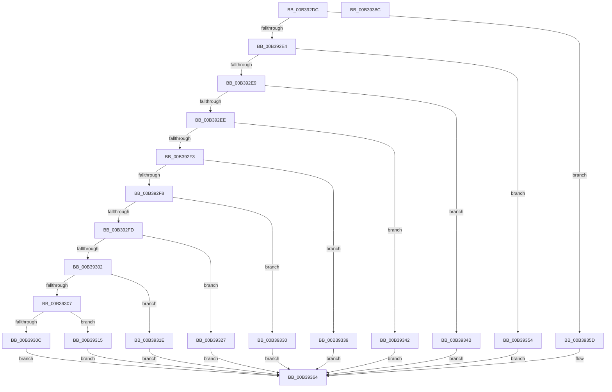

# sub_00B392DC

- RVA: `0x00B392DC`–`0x00B393BF` (길이 `227` bytes)
- VA: `0x0000000140B392DC`
- 실행 섹션: `PAGE`
- PDB 이름 있음: `아니요`; PDB Function 태그: `아니요`
- unwind 정보 RVA: `0x000AC3B0`
- 디코드: `60`개 명령, `227/227` bytes 표시
- 미해석 바이트: `0` (있으면 어셈블리에 `.byte`로 보존)

> 이 문서는 커널 이미지의 기계어와 PDB 기호를 분석해 생성했습니다. 4번과 5번은 함수 원형과 자료형을 바이너리 사용 방식에서 추정한 C 해석이며 원본 소스 복구 결과는 아닙니다.

## 1. Dependencies

- 직접 호출 지점: **2**; 고유 호출 대상: **2**
- 직접 호출자로 확인된 함수: **0**
- RIP 상대 이미지 참조: **12**

### Outgoing calls
- `0x00B39381` → [McTemplateK0zzd_EtwWriteTransfer](../../text/42/McTemplateK0zzd_EtwWriteTransfer_function_00424414.md) (function, `0x00424414`)
- `0x00B393B1` → [CmGetDeviceRelationsList](../9D/CmGetDeviceRelationsList_function_009D0660.md) (function, `0x009D0660`)

### Direct callers
- 이 함수 시작 RVA로 연결되는 직접 call은 확인되지 않았습니다. 간접 호출은 완전히 역산할 수 없습니다.

### Static image references
- `0x00B3930C` → RVA `0x006CB480` (` ?? ::FNODOBFM::`string'`; read)
- `0x00B39315` → RVA `0x006CB400` (` ?? ::FNODOBFM::`string'`; read)
- `0x00B3931E` → RVA `0x006CB3D0` (` ?? ::FNODOBFM::`string'`; read)
- `0x00B39327` → RVA `0x006CB3B0` (` ?? ::FNODOBFM::`string'`; read)
- `0x00B39330` → RVA `0x006CB390` (` ?? ::FNODOBFM::`string'`; read)
- `0x00B39339` → RVA `0x006CB450` (` ?? ::FNODOBFM::`string'`; read)
- `0x00B39342` → RVA `0x006CB430` (` ?? ::FNODOBFM::`string'`; read)
- `0x00B3934B` → RVA `0x006CB420` (` ?? ::FNODOBFM::`string'`; read)
- `0x00B39354` → RVA `0x006CB410` (` ?? ::FNODOBFM::`string'`; read)
- `0x00B3935D` → RVA `0x006CB380` (` ?? ::FNODOBFM::`string'`; read)
- `0x00B39368` → RVA `0x00026E90` (`.rdata`; read)
- `0x00B3939D` → RVA `0x00E66398` (`.data`; read)

## 2. Other-region calls and transfers

- 다른 실행 섹션으로 향하는 call: **1**
  - `0x00B39381` → [McTemplateK0zzd_EtwWriteTransfer](../../text/42/McTemplateK0zzd_EtwWriteTransfer_function_00424414.md) (`PAGE` → `.text`)
- call이 아닌 외부 분기/꼬리 이동: **2**
  - `0x00B39387` → [PiCMGetDeviceIdList + 0x7A](../A2/PiCMGetDeviceIdList_function_00A2BAAC.md) (`tail-transfer`)
  - `0x00B393BA` → [PiCMGetDeviceIdList + 0x170](../A2/PiCMGetDeviceIdList_function_00A2BAAC.md) (`tail-transfer`)

## 3. Assembly (complete function range)

```asm
00B392DC  41 0F B7 CE                     movzx ecx, r14w
00B392E0  85 C9                           test ecx, ecx
00B392E2  74 79                           je 0x140b3935d
00B392E4  83 E9 01                        sub ecx, 1
00B392E7  74 6B                           je 0x140b39354
00B392E9  83 E9 01                        sub ecx, 1
00B392EC  74 5D                           je 0x140b3934b
00B392EE  83 E9 02                        sub ecx, 2
00B392F1  74 4F                           je 0x140b39342
00B392F3  83 E9 04                        sub ecx, 4
00B392F6  74 41                           je 0x140b39339
00B392F8  83 E9 08                        sub ecx, 8
00B392FB  74 33                           je 0x140b39330
00B392FD  83 E9 10                        sub ecx, 0x10
00B39300  74 25                           je 0x140b39327
00B39302  83 E9 20                        sub ecx, 0x20
00B39305  74 17                           je 0x140b3931e
00B39307  83 F9 40                        cmp ecx, 0x40
00B3930A  74 09                           je 0x140b39315
00B3930C  48 8D 0D 6D 21 B9 FF            lea rcx, [rip - 0x46de93]
00B39313  EB 4F                           jmp 0x140b39364
00B39315  48 8D 0D E4 20 B9 FF            lea rcx, [rip - 0x46df1c]
00B3931C  EB 46                           jmp 0x140b39364
00B3931E  48 8D 0D AB 20 B9 FF            lea rcx, [rip - 0x46df55]
00B39325  EB 3D                           jmp 0x140b39364
00B39327  48 8D 0D 82 20 B9 FF            lea rcx, [rip - 0x46df7e]
00B3932E  EB 34                           jmp 0x140b39364
00B39330  48 8D 0D 59 20 B9 FF            lea rcx, [rip - 0x46dfa7]
00B39337  EB 2B                           jmp 0x140b39364
00B39339  48 8D 0D 10 21 B9 FF            lea rcx, [rip - 0x46def0]
00B39340  EB 22                           jmp 0x140b39364
00B39342  48 8D 0D E7 20 B9 FF            lea rcx, [rip - 0x46df19]
00B39349  EB 19                           jmp 0x140b39364
00B3934B  48 8D 0D CE 20 B9 FF            lea rcx, [rip - 0x46df32]
00B39352  EB 10                           jmp 0x140b39364
00B39354  48 8D 0D B5 20 B9 FF            lea rcx, [rip - 0x46df4b]
00B3935B  EB 07                           jmp 0x140b39364
00B3935D  48 8D 0D 1C 20 B9 FF            lea rcx, [rip - 0x46dfe4]
00B39364  4C 8B 4D F7                     mov r9, qword ptr [rbp - 9]
00B39368  48 8D 15 21 DB 4E FF            lea rdx, [rip - 0xb124df]
00B3936F  41 8B C6                        mov eax, r14d
00B39372  C1 E8 10                        shr eax, 0x10
00B39375  83 E0 01                        and eax, 1
00B39378  89 44 24 28                     mov dword ptr [rsp + 0x28], eax
00B3937C  48 89 4C 24 20                  mov qword ptr [rsp + 0x20], rcx
00B39381  E8 8E B0 8E FF                  call 0x140424414
00B39386  90                              nop
00B39387  E9 9A 27 EF FF                  jmp 0x140a2bb26
00B3938C  44 8B 45 EB                     mov r8d, dword ptr [rbp - 0x15]
00B39390  48 8D 45 E7                     lea rax, [rbp - 0x19]
00B39394  48 8B 55 F7                     mov rdx, qword ptr [rbp - 9]
00B39398  41 0F BA F0 08                  btr r8d, 8
00B3939D  48 8B 0D F4 CF 32 00            mov rcx, qword ptr [rip + 0x32cff4]
00B393A4  4C 8B CF                        mov r9, rdi
00B393A7  48 89 44 24 28                  mov qword ptr [rsp + 0x28], rax
00B393AC  44 89 54 24 20                  mov dword ptr [rsp + 0x20], r10d
00B393B1  E8 AA 72 E9 FF                  call 0x1409d0660
00B393B6  8B D8                           mov ebx, eax
00B393B8  85 C0                           test eax, eax
00B393BA  E9 5D 28 EF FF                  jmp 0x140a2bc1c
```

## 4. C-style interpretation (structured pseudocode)

```c
__int64 __fastcall sub_00B392DC(void)
{
    __int64 result;
    unsigned __int64 v_stack_p20;
    unsigned int v_stack_p28;

    if ((unsigned int)((unsigned __int16)(v_r14)) == 0) goto loc_00B3935D;
    a1 = (unsigned int)(((unsigned __int16)(v_r14)) - (1));
    if (condition_is_equal) goto loc_00B39354;
    a1 = (unsigned int)((a1) - (1));
    if (condition_is_equal) goto loc_00B3934B;
    a1 = (unsigned int)((a1) - (2));
    if (condition_is_equal) goto loc_00B39342;
    a1 = (unsigned int)((a1) - (4));
    if (condition_is_equal) goto loc_00B39339;
    a1 = (unsigned int)((a1) - (8));
    if (condition_is_equal) goto loc_00B39330;
    a1 = (unsigned int)((a1) - (16));
    if (condition_is_equal) goto loc_00B39327;
    a1 = (unsigned int)((a1) - (32));
    if (condition_is_equal) goto loc_00B3931E;
    if (((unsigned int)(a1)) == 64) goto loc_00B39315;
    goto loc_00B39364;
loc_00B39315:
    goto loc_00B39364;
loc_00B3931E:
    goto loc_00B39364;
loc_00B39327:
    goto loc_00B39364;
loc_00B39330:
    goto loc_00B39364;
loc_00B39339:
    goto loc_00B39364;
loc_00B39342:
    goto loc_00B39364;
loc_00B3934B:
    goto loc_00B39364;
loc_00B39354:
    goto loc_00B39364;
loc_00B3935D:
loc_00B39364:
    result = (unsigned int)(((unsigned int)((unsigned int)(v_r14))) >> (16));
    result = (unsigned int)((result) & (1));
    v_stack_p28 = (unsigned int)(result);
    v_stack_p20 = v_rip - 4644836;
    result = McTemplateK0zzd_EtwWriteTransfer(v_rip - 4644836, v_rip - 11609311, a3, *(unsigned __int64 *)(v_rbp - 9));
}
```

## 5. (Beta) C Style

```c
void sub_00B392DC(void)
{
    int64_t result;
    uint64_t v_stack_p20;
    uint32_t v_stack_p28;

    if ((uint32_t)((uint16_t)(local_r14)) == 0) goto loc_00B3935D;
    a1 = (uint32_t)(((uint16_t)(local_r14)) - (1));
    if (condition_is_equal) goto loc_00B39354;
    a1 = (uint32_t)((a1) - (1));
    if (condition_is_equal) goto loc_00B3934B;
    a1 = (uint32_t)((a1) - (2));
    if (condition_is_equal) goto loc_00B39342;
    a1 = (uint32_t)((a1) - (4));
    if (condition_is_equal) goto loc_00B39339;
    a1 = (uint32_t)((a1) - (8));
    if (condition_is_equal) goto loc_00B39330;
    a1 = (uint32_t)((a1) - (16));
    if (condition_is_equal) goto loc_00B39327;
    a1 = (uint32_t)((a1) - (32));
    if (condition_is_equal) goto loc_00B3931E;
    if (((uint32_t)(a1)) == 64) goto loc_00B39315;
    goto loc_00B39364;
loc_00B39315:
    goto loc_00B39364;
loc_00B3931E:
    goto loc_00B39364;
loc_00B39327:
    goto loc_00B39364;
loc_00B39330:
    goto loc_00B39364;
loc_00B39339:
    goto loc_00B39364;
loc_00B39342:
    goto loc_00B39364;
loc_00B3934B:
    goto loc_00B39364;
loc_00B39354:
    goto loc_00B39364;
loc_00B3935D:
loc_00B39364:
    result = (uint32_t)(((uint32_t)((uint32_t)(local_r14))) >> (16));
    result = (uint32_t)((result) & (1));
    v_stack_p28 = (uint32_t)(result);
    v_stack_p20 = v_rip - 4644836;
    result = McTemplateK0zzd_EtwWriteTransfer(v_rip - 4644836, v_rip - 11609311, a3, *(uint64_t *)(local_rbp - 0x9));
}
```

## 6. Execution-region graph

[열기: 2D/3D 그래프와 함수 탐색 컨트롤 패널](../../../control-panel.html?section=page&rva=0x00B392DC&view=graph)

- 2D 그래프는 위에서 아래로 흐르고, 3D 그래프는 빈 공간을 드래그해 회전합니다. Shift+드래그는 이동, 휠은 확대·축소, 함수 노드 선택은 대상 보고서 이동입니다.

### Static fallback


