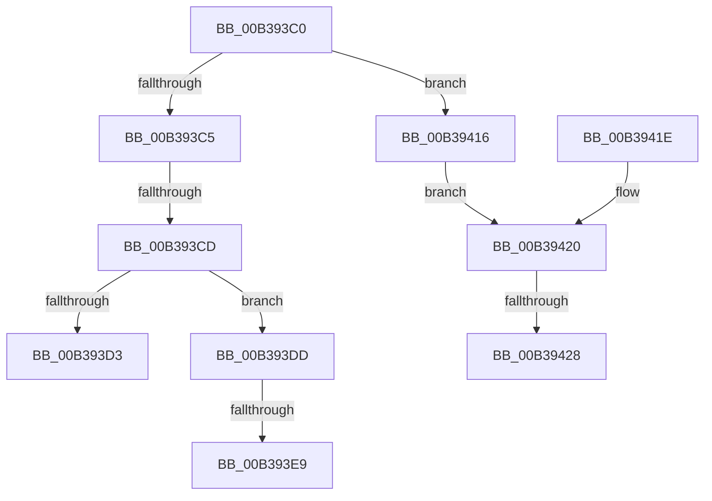

# sub_00B393C0

- RVA: `0x00B393C0`–`0x00B3943D` (길이 `125` bytes)
- VA: `0x0000000140B393C0`
- 실행 섹션: `PAGE`
- PDB 이름 있음: `아니요`; PDB Function 태그: `아니요`
- unwind 정보 RVA: `0x000AC76C`
- 디코드: `35`개 명령, `125/125` bytes 표시
- 미해석 바이트: `0` (있으면 어셈블리에 `.byte`로 보존)

> 이 문서는 커널 이미지의 기계어와 PDB 기호를 분석해 생성했습니다. 4번과 5번은 함수 원형과 자료형을 바이너리 사용 방식에서 추정한 C 해석이며 원본 소스 복구 결과는 아닙니다.

## 1. Dependencies

- 직접 호출 지점: **2**; 고유 호출 대상: **2**
- 직접 호출자로 확인된 함수: **0**
- RIP 상대 이미지 참조: **0**

### Outgoing calls
- `0x00B3940A` → [RtlUnicodeStringToInteger](../99/RtlUnicodeStringToInteger_function_00993480.md) (function, `0x00993480`)
- `0x00B39432` → [memcpy](../../text/6C/memcpy_function_006C6840.md) (function, `0x006C6840`)

### Direct callers
- 이 함수 시작 RVA로 연결되는 직접 call은 확인되지 않았습니다. 간접 호출은 완전히 역산할 수 없습니다.

### Static image references
- 디코드된 RIP-relative 메모리 참조가 없습니다.

## 2. Other-region calls and transfers

- 다른 실행 섹션으로 향하는 call: **1**
  - `0x00B39432` → [memcpy](../../text/6C/memcpy_function_006C6840.md) (`PAGE` → `.text`)
- call이 아닌 외부 분기/꼬리 이동: **6**
  - `0x00B393C7` → [RtlQueryImageFileKeyOption + 0x20D](../A2/RtlQueryImageFileKeyOption_function_00A2D110.md) (`tail-transfer`)
  - `0x00B393D8` → [RtlQueryImageFileKeyOption + 0x1AF](../A2/RtlQueryImageFileKeyOption_function_00A2D110.md) (`tail-transfer`)
  - `0x00B393E3` → [RtlQueryImageFileKeyOption + 0x1DC](../A2/RtlQueryImageFileKeyOption_function_00A2D110.md) (`tail-transfer`)
  - `0x00B39411` → [RtlQueryImageFileKeyOption + 0x195](../A2/RtlQueryImageFileKeyOption_function_00A2D110.md) (`tail-transfer`)
  - `0x00B39422` → [RtlQueryImageFileKeyOption + 0x1DC](../A2/RtlQueryImageFileKeyOption_function_00A2D110.md) (`tail-transfer`)
  - `0x00B39438` → [RtlQueryImageFileKeyOption + 0x195](../A2/RtlQueryImageFileKeyOption_function_00A2D110.md) (`tail-transfer`)

## 3. Assembly (complete function range)

```asm
00B393C0  44 3B F8                        cmp r15d, eax
00B393C3  75 51                           jne 0x140b39416
00B393C5  3B F0                           cmp esi, eax
00B393C7  0F 85 50 3F EF FF               jne 0x140a2d31d
00B393CD  41 F6 C6 03                     test r14b, 3
00B393D1  74 0A                           je 0x140b393dd
00B393D3  BB 02 00 00 80                  mov ebx, 0x80000002
00B393D8  E9 E2 3E EF FF                  jmp 0x140a2d2bf
00B393DD  89 45 C0                        mov dword ptr [rbp - 0x40], eax
00B393E0  4D 85 F6                        test r14, r14
00B393E3  0F 84 03 3F EF FF               je 0x140a2d2ec
00B393E9  48 8D 47 0C                     lea rax, [rdi + 0xc]
00B393ED  4D 8B C6                        mov r8, r14
00B393F0  48 89 45 D0                     mov qword ptr [rbp - 0x30], rax
00B393F4  48 8D 4D C8                     lea rcx, [rbp - 0x38]
00B393F8  0F B7 47 08                     movzx eax, word ptr [rdi + 8]
00B393FC  33 D2                           xor edx, edx
00B393FE  66 89 45 C8                     mov word ptr [rbp - 0x38], ax
00B39402  0F B7 47 08                     movzx eax, word ptr [rdi + 8]
00B39406  66 89 45 CA                     mov word ptr [rbp - 0x36], ax
00B3940A  E8 71 A0 E5 FF                  call 0x140993480
00B3940F  8B D8                           mov ebx, eax
00B39411  E9 8F 3E EF FF                  jmp 0x140a2d2a5
00B39416  8B 47 08                        mov eax, dword ptr [rdi + 8]
00B39419  89 45 C0                        mov dword ptr [rbp - 0x40], eax
00B3941C  EB 02                           jmp 0x140b39420
00B3941E  8B 02                           mov eax, dword ptr [rdx]
00B39420  3B C6                           cmp eax, esi
00B39422  0F 87 C4 3E EF FF               ja 0x140a2d2ec
00B39428  4C 8B C0                        mov r8, rax
00B3942B  48 8D 57 0C                     lea rdx, [rdi + 0xc]
00B3942F  49 8B CE                        mov rcx, r14
00B39432  E8 09 D4 B8 FF                  call 0x1406c6840
00B39437  90                              nop
00B39438  E9 68 3E EF FF                  jmp 0x140a2d2a5
```

## 4. C-style interpretation (structured pseudocode)

```c
__int64 __fastcall sub_00B393C0(__int64 a1, int a2)
{
    __int64 result;

    if (((unsigned int)(v_r15)) != ((unsigned int)(result))) goto loc_00B39416;
    if ((((unsigned __int8)(v_r14)) & (3)) == 0) goto loc_00B393DD;
loc_00B393DD:
    *(unsigned int *)(v_rbp - 64) = (unsigned int)(result);
    *(unsigned __int64 *)(v_rbp - 48) = v_rdi + 12;
    a2 = 0;
    *(unsigned __int16 *)(v_rbp - 56) = (unsigned __int16)(*(unsigned __int16 *)(v_rdi + 8));
    *(unsigned __int16 *)(v_rbp - 54) = (unsigned __int16)(*(unsigned __int16 *)(v_rdi + 8));
    result = RtlUnicodeStringToInteger(v_rbp - 56, a2, v_r14, a4);
loc_00B39416:
    *(unsigned int *)(v_rbp - 64) = (unsigned int)((unsigned int)(*(unsigned int *)(v_rdi + 8)));
    goto loc_00B39420;
loc_00B39420:
    result = memcpy(v_r14, v_rdi + 12, (unsigned int)(*(unsigned int *)(v_rdi + 8)), a4);
}
```

## 5. (Beta) C Style

```c
int64_t sub_00B393C0(int64_t Arg1, int32_t Arg2)
{
    int64_t result;

    if (((uint32_t)(local_r15)) != ((uint32_t)(result))) goto loc_00B39416;
    if ((((uint8_t)(local_r14)) & (3)) == 0) goto loc_00B393DD;
loc_00B393DD:
    *(uint32_t *)(local_rbp - 0x40) = (uint32_t)(result);
    *(uint64_t *)(local_rbp - 0x30) = local_rdi + 12;
    Arg2 = 0;
    *(uint16_t *)(local_rbp - 0x38) = (uint16_t)(*(uint16_t *)(local_rdi + 0x8));
    *(uint16_t *)(local_rbp - 0x36) = (uint16_t)(*(uint16_t *)(local_rdi + 0x8));
    result = RtlUnicodeStringToInteger(local_rbp - 56, Arg2, local_r14, a4);
loc_00B39416:
    *(uint32_t *)(local_rbp - 0x40) = (uint32_t)((uint32_t)(*(uint32_t *)(local_rdi + 0x8)));
    goto loc_00B39420;
loc_00B39420:
    result = memcpy(local_r14, local_rdi + 12, (uint32_t)(*(uint32_t *)(local_rdi + 0x8)), a4);
}
```

## 6. Execution-region graph

[열기: 2D/3D 그래프와 함수 탐색 컨트롤 패널](../../../control-panel.html?section=page&rva=0x00B393C0&view=graph)

- 2D 그래프는 위에서 아래로 흐르고, 3D 그래프는 빈 공간을 드래그해 회전합니다. Shift+드래그는 이동, 휠은 확대·축소, 함수 노드 선택은 대상 보고서 이동입니다.

### Static fallback


