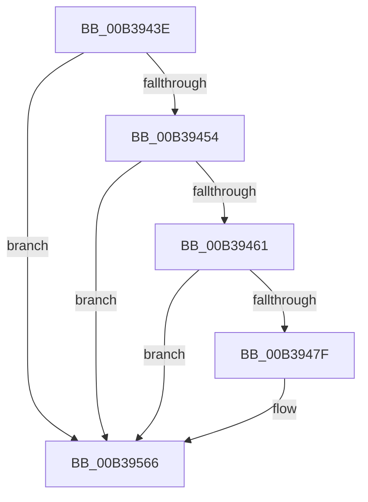

# sub_00B3943E

- RVA: `0x00B3943E`–`0x00B39570` (길이 `306` bytes)
- VA: `0x0000000140B3943E`
- 실행 섹션: `PAGE`
- PDB 이름 있음: `아니요`; PDB Function 태그: `아니요`
- unwind 정보 RVA: `0x000AC884`
- 디코드: `66`개 명령, `306/306` bytes 표시
- 미해석 바이트: `0` (있으면 어셈블리에 `.byte`로 보존)

> 이 문서는 커널 이미지의 기계어와 PDB 기호를 분석해 생성했습니다. 4번과 5번은 함수 원형과 자료형을 바이너리 사용 방식에서 추정한 C 해석이며 원본 소스 복구 결과는 아닙니다.

## 1. Dependencies

- 직접 호출 지점: **2**; 고유 호출 대상: **2**
- 직접 호출자로 확인된 함수: **0**
- RIP 상대 이미지 참조: **4**

### Outgoing calls
- `0x00B39472` → [tlgKeywordOn](../../text/42/tlgKeywordOn_function_0042EAA0.md) (function, `0x0042EAA0`)
- `0x00B39561` → [tlgWriteTransfer_EtwWriteTransfer](../../text/42/tlgWriteTransfer_EtwWriteTransfer_function_004260E0.md) (function, `0x004260E0`)

### Direct callers
- 이 함수 시작 RVA로 연결되는 직접 call은 확인되지 않았습니다. 간접 호출은 완전히 역산할 수 없습니다.

### Static image references
- `0x00B3943E` → RVA `0x00F07088` (`.data`; read/write)
- `0x00B39446` → RVA `0x00F07090` (`.data`; read)
- `0x00B39454` → RVA `0x00E083C8` (`.data`; read)
- `0x00B3948A` → RVA `0x000511A9` (`.rdata`; read)

## 2. Other-region calls and transfers

- 다른 실행 섹션으로 향하는 call: **2**
  - `0x00B39472` → [tlgKeywordOn](../../text/42/tlgKeywordOn_function_0042EAA0.md) (`PAGE` → `.text`)
  - `0x00B39561` → [tlgWriteTransfer_EtwWriteTransfer](../../text/42/tlgWriteTransfer_EtwWriteTransfer_function_004260E0.md) (`PAGE` → `.text`)
- call이 아닌 외부 분기/꼬리 이동: **1**
  - `0x00B3956B` → [SleepstudyHelperBuildBlocker + 0x1FD](../A2/SleepstudyHelperBuildBlocker_function_00A2DAD0.md) (`tail-transfer`)

## 3. Assembly (complete function range)

```asm
00B3943E  F0 48 FF 0D 42 DC 3C 00         lock dec qword ptr [rip + 0x3cdc42]
00B39446  8B 05 44 DC 3C 00               mov eax, dword ptr [rip + 0x3cdc44]
00B3944C  85 C0                           test eax, eax
00B3944E  0F 84 12 01 00 00               je 0x140b39566
00B39454  83 3D 6D EF 2C 00 05            cmp dword ptr [rip + 0x2cef6d], 5
00B3945B  0F 86 05 01 00 00               jbe 0x140b39566
00B39461  48 BA 00 00 00 00 00 40 00 00   movabs rdx, 0x400000000000
00B3946B  48 8D 0D 56 EF 2C 00            lea rcx, [rip + 0x2cef56]
00B39472  E8 29 56 8F FF                  call 0x14042eaa0
00B39477  84 C0                           test al, al
00B39479  0F 84 E7 00 00 00               je 0x140b39566
00B3947F  21 75 9C                        and dword ptr [rbp - 0x64], esi
00B39482  48 8D 44 24 48                  lea rax, [rsp + 0x48]
00B39487  21 75 AC                        and dword ptr [rbp - 0x54], esi
00B3948A  48 8D 15 18 7D 51 FF            lea rdx, [rip - 0xae82e8]
00B39491  48 89 45 90                     mov qword ptr [rbp - 0x70], rax
00B39495  B9 04 00 00 00                  mov ecx, 4
00B3949A  48 8D 44 24 4C                  lea rax, [rsp + 0x4c]
00B3949F  89 4D 98                        mov dword ptr [rbp - 0x68], ecx
00B394A2  48 89 45 A0                     mov qword ptr [rbp - 0x60], rax
00B394A6  B8 FF FF FF FF                  mov eax, 0xffffffff
00B394AB  4C 3B C0                        cmp r8, rax
00B394AE  44 89 4C 24 4C                  mov dword ptr [rsp + 0x4c], r9d
00B394B3  89 4D A8                        mov dword ptr [rbp - 0x58], ecx
00B394B6  44 0F 4F C0                     cmovg r8d, eax
00B394BA  89 4D B8                        mov dword ptr [rbp - 0x48], ecx
00B394BD  21 75 BC                        and dword ptr [rbp - 0x44], esi
00B394C0  48 8D 44 24 50                  lea rax, [rsp + 0x50]
00B394C5  21 75 CC                        and dword ptr [rbp - 0x34], esi
00B394C8  45 33 C9                        xor r9d, r9d
00B394CB  21 75 DC                        and dword ptr [rbp - 0x24], esi
00B394CE  21 75 EC                        and dword ptr [rbp - 0x14], esi
00B394D1  21 75 FC                        and dword ptr [rbp - 4], esi
00B394D4  21 75 0C                        and dword ptr [rbp + 0xc], esi
00B394D7  48 89 45 B0                     mov qword ptr [rbp - 0x50], rax
00B394DB  41 8B 45 28                     mov eax, dword ptr [r13 + 0x28]
00B394DF  89 44 24 54                     mov dword ptr [rsp + 0x54], eax
00B394E3  48 8D 44 24 54                  lea rax, [rsp + 0x54]
00B394E8  48 89 45 C0                     mov qword ptr [rbp - 0x40], rax
00B394EC  41 8B 45 18                     mov eax, dword ptr [r13 + 0x18]
00B394F0  89 44 24 40                     mov dword ptr [rsp + 0x40], eax
00B394F4  48 8D 44 24 40                  lea rax, [rsp + 0x40]
00B394F9  48 89 45 D0                     mov qword ptr [rbp - 0x30], rax
00B394FD  48 8D 45 F8                     lea rax, [rbp - 8]
00B39501  48 89 45 E0                     mov qword ptr [rbp - 0x20], rax
00B39505  49 8B 46 38                     mov rax, qword ptr [r14 + 0x38]
00B39509  48 89 45 F0                     mov qword ptr [rbp - 0x10], rax
00B3950D  41 0F B7 46 30                  movzx eax, word ptr [r14 + 0x30]
00B39512  89 45 F8                        mov dword ptr [rbp - 8], eax
00B39515  48 8D 44 24 58                  lea rax, [rsp + 0x58]
00B3951A  48 89 45 00                     mov qword ptr [rbp], rax
00B3951E  48 8D 44 24 70                  lea rax, [rsp + 0x70]
00B39523  44 89 44 24 50                  mov dword ptr [rsp + 0x50], r8d
00B39528  45 33 C0                        xor r8d, r8d
00B3952B  89 4D C8                        mov dword ptr [rbp - 0x38], ecx
00B3952E  89 4D D8                        mov dword ptr [rbp - 0x28], ecx
00B39531  48 8D 0D 90 EE 2C 00            lea rcx, [rip + 0x2cee90]
00B39538  48 89 44 24 28                  mov qword ptr [rsp + 0x28], rax
00B3953D  C7 44 24 20 0A 00 00 00         mov dword ptr [rsp + 0x20], 0xa
00B39545  44 89 54 24 48                  mov dword ptr [rsp + 0x48], r10d
00B3954A  C7 45 E8 02 00 00 00            mov dword ptr [rbp - 0x18], 2
00B39551  48 C7 44 24 58 00 00 00 01      mov qword ptr [rsp + 0x58], 0x1000000
00B3955A  C7 45 08 08 00 00 00            mov dword ptr [rbp + 8], 8
00B39561  E8 7A CB 8E FF                  call 0x1404260e0
00B39566  48 8B 5C 24 38                  mov rbx, qword ptr [rsp + 0x38]
00B3956B  E9 5D 47 EF FF                  jmp 0x140a2dccd
```

## 4. C-style interpretation (structured pseudocode)

```c
__int64 __fastcall sub_00B3943E(__int64 a1, __int64 a2, __int64 a3, int a4, __int64 a5, __int64 a6, __int64 a7, __int64 a8, __int64 a9, __int64 a10, __int64 a11, __int64 a12, __int64 a13, __int64 a14)
{
    __int64 result;
    unsigned int v_stack_p20;
    unsigned __int64 v_stack_p28;
    unsigned int v_stack_p40;
    unsigned int v_stack_p48;
    unsigned __int64 v_stack_p4C;
    unsigned int v_stack_p50;
    unsigned int v_stack_p54;
    unsigned __int64 v_stack_p58;

    if ((unsigned int)((unsigned int)(*(unsigned int *)(v_rip + 3988548))) == 0) goto loc_00B39566;
    if ((*(unsigned int *)(v_rip + 2944877)) <= 5) goto loc_00B39566;
    result = tlgKeywordOn(v_rip + 2944854, a2, a3, a4);
    if ((unsigned __int8)(result) != 0) {
        result = a9;
        a2 = v_rip - 11436776;
        *(unsigned __int64 *)(v_rbp - 112) = result;
        a1 = 4;
        result = v_stack_p4C;
        *(unsigned int *)(v_rbp - 104) = (unsigned int)(a1);
        *(unsigned __int64 *)(v_rbp - 96) = result;
        result = 0xFFFFFFFFULL;
        v_stack_p4C = a4;
        *(unsigned int *)(v_rbp - 88) = (unsigned int)(a1);
        if (a3 > result) { a3 = (unsigned int)(result); }
        *(unsigned int *)(v_rbp - 72) = (unsigned int)(a1);
        result = a10;
        a4 = 0;
        *(unsigned __int64 *)(v_rbp - 80) = result;
        result = *(unsigned int *)(v_r13 + 40);
        v_stack_p54 = (unsigned int)(result);
        result = v_stack_p54;
        *(unsigned __int64 *)(v_rbp - 64) = result;
        result = *(unsigned int *)(v_r13 + 24);
        v_stack_p40 = (unsigned int)(result);
        result = a8;
        *(unsigned __int64 *)(v_rbp - 48) = result;
        result = v_rbp - 8;
        *(unsigned __int64 *)(v_rbp - 32) = result;
        result = *(unsigned __int64 *)(v_r14 + 56);
        *(unsigned __int64 *)(v_rbp - 16) = result;
        result = *(unsigned __int16 *)(v_r14 + 48);
        *(unsigned int *)(v_rbp - 8) = (unsigned int)(result);
        result = a11;
        *(unsigned __int64 *)(v_rbp) = result;
        result = a14;
        v_stack_p50 = (unsigned int)(a3);
        a3 = 0;
        *(unsigned int *)(v_rbp - 56) = (unsigned int)(a1);
        *(unsigned int *)(v_rbp - 40) = (unsigned int)(a1);
        a1 = v_rip + 2944656;
        v_stack_p28 = result;
        v_stack_p20 = 10;
        v_stack_p48 = (unsigned int)(v_r10);
        *(unsigned int *)(v_rbp - 24) = 2;
        v_stack_p58 = 0x1000000ULL;
        *(unsigned int *)(v_rbp + 8) = 8;
        result = tlgWriteTransfer_EtwWriteTransfer(a1, a2, a3, a4);
    }
}
```

## 5. (Beta) C Style

```c
int64_t sub_00B3943E(int64_t Arg1, int64_t Arg2, int64_t Arg3, int32_t Arg4, uint64_t Arg5, uint64_t Arg6, int64_t Arg7, int64_t Arg8, int64_t Arg9, int64_t Arg10, int64_t Arg11, uint64_t Arg12, uint64_t Arg13, int64_t Arg14)
{
    int64_t result;
    uint32_t v_stack_p20;
    uint64_t v_stack_p28;
    uint32_t v_stack_p40;
    uint32_t v_stack_p48;
    uint64_t v_stack_p4C;
    uint32_t v_stack_p50;
    uint32_t v_stack_p54;
    uint64_t v_stack_p58;

    if ((uint32_t)((uint32_t)(*(uint32_t *)(v_rip + 0x3CDC44))) == 0) goto loc_00B39566;
    if ((*(uint32_t *)(v_rip + 0x2CEF6D)) <= 5) goto loc_00B39566;
    result = tlgKeywordOn(v_rip + 2944854, Arg2, Arg3, Arg4);
    if ((uint8_t)(result) != 0) {
        result = Arg9;
        Arg2 = v_rip - 11436776;
        *(uint64_t *)(local_rbp - 0x70) = result;
        Arg1 = 4;
        result = v_stack_p4C;
        *(uint32_t *)(local_rbp - 0x68) = (uint32_t)(Arg1);
        *(uint64_t *)(local_rbp - 0x60) = result;
        result = 0xFFFFFFFFULL;
        v_stack_p4C = Arg4;
        *(uint32_t *)(local_rbp - 0x58) = (uint32_t)(Arg1);
        if (Arg3 > result) { Arg3 = (uint32_t)(result); }
        *(uint32_t *)(local_rbp - 0x48) = (uint32_t)(Arg1);
        result = Arg10;
        Arg4 = 0;
        *(uint64_t *)(local_rbp - 0x50) = result;
        result = *(uint32_t *)(local_r13 + 0x28);
        v_stack_p54 = (uint32_t)(result);
        result = v_stack_p54;
        *(uint64_t *)(local_rbp - 0x40) = result;
        result = *(uint32_t *)(local_r13 + 0x18);
        v_stack_p40 = (uint32_t)(result);
        result = Arg8;
        *(uint64_t *)(local_rbp - 0x30) = result;
        result = local_rbp - 8;
        *(uint64_t *)(local_rbp - 0x20) = result;
        result = *(uint64_t *)(local_r14 + 0x38);
        *(uint64_t *)(local_rbp - 0x10) = result;
        result = *(uint16_t *)(local_r14 + 0x30);
        *(uint32_t *)(local_rbp - 0x8) = (uint32_t)(result);
        result = Arg11;
        *(uint64_t *)(local_rbp) = result;
        result = Arg14;
        v_stack_p50 = (uint32_t)(Arg3);
        Arg3 = 0;
        *(uint32_t *)(local_rbp - 0x38) = (uint32_t)(Arg1);
        *(uint32_t *)(local_rbp - 0x28) = (uint32_t)(Arg1);
        Arg1 = v_rip + 2944656;
        v_stack_p28 = result;
        v_stack_p20 = 10;
        v_stack_p48 = (uint32_t)(local_r10);
        *(uint32_t *)(local_rbp - 0x18) = 2;
        v_stack_p58 = 0x1000000ULL;
        *(uint32_t *)(local_rbp + 0x8) = 8;
        result = tlgWriteTransfer_EtwWriteTransfer(Arg1, Arg2, Arg3, Arg4);
    }
}
```

## 6. Execution-region graph

[열기: 2D/3D 그래프와 함수 탐색 컨트롤 패널](../../../control-panel.html?section=page&rva=0x00B3943E&view=graph)

- 2D 그래프는 위에서 아래로 흐르고, 3D 그래프는 빈 공간을 드래그해 회전합니다. Shift+드래그는 이동, 휠은 확대·축소, 함수 노드 선택은 대상 보고서 이동입니다.

### Static fallback


