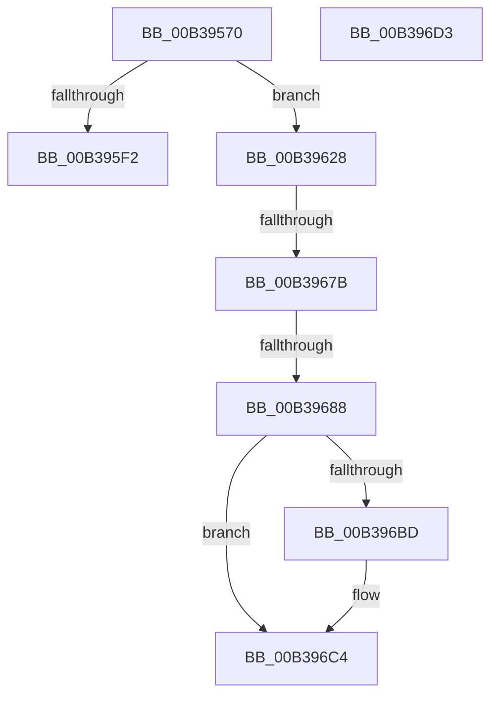

# sub_00B39570

- RVA: `0x00B39570`–`0x00B396FF` (길이 `399` bytes)
- VA: `0x0000000140B39570`
- 실행 섹션: `PAGE`
- PDB 이름 있음: `아니요`; PDB Function 태그: `아니요`
- unwind 정보 RVA: `0x000AC958`
- 디코드: `87`개 명령, `399/399` bytes 표시
- 미해석 바이트: `0` (있으면 어셈블리에 `.byte`로 보존)

> 이 문서는 커널 이미지의 기계어와 PDB 기호를 분석해 생성했습니다. 4번과 5번은 함수 원형과 자료형을 바이너리 사용 방식에서 추정한 C 해석이며 원본 소스 복구 결과는 아닙니다.

## 1. Dependencies

- 직접 호출 지점: **9**; 고유 호출 대상: **7**
- 직접 호출자로 확인된 함수: **0**
- RIP 상대 이미지 참조: **7**

### Outgoing calls
- `0x00B39598` → [memset](../../text/6C/memset_function_006C6C40.md) (function, `0x006C6C40`)
- `0x00B395E0` → [ZwAlpcAcceptConnectPort](../../text/6A/ZwAlpcAcceptConnectPort_function_006ADFF0.md) (function, `0x006ADFF0`)
- `0x00B3961D` → [ZwAlpcAcceptConnectPort](../../text/6A/ZwAlpcAcceptConnectPort_function_006ADFF0.md) (function, `0x006ADFF0`)
- `0x00B3966C` → [ZwAlpcOpenSenderProcess](../../text/6A/ZwAlpcOpenSenderProcess_function_006AE1F0.md) (function, `0x006AE1F0`)
- `0x00B396A9` → [ObReferenceObjectByHandle](../86/ObReferenceObjectByHandle_function_00868DB0.md) (function, `0x00868DB0`)
- `0x00B396C8` → [ZwClose](../../text/6A/ZwClose_function_006AD2B0.md) (function, `0x006AD2B0`)
- `0x00B396D5` → [PopAcquireUmpoPushLock](../A6/PopAcquireUmpoPushLock_function_00A65460.md) (function, `0x00A65460`)
- `0x00B396E8` → [PopReleaseUmpoPushLock](../A6/PopReleaseUmpoPushLock_function_00A68908.md) (function, `0x00A68908`)
- `0x00B396F0` → [ZwClose](../../text/6A/ZwClose_function_006AD2B0.md) (function, `0x006AD2B0`)

### Direct callers
- 이 함수 시작 RVA로 연결되는 직접 call은 확인되지 않았습니다. 간접 호출은 완전히 역산할 수 없습니다.

### Static image references
- `0x00B3959D` → RVA `0x00F084D8` (`.data`; read)
- `0x00B395A8` → RVA `0x00F084D0` (`.data`; read)
- `0x00B395AF` → RVA `0x00F084E0` (`.data`; read)
- `0x00B3962C` → RVA `0x00F084D8` (`.data`; write)
- `0x00B39688` → RVA `0x00FC6A98` (`ALMOSTRO`; read)
- `0x00B396B2` → RVA `0x00F084C0` (`.data`; write)
- `0x00B396E1` → RVA `0x00F084E0` (`.data`; write)

## 2. Other-region calls and transfers

- 다른 실행 섹션으로 향하는 call: **6**
  - `0x00B39598` → [memset](../../text/6C/memset_function_006C6C40.md) (`PAGE` → `.text`)
  - `0x00B395E0` → [ZwAlpcAcceptConnectPort](../../text/6A/ZwAlpcAcceptConnectPort_function_006ADFF0.md) (`PAGE` → `.text`)
  - `0x00B3961D` → [ZwAlpcAcceptConnectPort](../../text/6A/ZwAlpcAcceptConnectPort_function_006ADFF0.md) (`PAGE` → `.text`)
  - `0x00B3966C` → [ZwAlpcOpenSenderProcess](../../text/6A/ZwAlpcOpenSenderProcess_function_006AE1F0.md) (`PAGE` → `.text`)
  - `0x00B396C8` → [ZwClose](../../text/6A/ZwClose_function_006AD2B0.md) (`PAGE` → `.text`)
  - `0x00B396F0` → [ZwClose](../../text/6A/ZwClose_function_006AD2B0.md) (`PAGE` → `.text`)
- call이 아닌 외부 분기/꼬리 이동: **5**
  - `0x00B39623` → [PopUmpoProcessMessage + 0x62](../A2/PopUmpoProcessMessage_function_00A2E8C8.md) (`tail-transfer`)
  - `0x00B39675` → [PopUmpoProcessMessage + 0x62](../A2/PopUmpoProcessMessage_function_00A2E8C8.md) (`tail-transfer`)
  - `0x00B39682` → [PopUmpoProcessMessage + 0x62](../A2/PopUmpoProcessMessage_function_00A2E8C8.md) (`tail-transfer`)
  - `0x00B396CE` → [PopUmpoProcessMessage + 0x9C](../A2/PopUmpoProcessMessage_function_00A2E8C8.md) (`tail-transfer`)
  - `0x00B396FA` → [PopUmpoProcessMessage + 0x62](../A2/PopUmpoProcessMessage_function_00A2E8C8.md) (`tail-transfer`)

## 3. Assembly (complete function range)

```asm
00B39570  33 D2                           xor edx, edx
00B39572  C7 45 B7 30 00 00 00            mov dword ptr [rbp - 0x49], 0x30
00B39579  0F 57 C0                        xorps xmm0, xmm0
00B3957C  48 89 75 BF                     mov qword ptr [rbp - 0x41], rsi
00B39580  48 8D 4D E7                     lea rcx, [rbp - 0x19]
00B39584  C7 45 CF 00 02 00 00            mov dword ptr [rbp - 0x31], 0x200
00B3958B  48 89 75 C7                     mov qword ptr [rbp - 0x39], rsi
00B3958F  44 8D 42 48                     lea r8d, [rdx + 0x48]
00B39593  F3 0F 7F 45 D7                  movdqu xmmword ptr [rbp - 0x29], xmm0
00B39598  E8 A3 D6 B8 FF                  call 0x1406c6c40
00B3959D  40 38 35 34 EF 3C 00            cmp byte ptr [rip + 0x3cef34], sil
00B395A4  4C 8D 4D B7                     lea r9, [rbp - 0x49]
00B395A8  48 8B 15 21 EF 3C 00            mov rdx, qword ptr [rip + 0x3cef21]
00B395AF  48 8D 0D 2A EF 3C 00            lea rcx, [rip + 0x3cef2a]
00B395B6  0F 94 C0                        sete al
00B395B9  48 C7 45 F7 00 10 00 00         mov qword ptr [rbp - 9], 0x1000
00B395C1  88 44 24 40                     mov byte ptr [rsp + 0x40], al
00B395C5  45 33 C0                        xor r8d, r8d
00B395C8  48 89 74 24 38                  mov qword ptr [rsp + 0x38], rsi
00B395CD  48 8D 45 E7                     lea rax, [rbp - 0x19]
00B395D1  48 89 7C 24 30                  mov qword ptr [rsp + 0x30], rdi
00B395D6  48 89 74 24 28                  mov qword ptr [rsp + 0x28], rsi
00B395DB  48 89 44 24 20                  mov qword ptr [rsp + 0x20], rax
00B395E0  E8 0B 4A B7 FF                  call 0x1406adff0
00B395E5  48 8B 15 E4 EE 3C 00            mov rdx, qword ptr [rip + 0x3ceee4]
00B395EC  8B D8                           mov ebx, eax
00B395EE  85 C0                           test eax, eax
00B395F0  79 36                           jns 0x140b39628
00B395F2  40 88 74 24 40                  mov byte ptr [rsp + 0x40], sil
00B395F7  48 8D 45 E7                     lea rax, [rbp - 0x19]
00B395FB  48 89 74 24 38                  mov qword ptr [rsp + 0x38], rsi
00B39600  4C 8D 4D B7                     lea r9, [rbp - 0x49]
00B39604  48 89 7C 24 30                  mov qword ptr [rsp + 0x30], rdi
00B39609  48 8D 0D D0 EE 3C 00            lea rcx, [rip + 0x3ceed0]
00B39610  48 89 74 24 28                  mov qword ptr [rsp + 0x28], rsi
00B39615  45 33 C0                        xor r8d, r8d
00B39618  48 89 44 24 20                  mov qword ptr [rsp + 0x20], rax
00B3961D  E8 CE 49 B7 FF                  call 0x1406adff0
00B39622  90                              nop
00B39623  E9 02 53 EF FF                  jmp 0x140a2e92a
00B39628  48 8D 45 B7                     lea rax, [rbp - 0x49]
00B3962C  C6 05 A5 EE 3C 00 01            mov byte ptr [rip + 0x3ceea5], 1
00B39633  0F 57 C0                        xorps xmm0, xmm0
00B39636  48 89 44 24 28                  mov qword ptr [rsp + 0x28], rax
00B3963B  45 33 C9                        xor r9d, r9d
00B3963E  C7 44 24 20 00 04 00 00         mov dword ptr [rsp + 0x20], 0x400
00B39646  4C 8B C7                        mov r8, rdi
00B39649  C7 45 B7 30 00 00 00            mov dword ptr [rbp - 0x49], 0x30
00B39650  48 8D 4D A7                     lea rcx, [rbp - 0x59]
00B39654  48 89 75 BF                     mov qword ptr [rbp - 0x41], rsi
00B39658  C7 45 CF 00 02 00 00            mov dword ptr [rbp - 0x31], 0x200
00B3965F  48 89 75 C7                     mov qword ptr [rbp - 0x39], rsi
00B39663  F3 0F 7F 45 D7                  movdqu xmmword ptr [rbp - 0x29], xmm0
00B39668  48 89 75 A7                     mov qword ptr [rbp - 0x59], rsi
00B3966C  E8 7F 4B B7 FF                  call 0x1406ae1f0
00B39671  8B D8                           mov ebx, eax
00B39673  85 C0                           test eax, eax
00B39675  0F 88 AF 52 EF FF               js 0x140a2e92a
00B3967B  48 8B 4D A7                     mov rcx, qword ptr [rbp - 0x59]
00B3967F  48 85 C9                        test rcx, rcx
00B39682  0F 84 A2 52 EF FF               je 0x140a2e92a
00B39688  4C 8B 05 09 D4 48 00            mov r8, qword ptr [rip + 0x48d409]
00B3968F  48 8D 45 AF                     lea rax, [rbp - 0x51]
00B39693  48 89 74 24 28                  mov qword ptr [rsp + 0x28], rsi
00B39698  45 33 C9                        xor r9d, r9d
00B3969B  BA 00 00 00 10                  mov edx, 0x10000000
00B396A0  48 89 44 24 20                  mov qword ptr [rsp + 0x20], rax
00B396A5  48 89 75 AF                     mov qword ptr [rbp - 0x51], rsi
00B396A9  E8 02 F7 D2 FF                  call 0x140868db0
00B396AE  48 8B 4D AF                     mov rcx, qword ptr [rbp - 0x51]
00B396B2  48 89 0D 07 EE 3C 00            mov qword ptr [rip + 0x3cee07], rcx
00B396B9  85 C0                           test eax, eax
00B396BB  79 07                           jns 0x140b396c4
00B396BD  48 89 35 FC ED 3C 00            mov qword ptr [rip + 0x3cedfc], rsi
00B396C4  48 8B 4D A7                     mov rcx, qword ptr [rbp - 0x59]
00B396C8  E8 E3 3B B7 FF                  call 0x1406ad2b0
00B396CD  90                              nop
00B396CE  E9 91 52 EF FF                  jmp 0x140a2e964
00B396D3  B1 01                           mov cl, 1
00B396D5  E8 86 BD F2 FF                  call 0x140a65460
00B396DA  48 8B 1D FF ED 3C 00            mov rbx, qword ptr [rip + 0x3cedff]
00B396E1  48 89 35 F8 ED 3C 00            mov qword ptr [rip + 0x3cedf8], rsi
00B396E8  E8 1B F2 F2 FF                  call 0x140a68908
00B396ED  48 8B CB                        mov rcx, rbx
00B396F0  E8 BB 3B B7 FF                  call 0x1406ad2b0
00B396F5  BB 00 07 00 C0                  mov ebx, 0xc0000700
00B396FA  E9 2B 52 EF FF                  jmp 0x140a2e92a
```

## 4. C-style interpretation (structured pseudocode)

```c
__int64 __fastcall sub_00B39570(__int64 a1, int a2)
{
    __int64 result;
    unsigned __int64 v_stack_p20;
    unsigned __int64 v_stack_p28;
    unsigned __int64 v_stack_p30;
    unsigned __int64 v_stack_p38;
    unsigned __int8 v_stack_p40;

    a2 = 0;
    *(unsigned int *)(v_rbp - 73) = 48;
    *(unsigned __int64 *)(v_rbp - 65) = v_rsi;
    *(unsigned int *)(v_rbp - 49) = 512;
    *(unsigned __int64 *)(v_rbp - 57) = v_rsi;
    *(unsigned __int64 *)(v_rbp - 41) = v_xmm0;
    result = memset(v_rbp - 25, a2, a2 + 72, a4);
    result = ((*(unsigned __int8 *)(v_rip + 3993396)) == ((unsigned __int8)(v_rsi))) ? 1 : 0;
    *(unsigned __int64 *)(v_rbp - 9) = 0x1000ULL;
    v_stack_p40 = (unsigned __int8)(result);
    a3 = 0;
    v_stack_p38 = v_rsi;
    v_stack_p30 = v_rdi;
    v_stack_p28 = v_rsi;
    v_stack_p20 = v_rbp - 25;
    result = ZwAlpcAcceptConnectPort(v_rip + 3993386, *(unsigned __int64 *)(v_rip + 3993377), a3, v_rbp - 73);
    if (!sign_flag) goto loc_00B39628;
    v_stack_p40 = (unsigned __int8)(v_rsi);
    v_stack_p38 = v_rsi;
    v_stack_p30 = v_rdi;
    v_stack_p28 = v_rsi;
    a3 = 0;
    v_stack_p20 = v_rbp - 25;
    result = ZwAlpcAcceptConnectPort(v_rip + 3993296, *(unsigned __int64 *)(v_rip + 3993316), a3, v_rbp - 73);
loc_00B39628:
    *(unsigned __int8 *)(v_rip + 3993253) = 1;
    v_stack_p28 = v_rbp - 73;
    a4 = 0;
    v_stack_p20 = 0x400ULL;
    *(unsigned int *)(v_rbp - 73) = 48;
    *(unsigned __int64 *)(v_rbp - 65) = v_rsi;
    *(unsigned int *)(v_rbp - 49) = 512;
    *(unsigned __int64 *)(v_rbp - 57) = v_rsi;
    *(unsigned __int64 *)(v_rbp - 41) = v_xmm0;
    *(unsigned __int64 *)(v_rbp - 89) = v_rsi;
    result = ZwAlpcOpenSenderProcess(v_rbp - 89, *(unsigned __int64 *)(v_rip + 3993316), v_rdi, a4);
    v_stack_p28 = v_rsi;
    a4 = 0;
    v_stack_p20 = v_rbp - 81;
    *(unsigned __int64 *)(v_rbp - 81) = v_rsi;
    result = ObReferenceObjectByHandle(*(unsigned __int64 *)(v_rbp - 89), (unsigned int)(0x10000000ULL), *(unsigned __int64 *)(v_rip + 4772873), a4);
    *(unsigned __int64 *)(v_rip + 3993095) = *(unsigned __int64 *)(v_rbp - 81);
    if (sign_flag) {
        *(unsigned __int64 *)(v_rip + 3993084) = v_rsi;
    }
    result = ZwClose(*(unsigned __int64 *)(v_rbp - 89), (unsigned int)(0x10000000ULL), *(unsigned __int64 *)(v_rip + 4772873), a4);
}
```

## 5. (Beta) C Style

```c
int64_t sub_00B39570(int64_t Arg1, int32_t Arg2)
{
    int64_t result;
    uint64_t v_stack_p20;
    uint64_t v_stack_p28;
    uint64_t v_stack_p30;
    uint64_t v_stack_p38;
    uint8_t v_stack_p40;

    Arg2 = 0;
    *(uint32_t *)(local_rbp - 0x49) = 48;
    *(uint64_t *)(local_rbp - 0x41) = local_rsi;
    *(uint32_t *)(local_rbp - 0x31) = 512;
    *(uint64_t *)(local_rbp - 0x39) = local_rsi;
    *(uint64_t *)(local_rbp - 0x29) = v_xmm0;
    result = memset(local_rbp - 25, Arg2, Arg2 + 72, a4);
    result = ((*(uint8_t *)(v_rip + 0x3CEF34)) == ((uint8_t)(local_rsi))) ? 1 : 0;
    *(uint64_t *)(local_rbp - 0x9) = 0x1000ULL;
    v_stack_p40 = (uint8_t)(result);
    a3 = 0;
    v_stack_p38 = local_rsi;
    v_stack_p30 = local_rdi;
    v_stack_p28 = local_rsi;
    v_stack_p20 = local_rbp - 25;
    result = ZwAlpcAcceptConnectPort(v_rip + 3993386, *(uint64_t *)(v_rip + 0x3CEF21), a3, local_rbp - 73);
    if (!sign_flag) goto loc_00B39628;
    v_stack_p40 = (uint8_t)(local_rsi);
    v_stack_p38 = local_rsi;
    v_stack_p30 = local_rdi;
    v_stack_p28 = local_rsi;
    a3 = 0;
    v_stack_p20 = local_rbp - 25;
    result = ZwAlpcAcceptConnectPort(v_rip + 3993296, *(uint64_t *)(v_rip + 0x3CEEE4), a3, local_rbp - 73);
loc_00B39628:
    *(uint8_t *)(v_rip + 0x3CEEA5) = 1;
    v_stack_p28 = local_rbp - 73;
    a4 = 0;
    v_stack_p20 = 0x400ULL;
    *(uint32_t *)(local_rbp - 0x49) = 48;
    *(uint64_t *)(local_rbp - 0x41) = local_rsi;
    *(uint32_t *)(local_rbp - 0x31) = 512;
    *(uint64_t *)(local_rbp - 0x39) = local_rsi;
    *(uint64_t *)(local_rbp - 0x29) = v_xmm0;
    *(uint64_t *)(local_rbp - 0x59) = local_rsi;
    result = ZwAlpcOpenSenderProcess(local_rbp - 89, *(uint64_t *)(v_rip + 0x3CEEE4), local_rdi, a4);
    v_stack_p28 = local_rsi;
    a4 = 0;
    v_stack_p20 = local_rbp - 81;
    *(uint64_t *)(local_rbp - 0x51) = local_rsi;
    result = ObReferenceObjectByHandle(*(uint64_t *)(local_rbp - 0x59), (uint32_t)(0x10000000ULL), *(uint64_t *)(v_rip + 0x48D409), a4);
    *(uint64_t *)(v_rip + 0x3CEE07) = *(uint64_t *)(local_rbp - 0x51);
    if (sign_flag) {
        *(uint64_t *)(v_rip + 0x3CEDFC) = local_rsi;
    }
    result = ZwClose(*(uint64_t *)(local_rbp - 0x59), (uint32_t)(0x10000000ULL), *(uint64_t *)(v_rip + 0x48D409), a4);
}
```

## 6. Execution-region graph

[열기: 2D/3D 그래프와 함수 탐색 컨트롤 패널](../../../control-panel.html?section=page&rva=0x00B39570&view=graph)

- 2D 그래프는 위에서 아래로 흐르고, 3D 그래프는 빈 공간을 드래그해 회전합니다. Shift+드래그는 이동, 휠은 확대·축소, 함수 노드 선택은 대상 보고서 이동입니다.

### Static fallback


