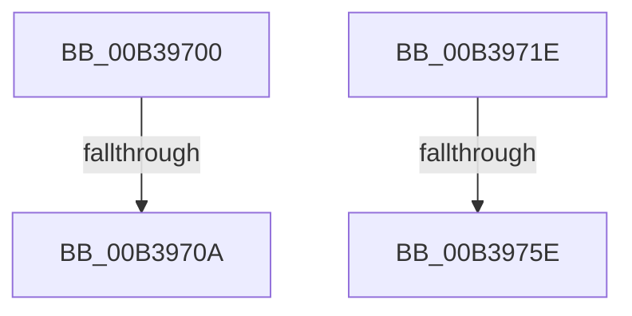

# sub_00B39700

- RVA: `0x00B39700`–`0x00B39769` (길이 `105` bytes)
- VA: `0x0000000140B39700`
- 실행 섹션: `PAGE`
- PDB 이름 있음: `아니요`; PDB Function 태그: `아니요`
- unwind 정보 RVA: `0x000AC974`
- 디코드: `21`개 명령, `105/105` bytes 표시
- 미해석 바이트: `0` (있으면 어셈블리에 `.byte`로 보존)

> 이 문서는 커널 이미지의 기계어와 PDB 기호를 분석해 생성했습니다. 4번과 5번은 함수 원형과 자료형을 바이너리 사용 방식에서 추정한 C 해석이며 원본 소스 복구 결과는 아닙니다.

## 1. Dependencies

- 직접 호출 지점: **5**; 고유 호출 대상: **5**
- 직접 호출자로 확인된 함수: **0**
- RIP 상대 이미지 참조: **4**

### Outgoing calls
- `0x00B3971E` → [PopPowerRequestOverrideInitialize](../75/PopPowerRequestOverrideInitialize_function_00754C04.md) (function, `0x00754C04`)
- `0x00B3972A` → [PopAcquireRwLockExclusive](../../text/43/PopAcquireRwLockExclusive_function_00430B44.md) (function, `0x00430B44`)
- `0x00B3973D` → [PopPowerAggregatorScheduleWorker](../91/PopPowerAggregatorScheduleWorker_function_00912B9C.md) (function, `0x00912B9C`)
- `0x00B39749` → [PopReleaseRwLock](../../text/2D/PopReleaseRwLock_function_002DFBBC.md) (function, `0x002DFBBC`)
- `0x00B3975E` → [guard_dispatch_icall](../../text/6B/guard_dispatch_icall_function_006BAAD0.md) (function, `0x006BAAD0`)

### Direct callers
- 이 함수 시작 RVA로 연결되는 직접 call은 확인되지 않았습니다. 간접 호출은 완전히 역산할 수 없습니다.

### Static image references
- `0x00B39723` → RVA `0x00F09710` (`.data`; read)
- `0x00B3972F` → RVA `0x00F09740` (`.data`; read)
- `0x00B39736` → RVA `0x00F0AD38` (`.data`; write)
- `0x00B3974E` → RVA `0x00E67830` (`.data`; read)

## 2. Other-region calls and transfers

- 다른 실행 섹션으로 향하는 call: **3**
  - `0x00B3972A` → [PopAcquireRwLockExclusive](../../text/43/PopAcquireRwLockExclusive_function_00430B44.md) (`PAGE` → `.text`)
  - `0x00B39749` → [PopReleaseRwLock](../../text/2D/PopReleaseRwLock_function_002DFBBC.md) (`PAGE` → `.text`)
  - `0x00B3975E` → [guard_dispatch_icall](../../text/6B/guard_dispatch_icall_function_006BAAD0.md) (`PAGE` → `.text`)
- call이 아닌 외부 분기/꼬리 이동: **4**
  - `0x00B39704` → [PopUmpoProcessPowerMessage + 0x35](../A2/PopUmpoProcessPowerMessage_function_00A2E9B4.md) (`tail-transfer`)
  - `0x00B39719` → [PopUmpoProcessPowerMessage + 0x35](../A2/PopUmpoProcessPowerMessage_function_00A2E9B4.md) (`tail-transfer`)
  - `0x00B39758` → [PopUmpoProcessPowerMessage + 0x35](../A2/PopUmpoProcessPowerMessage_function_00A2E9B4.md) (`tail-transfer`)
  - `0x00B39764` → [PopUmpoProcessPowerMessage + 0x35](../A2/PopUmpoProcessPowerMessage_function_00A2E9B4.md) (`tail-transfer`)

## 3. Assembly (complete function range)

```asm
00B39700  41 83 FB 01                     cmp r11d, 1
00B39704  0F 85 DF 52 EF FF               jne 0x140a2e9e9
00B3970A  88 42 02                        mov byte ptr [rdx + 2], al
00B3970D  4C 89 42 30                     mov qword ptr [rdx + 0x30], r8
00B39711  4C 89 4A 38                     mov qword ptr [rdx + 0x38], r9
00B39715  44 89 52 0C                     mov dword ptr [rdx + 0xc], r10d
00B39719  E9 CB 52 EF FF                  jmp 0x140a2e9e9
00B3971E  E8 E1 B4 C1 FF                  call 0x140754c04
00B39723  48 8D 0D E6 FF 3C 00            lea rcx, [rip + 0x3cffe6]
00B3972A  E8 15 74 8F FF                  call 0x140430b44
00B3972F  48 8D 0D 0A 00 3D 00            lea rcx, [rip + 0x3d000a]
00B39736  C6 05 FB 15 3D 00 01            mov byte ptr [rip + 0x3d15fb], 1
00B3973D  E8 5A 94 DD FF                  call 0x140912b9c
00B39742  48 8D 0D C7 FF 3C 00            lea rcx, [rip + 0x3cffc7]
00B39749  E8 6E 64 7A FF                  call 0x1402dfbbc
00B3974E  48 8B 05 DB E0 32 00            mov rax, qword ptr [rip + 0x32e0db]
00B39755  48 85 C0                        test rax, rax
00B39758  0F 84 8B 52 EF FF               je 0x140a2e9e9
00B3975E  E8 6D 13 B8 FF                  call 0x1406baad0
00B39763  90                              nop
00B39764  E9 80 52 EF FF                  jmp 0x140a2e9e9
```

## 4. C-style interpretation (structured pseudocode)

```c
__int64 __fastcall sub_00B39700(__int64 a1, __int64 a2, __int64 a3, __int64 a4)
{
    *(unsigned __int8 *)(a2 + 2) = (unsigned __int8)(result);
    *(unsigned __int64 *)(a2 + 48) = a3;
    *(unsigned __int64 *)(a2 + 56) = a4;
    *(unsigned int *)(a2 + 12) = (unsigned int)(v_r10);
}
```

## 5. (Beta) C Style

```c
int64_t sub_00B39700(int64_t Arg1, void *Arg2, int64_t Arg3, int64_t Arg4)
{
    uint8_t *arg2 = (uint8_t *)Arg2;

    *(uint8_t *)(arg2 + 0x2) = (uint8_t)(result);
    *(uint64_t *)(arg2 + 0x30) = Arg3;
    *(uint64_t *)(arg2 + 0x38) = Arg4;
    *(uint32_t *)(arg2 + 0xC) = (uint32_t)(local_r10);
}
```

### 관측된 메모리 오프셋

구조체 형식이 확인되지 않은 접근은 인자 기준의 오프셋으로만 기록했습니다.

| 기준 인자 | 오프셋 표현 | 폭 (bit) | 접근 |
|---|---:|---:|---|
| `Arg2` | `+ 0x2` | `8` | `W` |
| `Arg2` | `+ 0xC` | `32` | `W` |
| `Arg2` | `+ 0x30` | `64` | `W` |
| `Arg2` | `+ 0x38` | `64` | `W` |

## 6. Execution-region graph

[열기: 2D/3D 그래프와 함수 탐색 컨트롤 패널](../../../control-panel.html?section=page&rva=0x00B39700&view=graph)

- 2D 그래프는 위에서 아래로 흐르고, 3D 그래프는 빈 공간을 드래그해 회전합니다. Shift+드래그는 이동, 휠은 확대·축소, 함수 노드 선택은 대상 보고서 이동입니다.

### Static fallback


