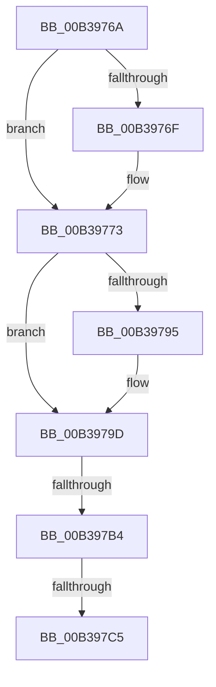

# sub_00B3976A

- RVA: `0x00B3976A`–`0x00B397D0` (길이 `102` bytes)
- VA: `0x0000000140B3976A`
- 실행 섹션: `PAGE`
- PDB 이름 있음: `아니요`; PDB Function 태그: `아니요`
- unwind 정보 RVA: `0x000ACA20`
- 디코드: `25`개 명령, `102/102` bytes 표시
- 미해석 바이트: `0` (있으면 어셈블리에 `.byte`로 보존)

> 이 문서는 커널 이미지의 기계어와 PDB 기호를 분석해 생성했습니다. 4번과 5번은 함수 원형과 자료형을 바이너리 사용 방식에서 추정한 C 해석이며 원본 소스 복구 결과는 아닙니다.

## 1. Dependencies

- 직접 호출 지점: **4**; 고유 호출 대상: **4**
- 직접 호출자로 확인된 함수: **0**
- RIP 상대 이미지 참조: **2**

### Outgoing calls
- `0x00B3977D` → [RtlAvlRemoveNode](../../text/29/RtlAvlRemoveNode_function_00296650.md) (function, `0x00296650`)
- `0x00B39798` → [ExfTryToWakePushLock](../../text/26/ExfTryToWakePushLock_function_00265DD0.md) (function, `0x00265DD0`)
- `0x00B397A0` → [KeAbPostRelease](../../text/2E/KeAbPostRelease_function_002E1600.md) (function, `0x002E1600`)
- `0x00B397C5` → [KiCheckForKernelApcDelivery](../../text/2E/KiCheckForKernelApcDelivery_function_002E2C80.md) (function, `0x002E2C80`)

### Direct callers
- 이 함수 시작 RVA로 연결되는 직접 call은 확인되지 않았습니다. 간접 호출은 완전히 역산할 수 없습니다.

### Static image references
- `0x00B39776` → RVA `0x00E2CD08` (`.data`; read)
- `0x00B39786` → RVA `0x00E2CD10` (`.data`; read/write)

## 2. Other-region calls and transfers

- 다른 실행 섹션으로 향하는 call: **4**
  - `0x00B3977D` → [RtlAvlRemoveNode](../../text/29/RtlAvlRemoveNode_function_00296650.md) (`PAGE` → `.text`)
  - `0x00B39798` → [ExfTryToWakePushLock](../../text/26/ExfTryToWakePushLock_function_00265DD0.md) (`PAGE` → `.text`)
  - `0x00B397A0` → [KeAbPostRelease](../../text/2E/KeAbPostRelease_function_002E1600.md) (`PAGE` → `.text`)
  - `0x00B397C5` → [KiCheckForKernelApcDelivery](../../text/2E/KiCheckForKernelApcDelivery_function_002E2C80.md) (`PAGE` → `.text`)
- call이 아닌 외부 분기/꼬리 이동: **3**
  - `0x00B397AE` → [MiSectionDelete + 0x41](../A2/MiSectionDelete_function_00A2ECA0.md) (`tail-transfer`)
  - `0x00B397BF` → [MiSectionDelete + 0x41](../A2/MiSectionDelete_function_00A2ECA0.md) (`tail-transfer`)
  - `0x00B397CB` → [MiSectionDelete + 0x41](../A2/MiSectionDelete_function_00A2ECA0.md) (`tail-transfer`)

## 3. Assembly (complete function range)

```asm
00B3976A  48 85 ED                        test rbp, rbp
00B3976D  74 04                           je 0x140b39773
00B3976F  44 88 6D 0A                     mov byte ptr [rbp + 0xa], r13b
00B39773  48 8B D7                        mov rdx, rdi
00B39776  48 8D 0D 8B 35 2F 00            lea rcx, [rip + 0x2f358b]
00B3977D  E8 CE CE 75 FF                  call 0x140296650
00B39782  48 83 C8 FF                     or rax, 0xffffffffffffffff
00B39786  F0 48 0F C1 05 81 35 2F 00      lock xadd qword ptr [rip + 0x2f3581], rax
00B3978F  24 06                           and al, 6
00B39791  3C 02                           cmp al, 2
00B39793  75 08                           jne 0x140b3979d
00B39795  49 8B CC                        mov rcx, r12
00B39798  E8 33 C6 72 FF                  call 0x140265dd0
00B3979D  49 8B CC                        mov rcx, r12
00B397A0  E8 5B 7E 7A FF                  call 0x1402e1600
00B397A5  90                              nop
00B397A6  66 44 01 AE E6 01 00 00         add word ptr [rsi + 0x1e6], r13w
00B397AE  0F 85 2D 55 EF FF               jne 0x140a2ece1
00B397B4  48 8D 86 98 00 00 00            lea rax, [rsi + 0x98]
00B397BB  90                              nop
00B397BC  48 39 00                        cmp qword ptr [rax], rax
00B397BF  0F 84 1C 55 EF FF               je 0x140a2ece1
00B397C5  E8 B6 94 7A FF                  call 0x1402e2c80
00B397CA  90                              nop
00B397CB  E9 11 55 EF FF                  jmp 0x140a2ece1
```

## 4. C-style interpretation (structured pseudocode)

```c
__int64 __fastcall sub_00B3976A(void)
{
    __int64 result;

    if (v_rbp != 0) {
        *(unsigned __int8 *)(v_rbp + 10) = (unsigned __int8)(v_r13);
    }
    result = RtlAvlRemoveNode(v_rip + 3093899, v_rdi, a3, a4);
    result = (result) | (-1);
    result = (unsigned __int8)((result) & (6));
    if (((unsigned __int8)(result)) == 2) {
        a1 = v_r12;
        result = ExfTryToWakePushLock(a1, v_rdi, a3, a4);
    }
    result = KeAbPostRelease(v_r12, v_rdi, a3, a4);
    result = KiCheckForKernelApcDelivery(v_r12, v_rdi, a3, a4);
}
```

## 5. (Beta) C Style

```c
void sub_00B3976A(void)
{
    int64_t result;

    if (local_rbp != 0) {
        *(uint8_t *)(local_rbp + 0xA) = (uint8_t)(local_r13);
    }
    result = RtlAvlRemoveNode(v_rip + 3093899, local_rdi, a3, a4);
    result = (result) | (-1);
    result = (uint8_t)((result) & (6));
    if (((uint8_t)(result)) == 2) {
        a1 = local_r12;
        result = ExfTryToWakePushLock(a1, local_rdi, a3, a4);
    }
    result = KeAbPostRelease(local_r12, local_rdi, a3, a4);
    result = KiCheckForKernelApcDelivery(local_r12, local_rdi, a3, a4);
}
```

## 6. Execution-region graph

[열기: 2D/3D 그래프와 함수 탐색 컨트롤 패널](../../../control-panel.html?section=page&rva=0x00B3976A&view=graph)

- 2D 그래프는 위에서 아래로 흐르고, 3D 그래프는 빈 공간을 드래그해 회전합니다. Shift+드래그는 이동, 휠은 확대·축소, 함수 노드 선택은 대상 보고서 이동입니다.

### Static fallback


