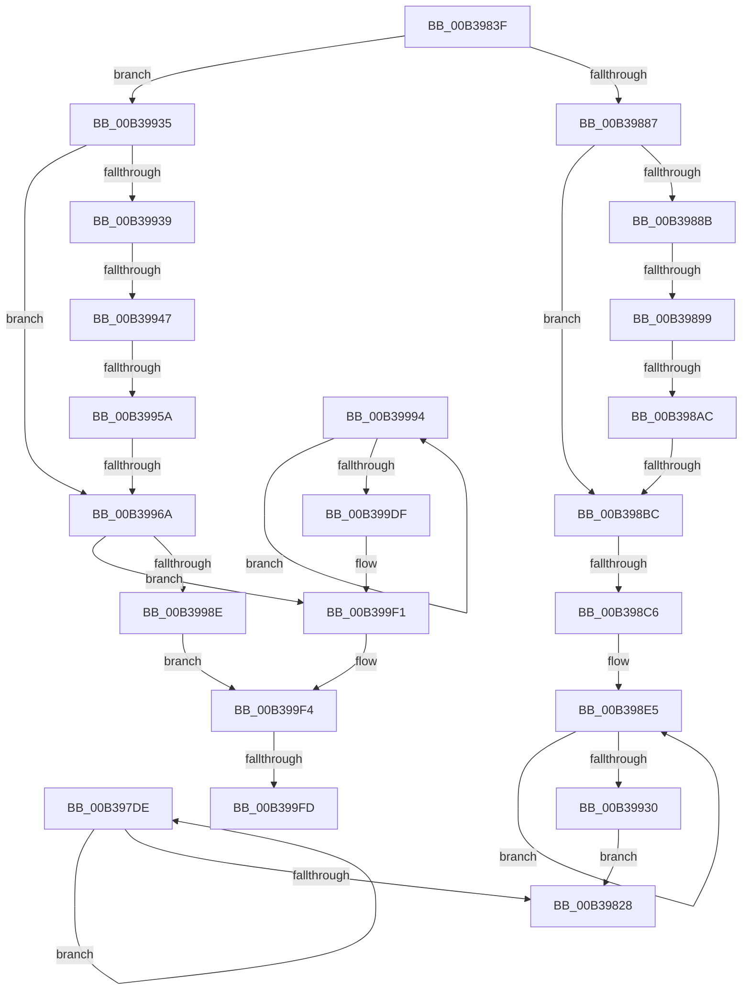

# sub_00B397DE

- RVA: `0x00B397DE`–`0x00B39A5D` (길이 `639` bytes)
- VA: `0x0000000140B397DE`
- 실행 섹션: `PAGE`
- PDB 이름 있음: `아니요`; PDB Function 태그: `아니요`
- unwind 정보 RVA: `0x000ACAD4`
- 디코드: `141`개 명령, `639/639` bytes 표시
- 미해석 바이트: `0` (있으면 어셈블리에 `.byte`로 보존)

> 이 문서는 커널 이미지의 기계어와 PDB 기호를 분석해 생성했습니다. 4번과 5번은 함수 원형과 자료형을 바이너리 사용 방식에서 추정한 C 해석이며 원본 소스 복구 결과는 아닙니다.

## 1. Dependencies

- 직접 호출 지점: **8**; 고유 호출 대상: **4**
- 직접 호출자로 확인된 함수: **0**
- RIP 상대 이미지 참조: **1**

### Outgoing calls
- `0x00B3981D` → [SepSetAuditInfoForObjectType](../7A/SepSetAuditInfoForObjectType_function_007A05A0.md) (function, `0x007A05A0`)
- `0x00B39879` → [SepSidInToken](../../text/3D/SepSidInToken_function_003D0430.md) (function, `0x003D0430`)
- `0x00B398AF` → [memcmp](../../text/6C/memcmp_function_006C6B10.md) (function, `0x006C6B10`)
- `0x00B39925` → [SepSetAuditInfoForObjectType](../7A/SepSetAuditInfoForObjectType_function_007A05A0.md) (function, `0x007A05A0`)
- `0x00B3995D` → [memcmp](../../text/6C/memcmp_function_006C6B10.md) (function, `0x006C6B10`)
- `0x00B3997D` → [AuthzBasepObjectInTypeList](../../text/4B/AuthzBasepObjectInTypeList_function_004B8FF4.md) (function, `0x004B8FF4`)
- `0x00B399D4` → [SepSetAuditInfoForObjectType](../7A/SepSetAuditInfoForObjectType_function_007A05A0.md) (function, `0x007A05A0`)
- `0x00B39A52` → [SepSetAuditInfoForObjectType](../7A/SepSetAuditInfoForObjectType_function_007A05A0.md) (function, `0x007A05A0`)

### Direct callers
- 이 함수 시작 RVA로 연결되는 직접 call은 확인되지 않았습니다. 간접 호출은 완전히 역산할 수 없습니다.

### Static image references
- `0x00B39899` → RVA `0x00E67D48` (`.data`; read)

## 2. Other-region calls and transfers

- 다른 실행 섹션으로 향하는 call: **4**
  - `0x00B39879` → [SepSidInToken](../../text/3D/SepSidInToken_function_003D0430.md) (`PAGE` → `.text`)
  - `0x00B398AF` → [memcmp](../../text/6C/memcmp_function_006C6B10.md) (`PAGE` → `.text`)
  - `0x00B3995D` → [memcmp](../../text/6C/memcmp_function_006C6B10.md) (`PAGE` → `.text`)
  - `0x00B3997D` → [AuthzBasepObjectInTypeList](../../text/4B/AuthzBasepObjectInTypeList_function_004B8FF4.md) (`PAGE` → `.text`)
- call이 아닌 외부 분기/꼬리 이동: **10**
  - `0x00B3983A` → [SepExamineSaclEx + 0x158](../A2/SepExamineSaclEx_function_00A2F39C.md) (`tail-transfer`)
  - `0x00B39893` → [SepExamineSaclEx + 0x158](../A2/SepExamineSaclEx_function_00A2F39C.md) (`tail-transfer`)
  - `0x00B398A6` → [SepExamineSaclEx + 0x158](../A2/SepExamineSaclEx_function_00A2F39C.md) (`tail-transfer`)
  - `0x00B398B6` → [SepExamineSaclEx + 0x158](../A2/SepExamineSaclEx_function_00A2F39C.md) (`tail-transfer`)
  - `0x00B398C0` → [SepExamineSaclEx + 0x158](../A2/SepExamineSaclEx_function_00A2F39C.md) (`tail-transfer`)
  - `0x00B39941` → [SepExamineSaclEx + 0x158](../A2/SepExamineSaclEx_function_00A2F39C.md) (`tail-transfer`)
  - `0x00B39954` → [SepExamineSaclEx + 0x158](../A2/SepExamineSaclEx_function_00A2F39C.md) (`tail-transfer`)
  - `0x00B39964` → [SepExamineSaclEx + 0x158](../A2/SepExamineSaclEx_function_00A2F39C.md) (`tail-transfer`)
  - `0x00B399F7` → [SepExamineSaclEx + 0x158](../A2/SepExamineSaclEx_function_00A2F39C.md) (`tail-transfer`)
  - `0x00B39A58` → [SepExamineSaclEx + 0x158](../A2/SepExamineSaclEx_function_00A2F39C.md) (`tail-transfer`)

## 3. Assembly (complete function range)

```asm
00B397DE  48 8B 84 24 20 01 00 00         mov rax, qword ptr [rsp + 0x120]
00B397E6  44 8B C6                        mov r8d, esi
00B397E9  4C 8B 8C 24 00 01 00 00         mov r9, qword ptr [rsp + 0x100]
00B397F1  8B D7                           mov edx, edi
00B397F3  4C 89 6C 24 50                  mov qword ptr [rsp + 0x50], r13
00B397F8  41 8A CE                        mov cl, r14b
00B397FB  4C 89 64 24 48                  mov qword ptr [rsp + 0x48], r12
00B39800  48 89 44 24 40                  mov qword ptr [rsp + 0x40], rax
00B39805  8A 84 24 10 01 00 00            mov al, byte ptr [rsp + 0x110]
00B3980C  4C 89 7C 24 38                  mov qword ptr [rsp + 0x38], r15
00B39811  89 5C 24 30                     mov dword ptr [rsp + 0x30], ebx
00B39815  88 44 24 28                     mov byte ptr [rsp + 0x28], al
00B39819  89 6C 24 20                     mov dword ptr [rsp + 0x20], ebp
00B3981D  E8 7E 6D C6 FF                  call 0x1407a05a0
00B39822  FF C3                           inc ebx
00B39824  3B DD                           cmp ebx, ebp
00B39826  72 B6                           jb 0x140b397de
00B39828  48 8B B4 24 80 00 00 00         mov rsi, qword ptr [rsp + 0x80]
00B39830  4C 8B 64 24 78                  mov r12, qword ptr [rsp + 0x78]
00B39835  44 8B 6C 24 64                  mov r13d, dword ptr [rsp + 0x64]
00B3983A  E9 B5 5C EF FF                  jmp 0x140a2f4f4
00B3983F  33 FF                           xor edi, edi
00B39841  48 8B 94 24 28 01 00 00         mov rdx, qword ptr [rsp + 0x128]
00B39849  83 E0 02                        and eax, 2
00B3984C  48 C1 E0 03                     shl rax, 3
00B39850  41 B1 01                        mov r9b, 1
00B39853  48 83 C8 0C                     or rax, 0xc
00B39857  8B D9                           mov ebx, ecx
00B39859  48 03 C6                        add rax, rsi
00B3985C  48 C1 E3 04                     shl rbx, 4
00B39860  48 03 D8                        add rbx, rax
00B39863  49 8B CA                        mov rcx, r10
00B39866  8A 84 24 30 01 00 00            mov al, byte ptr [rsp + 0x130]
00B3986D  4C 8B C3                        mov r8, rbx
00B39870  88 44 24 28                     mov byte ptr [rsp + 0x28], al
00B39874  C6 44 24 20 00                  mov byte ptr [rsp + 0x20], 0
00B39879  E8 B2 6B 89 FF                  call 0x1403d0430
00B3987E  48 85 FF                        test rdi, rdi
00B39881  0F 85 AE 00 00 00               jne 0x140b39935
00B39887  84 C0                           test al, al
00B39889  75 31                           jne 0x140b398bc
00B3988B  44 8B 44 24 60                  mov r8d, dword ptr [rsp + 0x60]
00B39890  45 85 C0                        test r8d, r8d
00B39893  0F 84 5B 5C EF FF               je 0x140a2f4f4
00B39899  48 8B 0D A8 E4 32 00            mov rcx, qword ptr [rip + 0x32e4a8]
00B398A0  0F B7 03                        movzx eax, word ptr [rbx]
00B398A3  66 39 01                        cmp word ptr [rcx], ax
00B398A6  0F 85 48 5C EF FF               jne 0x140a2f4f4
00B398AC  48 8B D3                        mov rdx, rbx
00B398AF  E8 5C D2 B8 FF                  call 0x1406c6b10
00B398B4  85 C0                           test eax, eax
00B398B6  0F 85 38 5C EF FF               jne 0x140a2f4f4
00B398BC  33 DB                           xor ebx, ebx
00B398BE  85 ED                           test ebp, ebp
00B398C0  0F 84 2E 5C EF FF               je 0x140a2f4f4
00B398C6  4C 8B A4 24 38 01 00 00         mov r12, qword ptr [rsp + 0x138]
00B398CE  4C 8B AC 24 40 01 00 00         mov r13, qword ptr [rsp + 0x140]
00B398D6  48 8B BC 24 18 01 00 00         mov rdi, qword ptr [rsp + 0x118]
00B398DE  8B B4 24 F8 00 00 00            mov esi, dword ptr [rsp + 0xf8]
00B398E5  48 8B 84 24 20 01 00 00         mov rax, qword ptr [rsp + 0x120]
00B398ED  44 8B C6                        mov r8d, esi
00B398F0  4C 8B 8C 24 00 01 00 00         mov r9, qword ptr [rsp + 0x100]
00B398F8  41 8B D7                        mov edx, r15d
00B398FB  4C 89 6C 24 50                  mov qword ptr [rsp + 0x50], r13
00B39900  41 8A CE                        mov cl, r14b
00B39903  4C 89 64 24 48                  mov qword ptr [rsp + 0x48], r12
00B39908  48 89 44 24 40                  mov qword ptr [rsp + 0x40], rax
00B3990D  8A 84 24 10 01 00 00            mov al, byte ptr [rsp + 0x110]
00B39914  48 89 7C 24 38                  mov qword ptr [rsp + 0x38], rdi
00B39919  89 5C 24 30                     mov dword ptr [rsp + 0x30], ebx
00B3991D  88 44 24 28                     mov byte ptr [rsp + 0x28], al
00B39921  89 6C 24 20                     mov dword ptr [rsp + 0x20], ebp
00B39925  E8 76 6C C6 FF                  call 0x1407a05a0
00B3992A  FF C3                           inc ebx
00B3992C  3B DD                           cmp ebx, ebp
00B3992E  72 B5                           jb 0x140b398e5
00B39930  E9 F3 FE FF FF                  jmp 0x140b39828
00B39935  84 C0                           test al, al
00B39937  75 31                           jne 0x140b3996a
00B39939  44 8B 44 24 60                  mov r8d, dword ptr [rsp + 0x60]
00B3993E  45 85 C0                        test r8d, r8d
00B39941  0F 84 AD 5B EF FF               je 0x140a2f4f4
00B39947  48 8B 0D FA E3 32 00            mov rcx, qword ptr [rip + 0x32e3fa]
00B3994E  0F B7 03                        movzx eax, word ptr [rbx]
00B39951  66 39 01                        cmp word ptr [rcx], ax
00B39954  0F 85 9A 5B EF FF               jne 0x140a2f4f4
00B3995A  48 8B D3                        mov rdx, rbx
00B3995D  E8 AE D1 B8 FF                  call 0x1406c6b10
00B39962  85 C0                           test eax, eax
00B39964  0F 85 8A 5B EF FF               jne 0x140a2f4f4
00B3996A  48 8B 94 24 00 01 00 00         mov rdx, qword ptr [rsp + 0x100]
00B39972  4C 8D 4C 24 68                  lea r9, [rsp + 0x68]
00B39977  44 8B C5                        mov r8d, ebp
00B3997A  48 8B CF                        mov rcx, rdi
00B3997D  E8 72 F6 97 FF                  call 0x1404b8ff4
00B39982  48 8B BC 24 18 01 00 00         mov rdi, qword ptr [rsp + 0x118]
00B3998A  84 C0                           test al, al
00B3998C  74 63                           je 0x140b399f1
00B3998E  8B 44 24 68                     mov eax, dword ptr [rsp + 0x68]
00B39992  EB 60                           jmp 0x140b399f4
00B39994  48 8B 84 24 20 01 00 00         mov rax, qword ptr [rsp + 0x120]
00B3999C  44 8B C6                        mov r8d, esi
00B3999F  4C 8B 8C 24 00 01 00 00         mov r9, qword ptr [rsp + 0x100]
00B399A7  41 8B D7                        mov edx, r15d
00B399AA  4C 89 6C 24 50                  mov qword ptr [rsp + 0x50], r13
00B399AF  41 8A CE                        mov cl, r14b
00B399B2  4C 89 64 24 48                  mov qword ptr [rsp + 0x48], r12
00B399B7  48 89 44 24 40                  mov qword ptr [rsp + 0x40], rax
00B399BC  8A 84 24 10 01 00 00            mov al, byte ptr [rsp + 0x110]
00B399C3  48 89 7C 24 38                  mov qword ptr [rsp + 0x38], rdi
00B399C8  89 5C 24 30                     mov dword ptr [rsp + 0x30], ebx
00B399CC  88 44 24 28                     mov byte ptr [rsp + 0x28], al
00B399D0  89 6C 24 20                     mov dword ptr [rsp + 0x20], ebp
00B399D4  E8 C7 6B C6 FF                  call 0x1407a05a0
00B399D9  FF C3                           inc ebx
00B399DB  3B DD                           cmp ebx, ebp
00B399DD  72 B5                           jb 0x140b39994
00B399DF  48 8B B4 24 80 00 00 00         mov rsi, qword ptr [rsp + 0x80]
00B399E7  4C 8B 64 24 78                  mov r12, qword ptr [rsp + 0x78]
00B399EC  44 8B 6C 24 64                  mov r13d, dword ptr [rsp + 0x64]
00B399F1  83 C8 FF                        or eax, 0xffffffff
00B399F4  83 F8 FF                        cmp eax, -1
00B399F7  0F 84 F7 5A EF FF               je 0x140a2f4f4
00B399FD  48 8B 8C 24 40 01 00 00         mov rcx, qword ptr [rsp + 0x140]
00B39A05  41 8B D7                        mov edx, r15d
00B39A08  4C 8B 8C 24 00 01 00 00         mov r9, qword ptr [rsp + 0x100]
00B39A10  44 8B 84 24 F8 00 00 00         mov r8d, dword ptr [rsp + 0xf8]
00B39A18  48 89 4C 24 50                  mov qword ptr [rsp + 0x50], rcx
00B39A1D  48 8B 8C 24 38 01 00 00         mov rcx, qword ptr [rsp + 0x138]
00B39A25  48 89 4C 24 48                  mov qword ptr [rsp + 0x48], rcx
00B39A2A  48 8B 8C 24 20 01 00 00         mov rcx, qword ptr [rsp + 0x120]
00B39A32  48 89 4C 24 40                  mov qword ptr [rsp + 0x40], rcx
00B39A37  41 8A CE                        mov cl, r14b
00B39A3A  48 89 7C 24 38                  mov qword ptr [rsp + 0x38], rdi
00B39A3F  89 44 24 30                     mov dword ptr [rsp + 0x30], eax
00B39A43  8A 84 24 10 01 00 00            mov al, byte ptr [rsp + 0x110]
00B39A4A  88 44 24 28                     mov byte ptr [rsp + 0x28], al
00B39A4E  89 6C 24 20                     mov dword ptr [rsp + 0x20], ebp
00B39A52  E8 49 6B C6 FF                  call 0x1407a05a0
00B39A57  90                              nop
00B39A58  E9 97 5A EF FF                  jmp 0x140a2f4f4
```

## 4. C-style interpretation (structured pseudocode)

```c
__int64 __fastcall sub_00B397DE(__int64 a1, __int64 a2, __int64 a3, __int64 a4, __int64 a5, __int64 a6, __int64 a7, __int64 a8, __int64 a9, __int64 a10, __int64 a11, __int64 a12, __int64 a13, __int64 a14, __int64 a15, __int64 a16, __int64 a17, __int64 a18, __int64 a19, __int64 a20, __int64 a21, __int64 a22, __int64 a23, __int64 a24, __int64 a25, __int64 a26, __int64 a27, __int64 a28, __int64 a29, __int64 a30, __int64 a31, __int64 a32, __int64 a33, unsigned __int8 a34, __int64 a35, __int64 a36)
{
    __int64 result;
    __int64 v_rbx;
    unsigned __int64 v_stack_p100;
    unsigned __int8 v_stack_p110;
    unsigned __int64 v_stack_p118;
    unsigned __int64 v_stack_p120;
    unsigned __int64 v_stack_p128;
    unsigned __int8 v_stack_p130;
    unsigned __int64 v_stack_p138;
    unsigned __int64 v_stack_p140;
    unsigned int v_stack_p20;
    unsigned __int8 v_stack_p28;
    unsigned int v_stack_p30;
    unsigned __int64 v_stack_p38;
    unsigned __int64 v_stack_p40;
    unsigned __int64 v_stack_p48;
    unsigned __int64 v_stack_p50;
    unsigned int v_stack_p60;
    unsigned int v_stack_p64;
    unsigned __int64 v_stack_p68;
    unsigned __int64 v_stack_p78;
    unsigned __int64 v_stack_p80;
    unsigned int v_stack_pF8;

    v_stack_p50 = v_r13;
    v_stack_p48 = v_r12;
    v_stack_p40 = a36;
    v_stack_p38 = v_r15;
    v_stack_p30 = (unsigned int)(v_rbx);
    v_stack_p28 = a34;
    v_stack_p20 = (unsigned int)(v_rbp);
    result = SepSetAuditInfoForObjectType((unsigned __int8)(v_r14), (unsigned int)((unsigned int)(v_rdi)), (unsigned int)((unsigned int)(v_rsi)), a32);
    v_rbx = (unsigned int)((v_rbx) + 1);
    if (((unsigned int)(v_rbx)) < ((unsigned int)(v_rbp))) goto loc_00B397DE;
loc_00B39828:
}
```

## 5. (Beta) C Style

```c
int64_t sub_00B397DE(int64_t Arg1, int64_t Arg2, int64_t Arg3, int64_t Arg4, uint64_t Arg5, uint64_t Arg6, uint64_t Arg7, uint64_t Arg8, uint64_t Arg9, uint64_t Arg10, uint64_t Arg11, uint64_t Arg12, uint64_t Arg13, uint64_t Arg14, int64_t Arg15, int64_t Arg16, uint64_t Arg17, uint64_t Arg18, uint64_t Arg19, uint64_t Arg20, uint64_t Arg21, uint64_t Arg22, uint64_t Arg23, uint64_t Arg24, uint64_t Arg25, uint64_t Arg26, uint64_t Arg27, uint64_t Arg28, uint64_t Arg29, uint64_t Arg30, uint64_t Arg31, int64_t Arg32, uint64_t Arg33, uint8_t Arg34, uint64_t Arg35, int64_t Arg36)
{
    int64_t result;
    int64_t local_rbx;
    uint64_t v_stack_p100;
    uint8_t v_stack_p110;
    uint64_t v_stack_p118;
    uint64_t v_stack_p120;
    uint64_t v_stack_p128;
    uint8_t v_stack_p130;
    uint64_t v_stack_p138;
    uint64_t v_stack_p140;
    uint32_t v_stack_p20;
    uint8_t v_stack_p28;
    uint32_t v_stack_p30;
    uint64_t v_stack_p38;
    uint64_t v_stack_p40;
    uint64_t v_stack_p48;
    uint64_t v_stack_p50;
    uint32_t v_stack_p60;
    uint32_t v_stack_p64;
    uint64_t v_stack_p68;
    uint64_t v_stack_p78;
    uint64_t v_stack_p80;
    uint32_t v_stack_pF8;

    v_stack_p50 = local_r13;
    v_stack_p48 = local_r12;
    v_stack_p40 = Arg36;
    v_stack_p38 = local_r15;
    v_stack_p30 = (uint32_t)(local_rbx);
    v_stack_p28 = Arg34;
    v_stack_p20 = (uint32_t)(local_rbp);
    result = SepSetAuditInfoForObjectType((uint8_t)(local_r14), (uint32_t)((uint32_t)(local_rdi)), (uint32_t)((uint32_t)(local_rsi)), Arg32);
    local_rbx = (uint32_t)((local_rbx) + 1);
    if (((uint32_t)(local_rbx)) < ((uint32_t)(local_rbp))) goto loc_00B397DE;
loc_00B39828:
}
```

## 6. Execution-region graph

[열기: 2D/3D 그래프와 함수 탐색 컨트롤 패널](../../../control-panel.html?section=page&rva=0x00B397DE&view=graph)

- 2D 그래프는 위에서 아래로 흐르고, 3D 그래프는 빈 공간을 드래그해 회전합니다. Shift+드래그는 이동, 휠은 확대·축소, 함수 노드 선택은 대상 보고서 이동입니다.

### Static fallback


