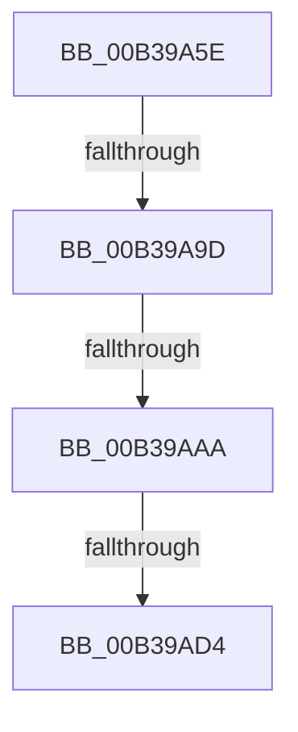

# sub_00B39A5E

- RVA: `0x00B39A5E`–`0x00B39ADF` (길이 `129` bytes)
- VA: `0x0000000140B39A5E`
- 실행 섹션: `PAGE`
- PDB 이름 있음: `아니요`; PDB Function 태그: `아니요`
- unwind 정보 RVA: `0x000AD0A4`
- 디코드: `28`개 명령, `129/129` bytes 표시
- 미해석 바이트: `0` (있으면 어셈블리에 `.byte`로 보존)

> 이 문서는 커널 이미지의 기계어와 PDB 기호를 분석해 생성했습니다. 4번과 5번은 함수 원형과 자료형을 바이너리 사용 방식에서 추정한 C 해석이며 원본 소스 복구 결과는 아닙니다.

## 1. Dependencies

- 직접 호출 지점: **2**; 고유 호출 대상: **2**
- 직접 호출자로 확인된 함수: **0**
- RIP 상대 이미지 참조: **0**

### Outgoing calls
- `0x00B39A71` → [MiUnlockAndDereferenceVadShared](../../text/2A/MiUnlockAndDereferenceVadShared_function_002AEF10.md) (function, `0x002AEF10`)
- `0x00B39AC7` → [ZwAllocateVirtualMemory](../../text/6A/ZwAllocateVirtualMemory_function_006AD3D0.md) (function, `0x006AD3D0`)

### Direct callers
- 이 함수 시작 RVA로 연결되는 직접 call은 확인되지 않았습니다. 간접 호출은 완전히 역산할 수 없습니다.

### Static image references
- 디코드된 RIP-relative 메모리 참조가 없습니다.

## 2. Other-region calls and transfers

- 다른 실행 섹션으로 향하는 call: **2**
  - `0x00B39A71` → [MiUnlockAndDereferenceVadShared](../../text/2A/MiUnlockAndDereferenceVadShared_function_002AEF10.md) (`PAGE` → `.text`)
  - `0x00B39AC7` → [ZwAllocateVirtualMemory](../../text/6A/ZwAllocateVirtualMemory_function_006AD3D0.md) (`PAGE` → `.text`)
- call이 아닌 외부 분기/꼬리 이동: **4**
  - `0x00B39A97` → [MiCheckShadowStackOverflow + 0x2C](../A3/MiCheckShadowStackOverflow_function_00A30B68.md) (`tail-transfer`)
  - `0x00B39AA4` → [MiCheckShadowStackOverflow + 0x2C](../A3/MiCheckShadowStackOverflow_function_00A30B68.md) (`tail-transfer`)
  - `0x00B39ACE` → [MiCheckShadowStackOverflow + 0x2C](../A3/MiCheckShadowStackOverflow_function_00A30B68.md) (`tail-transfer`)
  - `0x00B39ADA` → [MiCheckShadowStackOverflow + 0x2C](../A3/MiCheckShadowStackOverflow_function_00A30B68.md) (`tail-transfer`)

## 3. Assembly (complete function range)

```asm
00B39A5E  0F B6 79 20                     movzx edi, byte ptr [rcx + 0x20]
00B39A62  BB 01 00 00 00                  mov ebx, 1
00B39A67  8B 41 18                        mov eax, dword ptr [rcx + 0x18]
00B39A6A  48 C1 E7 20                     shl rdi, 0x20
00B39A6E  48 0B F8                        or rdi, rax
00B39A71  E8 9A 54 77 FF                  call 0x1402aef10
00B39A76  48 8B C5                        mov rax, rbp
00B39A79  B9 00 10 00 00                  mov ecx, 0x1000
00B39A7E  48 25 00 F0 FF FF               and rax, 0xfffffffffffff000
00B39A84  48 89 4C 24 60                  mov qword ptr [rsp + 0x60], rcx
00B39A89  48 05 00 F0 FF FF               add rax, -0x1000
00B39A8F  48 89 44 24 68                  mov qword ptr [rsp + 0x68], rax
00B39A94  48 3B C5                        cmp rax, rbp
00B39A97  0F 87 F7 70 EF FF               ja 0x140a30b94
00B39A9D  48 C1 E7 0C                     shl rdi, 0xc
00B39AA1  48 3B C7                        cmp rax, rdi
00B39AA4  0F 86 EA 70 EF FF               jbe 0x140a30b94
00B39AAA  C7 44 24 28 02 01 00 00         mov dword ptr [rsp + 0x28], 0x102
00B39AB2  4C 8D 4C 24 60                  lea r9, [rsp + 0x60]
00B39AB7  89 4C 24 20                     mov dword ptr [rsp + 0x20], ecx
00B39ABB  48 8D 54 24 68                  lea rdx, [rsp + 0x68]
00B39AC0  48 83 C9 FF                     or rcx, 0xffffffffffffffff
00B39AC4  45 33 C0                        xor r8d, r8d
00B39AC7  E8 04 39 B7 FF                  call 0x1406ad3d0
00B39ACC  85 C0                           test eax, eax
00B39ACE  0F 88 C0 70 EF FF               js 0x140a30b94
00B39AD4  C7 06 13 01 00 00               mov dword ptr [rsi], 0x113
00B39ADA  E9 B5 70 EF FF                  jmp 0x140a30b94
```

## 4. C-style interpretation (structured pseudocode)

```c
__int64 __fastcall sub_00B39A5E(__int64 a1, __int64 a2, int a3, __int64 a4, __int64 a5, __int64 a6, __int64 a7, __int64 a8, __int64 a9, __int64 a10, __int64 a11, __int64 a12, __int64 a13)
{
    __int64 result;
    __int64 v_rdi;
    unsigned int v_stack_p20;
    unsigned int v_stack_p28;
    unsigned __int64 v_stack_p60;
    unsigned __int64 v_stack_p68;

    v_rdi = (*(unsigned __int8 *)(a1 + 32)) << (32);
    v_rdi = (v_rdi) | ((unsigned int)(*(unsigned int *)(a1 + 24)));
    result = MiUnlockAndDereferenceVadShared(a1, a2, a3, a4);
    result = (v_rbp) & (0xFFFFFFFFFFFFF000ULL);
    v_stack_p60 = (unsigned int)(0x1000ULL);
    result = (result) + (0xFFFFFFFFFFFFF000ULL);
    v_stack_p68 = result;
    v_rdi = (v_rdi) << (12);
    v_stack_p28 = 258;
    v_stack_p20 = (unsigned int)((unsigned int)(0x1000ULL));
    a1 = ((unsigned int)(0x1000ULL)) | (-1);
    a3 = 0;
    result = ZwAllocateVirtualMemory(a1, a13, a3, a12);
    *(unsigned int *)(v_rsi) = 275;
}
```

## 5. (Beta) C Style

```c
int64_t sub_00B39A5E(void *Arg1, int64_t Arg2, int32_t Arg3, int64_t Arg4, uint64_t Arg5, uint64_t Arg6, uint64_t Arg7, uint64_t Arg8, uint64_t Arg9, uint64_t Arg10, uint64_t Arg11, int64_t Arg12, int64_t Arg13)
{
    uint8_t *arg1 = (uint8_t *)Arg1;

    int64_t result;
    int64_t local_rdi;
    uint32_t v_stack_p20;
    uint32_t v_stack_p28;
    uint64_t v_stack_p60;
    uint64_t v_stack_p68;

    local_rdi = (*(uint8_t *)(arg1 + 0x20)) << (32);
    local_rdi = (local_rdi) | ((uint32_t)(*(uint32_t *)(arg1 + 0x18)));
    result = MiUnlockAndDereferenceVadShared(Arg1, Arg2, Arg3, Arg4);
    result = (local_rbp) & (0xFFFFFFFFFFFFF000ULL);
    v_stack_p60 = (uint32_t)(0x1000ULL);
    result = (result) + (0xFFFFFFFFFFFFF000ULL);
    v_stack_p68 = result;
    local_rdi = (local_rdi) << (12);
    v_stack_p28 = 258;
    v_stack_p20 = (uint32_t)((uint32_t)(0x1000ULL));
    Arg1 = ((uint32_t)(0x1000ULL)) | (-1);
    Arg3 = 0;
    result = ZwAllocateVirtualMemory(Arg1, Arg13, Arg3, Arg12);
    *(uint32_t *)(local_rsi) = 275;
}
```

### 관측된 메모리 오프셋

구조체 형식이 확인되지 않은 접근은 인자 기준의 오프셋으로만 기록했습니다.

| 기준 인자 | 오프셋 표현 | 폭 (bit) | 접근 |
|---|---:|---:|---|
| `Arg1` | `+ 0x18` | `32` | `R` |
| `Arg1` | `+ 0x20` | `8` | `R` |

## 6. Execution-region graph

[열기: 2D/3D 그래프와 함수 탐색 컨트롤 패널](../../../control-panel.html?section=page&rva=0x00B39A5E&view=graph)

- 2D 그래프는 위에서 아래로 흐르고, 3D 그래프는 빈 공간을 드래그해 회전합니다. Shift+드래그는 이동, 휠은 확대·축소, 함수 노드 선택은 대상 보고서 이동입니다.

### Static fallback


