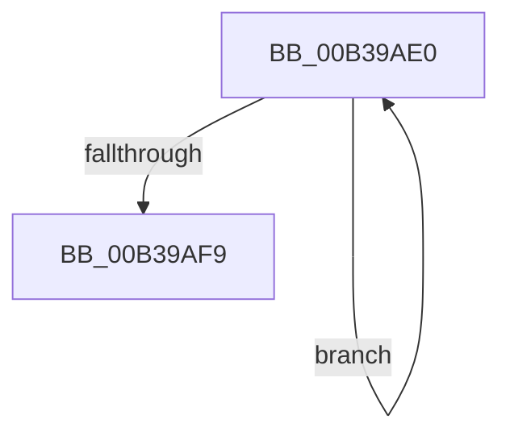

# sub_00B39AE0

- RVA: `0x00B39AE0`–`0x00B39AFE` (길이 `30` bytes)
- VA: `0x0000000140B39AE0`
- 실행 섹션: `PAGE`
- PDB 이름 있음: `아니요`; PDB Function 태그: `아니요`
- unwind 정보 RVA: `0x000AD0E0`
- 디코드: `8`개 명령, `30/30` bytes 표시
- 미해석 바이트: `0` (있으면 어셈블리에 `.byte`로 보존)

> 이 문서는 커널 이미지의 기계어와 PDB 기호를 분석해 생성했습니다. 4번과 5번은 함수 원형과 자료형을 바이너리 사용 방식에서 추정한 C 해석이며 원본 소스 복구 결과는 아닙니다.

## 1. Dependencies

- 직접 호출 지점: **0**; 고유 호출 대상: **0**
- 직접 호출자로 확인된 함수: **0**
- RIP 상대 이미지 참조: **0**

### Outgoing calls
- 직접 디코드된 call 명령이 없습니다.

### Direct callers
- 이 함수 시작 RVA로 연결되는 직접 call은 확인되지 않았습니다. 간접 호출은 완전히 역산할 수 없습니다.

### Static image references
- 디코드된 RIP-relative 메모리 참조가 없습니다.

## 2. Other-region calls and transfers

- 다른 실행 섹션으로 향하는 call: **0**
- call이 아닌 외부 분기/꼬리 이동: **1**
  - `0x00B39AF9` → [CmpSortedValueEnumStackStartFromKeyNodeStack + 0x33](../A3/CmpSortedValueEnumStackStartFromKeyNodeStack_function_00A30CF0.md) (`tail-transfer`)

## 3. Assembly (complete function range)

```asm
00B39AE0  48 8B 46 50                     mov rax, qword ptr [rsi + 0x50]
00B39AE4  0F 57 C0                        xorps xmm0, xmm0
00B39AE7  0F 11 04 01                     movups xmmword ptr [rcx + rax], xmm0
00B39AEB  0F 11 44 01 10                  movups xmmword ptr [rcx + rax + 0x10], xmm0
00B39AF0  48 8D 49 20                     lea rcx, [rcx + 0x20]
00B39AF4  49 2B D7                        sub rdx, r15
00B39AF7  75 E7                           jne 0x140b39ae0
00B39AF9  E9 25 72 EF FF                  jmp 0x140a30d23
```

## 4. C-style interpretation (structured pseudocode)

```c
__int64 __fastcall sub_00B39AE0(__int64 a1, __int64 a2)
{
    *(unsigned __int64 *)(a1 + *(unsigned __int64 *)(v_rsi + 80) * 1) = v_xmm0;
    *(unsigned __int64 *)(a1 + *(unsigned __int64 *)(v_rsi + 80) * 1 + 16) = v_xmm0;
    a2 = (a2) - (v_r15);
    if (condition_is_not_equal) goto loc_00B39AE0;
}
```

## 5. (Beta) C Style

```c
int64_t sub_00B39AE0(void *Arg1, int64_t Arg2)
{
    uint8_t *arg1 = (uint8_t *)Arg1;

    *(uint64_t *)(arg1 + *(uint64_t *)(local_rsi + 0x50) * 1) = v_xmm0;
    *(uint64_t *)(arg1 + *(uint64_t *)(local_rsi + 0x50) * 1 + 0x10) = v_xmm0;
    Arg2 = (Arg2) - (local_r15);
    if (condition_is_not_equal) goto loc_00B39AE0;
}
```

### 관측된 메모리 오프셋

구조체 형식이 확인되지 않은 접근은 인자 기준의 오프셋으로만 기록했습니다.

| 기준 인자 | 오프셋 표현 | 폭 (bit) | 접근 |
|---|---:|---:|---|
| `Arg1` | `+ 0x0 + rax*1` | `128` | `R` |
| `Arg1` | `+ 0x10 + rax*1` | `128` | `R` |
| `Arg1` | `+ 0x20` | `64` | `R` |

## 6. Execution-region graph

[열기: 2D/3D 그래프와 함수 탐색 컨트롤 패널](../../../control-panel.html?section=page&rva=0x00B39AE0&view=graph)

- 2D 그래프는 위에서 아래로 흐르고, 3D 그래프는 빈 공간을 드래그해 회전합니다. Shift+드래그는 이동, 휠은 확대·축소, 함수 노드 선택은 대상 보고서 이동입니다.

### Static fallback


