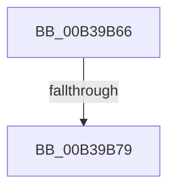

# sub_00B39B66

- RVA: `0x00B39B66`–`0x00B39B7E` (길이 `24` bytes)
- VA: `0x0000000140B39B66`
- 실행 섹션: `PAGE`
- PDB 이름 있음: `아니요`; PDB Function 태그: `아니요`
- unwind 정보 RVA: `0x000AD214`
- 디코드: `5`개 명령, `24/24` bytes 표시
- 미해석 바이트: `0` (있으면 어셈블리에 `.byte`로 보존)

> 이 문서는 커널 이미지의 기계어와 PDB 기호를 분석해 생성했습니다. 4번과 5번은 함수 원형과 자료형을 바이너리 사용 방식에서 추정한 C 해석이며 원본 소스 복구 결과는 아닙니다.

## 1. Dependencies

- 직접 호출 지점: **1**; 고유 호출 대상: **1**
- 직접 호출자로 확인된 함수: **0**
- RIP 상대 이미지 참조: **1**

### Outgoing calls
- `0x00B39B66` → [PopAcquirePolicyLock](../../pagelk/B7/PopAcquirePolicyLock_function_00B783C0.md) (function, `0x00B783C0`)

### Direct callers
- 이 함수 시작 RVA로 연결되는 직접 call은 확인되지 않았습니다. 간접 호출은 완전히 역산할 수 없습니다.

### Static image references
- `0x00B39B6D` → RVA `0x00FC5284` (`ALMOSTRO`; read)

## 2. Other-region calls and transfers

- 다른 실행 섹션으로 향하는 call: **1**
  - `0x00B39B66` → [PopAcquirePolicyLock](../../pagelk/B7/PopAcquirePolicyLock_function_00B783C0.md) (`PAGE` → `PAGELK`)
- call이 아닌 외부 분기/꼬리 이동: **2**
  - `0x00B39B73` → [PdcPoResiliencyClient + 0x3E](../A3/PdcPoResiliencyClient_function_00A314B0.md) (`tail-transfer`)
  - `0x00B39B79` → [PdcPoResiliencyClient + 0x52](../A3/PdcPoResiliencyClient_function_00A314B0.md) (`tail-transfer`)

## 3. Assembly (complete function range)

```asm
00B39B66  E8 55 E8 03 00                  call 0x140b783c0
00B39B6B  33 DB                           xor ebx, ebx
00B39B6D  39 1D 11 B7 48 00               cmp dword ptr [rip + 0x48b711], ebx
00B39B73  0F 84 75 79 EF FF               je 0x140a314ee
00B39B79  E9 84 79 EF FF                  jmp 0x140a31502
```

## 4. C-style interpretation (structured pseudocode)

```c
__int64 __fastcall sub_00B39B66(void)
{
    __int64 result;
    __int64 v_rbx;

    result = PopAcquirePolicyLock(a1, a2, a3, a4);
    v_rbx = 0;
}
```

## 5. (Beta) C Style

```c
void sub_00B39B66(void)
{
    int64_t result;
    int64_t local_rbx;

    result = PopAcquirePolicyLock(a1, a2, a3, a4);
    local_rbx = 0;
}
```

## 6. Execution-region graph

[열기: 2D/3D 그래프와 함수 탐색 컨트롤 패널](../../../control-panel.html?section=page&rva=0x00B39B66&view=graph)

- 2D 그래프는 위에서 아래로 흐르고, 3D 그래프는 빈 공간을 드래그해 회전합니다. Shift+드래그는 이동, 휠은 확대·축소, 함수 노드 선택은 대상 보고서 이동입니다.

### Static fallback


