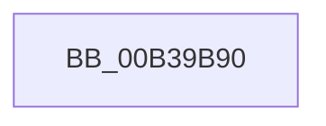

# sub_00B39B90

- RVA: `0x00B39B90`–`0x00B39BB0` (길이 `32` bytes)
- VA: `0x0000000140B39B90`
- 실행 섹션: `PAGE`
- PDB 이름 있음: `아니요`; PDB Function 태그: `아니요`
- unwind 정보 RVA: `0x000AD2EC`
- 디코드: `7`개 명령, `32/32` bytes 표시
- 미해석 바이트: `0` (있으면 어셈블리에 `.byte`로 보존)

> 이 문서는 커널 이미지의 기계어와 PDB 기호를 분석해 생성했습니다. 4번과 5번은 함수 원형과 자료형을 바이너리 사용 방식에서 추정한 C 해석이며 원본 소스 복구 결과는 아닙니다.

## 1. Dependencies

- 직접 호출 지점: **2**; 고유 호출 대상: **2**
- 직접 호출자로 확인된 함수: **0**
- RIP 상대 이미지 참조: **2**

### Outgoing calls
- `0x00B39BA0` → [KeCancelTimer2](../../text/3A/KeCancelTimer2_function_003A01E0.md) (function, `0x003A01E0`)
- `0x00B39BA5` → [PopPowerRequestHandleExecutionEnablementUpdate](../A4/PopPowerRequestHandleExecutionEnablementUpdate_function_00A4A624.md) (function, `0x00A4A624`)

### Direct callers
- 이 함수 시작 RVA로 연결되는 직접 call은 확인되지 않았습니다. 간접 호출은 완전히 역산할 수 없습니다.

### Static image references
- `0x00B39B92` → RVA `0x00F0EFC8` (`.data`; write)
- `0x00B39B99` → RVA `0x00F0EF00` (`.data`; read)

## 2. Other-region calls and transfers

- 다른 실행 섹션으로 향하는 call: **1**
  - `0x00B39BA0` → [KeCancelTimer2](../../text/3A/KeCancelTimer2_function_003A01E0.md) (`PAGE` → `.text`)
- call이 아닌 외부 분기/꼬리 이동: **1**
  - `0x00B39BAB` → [PopUpdatePdcSystemIdleState + 0x23](../A3/PopUpdatePdcSystemIdleState_function_00A320B4.md) (`tail-transfer`)

## 3. Assembly (complete function range)

```asm
00B39B90  33 D2                           xor edx, edx
00B39B92  48 89 1D 2F 54 3D 00            mov qword ptr [rip + 0x3d542f], rbx
00B39B99  48 8D 0D 60 53 3D 00            lea rcx, [rip + 0x3d5360]
00B39BA0  E8 3B 66 86 FF                  call 0x1403a01e0
00B39BA5  E8 7A 0A F1 FF                  call 0x140a4a624
00B39BAA  90                              nop
00B39BAB  E9 27 85 EF FF                  jmp 0x140a320d7
```

## 4. C-style interpretation (structured pseudocode)

```c
__int64 __fastcall sub_00B39B90(__int64 a1, int a2)
{
    __int64 result;

    a2 = 0;
    *(unsigned __int64 *)(v_rip + 4019247) = v_rbx;
    result = KeCancelTimer2(v_rip + 4019040, a2, a3, a4);
    result = PopPowerRequestHandleExecutionEnablementUpdate(v_rip + 4019040, a2, a3, a4);
}
```

## 5. (Beta) C Style

```c
int64_t sub_00B39B90(int64_t Arg1, int32_t Arg2)
{
    int64_t result;

    Arg2 = 0;
    *(uint64_t *)(v_rip + 0x3D542F) = local_rbx;
    result = KeCancelTimer2(v_rip + 4019040, Arg2, a3, a4);
    result = PopPowerRequestHandleExecutionEnablementUpdate(v_rip + 4019040, Arg2, a3, a4);
}
```

## 6. Execution-region graph

[열기: 2D/3D 그래프와 함수 탐색 컨트롤 패널](../../../control-panel.html?section=page&rva=0x00B39B90&view=graph)

- 2D 그래프는 위에서 아래로 흐르고, 3D 그래프는 빈 공간을 드래그해 회전합니다. Shift+드래그는 이동, 휠은 확대·축소, 함수 노드 선택은 대상 보고서 이동입니다.

### Static fallback


