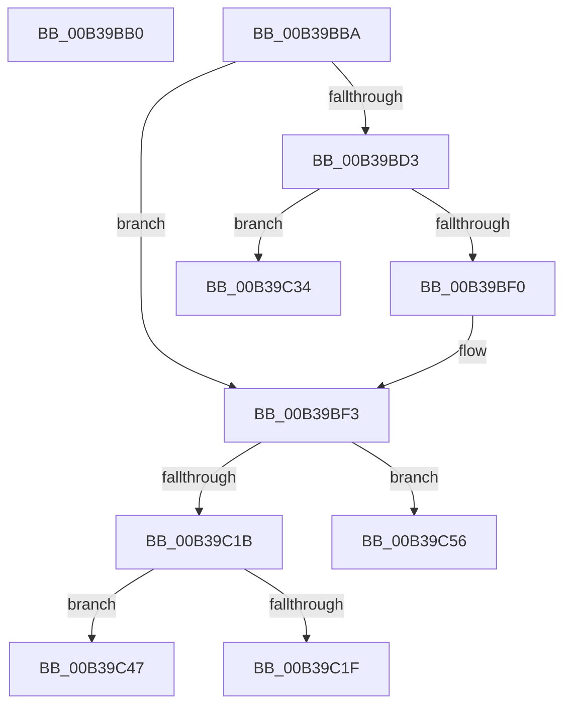

# sub_00B39BB0

- RVA: `0x00B39BB0`–`0x00B39C60` (길이 `176` bytes)
- VA: `0x0000000140B39BB0`
- 실행 섹션: `PAGE`
- PDB 이름 있음: `아니요`; PDB Function 태그: `아니요`
- unwind 정보 RVA: `0x000AD460`
- 디코드: `46`개 명령, `176/176` bytes 표시
- 미해석 바이트: `0` (있으면 어셈블리에 `.byte`로 보존)

> 이 문서는 커널 이미지의 기계어와 PDB 기호를 분석해 생성했습니다. 4번과 5번은 함수 원형과 자료형을 바이너리 사용 방식에서 추정한 C 해석이며 원본 소스 복구 결과는 아닙니다.

## 1. Dependencies

- 직접 호출 지점: **8**; 고유 호출 대상: **7**
- 직접 호출자로 확인된 함수: **0**
- RIP 상대 이미지 참조: **1**

### Outgoing calls
- `0x00B39BC2` → [KeLeaveCriticalRegionThread](../../text/25/KeLeaveCriticalRegionThread_function_0025EFF0.md) (function, `0x0025EFF0`)
- `0x00B39BCA` → [IopLoadFileSystemDriver](../71/IopLoadFileSystemDriver_function_0071BB1C.md) (function, `0x0071BB1C`)
- `0x00B39BE5` → [IopWaitForLockAlertable](../../text/47/IopWaitForLockAlertable_function_0047A684.md) (function, `0x0047A684`)
- `0x00B39C07` → [ExAcquireResourceSharedLite](../../text/21/ExAcquireResourceSharedLite_function_00211BC0.md) (function, `0x00211BC0`)
- `0x00B39C0F` → [IopQueryVpbFlagsSafe](../../text/4A/IopQueryVpbFlagsSafe_function_004A1184.md) (function, `0x004A1184`)
- `0x00B39C37` → [ObfDereferenceObject](../../text/2F/ObfDereferenceObject_function_002F9350.md) (function, `0x002F9350`)
- `0x00B39C3C` → [KeLeaveCriticalRegion](../../text/25/KeLeaveCriticalRegion_function_0025D8B0.md) (function, `0x0025D8B0`)
- `0x00B39C4A` → [ObfDereferenceObject](../../text/2F/ObfDereferenceObject_function_002F9350.md) (function, `0x002F9350`)

### Direct callers
- 이 함수 시작 RVA로 연결되는 직접 call은 확인되지 않았습니다. 간접 호출은 완전히 역산할 수 없습니다.

### Static image references
- `0x00B39BF6` → RVA `0x00F8D320` (`.data`; read)

## 2. Other-region calls and transfers

- 다른 실행 섹션으로 향하는 call: **7**
  - `0x00B39BC2` → [KeLeaveCriticalRegionThread](../../text/25/KeLeaveCriticalRegionThread_function_0025EFF0.md) (`PAGE` → `.text`)
  - `0x00B39BE5` → [IopWaitForLockAlertable](../../text/47/IopWaitForLockAlertable_function_0047A684.md) (`PAGE` → `.text`)
  - `0x00B39C07` → [ExAcquireResourceSharedLite](../../text/21/ExAcquireResourceSharedLite_function_00211BC0.md) (`PAGE` → `.text`)
  - `0x00B39C0F` → [IopQueryVpbFlagsSafe](../../text/4A/IopQueryVpbFlagsSafe_function_004A1184.md) (`PAGE` → `.text`)
  - `0x00B39C37` → [ObfDereferenceObject](../../text/2F/ObfDereferenceObject_function_002F9350.md) (`PAGE` → `.text`)
  - `0x00B39C3C` → [KeLeaveCriticalRegion](../../text/25/KeLeaveCriticalRegion_function_0025D8B0.md) (`PAGE` → `.text`)
  - `0x00B39C4A` → [ObfDereferenceObject](../../text/2F/ObfDereferenceObject_function_002F9350.md) (`PAGE` → `.text`)
- call이 아닌 외부 분기/꼬리 이동: **5**
  - `0x00B39BB5` → [IopMountVolume + 0x13E](../A3/IopMountVolume_function_00A329D0.md) (`tail-transfer`)
  - `0x00B39C2F` → [IopMountVolume + 0x325](../A3/IopMountVolume_function_00A329D0.md) (`tail-transfer`)
  - `0x00B39C42` → [IopMountVolume + 0x37A](../A3/IopMountVolume_function_00A329D0.md) (`tail-transfer`)
  - `0x00B39C51` → [IopMountVolume + 0x36E](../A3/IopMountVolume_function_00A329D0.md) (`tail-transfer`)
  - `0x00B39C5B` → [IopMountVolume + 0x366](../A3/IopMountVolume_function_00A329D0.md) (`tail-transfer`)

## 3. Assembly (complete function range)

```asm
00B39BB0  44 88 7C 24 43                  mov byte ptr [rsp + 0x43], r15b
00B39BB5  E9 54 8F EF FF                  jmp 0x140a32b0e
00B39BBA  48 8B 74 24 50                  mov rsi, qword ptr [rsp + 0x50]
00B39BBF  48 8B CE                        mov rcx, rsi
00B39BC2  E8 29 54 72 FF                  call 0x14025eff0
00B39BC7  49 8B CE                        mov rcx, r14
00B39BCA  E8 4D 1F BE FF                  call 0x14071bb1c
00B39BCF  84 DB                           test bl, bl
00B39BD1  75 20                           jne 0x140b39bf3
00B39BD3  44 8A 44 24 46                  mov r8b, byte ptr [rsp + 0x46]
00B39BD8  48 8D 8F 18 01 00 00            lea rcx, [rdi + 0x118]
00B39BDF  8A 96 32 02 00 00               mov dl, byte ptr [rsi + 0x232]
00B39BE5  E8 9A 0A 94 FF                  call 0x14047a684
00B39BEA  8B D8                           mov ebx, eax
00B39BEC  85 C0                           test eax, eax
00B39BEE  78 44                           js 0x140b39c34
00B39BF0  41 B4 01                        mov r12b, 1
00B39BF3  83 C8 FF                        or eax, 0xffffffff
00B39BF6  48 8D 0D 23 37 45 00            lea rcx, [rip + 0x453723]
00B39BFD  66 01 86 E4 01 00 00            add word ptr [rsi + 0x1e4], ax
00B39C04  B2 01                           mov dl, 1
00B39C06  90                              nop
00B39C07  E8 B4 7F 6D FF                  call 0x140211bc0
00B39C0C  48 8B CF                        mov rcx, rdi
00B39C0F  E8 70 75 96 FF                  call 0x1404a1184
00B39C14  0F B7 C0                        movzx eax, ax
00B39C17  A8 08                           test al, 8
00B39C19  75 3B                           jne 0x140b39c56
00B39C1B  A8 01                           test al, 1
00B39C1D  75 28                           jne 0x140b39c47
00B39C1F  49 8B 07                        mov rax, qword ptr [r15]
00B39C22  48 8D 75 90                     lea rsi, [rbp - 0x70]
00B39C26  48 89 45 90                     mov qword ptr [rbp - 0x70], rax
00B39C2A  BB 4F 01 00 C0                  mov ebx, 0xc000014f
00B39C2F  E9 C1 90 EF FF                  jmp 0x140a32cf5
00B39C34  49 8B CD                        mov rcx, r13
00B39C37  E8 14 F7 7B FF                  call 0x1402f9350
00B39C3C  E8 6F 3C 72 FF                  call 0x14025d8b0
00B39C41  90                              nop
00B39C42  E9 03 91 EF FF                  jmp 0x140a32d4a
00B39C47  49 8B CD                        mov rcx, r13
00B39C4A  E8 01 F7 7B FF                  call 0x1402f9350
00B39C4F  33 DB                           xor ebx, ebx
00B39C51  E9 E8 90 EF FF                  jmp 0x140a32d3e
00B39C56  BB C0 00 00 C0                  mov ebx, 0xc00000c0
00B39C5B  E9 D6 90 EF FF                  jmp 0x140a32d36
```

## 4. C-style interpretation (structured pseudocode)

```c
__int64 __fastcall sub_00B39BB0(void)
{
    unsigned __int8 v_stack_p43;
    unsigned __int8 v_stack_p46;
    unsigned __int64 v_stack_p50;

    v_stack_p43 = (unsigned __int8)(v_r15);
}
```

## 5. (Beta) C Style

```c
void sub_00B39BB0(void)
{
    uint8_t v_stack_p43;
    uint8_t v_stack_p46;
    uint64_t v_stack_p50;

    v_stack_p43 = (uint8_t)(local_r15);
}
```

## 6. Execution-region graph

[열기: 2D/3D 그래프와 함수 탐색 컨트롤 패널](../../../control-panel.html?section=page&rva=0x00B39BB0&view=graph)

- 2D 그래프는 위에서 아래로 흐르고, 3D 그래프는 빈 공간을 드래그해 회전합니다. Shift+드래그는 이동, 휠은 확대·축소, 함수 노드 선택은 대상 보고서 이동입니다.

### Static fallback


