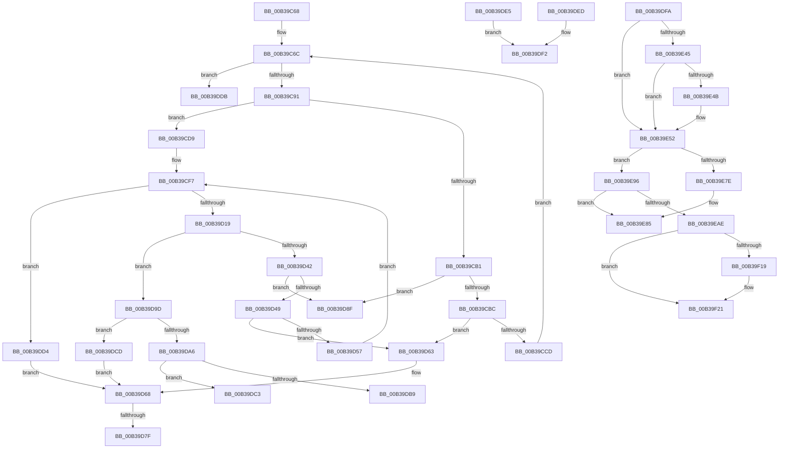

# sub_00B39C68

- RVA: `0x00B39C68`–`0x00B39F44` (길이 `732` bytes)
- VA: `0x0000000140B39C68`
- 실행 섹션: `PAGE`
- PDB 이름 있음: `아니요`; PDB Function 태그: `아니요`
- unwind 정보 RVA: `0x000AD4AC`
- 디코드: `193`개 명령, `732/732` bytes 표시
- 미해석 바이트: `0` (있으면 어셈블리에 `.byte`로 보존)

> 이 문서는 커널 이미지의 기계어와 PDB 기호를 분석해 생성했습니다. 4번과 5번은 함수 원형과 자료형을 바이너리 사용 방식에서 추정한 C 해석이며 원본 소스 복구 결과는 아닙니다.

## 1. Dependencies

- 직접 호출 지점: **18**; 고유 호출 대상: **12**
- 직접 호출자로 확인된 함수: **0**
- RIP 상대 이미지 참조: **0**

### Outgoing calls
- `0x00B39C7A` → [ExAllocatePool2](../../poolcode/B8/ExAllocatePool2_function_00B820F0.md) (function, `0x00B820F0`)
- `0x00B39CA3` → [ObQueryNameStringMode](../8A/ObQueryNameStringMode_function_008A7ED0.md) (function, `0x008A7ED0`)
- `0x00B39CD2` → [ExFreePoolWithTag](../../poolcode/B8/ExFreePoolWithTag_function_00B82870.md) (function, `0x00B82870`)
- `0x00B39D04` → [ExAllocatePool2](../../poolcode/B8/ExAllocatePool2_function_00B820F0.md) (function, `0x00B820F0`)
- `0x00B39D34` → [IopGetFileInformation](../8A/IopGetFileInformation_function_008AD4D0.md) (function, `0x008AD4D0`)
- `0x00B39D5C` → [ExFreePoolWithTag](../../poolcode/B8/ExFreePoolWithTag_function_00B82870.md) (function, `0x00B82870`)
- `0x00B39D6D` → [ExFreePoolWithTag](../../poolcode/B8/ExFreePoolWithTag_function_00B82870.md) (function, `0x00B82870`)
- `0x00B39D84` → [ExFreePoolWithTag](../../poolcode/B8/ExFreePoolWithTag_function_00B82870.md) (function, `0x00B82870`)
- `0x00B39E06` → [memcpy](../../text/6C/memcpy_function_006C6840.md) (function, `0x006C6840`)
- `0x00B39E25` → [memcpy](../../text/6C/memcpy_function_006C6840.md) (function, `0x006C6840`)
- `0x00B39E5D` → [IopSymlinkRemoveECP](../../text/44/IopSymlinkRemoveECP_function_00446480.md) (function, `0x00446480`)
- `0x00B39E88` → [ExFreePoolWithTag](../../poolcode/B8/ExFreePoolWithTag_function_00B82870.md) (function, `0x00B82870`)
- `0x00B39EA1` → [IopSymlinkAllocateAndAddECP](../8A/IopSymlinkAllocateAndAddECP_function_008A1E20.md) (function, `0x008A1E20`)
- `0x00B39EF6` → [IopSymlinkInitializeSymlinkInfo](../8A/IopSymlinkInitializeSymlinkInfo_function_008A1BF8.md) (function, `0x008A1BF8`)
- `0x00B39EFE` → [FsRtlFreeExtraCreateParameter](../8A/FsRtlFreeExtraCreateParameter_function_008A1760.md) (function, `0x008A1760`)
- `0x00B39F0F` → [IopSymlinkGetRelatedMountPoint](../A3/IopSymlinkGetRelatedMountPoint_function_00A33628.md) (function, `0x00A33628`)
- `0x00B39F1C` → [IopSymlinkGetMostRecentlyUsedName](../../text/48/IopSymlinkGetMostRecentlyUsedName_function_0048476C.md) (function, `0x0048476C`)
- `0x00B39F38` → [IopSymlinkApplyToOpenedName](../9D/IopSymlinkApplyToOpenedName_function_009DBCF8.md) (function, `0x009DBCF8`)

### Direct callers
- 이 함수 시작 RVA로 연결되는 직접 call은 확인되지 않았습니다. 간접 호출은 완전히 역산할 수 없습니다.

### Static image references
- 디코드된 RIP-relative 메모리 참조가 없습니다.

## 2. Other-region calls and transfers

- 다른 실행 섹션으로 향하는 call: **11**
  - `0x00B39C7A` → [ExAllocatePool2](../../poolcode/B8/ExAllocatePool2_function_00B820F0.md) (`PAGE` → `POOLCODE`)
  - `0x00B39CD2` → [ExFreePoolWithTag](../../poolcode/B8/ExFreePoolWithTag_function_00B82870.md) (`PAGE` → `POOLCODE`)
  - `0x00B39D04` → [ExAllocatePool2](../../poolcode/B8/ExAllocatePool2_function_00B820F0.md) (`PAGE` → `POOLCODE`)
  - `0x00B39D5C` → [ExFreePoolWithTag](../../poolcode/B8/ExFreePoolWithTag_function_00B82870.md) (`PAGE` → `POOLCODE`)
  - `0x00B39D6D` → [ExFreePoolWithTag](../../poolcode/B8/ExFreePoolWithTag_function_00B82870.md) (`PAGE` → `POOLCODE`)
  - `0x00B39D84` → [ExFreePoolWithTag](../../poolcode/B8/ExFreePoolWithTag_function_00B82870.md) (`PAGE` → `POOLCODE`)
  - `0x00B39E06` → [memcpy](../../text/6C/memcpy_function_006C6840.md) (`PAGE` → `.text`)
  - `0x00B39E25` → [memcpy](../../text/6C/memcpy_function_006C6840.md) (`PAGE` → `.text`)
  - `0x00B39E5D` → [IopSymlinkRemoveECP](../../text/44/IopSymlinkRemoveECP_function_00446480.md) (`PAGE` → `.text`)
  - `0x00B39E88` → [ExFreePoolWithTag](../../poolcode/B8/ExFreePoolWithTag_function_00B82870.md) (`PAGE` → `POOLCODE`)
  - `0x00B39F1C` → [IopSymlinkGetMostRecentlyUsedName](../../text/48/IopSymlinkGetMostRecentlyUsedName_function_0048476C.md) (`PAGE` → `.text`)
- call이 아닌 외부 분기/꼬리 이동: **9**
  - `0x00B39D79` → [IopGraftName + 0x231](../A3/IopGraftName_function_00A33160.md) (`tail-transfer`)
  - `0x00B39D8A` → [IopGraftName + 0x231](../A3/IopGraftName_function_00A33160.md) (`tail-transfer`)
  - `0x00B39D98` → [IopGraftName + 0x14B](../A3/IopGraftName_function_00A33160.md) (`tail-transfer`)
  - `0x00B39DBE` → [IopGraftName + 0x158](../A3/IopGraftName_function_00A33160.md) (`tail-transfer`)
  - `0x00B39DC8` → [IopGraftName + 0x14B](../A3/IopGraftName_function_00A33160.md) (`tail-transfer`)
  - `0x00B39DE0` → [IopGraftName + 0x123](../A3/IopGraftName_function_00A33160.md) (`tail-transfer`)
  - `0x00B39DF5` → [IopGraftName + 0x180](../A3/IopGraftName_function_00A33160.md) (`tail-transfer`)
  - `0x00B39E91` → [IopGraftName + 0x274](../A3/IopGraftName_function_00A33160.md) (`tail-transfer`)
  - `0x00B39F3F` → [IopGraftName + 0x274](../A3/IopGraftName_function_00A33160.md) (`tail-transfer`)

## 3. Assembly (complete function range)

```asm
00B39C68  48 8B 7D 6F                     mov rdi, qword ptr [rbp + 0x6f]
00B39C6C  41 8B D7                        mov edx, r15d
00B39C6F  B9 00 01 00 00                  mov ecx, 0x100
00B39C74  41 B8 49 6F 46 63               mov r8d, 0x63466f49
00B39C7A  E8 71 84 04 00                  call 0x140b820f0
00B39C7F  33 D2                           xor edx, edx
00B39C81  48 89 45 E7                     mov qword ptr [rbp - 0x19], rax
00B39C85  4C 8B E8                        mov r13, rax
00B39C88  48 85 C0                        test rax, rax
00B39C8B  0F 84 4A 01 00 00               je 0x140b39ddb
00B39C91  48 8B 4F 08                     mov rcx, qword ptr [rdi + 8]
00B39C95  4C 8D 4D 7F                     lea r9, [rbp + 0x7f]
00B39C99  88 54 24 20                     mov byte ptr [rsp + 0x20], dl
00B39C9D  45 8B C7                        mov r8d, r15d
00B39CA0  48 8B D0                        mov rdx, rax
00B39CA3  E8 28 E2 D6 FF                  call 0x1408a7ed0
00B39CA8  45 33 C0                        xor r8d, r8d
00B39CAB  8B D8                           mov ebx, eax
00B39CAD  85 C0                           test eax, eax
00B39CAF  79 28                           jns 0x140b39cd9
00B39CB1  3D 05 00 00 80                  cmp eax, 0x80000005
00B39CB6  0F 85 D3 00 00 00               jne 0x140b39d8f
00B39CBC  44 8B 7D 7F                     mov r15d, dword ptr [rbp + 0x7f]
00B39CC0  41 81 FF FF FF 00 00            cmp r15d, 0xffff
00B39CC7  0F 83 96 00 00 00               jae 0x140b39d63
00B39CCD  33 D2                           xor edx, edx
00B39CCF  49 8B CD                        mov rcx, r13
00B39CD2  E8 99 8B 04 00                  call 0x140b82870
00B39CD7  EB 93                           jmp 0x140b39c6c
00B39CD9  41 0F B7 46 06                  movzx eax, word ptr [r14 + 6]
00B39CDE  BB 00 01 00 00                  mov ebx, 0x100
00B39CE3  41 0F B7 75 00                  movzx esi, word ptr [r13]
00B39CE8  48 8B 7D DF                     mov rdi, qword ptr [rbp - 0x21]
00B39CEC  2B F0                           sub esi, eax
00B39CEE  48 8B 45 EF                     mov rax, qword ptr [rbp - 0x11]
00B39CF2  0F B7 00                        movzx eax, word ptr [rax]
00B39CF5  03 F0                           add esi, eax
00B39CF7  8B D3                           mov edx, ebx
00B39CF9  B9 00 01 00 00                  mov ecx, 0x100
00B39CFE  41 B8 49 6F 46 63               mov r8d, 0x63466f49
00B39D04  E8 E7 83 04 00                  call 0x140b820f0
00B39D09  48 89 45 0F                     mov qword ptr [rbp + 0xf], rax
00B39D0D  4C 8B F8                        mov r15, rax
00B39D10  48 85 C0                        test rax, rax
00B39D13  0F 84 BB 00 00 00               je 0x140b39dd4
00B39D19  48 8D 4D 7F                     lea rcx, [rbp + 0x7f]
00B39D1D  48 89 45 FF                     mov qword ptr [rbp - 1], rax
00B39D21  48 89 4C 24 20                  mov qword ptr [rsp + 0x20], rcx
00B39D26  4C 8B C8                        mov r9, rax
00B39D29  48 8B CF                        mov rcx, rdi
00B39D2C  41 B8 09 00 00 00               mov r8d, 9
00B39D32  8B D3                           mov edx, ebx
00B39D34  E8 97 37 D7 FF                  call 0x1408ad4d0
00B39D39  45 33 C0                        xor r8d, r8d
00B39D3C  8B D8                           mov ebx, eax
00B39D3E  85 C0                           test eax, eax
00B39D40  79 5B                           jns 0x140b39d9d
00B39D42  3D 05 00 00 80                  cmp eax, 0x80000005
00B39D47  75 46                           jne 0x140b39d8f
00B39D49  41 8B 1F                        mov ebx, dword ptr [r15]
00B39D4C  83 C3 08                        add ebx, 8
00B39D4F  81 FB FF FF 00 00               cmp ebx, 0xffff
00B39D55  73 0C                           jae 0x140b39d63
00B39D57  33 D2                           xor edx, edx
00B39D59  49 8B CF                        mov rcx, r15
00B39D5C  E8 0F 8B 04 00                  call 0x140b82870
00B39D61  EB 94                           jmp 0x140b39cf7
00B39D63  BB 06 01 00 C0                  mov ebx, 0xc0000106
00B39D68  33 D2                           xor edx, edx
00B39D6A  49 8B CD                        mov rcx, r13
00B39D6D  E8 FE 8A 04 00                  call 0x140b82870
00B39D72  48 8B 45 0F                     mov rax, qword ptr [rbp + 0xf]
00B39D76  48 85 C0                        test rax, rax
00B39D79  0F 84 12 96 EF FF               je 0x140a33391
00B39D7F  33 D2                           xor edx, edx
00B39D81  48 8B C8                        mov rcx, rax
00B39D84  E8 E7 8A 04 00                  call 0x140b82870
00B39D89  90                              nop
00B39D8A  E9 02 96 EF FF                  jmp 0x140a33391
00B39D8F  48 8B 7D D7                     mov rdi, qword ptr [rbp - 0x29]
00B39D93  44 0F B7 7D 77                  movzx r15d, word ptr [rbp + 0x77]
00B39D98  E9 0E 95 EF FF                  jmp 0x140a332ab
00B39D9D  41 8B 0F                        mov ecx, dword ptr [r15]
00B39DA0  03 CE                           add ecx, esi
00B39DA2  3B CE                           cmp ecx, esi
00B39DA4  72 27                           jb 0x140b39dcd
00B39DA6  48 8B 7D D7                     mov rdi, qword ptr [rbp - 0x29]
00B39DAA  8B F1                           mov esi, ecx
00B39DAC  44 0F B7 7D 77                  movzx r15d, word ptr [rbp + 0x77]
00B39DB1  81 F9 FF FF 00 00               cmp ecx, 0xffff
00B39DB7  73 0A                           jae 0x140b39dc3
00B39DB9  41 0F B7 56 06                  movzx edx, word ptr [r14 + 6]
00B39DBE  E9 F5 94 EF FF                  jmp 0x140a332b8
00B39DC3  BB 06 01 00 C0                  mov ebx, 0xc0000106
00B39DC8  E9 DE 94 EF FF                  jmp 0x140a332ab
00B39DCD  BB 95 00 00 C0                  mov ebx, 0xc0000095
00B39DD2  EB 94                           jmp 0x140b39d68
00B39DD4  BB 9A 00 00 C0                  mov ebx, 0xc000009a
00B39DD9  EB 8D                           jmp 0x140b39d68
00B39DDB  BB 9A 00 00 C0                  mov ebx, 0xc000009a
00B39DE0  E9 9E 94 EF FF                  jmp 0x140a33283
00B39DE5  48 8B 7D D7                     mov rdi, qword ptr [rbp - 0x29]
00B39DE9  03 F1                           add esi, ecx
00B39DEB  EB 05                           jmp 0x140b39df2
00B39DED  3B F1                           cmp esi, ecx
00B39DEF  0F 46 F1                        cmovbe esi, ecx
00B39DF2  41 03 F2                        add esi, r10d
00B39DF5  E9 E6 94 EF FF                  jmp 0x140a332e0
00B39DFA  45 0F B7 45 00                  movzx r8d, word ptr [r13]
00B39DFF  48 8B CE                        mov rcx, rsi
00B39E02  49 8B 55 08                     mov rdx, qword ptr [r13 + 8]
00B39E06  E8 35 CA B8 FF                  call 0x1406c6840
00B39E0B  41 0F B7 45 00                  movzx eax, word ptr [r13]
00B39E10  48 8B 7D FF                     mov rdi, qword ptr [rbp - 1]
00B39E14  48 D1 E8                        shr rax, 1
00B39E17  44 8B 07                        mov r8d, dword ptr [rdi]
00B39E1A  48 8D 57 04                     lea rdx, [rdi + 4]
00B39E1E  48 8D 1C 46                     lea rbx, [rsi + rax*2]
00B39E22  48 8B CB                        mov rcx, rbx
00B39E25  E8 16 CA B8 FF                  call 0x1406c6840
00B39E2A  8B 07                           mov eax, dword ptr [rdi]
00B39E2C  B9 5C 00 00 00                  mov ecx, 0x5c
00B39E31  48 D1 E8                        shr rax, 1
00B39E34  48 8D 3C 43                     lea rdi, [rbx + rax*2]
00B39E38  48 8B 45 6F                     mov rax, qword ptr [rbp + 0x6f]
00B39E3C  48 8B 40 60                     mov rax, qword ptr [rax + 0x60]
00B39E40  66 39 08                        cmp word ptr [rax], cx
00B39E43  74 0D                           je 0x140b39e52
00B39E45  66 39 4F FE                     cmp word ptr [rdi - 2], cx
00B39E49  74 07                           je 0x140b39e52
00B39E4B  66 89 0F                        mov word ptr [rdi], cx
00B39E4E  48 83 C7 02                     add rdi, 2
00B39E52  48 8B 4D 07                     mov rcx, qword ptr [rbp + 7]
00B39E56  48 8D 55 D7                     lea rdx, [rbp - 0x29]
00B39E5A  66 2B FE                        sub di, si
00B39E5D  E8 1E C6 90 FF                  call 0x140446480
00B39E62  4C 8B 7D D7                     mov r15, qword ptr [rbp - 0x29]
00B39E66  44 0F B7 EF                     movzx r13d, di
00B39E6A  41 0F B7 4F 10                  movzx ecx, word ptr [r15 + 0x10]
00B39E6F  83 C1 02                        add ecx, 2
00B39E72  44 03 E9                        add r13d, ecx
00B39E75  41 81 FD FF FF 00 00            cmp r13d, 0xffff
00B39E7C  72 18                           jb 0x140b39e96
00B39E7E  BB 06 01 00 C0                  mov ebx, 0xc0000106
00B39E83  33 D2                           xor edx, edx
00B39E85  48 8B CE                        mov rcx, rsi
00B39E88  E8 E3 89 04 00                  call 0x140b82870
00B39E8D  4C 8B 6D E7                     mov r13, qword ptr [rbp - 0x19]
00B39E91  E9 3E 95 EF FF                  jmp 0x140a333d4
00B39E96  45 0F B7 C5                     movzx r8d, r13w
00B39E9A  48 8D 55 67                     lea rdx, [rbp + 0x67]
00B39E9E  49 8B CC                        mov rcx, r12
00B39EA1  E8 7A 7F D6 FF                  call 0x1408a1e20
00B39EA6  33 D2                           xor edx, edx
00B39EA8  8B D8                           mov ebx, eax
00B39EAA  85 C0                           test eax, eax
00B39EAC  78 D7                           js 0x140b39e85
00B39EAE  49 8B 47 08                     mov rax, qword ptr [r15 + 8]
00B39EB2  41 8D 55 20                     lea edx, [r13 + 0x20]
00B39EB6  4C 8B 6D E7                     mov r13, qword ptr [rbp - 0x19]
00B39EBA  45 0F B7 4F 10                  movzx r9d, word ptr [r15 + 0x10]
00B39EBF  4D 8B 47 18                     mov r8, qword ptr [r15 + 0x18]
00B39EC3  48 89 44 24 48                  mov qword ptr [rsp + 0x48], rax
00B39EC8  41 0F B7 47 02                  movzx eax, word ptr [r15 + 2]
00B39ECD  66 89 44 24 40                  mov word ptr [rsp + 0x40], ax
00B39ED2  41 0F B7 45 00                  movzx eax, word ptr [r13]
00B39ED7  66 89 44 24 38                  mov word ptr [rsp + 0x38], ax
00B39EDC  41 0F B7 07                     movzx eax, word ptr [r15]
00B39EE0  66 89 7C 24 30                  mov word ptr [rsp + 0x30], di
00B39EE5  48 8B 7D 67                     mov rdi, qword ptr [rbp + 0x67]
00B39EE9  48 8B CF                        mov rcx, rdi
00B39EEC  48 89 74 24 28                  mov qword ptr [rsp + 0x28], rsi
00B39EF1  66 89 44 24 20                  mov word ptr [rsp + 0x20], ax
00B39EF6  E8 FD 7C D6 FF                  call 0x1408a1bf8
00B39EFB  49 8B CF                        mov rcx, r15
00B39EFE  E8 5D 78 D6 FF                  call 0x1408a1760
00B39F03  44 8B 7D EF                     mov r15d, dword ptr [rbp - 0x11]
00B39F07  41 0F B7 56 06                  movzx edx, word ptr [r14 + 6]
00B39F0C  48 8B CF                        mov rcx, rdi
00B39F0F  E8 14 97 EF FF                  call 0x140a33628
00B39F14  48 85 C0                        test rax, rax
00B39F17  75 08                           jne 0x140b39f21
00B39F19  48 8B CF                        mov rcx, rdi
00B39F1C  E8 4B A8 94 FF                  call 0x14048476c
00B39F21  48 8B 4D 6F                     mov rcx, qword ptr [rbp + 0x6f]
00B39F25  4D 8B CC                        mov r9, r12
00B39F28  44 89 7C 24 28                  mov dword ptr [rsp + 0x28], r15d
00B39F2D  4D 8B C6                        mov r8, r14
00B39F30  48 8B D0                        mov rdx, rax
00B39F33  48 89 74 24 20                  mov qword ptr [rsp + 0x20], rsi
00B39F38  E8 BB 1D EA FF                  call 0x1409dbcf8
00B39F3D  8B D8                           mov ebx, eax
00B39F3F  E9 90 94 EF FF                  jmp 0x140a333d4
```

## 4. C-style interpretation (structured pseudocode)

```c
__int64 __fastcall sub_00B39C68(void)
{
    __int64 result;
    __int64 v_rbx;
    __int64 v_rsi;
    unsigned __int8 v_stack_p20;
    unsigned __int64 v_stack_p28;
    unsigned __int16 v_stack_p30;
    unsigned __int16 v_stack_p38;
    unsigned __int16 v_stack_p40;
    unsigned __int64 v_stack_p48;

loc_00B39C6C:
    result = ExAllocatePool2(256, (unsigned int)((unsigned int)(v_r15)), (unsigned int)(0x63466F49ULL), a4);
    a2 = 0;
    *(unsigned __int64 *)(v_rbp - 25) = result;
    if (result == 0) goto loc_00B39DDB;
    v_stack_p20 = 0;
    result = ObQueryNameStringMode(*(unsigned __int64 *)(*(unsigned __int64 *)(v_rbp + 111) + 8), result, (unsigned int)((unsigned int)(v_r15)), v_rbp + 127);
    a3 = 0;
    if (!sign_flag) goto loc_00B39CD9;
    if (((unsigned int)(result)) != 0x80000005ULL) goto loc_00B39D8F;
    if (((unsigned int)((unsigned int)(*(unsigned int *)(v_rbp + 127)))) >= 0xFFFFULL) goto loc_00B39D63;
    a2 = 0;
    result = ExFreePoolWithTag(result, a2, a3, v_rbp + 127);
    goto loc_00B39C6C;
loc_00B39CD9:
    v_rsi = (unsigned int)((*(unsigned __int16 *)(result)) - ((unsigned int)(*(unsigned __int16 *)(v_r14 + 6))));
    v_rsi = (unsigned int)((v_rsi) + ((unsigned int)(*(unsigned __int16 *)(*(unsigned __int64 *)(v_rbp - 17)))));
loc_00B39CF7:
    result = ExAllocatePool2(256, 256, (unsigned int)(0x63466F49ULL), v_rbp + 127);
    *(unsigned __int64 *)(v_rbp + 15) = result;
    if (result == 0) goto loc_00B39DD4;
    *(unsigned __int64 *)(v_rbp - 1) = result;
    v_stack_p20 = v_rbp + 127;
    result = IopGetFileInformation(*(unsigned __int64 *)(v_rbp - 33), 256, 9, result);
    a3 = 0;
    if (!sign_flag) goto loc_00B39D9D;
    if (((unsigned int)(result)) != 0x80000005ULL) goto loc_00B39D8F;
    v_rbx = (unsigned int)(((unsigned int)(*(unsigned int *)(result))) + (8));
    if (((unsigned int)(v_rbx)) >= 0xFFFFULL) goto loc_00B39D63;
    a2 = 0;
    result = ExFreePoolWithTag(result, a2, a3, result);
    goto loc_00B39CF7;
loc_00B39D63:
loc_00B39D68:
    a2 = 0;
    result = ExFreePoolWithTag(result, a2, a3, result);
    a2 = 0;
    result = ExFreePoolWithTag(*(unsigned __int64 *)(v_rbp + 15), a2, a3, result);
loc_00B39D8F:
loc_00B39D9D:
    a1 = (unsigned int)(((unsigned int)(*(unsigned int *)(*(unsigned __int16 *)(v_rbp + 119)))) + ((unsigned int)(v_rsi)));
    if (((unsigned int)(a1)) < ((unsigned int)(v_rsi))) goto loc_00B39DCD;
    if (((unsigned int)(a1)) >= 0xFFFFULL) goto loc_00B39DC3;
loc_00B39DC3:
loc_00B39DCD:
    goto loc_00B39D68;
loc_00B39DD4:
    goto loc_00B39D68;
loc_00B39DDB:
}
```

## 5. (Beta) C Style

```c
void sub_00B39C68(void)
{
    int64_t result;
    int64_t local_rbx;
    int64_t local_rsi;
    uint8_t v_stack_p20;
    uint64_t v_stack_p28;
    uint16_t v_stack_p30;
    uint16_t v_stack_p38;
    uint16_t v_stack_p40;
    uint64_t v_stack_p48;

loc_00B39C6C:
    result = ExAllocatePool2(256, (uint32_t)((uint32_t)(local_r15)), (uint32_t)(0x63466F49ULL), a4);
    a2 = 0;
    *(uint64_t *)(local_rbp - 0x19) = result;
    if (result == 0) goto loc_00B39DDB;
    v_stack_p20 = 0;
    result = ObQueryNameStringMode(*(uint64_t *)(*(uint64_t *)(local_rbp + 0x6F) + 0x8), result, (uint32_t)((uint32_t)(local_r15)), local_rbp + 127);
    a3 = 0;
    if (!sign_flag) goto loc_00B39CD9;
    if (((uint32_t)(result)) != 0x80000005ULL) goto loc_00B39D8F;
    if (((uint32_t)((uint32_t)(*(uint32_t *)(local_rbp + 0x7F)))) >= 0xFFFFULL) goto loc_00B39D63;
    a2 = 0;
    result = ExFreePoolWithTag(result, a2, a3, local_rbp + 127);
    goto loc_00B39C6C;
loc_00B39CD9:
    local_rsi = (uint32_t)((*(uint16_t *)(result)) - ((uint32_t)(*(uint16_t *)(local_r14 + 0x6))));
    local_rsi = (uint32_t)((local_rsi) + ((uint32_t)(*(uint16_t *)(*(uint64_t *)(local_rbp - 0x11)))));
loc_00B39CF7:
    result = ExAllocatePool2(256, 256, (uint32_t)(0x63466F49ULL), local_rbp + 127);
    *(uint64_t *)(local_rbp + 0xF) = result;
    if (result == 0) goto loc_00B39DD4;
    *(uint64_t *)(local_rbp - 0x1) = result;
    v_stack_p20 = local_rbp + 127;
    result = IopGetFileInformation(*(uint64_t *)(local_rbp - 0x21), 256, 9, result);
    a3 = 0;
    if (!sign_flag) goto loc_00B39D9D;
    if (((uint32_t)(result)) != 0x80000005ULL) goto loc_00B39D8F;
    local_rbx = (uint32_t)(((uint32_t)(*(uint32_t *)(result))) + (8));
    if (((uint32_t)(local_rbx)) >= 0xFFFFULL) goto loc_00B39D63;
    a2 = 0;
    result = ExFreePoolWithTag(result, a2, a3, result);
    goto loc_00B39CF7;
loc_00B39D63:
loc_00B39D68:
    a2 = 0;
    result = ExFreePoolWithTag(result, a2, a3, result);
    a2 = 0;
    result = ExFreePoolWithTag(*(uint64_t *)(local_rbp + 0xF), a2, a3, result);
loc_00B39D8F:
loc_00B39D9D:
    a1 = (uint32_t)(((uint32_t)(*(uint32_t *)(*(uint16_t *)(local_rbp + 0x77)))) + ((uint32_t)(local_rsi)));
    if (((uint32_t)(a1)) < ((uint32_t)(local_rsi))) goto loc_00B39DCD;
    if (((uint32_t)(a1)) >= 0xFFFFULL) goto loc_00B39DC3;
loc_00B39DC3:
loc_00B39DCD:
    goto loc_00B39D68;
loc_00B39DD4:
    goto loc_00B39D68;
loc_00B39DDB:
}
```

## 6. Execution-region graph

[열기: 2D/3D 그래프와 함수 탐색 컨트롤 패널](../../../control-panel.html?section=page&rva=0x00B39C68&view=graph)

- 2D 그래프는 위에서 아래로 흐르고, 3D 그래프는 빈 공간을 드래그해 회전합니다. Shift+드래그는 이동, 휠은 확대·축소, 함수 노드 선택은 대상 보고서 이동입니다.

### Static fallback


