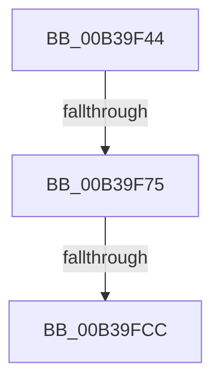

# sub_00B39F44

- RVA: `0x00B39F44`–`0x00B39FE2` (길이 `158` bytes)
- VA: `0x0000000140B39F44`
- 실행 섹션: `PAGE`
- PDB 이름 있음: `아니요`; PDB Function 태그: `아니요`
- unwind 정보 RVA: `0x000AD4DC`
- 디코드: `38`개 명령, `158/158` bytes 표시
- 미해석 바이트: `0` (있으면 어셈블리에 `.byte`로 보존)

> 이 문서는 커널 이미지의 기계어와 PDB 기호를 분석해 생성했습니다. 4번과 5번은 함수 원형과 자료형을 바이너리 사용 방식에서 추정한 C 해석이며 원본 소스 복구 결과는 아닙니다.

## 1. Dependencies

- 직접 호출 지점: **6**; 고유 호출 대상: **6**
- 직접 호출자로 확인된 함수: **0**
- RIP 상대 이미지 참조: **1**

### Outgoing calls
- `0x00B39F66` → [IopGetRelatedFileName](../71/IopGetRelatedFileName_function_0071B4A0.md) (function, `0x0071B4A0`)
- `0x00B39F80` → [RtlAppendUnicodeToString](../../text/40/RtlAppendUnicodeToString_function_0040F990.md) (function, `0x0040F990`)
- `0x00B39F8D` → [RtlAppendUnicodeStringToString](../../text/40/RtlAppendUnicodeStringToString_function_0040FA50.md) (function, `0x0040FA50`)
- `0x00B39FB2` → [IopSymlinkUpdateECP](../8A/IopSymlinkUpdateECP_function_008A20CC.md) (function, `0x008A20CC`)
- `0x00B39FBF` → [ExFreePoolWithTag](../../poolcode/B8/ExFreePoolWithTag_function_00B82870.md) (function, `0x00B82870`)
- `0x00B39FD4` → [IopSymlinkGetECP](../../text/45/IopSymlinkGetECP_function_00458288.md) (function, `0x00458288`)

### Direct callers
- 이 함수 시작 RVA로 연결되는 직접 call은 확인되지 않았습니다. 간접 호출은 완전히 역산할 수 없습니다.

### Static image references
- `0x00B39F75` → RVA `0x00AFC990` (` ?? ::NNGAKEGL::`string'`; read)

## 2. Other-region calls and transfers

- 다른 실행 섹션으로 향하는 call: **4**
  - `0x00B39F80` → [RtlAppendUnicodeToString](../../text/40/RtlAppendUnicodeToString_function_0040F990.md) (`PAGE` → `.text`)
  - `0x00B39F8D` → [RtlAppendUnicodeStringToString](../../text/40/RtlAppendUnicodeStringToString_function_0040FA50.md) (`PAGE` → `.text`)
  - `0x00B39FBF` → [ExFreePoolWithTag](../../poolcode/B8/ExFreePoolWithTag_function_00B82870.md) (`PAGE` → `POOLCODE`)
  - `0x00B39FD4` → [IopSymlinkGetECP](../../text/45/IopSymlinkGetECP_function_00458288.md) (`PAGE` → `.text`)
- call이 아닌 외부 분기/꼬리 이동: **3**
  - `0x00B39F6F` → [IopSymlinkRememberJunction + 0x6F](../A3/IopSymlinkRememberJunction_function_00A33524.md) (`tail-transfer`)
  - `0x00B39FC6` → [IopSymlinkRememberJunction + 0xC2](../A3/IopSymlinkRememberJunction_function_00A33524.md) (`tail-transfer`)
  - `0x00B39FDD` → [IopSymlinkRememberJunction + 0x6F](../A3/IopSymlinkRememberJunction_function_00A33524.md) (`tail-transfer`)

## 3. Assembly (complete function range)

```asm
00B39F44  45 0F B7 41 10                  movzx r8d, word ptr [r9 + 0x10]
00B39F49  48 8D 55 F0                     lea rdx, [rbp - 0x10]
00B39F4D  66 41 83 C0 02                  add r8w, 2
00B39F52  4C 89 65 F0                     mov qword ptr [rbp - 0x10], r12
00B39F56  4C 8D 4D E0                     lea r9, [rbp - 0x20]
00B39F5A  4C 89 65 F8                     mov qword ptr [rbp - 8], r12
00B39F5E  49 8B CF                        mov rcx, r15
00B39F61  66 44 89 65 E0                  mov word ptr [rbp - 0x20], r12w
00B39F66  E8 35 15 BE FF                  call 0x14071b4a0
00B39F6B  8B F0                           mov esi, eax
00B39F6D  85 C0                           test eax, eax
00B39F6F  0F 88 1E 96 EF FF               js 0x140a33593
00B39F75  48 8D 15 14 2A FC FF            lea rdx, [rip - 0x3d5ec]
00B39F7C  48 8D 4D F0                     lea rcx, [rbp - 0x10]
00B39F80  E8 0B 5A 8D FF                  call 0x14040f990
00B39F85  48 8D 57 10                     lea rdx, [rdi + 0x10]
00B39F89  48 8D 4D F0                     lea rcx, [rbp - 0x10]
00B39F8D  E8 BE 5A 8D FF                  call 0x14040fa50
00B39F92  0F B7 47 02                     movzx eax, word ptr [rdi + 2]
00B39F96  4C 8D 4D F0                     lea r9, [rbp - 0x10]
00B39F9A  66 89 44 24 28                  mov word ptr [rsp + 0x28], ax
00B39F9F  45 0F B7 C6                     movzx r8d, r14w
00B39FA3  0F B7 45 E0                     movzx eax, word ptr [rbp - 0x20]
00B39FA7  48 8B D7                        mov rdx, rdi
00B39FAA  49 8B CD                        mov rcx, r13
00B39FAD  66 89 44 24 20                  mov word ptr [rsp + 0x20], ax
00B39FB2  E8 15 81 D6 FF                  call 0x1408a20cc
00B39FB7  48 8B 4D F8                     mov rcx, qword ptr [rbp - 8]
00B39FBB  33 D2                           xor edx, edx
00B39FBD  8B F0                           mov esi, eax
00B39FBF  E8 AC 88 04 00                  call 0x140b82870
00B39FC4  85 F6                           test esi, esi
00B39FC6  0F 88 1A 96 EF FF               js 0x140a335e6
00B39FCC  49 8B 4D 70                     mov rcx, qword ptr [r13 + 0x70]
00B39FD0  48 8D 55 E8                     lea rdx, [rbp - 0x18]
00B39FD4  E8 AF E2 91 FF                  call 0x140458288
00B39FD9  48 8B 5D E8                     mov rbx, qword ptr [rbp - 0x18]
00B39FDD  E9 B1 95 EF FF                  jmp 0x140a33593
```

## 4. C-style interpretation (structured pseudocode)

```c
__int64 __fastcall sub_00B39F44(__int64 a1, __int64 a2, __int64 a3, __int64 a4)
{
    __int64 result;
    unsigned __int16 v_stack_p20;
    unsigned __int16 v_stack_p28;

    a3 = (unsigned __int16)((*(unsigned __int16 *)(a4 + 16)) + (2));
    *(unsigned __int64 *)(v_rbp - 16) = v_r12;
    *(unsigned __int64 *)(v_rbp - 8) = v_r12;
    *(unsigned __int16 *)(v_rbp - 32) = (unsigned __int16)(v_r12);
    result = IopGetRelatedFileName(v_r15, v_rbp - 16, a3, v_rbp - 32);
    result = RtlAppendUnicodeToString(v_rbp - 16, v_rip - 251372, a3, v_rbp - 32);
    result = RtlAppendUnicodeStringToString(v_rbp - 16, v_rdi + 16, a3, v_rbp - 32);
    v_stack_p28 = (unsigned __int16)(*(unsigned __int16 *)(v_rdi + 2));
    v_stack_p20 = (unsigned __int16)(*(unsigned __int16 *)(v_rbp - 32));
    result = IopSymlinkUpdateECP(v_r13, v_rdi, (unsigned __int16)(v_r14), v_rbp - 16);
    a2 = 0;
    result = ExFreePoolWithTag(*(unsigned __int64 *)(v_rbp - 8), a2, (unsigned __int16)(v_r14), v_rbp - 16);
    result = IopSymlinkGetECP(*(unsigned __int64 *)(v_r13 + 112), v_rbp - 24, (unsigned __int16)(v_r14), v_rbp - 16);
}
```

## 5. (Beta) C Style

```c
int64_t sub_00B39F44(int64_t Arg1, int64_t Arg2, int64_t Arg3, void *Arg4)
{
    uint8_t *arg4 = (uint8_t *)Arg4;

    int64_t result;
    uint16_t v_stack_p20;
    uint16_t v_stack_p28;

    Arg3 = (uint16_t)((*(uint16_t *)(arg4 + 0x10)) + (2));
    *(uint64_t *)(local_rbp - 0x10) = local_r12;
    *(uint64_t *)(local_rbp - 0x8) = local_r12;
    *(uint16_t *)(local_rbp - 0x20) = (uint16_t)(local_r12);
    result = IopGetRelatedFileName(local_r15, local_rbp - 16, Arg3, local_rbp - 32);
    result = RtlAppendUnicodeToString(local_rbp - 16, v_rip - 251372, Arg3, local_rbp - 32);
    result = RtlAppendUnicodeStringToString(local_rbp - 16, local_rdi + 16, Arg3, local_rbp - 32);
    v_stack_p28 = (uint16_t)(*(uint16_t *)(local_rdi + 0x2));
    v_stack_p20 = (uint16_t)(*(uint16_t *)(local_rbp - 0x20));
    result = IopSymlinkUpdateECP(local_r13, local_rdi, (uint16_t)(local_r14), local_rbp - 16);
    Arg2 = 0;
    result = ExFreePoolWithTag(*(uint64_t *)(local_rbp - 0x8), Arg2, (uint16_t)(local_r14), local_rbp - 16);
    result = IopSymlinkGetECP(*(uint64_t *)(local_r13 + 0x70), local_rbp - 24, (uint16_t)(local_r14), local_rbp - 16);
}
```

### 관측된 메모리 오프셋

구조체 형식이 확인되지 않은 접근은 인자 기준의 오프셋으로만 기록했습니다.

| 기준 인자 | 오프셋 표현 | 폭 (bit) | 접근 |
|---|---:|---:|---|
| `Arg4` | `+ 0x10` | `16` | `R` |

## 6. Execution-region graph

[열기: 2D/3D 그래프와 함수 탐색 컨트롤 패널](../../../control-panel.html?section=page&rva=0x00B39F44&view=graph)

- 2D 그래프는 위에서 아래로 흐르고, 3D 그래프는 빈 공간을 드래그해 회전합니다. Shift+드래그는 이동, 휠은 확대·축소, 함수 노드 선택은 대상 보고서 이동입니다.

### Static fallback


