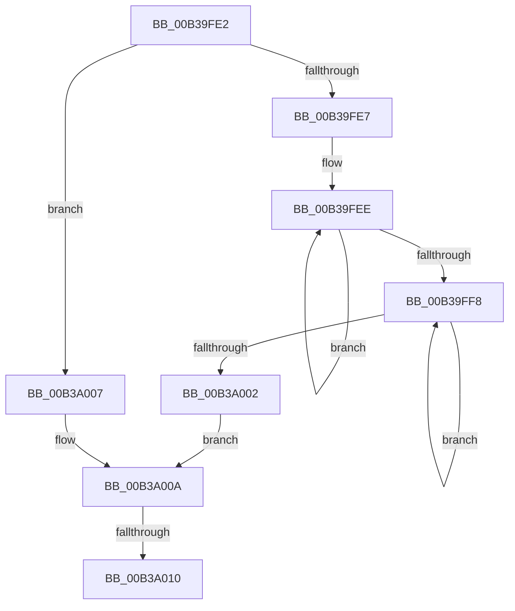

# sub_00B39FE2

- RVA: `0x00B39FE2`–`0x00B3A01A` (길이 `56` bytes)
- VA: `0x0000000140B39FE2`
- 실행 섹션: `PAGE`
- PDB 이름 있음: `아니요`; PDB Function 태그: `아니요`
- unwind 정보 RVA: `0x000AD5D4`
- 디코드: `16`개 명령, `56/56` bytes 표시
- 미해석 바이트: `0` (있으면 어셈블리에 `.byte`로 보존)

> 이 문서는 커널 이미지의 기계어와 PDB 기호를 분석해 생성했습니다. 4번과 5번은 함수 원형과 자료형을 바이너리 사용 방식에서 추정한 C 해석이며 원본 소스 복구 결과는 아닙니다.

## 1. Dependencies

- 직접 호출 지점: **0**; 고유 호출 대상: **0**
- 직접 호출자로 확인된 함수: **0**
- RIP 상대 이미지 참조: **0**

### Outgoing calls
- 직접 디코드된 call 명령이 없습니다.

### Direct callers
- 이 함수 시작 RVA로 연결되는 직접 call은 확인되지 않았습니다. 간접 호출은 완전히 역산할 수 없습니다.

### Static image references
- 디코드된 RIP-relative 메모리 참조가 없습니다.

## 2. Other-region calls and transfers

- 다른 실행 섹션으로 향하는 call: **0**
- call이 아닌 외부 분기/꼬리 이동: **2**
  - `0x00B3A00A` → [SubstringMatch + 0x31](../A3/SubstringMatch_function_00A3408C.md) (`tail-transfer`)
  - `0x00B3A015` → [SubstringMatch + 0x31](../A3/SubstringMatch_function_00A3408C.md) (`tail-transfer`)

## 3. Assembly (complete function range)

```asm
00B39FE2  83 FF 0A                        cmp edi, 0xa
00B39FE5  75 20                           jne 0x140b3a007
00B39FE7  48 83 C8 FF                     or rax, 0xffffffffffffffff
00B39FEB  48 8B C8                        mov rcx, rax
00B39FEE  48 FF C1                        inc rcx
00B39FF1  66 41 39 1C 48                  cmp word ptr [r8 + rcx*2], bx
00B39FF6  75 F6                           jne 0x140b39fee
00B39FF8  48 FF C0                        inc rax
00B39FFB  66 39 5C 45 00                  cmp word ptr [rbp + rax*2], bx
00B3A000  75 F6                           jne 0x140b39ff8
00B3A002  48 3B C8                        cmp rcx, rax
00B3A005  EB 03                           jmp 0x140b3a00a
00B3A007  83 FF 0B                        cmp edi, 0xb
00B3A00A  0F 85 AD A0 EF FF               jne 0x140a340bd
00B3A010  BB 01 00 00 00                  mov ebx, 1
00B3A015  E9 A3 A0 EF FF                  jmp 0x140a340bd
```

## 4. C-style interpretation (structured pseudocode)

```c
__int64 __fastcall sub_00B39FE2(__int64 a1, __int64 a2, __int64 a3)
{
    __int64 result;

    if (((unsigned int)(v_rdi)) != 10) goto loc_00B3A007;
    result = (result) | (-1);
loc_00B39FEE:
    a1 = (result) + 1;
    if ((*(unsigned __int16 *)(a3 + a1 * 2)) != ((unsigned __int16)(v_rbx))) goto loc_00B39FEE;
loc_00B39FF8:
    result = (result) + 1;
    if ((*(unsigned __int16 *)(v_rbp + result * 2)) != ((unsigned __int16)(v_rbx))) goto loc_00B39FF8;
    goto loc_00B3A00A;
loc_00B3A007:
loc_00B3A00A:
}
```

## 5. (Beta) C Style

```c
int64_t sub_00B39FE2(int64_t Arg1, int64_t Arg2, void *Arg3)
{
    uint8_t *arg3 = (uint8_t *)Arg3;

    int64_t result;

    if (((uint32_t)(local_rdi)) != 10) goto loc_00B3A007;
    result = (result) | (-1);
loc_00B39FEE:
    Arg1 = (result) + 1;
    if ((*(uint16_t *)(arg3 + Arg1 * 2)) != ((uint16_t)(local_rbx))) goto loc_00B39FEE;
loc_00B39FF8:
    result = (result) + 1;
    if ((*(uint16_t *)(local_rbp + result * 2)) != ((uint16_t)(local_rbx))) goto loc_00B39FF8;
    goto loc_00B3A00A;
loc_00B3A007:
loc_00B3A00A:
}
```

### 관측된 메모리 오프셋

구조체 형식이 확인되지 않은 접근은 인자 기준의 오프셋으로만 기록했습니다.

| 기준 인자 | 오프셋 표현 | 폭 (bit) | 접근 |
|---|---:|---:|---|
| `Arg3` | `+ 0x0 + rcx*2` | `16` | `R` |

## 6. Execution-region graph

[열기: 2D/3D 그래프와 함수 탐색 컨트롤 패널](../../../control-panel.html?section=page&rva=0x00B39FE2&view=graph)

- 2D 그래프는 위에서 아래로 흐르고, 3D 그래프는 빈 공간을 드래그해 회전합니다. Shift+드래그는 이동, 휠은 확대·축소, 함수 노드 선택은 대상 보고서 이동입니다.

### Static fallback


